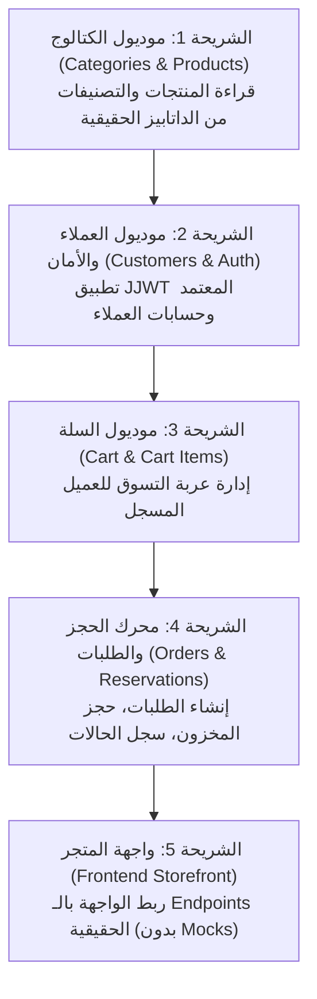

# دليل المهندس الشامل: كيف تقود الذكاء الاصطناعي (AI) لبناء مشروع ضخم بدون أخطاء
## VARELLION E-Commerce — The Senior Engineering & AI Management Playbook

---

## 1. المقدمة: لماذا يخطئ الذكاء الاصطناعي في المشاريع الكبيرة؟

عندما يتعامل الذكاء الاصطناعي مع مشروع برمجيات تجاري متكامل (مثل **VARELLION**)، تحدث الأخطاء والهلاوس (Hallucinations) لثلاثة أسباب رئيسية:
1. **اتساع نطاق الطلب (Broad Scope):** عندما تطلب منه "ابنيلي متجر كامل" أو "اعمل الباك إند"، يحاول توليد مئات الأسطر دفعة واحدة، مما يؤدي إلى نسيان التفاصيل الدقيقة، واستخدام دوال وهمية (Mocks)، وتوليد استيرادات خاطئة.
2. **عدم ربطه بالحقيقة (Lack of Grounding):** إذا لم تجبره على فحص قاعدة البيانات الفعلية (`database_snapshot.txt`)، فإنه يفترض تلقائياً جداول تقليدية من الذاكرة العامة (مثل افتراض جدول `users` أو `roles` بينما قاعدة بيانات المشروع تستخدم جدول `customers` برقم `user_id`).
3. **غياب بوابات الفحص الإلزامية (No Verification Gates):** ادعاء أن الكود سليم دون تشغيل مترجم اللغة (`mvn test-compile` أو `npm run build`).

هذا الدليل يضع لك **نظام إدارة صارم (Strict Operating Framework)** يحول الـ AI من "مولد نصوص احتمالي" إلى "مساعد هندسي فائق الدقة".

---

## 2. القواعد الذهبية الخمس (The 5 Iron Rules)

### القاعدة 1: الربط الإلزامي بقاعدة البيانات (Grounding with Live Schema)
- **المبدأ:** لا يُسمح للـ AI بكتابة أي كلاس Entity أو Repository دون أن يقرأ أولاً ملف `database_snapshot.txt`.
- **الإلزام:** في كل برومبت يخص البيانات، اطلب منه:
  > "قبل كتابة أي كود، استخرج تعريف الجدول وأسماء الأعمدة والـ Constraints من ملف `database_snapshot.txt` واعرضها، ثم طابق الـ Entity معها تماماً بدون إضافة أو تعديل أعمدة".

### القاعدة 2: مبدأ الشريحة الذرية (One Atomic Slice at a Time)
- قسّم العمل إلى أجزاء صغيرة مستقلة ومغلقة:
  1. **الخطوة أ:** الـ Entity والـ Repository فقط.
  2. **الخطوة ب:** الـ DTOs والـ Mapper.
  3. **الخطوة ج:** الـ Service و الـ Business Logic.
  4. **الخطوة د:** الـ Controller والـ Endpoints.
- **القاعدة الذهبية:** لا تنتقل من خطوة إلى التالية قبل التأكد من نجاح الخطوة الحالية وتمرير الفحص البرمجي (`BUILD SUCCESS`).

### القاعدة 3: بوابة الفحص في التيرمينال (Mandatory Terminal Verification Gate)
- لا تقبل من الـ AI كلمة "تم الانتهاء بنجاح" إلا إذا قام بتشغيل أمر البناء الفعلي في التيرمينال وعرض النتيجة:
  - للباك إند: `mvn clean test-compile`
  - للفرونت إند: `npm run build` أو فحص الـ TypeScript
- إذا ظهر أي خطأ تصريفي (Compilation Error)، يجب حله فوراً قبل الانتقال لأي ميزة أخرى.

### القاعدة 4: تثبيت المرجع المعماري (Architectural Anchoring)
- لتجنب تشتت الـ AI بين حلول برمجية مختلفة، حدد له المرجع دائماً:
  - الأمان (Security): استخدام Spring Security 6 مع مكتبة JJWT `0.12.6` وفق الكود المعتمد في المشروع المرجعي للمستخدم:
    `/home/mohamed-saad/IdeaProjects/spring-security-jwt`
  - قواعد البيانات: الالتزام الصارم بقواعد Flyway وعدم تعديل قاعدة البيانات الحية بدون ملف مايجريشن جديد `V6`.
  - إدارة الأخطاء: الاعتماد على `GlobalExceptionHandler` و `ApiResponse<T>` الموحد.

### القاعدة 5: التقييد الصارم للحدود (Strict Negative Constraints)
- أخبر الـ AI دائماً بما **لا يجب عليه فعله** (Negative Prompts):
  - ❌ ممنوع إنشاء جدول `users` أو `roles` في الـ Entities.
  - ❌ ممنوع استخدام Mock Data أو localStorage كبديل لدورة الشراء الحقيقية.
  - ❌ ممنوع تعديل ملفات الإعدادات (`application.properties` أو `pom.xml`) بدون إذن مسبق.
  - ❌ ممنوع حذف أو تغيير أي كود يعمل حالياً.

---

## 3. قوالب البرومبتات الاحترافية (Ready-to-Use Prompt Templates)

استخدم هذه الصيغ الجاهزة عند مخاطبة الـ AI للحصول على أعلى دقة:

### 📋 قالب 1: إنشاء كائن Entity و Repository
```markdown
يا شات، مهمتك التالية هي إنشاء طبقة البيانات لجدول [اسم الجدول، مثلاً: categories] في موديول [اسم الموديول، مثلاً: catalog]:

الشروط الإلزامية:
1. اقرأ أولاً تعريف جدول [اسم الجدول] من ملف `database_snapshot.txt`.
2. أنشئ كلاس الـ Entity مع الـ JPA Annotations المطابقة تماماً للأعمدة والـ Data Types والـ Nullability.
3. أنشئ الـ Repository المقابل مع الـ Custom Query Methods الأساسية.
4. ممنوع إضافة أي أعمدة غير موجودة في الداتابيز الحقيقية.
5. شغل أمر `mvn test-compile` في التيرمينال واعرض ناتج البناء للتأكد من خلوه من أي أخطاء.
```

### 📋 قالب 2: إنشاء الـ DTOs والـ Service
```markdown
يا شات، مهمتك هي كتابة طبقة الـ Service والـ DTOs لموديول [اسم الموديول]:

الشروط الإلزامية:
1. أنشئ الـ Request DTOs والـ Response DTOs اللازمة مع الـ Validation Annotations (`@NotNull`, `@NotBlank`, ...).
2. أنشئ الـ Service Interface و الـ Service Implementation.
3. استخدم الـ Exception الموحدة (`ResourceNotFoundException` و `BusinessException`).
4. تأكد من أن جميع العمليات التي تعدل البيانات تحمل `@Transactional`.
5. شغل `mvn test-compile` واعرض ناتج الفحص.
```

### 📋 قالب 3: إنشاء الـ Controller والـ REST Endpoints
```markdown
يا شات، مهمتك هي إنشاء الـ REST Controller لموديول [اسم الموديول]:

الشروط الإلزامية:
1. أنشئ الـ Controller مع الـ Path المعتمد في الوثائق (`/api/v1/...`).
2. غلف جميع الردود داخل الكائن الموحد `ApiResponse<T>`.
3. استخدم `@Valid` على جميع الـ Request Bodies.
4. حدد صلاحيات الأمان على الـ Endpoints (Public للمتجر العام، أو Authenticated للطلبات والسلة).
5. شغل `mvn test-compile` واعرض ناتج الفحص.
```

### 📋 قالب 4: إصلاح مشكلة أو خطأ (Debugging Prompt)
```markdown
يا شات، ظهر هذا الخطأ عند تشغيل الأمر:
[ضع رسالة الخطأ هنا]

الشروط الإلزامية:
1. حلل السبب الجذري للخطأ (Root Cause) دون القفز إلى حلول عشوائية.
2. لا تعدل أي ملفات أخرى خارج نطاق الخطأ.
3. اشرح التعديل بدقة ثم طبقه.
4. أعد تشغيل أمر الفحص في التيرمينال وأثبت أن الخطأ اختفى تماماً.
```

---

## 4. خريطة التنفيذ المعمارية لمشروع VARELLION

لكي تسير عملية البناء بسلاسة واحترافية وبدون أي تصادمات، هذا هو الترتيب المنطقي لشرائح العمل (Slices):



### تفاصيل الشرائح:
1. **الشريحة 1 (Catalog Module):**
   - الجداول: `categories`, `products`, `product_images`.
   - الهدف: إتاحة تصفح المنتجات والبحث والتصفية للزوار بدون تسجيل دخول.
2. **الشريحة 2 (Customer & Security Module):**
   - الجداول: `customers`, `customer_addresses`.
   - التقنية: Custom JJWT (مكتبة io.jsonwebtoken 0.12.6) متطابق مع المشروع المرجعي.
   - الهدف: تسجيل الدخول، إنشاء الحساب، تعديل العناوين.
3. **الشريحة 3 (Cart Module):**
   - الجداول: `carts`, `cart_items`.
   - الهدف: إضافة وحذف وتعديل عناصر السلة، التحقق من توفر الكمية المطلوبة.
4. **الشريحة 4 (Order & Inventory Module):**
   - الجداول: `orders`, `order_items`, `order_status_history`.
   - منطق العمل: حجز المخزون (`reserved_quantity`)، مهلة تأكيد الطلب، تغيير الحالات.
5. **الشريحة 5 (Frontend Integration):**
   - شاشات: الصفحة الرئيسية، صفحة المنتجات، تفاصيل المنتج، السلة، وإتمام الطلب.
   - الربط: استخدام Axios مع interceptor لإرفاق الـ JWT token ومعالجة أخطاء الـ API الموحدة.

---

## 5. مصفوفة الملفات المرجعية المعتمدة في المشروع

كل معلومة تحتاجها موجودة في ملف محدد بدقة، احرص على توجيه الـ AI إلى الملف المناسب:

| الملف | المسؤولية ومحتوى الملف |
| :--- | :--- |
| `database_snapshot.txt` | **الحقيقة المطلقة لقاعدة البيانات الحية** (10 جداول، أعمدة، أنواع بيانات، علاقات). |
| `00_VARELLION_MASTER_BUILD_PROMPT.md` | إطار العمل العام ومراحل التسليم (Milestone A و B). |
| `01_VARELLION_BRAND_IDENTITY_AND_DESIGN_SYSTEM.md` | ألوان البراند، الخطوط، Typography، التصميم الفاخر للمنتجات الرجالية. |
| `02_VARELLION_UI_UX_SPECIFICATION.md` | تدفق الصفحات، سلوك السلة والشراء، تجربة المستخدم. |
| `03_VARELLION_BUSINESS_PRODUCT_CONTENT_SPEC.md` | بيانات المنتجات الرجالية (ساعات، محافظ، إكسسوارات) والأسعار والشحن. |
| `04_VARELLION_FRONTEND_ARCHITECTURE.md` | هيكل مجلدات الفرونت إند والـ Components والـ Services. |
| `08_VARELLION_BACKEND_DATABASE_SECURITY_SPEC.md` | مواصفات الـ Endpoints، الأمان، حسابات الشحن، وقواعد الأعمال. |
| `PROJECT_GUIDE.md` | الدليل الشامل والمفهرس لكل تفاصيل النظام. |

---

## 6. نصيحة أخيرة للمطور
> **"الذكاء الاصطناعي لا يفتقر إلى الذكاء، بل يفتقر إلى السياق المنضبط."**
> كلما كان سياقك ضيقاً، ومربوطاً بملف حقيقي، ومتبوعاً بشرط تشغيل التيرمينال، كلما حصلت على كود نظيف من أول محاولة كأنك تعمل مع كبير مهندسين (Principal Engineer).
