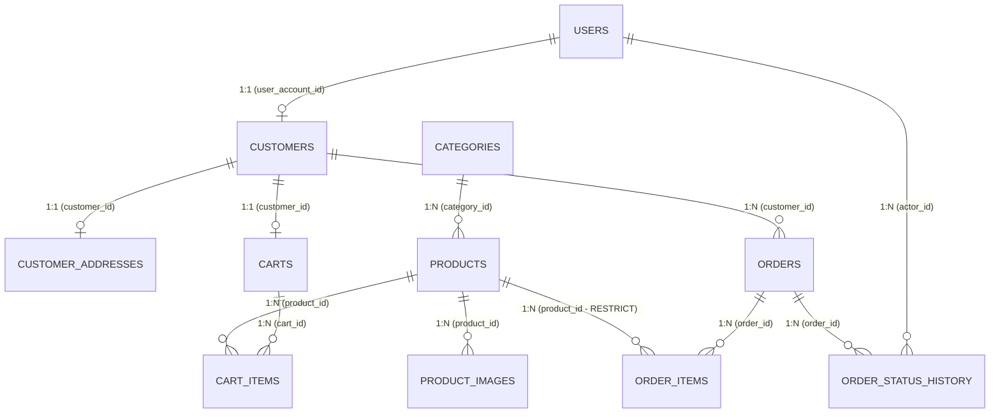
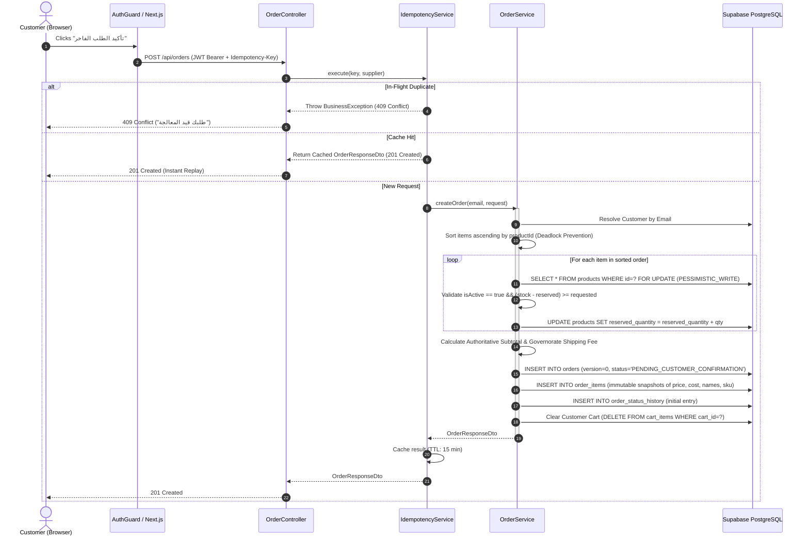

# VARELLION — Authoritative Technical Knowledge Base & System Architecture
**Document File:** `PROJECT_CONTEXT.md`  
**System Name:** VARELLION Luxury E-Commerce Platform  
**Target Market:** Egypt (27 Governorates, EGP Currency, Cash on Delivery + Inspection Prior to Payment)  
**Architecture Specification Version:** 2.0.0 (Consolidated & Reconciled Ground Truth)  
**Last Verified Date:** November 13, 2026  
**Confidentiality:** Proprietary Technical Architecture — Secrets Sanitized  

---

## 1. Project Identity & Purpose

### 1.1 Commercial Identity
* **Brand Name:** VARELLION (فارليون)
* **Tagline (Arabic):** الفخامة الرجالية اليومية — ساعات ومصنوعات جلدية صُنعت لتدوم
* **Tagline (English):** Everyday Masculine Luxury — Fine Watches & Genuine Leather Goods
* **Core Product Categories:**
  1. **Luxury Horology:** Premium chronographs and skeleton automatics crafted with 316L surgical stainless steel, sapphire crystal dials, Japanese Miyota quartz or automatic movements, and 50m (5ATM) water resistance.
  2. **100% Genuine Leather Goods:** Bifold wallets, minimalist cardholders, and passport covers handcrafted from vegetable-tanned full-grain cowhide with certified RFID-blocking shielding layers.
  3. **Men's Jewelry & Accessories:** Solid 316L steel cuff bracelets, monogram cufflinks, and luxury accessories.
* **Geographical Scope:** Arab Republic of Egypt (all 27 governorates served via tracked courier network).
* **Official Currency:** Egyptian Pound (`EGP` / `ج.م`). All prices are integer or 2-decimal exact.

### 1.2 Core Value Propositions & Business Model
* **Inspection Before Payment ("معاينة وفحص قبل الاستلام"):** Absolute customer right to unbox, inspect, and verify the physical product with the delivery courier prior to paying.
* **Authoritative Cash on Delivery (COD):** The primary transaction mechanism nationwide. Unrestricted COD coverage across all Egyptian governorates.
* **Tiered Governorate Shipping:** Server-calculated delivery fees starting from 50.00 EGP (Cairo/Giza) up to 85.00 EGP (Frontier/Upper Egypt), with automated Free Shipping on subtotal $\ge$ 2,500.00 EGP.
* **14-Day Consumer Protection:** Full compliance with the Egyptian Consumer Protection Law (قانون حماية المستهلك المصري) for returns and exchanges.
* **Dual-Language First-Class UX:** Native Arabic RTL layout styled with the `Tajawal` typeface alongside Latin brand accents in `Cinzel`.

---

## 2. Technology Stack

| Layer | Technology | Exact Version | Configuration Source | Operational Role |
| :--- | :--- | :--- | :--- | :--- |
| **Backend Runtime** | Java OpenJDK | `17 LTS` (target), `21` (container) | `backend/pom.xml` (`<java.version>17</java.version>`), `backend/Dockerfile` | JVM execution, sealed switch expressions, record types, virtual thread compatibility. |
| **Backend Framework** | Spring Boot | `3.3.4` | `backend/pom.xml` (`spring-boot-starter-parent:3.3.4`) | Core application engine, auto-configuration, Tomcat 10 embedded container. |
| **Security Framework** | Spring Security | `6.3.3` | `spring-boot-starter-security` | SecurityFilterChain, stateless auth, role-based access (`ROLE_USER`, `ROLE_ADMIN`), BCrypt hashing. |
| **JWT Library** | io.jsonwebtoken (JJWT) | `0.12.6` | `backend/pom.xml` (`jjwt-api`, `jjwt-impl`, `jjwt-jackson`) | HS256 HMAC-SHA token signing, claims verification, token parsing. |
| **Persistence ORM** | Spring Data JPA / Hibernate | `3.3.4` / `6.5.3.Final` | `spring-boot-starter-data-jpa` | Object-relational mapping, pessimistic locking, optimistic versioning, batch fetching. |
| **Database Migrations** | Flyway | `10.10.0` | `flyway-core`, `flyway-database-postgresql` | Schema version control (`V1` to `V13`), automated migration on boot. |
| **Database Driver** | PostgreSQL JDBC Driver | `42.7.4` | `org.postgresql:postgresql` | JDBC pool communication with Supabase transaction pooler. |
| **OAuth Integration** | Google API Client | `2.7.0` | `com.google.api-client:google-api-client`, `google-http-client-gson:1.45.0` | Server-side Google ID Token cryptographic validation. |
| **DTO Mapping** | MapStruct / Lombok | `1.6.3` / `1.18.34` | `backend/pom.xml` (compiler annotation processor) | Boilerplate elimination, type-safe entity-DTO conversions. |
| **Validation** | Jakarta Bean Validation | `3.0.2` (Hibernate Validator 8.0.1) | `spring-boot-starter-validation` | Request DTO constraint validation (`@NotBlank`, `@Pattern`, `@Size`). |
| **Backend Testing** | JUnit 5 / Mockito / AssertJ / H2 | `5.10.3` / `5.11.0` / `3.25.3` / `2.2.224` | `backend/pom.xml` (`spring-boot-starter-test`, `h2`) | Unit, service mock, and in-memory PostgreSQL-mode JPA tests. |
| **Frontend Framework** | Next.js (App Router) | `15.2.1` | `frontend/package.json` | SSR, dynamic metadata, static sitemap/robots generation, standalone container build. |
| **UI Library** | React / React DOM | `19.0.0` | `frontend/package.json` | Declarative UI, Client/Server component boundary, React Server Actions. |
| **Language** | TypeScript | `5.8.2` | `frontend/tsconfig.json` | Strict type safety, shared domain interfaces, lint enforcement. |
| **Styling Engine** | Tailwind CSS | `4.0.9` | `@tailwindcss/postcss:4.0.9`, `frontend/src/styles/globals.css` | Utility styling, custom CSS custom-property luxury token system. |
| **Icons** | Lucide React | `1.16.0` | `frontend/package.json` | Consistent SVG icons with strict accessibility wrappers. |
| **Frontend Testing** | Vitest / Testing Library | `5.0.5` / `16.3.3` | `frontend/vitest.config.mjs`, `jsdom:30.1.3` | Client component testing, service mocks, regex and validation tests. |
| **Reverse Proxy** | Nginx Alpine | `alpine` | `compose.prod.yml`, `nginx.conf` | Port 80/443 SSL termination, gzip compression, routing `/api/` to backend and `/` to frontend. |
| **Managed Database** | Supabase PostgreSQL | `15+ / 17.11` | AWS Ireland (`eu-west-1`), Port 6543 (Pooler) | Primary transactional database, Row Level Security, extensions. |

---

## 3. Architecture Overview

### 3.1 High-Level Deployment Topology
```
                          [ Internet / Customer Client ]
                                        │
                                        ▼ HTTPS (443) / HTTP (80)
                       ┌─────────────────────────────────┐
                       │       Nginx Reverse Proxy       │
                       │     (Docker: alpine / :80)      │
                       └────────────────┬────────────────┘
                                        │
             ┌──────────────────────────┴──────────────────────────┐
             │ Path: /api/*, /actuator/health                      │ Path: /*
             ▼                                                     ▼
┌───────────────────────────────┐               ┌─────────────────────────────────┐
│     Spring Boot Backend       │               │        Next.js Frontend         │
│  (Docker: Temurin 21 / :8080) │               │   (Docker: Node 20 / :3000)     │
└──────────────┬────────────────┘               └─────────────────────────────────┘
               │
               │ JDBC / TLS (Port 6543, HikariCP Pool)
               ▼
┌─────────────────────────────────────────────────────────────────────────────────┐
│                    Supabase Cloud PostgreSQL (AWS eu-west-1)                    │
│    - RLS enabled on sensitive tables (users, carts, orders)                     │
│    - PostgREST direct client access completely REVOKED                          │
│    - All mutations route strictly through Spring Boot API                       │
└─────────────────────────────────────────────────────────────────────────────────┘
```

### 3.2 System Architecture Principles
1. **Server-Side Authoritative Pricing & Inventory:** Client price inputs are disregarded. Unit prices, discounts, line totals, and governorate shipping rates are computed on the backend inside a serializable/pessimistic lock transaction.
2. **Stateless Authentication with Dual Token Lifecycle:**
   - **Access Token:** Short-lived (15 minutes), issued in response JSON, stored exclusively in React memory (`AuthContext.tsx`). **Never stored in `localStorage` or `sessionStorage`**.
   - **Refresh Token:** Long-lived (7 days), stored in an `HttpOnly`, `Secure`, `SameSite=Lax` cookie. Re-hydrates session silently via `/api/auth/refresh`.
3. **Pessimistic Row-Level Locking & Deadlock Prevention:** Products ordered during checkout are acquired via `@Lock(LockModeType.PESSIMISTIC_WRITE)` (`SELECT ... FOR UPDATE`). Deadlocks are prevented by deterministically sorting requested items in ascending order by `productId` before locking.
4. **Optimistic Locking on Order Lifecycle:** The `orders` table includes a `version BIGINT NOT NULL DEFAULT 0` column mapped to JPA `@Version` to prevent lost updates during concurrent administrative status updates.
5. **PostgREST Hardening:** Direct Supabase client access (via `anon` or `authenticated` roles) is revoked on `users`, `carts`, `cart_items`, `orders`, `order_items`, and `order_status_history`. All business flows run through Spring Boot.
6. **Graceful Hybrid Frontend Resiliency:** The Next.js frontend is configured to build and SSR cleanly even if the backend is temporarily offline during build time, utilizing type-safe embedded catalog fixtures (`mockProducts.ts`) as fallbacks.

---

## 4. Directory & File Responsibilities

### 4.1 Root Workspace Layout
```
/home/mohamed-saad/Desktop/BRAND/
├── backend/                       # Spring Boot 3.3.4 Maven project
├── frontend/                      # Next.js 15.2.1 React 19 application
├── bruno/                         # Bruno API testing collection (Auth, Profile, Orders)
├── docs/                          # Architectural documentation, schemas, and audits
├── _references/                   # Reference templates (skateshop, commerce, dsh)
├── compose.prod.yml               # Production Docker Compose orchestration
├── nginx.conf                     # Production Nginx reverse proxy configuration
├── check_db.sh                    # Diagnostic script for database connectivity
├── connect_db.sh                  # Interactive PostgreSQL CLI connection script
└── PROJECT_CONTEXT.md             # Authoritative single-file project technical knowledge base
```

### 4.2 Backend Source Architecture (`backend/src/main/java/com/varellion/store/`)

| Package | Class / Interface | Responsibility & Architectural Function |
| :--- | :--- | :--- |
| **`root`** | `VarellionApplication.java` | Main application entry point (`@SpringBootApplication`). |
| **`common.config`** | `JpaAuditingConfig.java` | Enables Spring Data JPA auditing (`@EnableJpaAuditing`). |
| **`common.exception`** | `GlobalExceptionHandler.java` | Centralized `@RestControllerAdvice` mapping domain exceptions (`ResourceNotFoundException`, `BusinessException`, `MethodArgumentNotValidException`, `LockedException`, `BadCredentialsException`) to unified `ErrorResponse` DTOs. |
| | `BusinessException.java` | Custom runtime exception carrying HTTP status codes and domain error descriptions. |
| | `ResourceNotFoundException.java` | Custom runtime exception producing HTTP 404 responses. |
| **`common.response`** | `ApiResponse.java` | Standard generic envelope: `{ success: boolean, message: String, data: T, timestamp: OffsetDateTime }`. |
| | `ErrorResponse.java` | Standard error envelope: `{ timestamp, status, error, message, path, validationErrors }`. |
| **`security.config`** | `SecurityConfig.java` | Configures `SecurityFilterChain`, sets stateless session creation, configures authorization rules, enforces CSP/HSTS headers, and registers filters. |
| | `ApplicationConfig.java` | Configures `PasswordEncoder` (BCrypt), `AuthenticationProvider` (`DaoAuthenticationProvider`), and `AuthenticationManager`. |
| | `CorsConfig.java` | Implements `CorsConfigurationSource` restricting allowed origins to `FRONTEND_URL` (`http://localhost:3000`). |
| **`security.jwt`** | `JwtService.java` | Issues and verifies HS256 HMAC-SHA JWT access tokens (15 min) and refresh tokens (7 days). |
| | `JwtAuthenticationFilter.java` | Intercepts HTTP requests, extracts `Authorization: Bearer <token>`, validates claims, and populates `SecurityContextHolder`. |
| | `JwtAuthenticationEntryPoint.java` | Handles 401 Unauthorized errors, writing structured JSON error responses. |
| | `JwtAccessDeniedHandler.java` | Handles 403 Forbidden errors, writing structured JSON error responses. |
| **`security.filter`** | `RateLimitFilter.java` | In-memory IP-based rate limiting via `ConcurrentHashMap`: 20 req/min for `/api/auth/**`, 15 req/min for `/api/orders/lookup|track`, 5 req/min for expensive endpoints. Cleans up expired buckets every 5 minutes. |
| **`security.controller`** | `AuthController.java` | REST endpoints for `/api/auth/register`, `/api/auth/login`, `/api/auth/google`, `/api/auth/refresh`, and `/api/auth/logout`. Sets HttpOnly refresh token cookie. |
| **`security.service`** | `AuthService.java` | Coordinates credential verification, account lockout (5 failed attempts = 15 min lock), user registration, Google ID Token handling, and customer profile auto-provisioning. |
| | `CustomUserDetails.java` | Adapts `User` entity to Spring Security's `UserDetails`. |
| | `CustomUserDetailsService.java` | Implements `UserDetailsService` resolving users by email or username. |
| | `GoogleTokenVerifier.java` | Verifies Google OAuth2 ID tokens using Google's public keys via `GoogleIdTokenVerifier`. |
| **`security.entity`** | `User.java` | JPA entity mapping `public.users` (id, email, username, password, role, enabled, failed_attempts, lockout_time). |
| **`security.repository`**| `UserRepository.java` | Spring Data repository for user lookups by email or username. |
| **`customer.controller`**| `CustomerController.java` | REST endpoints for `/api/customer/profile` (GET, PUT) and `/api/customer/address` (PUT, DELETE). Bound strictly to `@AuthenticationPrincipal`. |
| **`customer.service`** | `CustomerService.java` | Resolves or auto-provisions `Customer` profiles for authenticated users. Uses `UUID.nameUUIDFromBytes` to deterministically bridge internal BIGINT `users.id` with UUID `customers.user_id`. Manages customer delivery addresses. |
| **`customer.entity`** | `Customer.java` | JPA entity mapping `public.customers` (userId, userAccountId, fullName, phoneNumber, isActive). |
| | `CustomerAddress.java` | JPA entity mapping `public.customer_addresses` (addressId, governorate, cityArea, detailedAddress). |
| **`customer.repository`**| `CustomerRepository.java` | Spring Data queries for customer resolution by `userAccountId` or `userId`. |
| | `CustomerAddressRepository.java` | Spring Data queries for address lookup and deletion by customer UUID. |
| **`catalog.controller`** | `CategoryController.java` | Public REST endpoints for `/api/categories` and `/api/categories/{slug}`. |
| | `ProductController.java` | Public REST endpoints for `/api/products` (paginated, filtered), `/api/products/best-sellers`, and `/api/products/{identifier}`. |
| **`catalog.service`** | `CategoryService.java` | Retrieves active categories and calculates active product counts. |
| | `ProductService.java` | Implements paginated catalog retrieval, category slug filtering, full-text bilingual search, and SKU/UUID product resolution. |
| **`catalog.entity`** | `Category.java` | JPA entity mapping `public.categories`. |
| | `Product.java` | JPA entity mapping `public.products` (productId, category, nameAr, nameEn, price, costPrice, stockQuantity, reservedQuantity, sku, isActive). |
| | `ProductImage.java` | JPA entity mapping `public.product_images` (imageId, imageUrl, isMain, displayOrder). |
| **`catalog.repository`**| `ProductRepository.java` | Spring Data queries including `@Lock(LockModeType.PESSIMISTIC_WRITE) findByIdForUpdate`, filtered searches, and bestsellers. |
| | `CategoryRepository.java` | Lookups for active categories by slug. |
| | `ProductImageRepository.java` | Product image relationships. |
| **`cart.controller`** | `CartController.java` | Authenticated REST endpoints for `/api/cart` (GET, DELETE), `/api/cart/items` (POST), `/api/cart/items/{id}` (PUT, DELETE), and `/api/cart/merge` (POST). |
| **`cart.service`** | `CartService.java` | Manages persistent user shopping carts. Calculates available stock `(stock_quantity - reserved_quantity)`. Handles batch-merging of guest items upon login. |
| **`cart.entity`** | `Cart.java` | JPA entity mapping `public.carts` (1:1 with Customer). |
| | `CartItem.java` | JPA entity mapping `public.cart_items` (Unique per cart and product). |
| **`cart.repository`** | `CartRepository.java` | Lookup cart by Customer. |
| | `CartItemRepository.java` | Line-item persistence and deletion. |
| **`order.controller`** | `OrderController.java` | Authenticated REST endpoints: `POST /api/orders` (replay-protected with `Idempotency-Key`), `GET /api/orders/my-orders`, `GET /api/orders/{orderNumber}`. |
| | `GuestOrderLookupController.java` | Public tracking endpoints: `POST /api/orders/lookup` and `GET /api/orders/track`. Dual-factor verification (orderNumber + registered phone). |
| **`order.service`** | `OrderService.java` | Central order placement engine: sorts product IDs ascending, executes pessimistic locks, validates available stock, calculates server-side financials and shipping rates, persists immutable order/items/status history, clears cart, and manages state transitions. |
| | `IdempotencyService.java` | In-memory replay cache (15-min TTL) protecting against duplicate order submissions. Detects in-flight requests (30s window) and returns `409 Conflict`. |
| | `OrderReservationService.java` | Calculates 24-hour confirmation deadline (`OffsetDateTime.now().plusHours(24)`) and checks reservation expiration. |
| **`order.entity`** | `Order.java` | JPA entity mapping `public.orders` with `@Version private Long version;` for optimistic concurrency control. |
| | `OrderItem.java` | JPA entity mapping `public.order_items` (immutable price, cost, SKU, and bilingual name snapshots). |
| | `OrderStatusHistory.java` | JPA entity mapping `public.order_status_history` (audit trail, previousStatus, newStatus, reason, actorId linking to `public.users.id`). |
| | `OrderStatus.java` | Enum with explicit finite state machine transition logic (`canTransitionTo`). |
| | `ShippingFeeStatus.java`| Enum (`PENDING`, `CONFIRMED`). |
| **`order.repository`** | `OrderRepository.java` | Queries by customer ID, order number with details, administrative paginated queries with status and search filters. |
| | `OrderItemRepository.java` | Order item persistence. |
| | `OrderStatusHistoryRepository.java` | Order audit history queries. |
| **`admin.order.controller`** | `AdminOrderController.java` | Protected administrative endpoints (`@PreAuthorize("hasRole('ADMIN')")`): `GET /api/admin/orders`, `GET /api/admin/orders/{orderNumber}`, `PUT /api/admin/orders/{orderNumber}/status`. |

### 4.3 Frontend Source Architecture (`frontend/src/`)

| Path / File | Responsibility |
| :--- | :--- |
| **`app/layout.tsx`** | Root layout, HTML attributes (`dir="rtl" lang="ar"`), loads `Tajawal` and `Cinzel` fonts, WCAG Skip to Main Content bypass link, wraps with `AuthProvider` and `CartProvider`. |
| **`app/page.tsx`** | Luxury homepage: asymmetric hero showcase, 4 Egyptian confidence drivers, curated collection links, featured products grid, brand guarantee banner. |
| **`app/products/page.tsx`** | Full catalog page with bilingual category filter pills, sorting controls, mobile filter drawer, and `ProductGrid`. |
| **`app/products/[slug]/page.tsx`** | Dynamic product detail page (PDP) with SSR `generateMetadata`, JSON-LD structured data (`Product` and `BreadcrumbList`), gallery, craftsmanship attributes, SKU, stock indicator, and Add to Cart. |
| **`app/checkout/page.tsx`** | Multi-step checkout wizard protected by `AuthGuard`. Calculates dynamic governorate shipping, validates Egyptian phone, triggers authoritative order creation, and handles COD or online payment redirect. |
| **`app/checkout/success/page.tsx`** | Order confirmation screen displaying order number, delivery estimate, governorate shipping breakdown, and next steps for courier inspection. |
| **`app/checkout/mock-paymob/page.tsx`** | Local development interactive simulator for Paymob online card payments. |
| **`app/checkout/callback/page.tsx`** | Payment return handler processing gateway callbacks and routing to order success screen. |
| **`app/track-order/page.tsx`** | Dual-factor guest tracking lookup screen (order number + registered phone number) with visual step timeline. |
| **`app/profile/page.tsx`** | Authenticated customer portal with tabs for Personal Info, Saved Delivery Address, and Order History. |
| **`app/admin/orders/page.tsx`** | Administrative dashboard with order search, status filter tabs, paginated table, and `OrderStatusUpdateDialog`. |
| **`app/sitemap.ts`** | Dynamic XML sitemap generator covering core static pages, category query routes, and product detail URLs with images. |
| **`app/robots.ts`** | Search engine and AI crawler rules (allowing public pages; disallowing `/admin`, `/checkout`, `/profile`). |
| **`context/AuthContext.tsx`** | Memory-only access token management, silent session hydration via HttpOnly cookie refresh, login/register/logout methods. |
| **`context/CartContext.tsx`** | Client cart state. For guests: persists to `localStorage`. For authenticated users: syncs with backend `/api/cart`. Merges guest items on login. |
| **`services/api.ts`** | Central Fetch wrapper: handles SSR vs browser URL resolution, automatic 401 interception, token refresh queue, request timeouts. |
| **`services/auth.ts`** | Authentication API client (login, register, google, refresh, logout). |
| **`services/orders.ts`** | Order submission (attaching `Idempotency-Key`), session storage caching, and tracking API calls. |
| **`services/adminOrders.ts`**| Admin order queries, status update API calls, permitted status transition maps. |
| **`services/customer.ts`** | Customer profile and address book API calls. |
| **`services/payment.ts`** | Payment initiation (attempts live gateway, falls back to `/checkout/mock-paymob` simulator). |
| **`data/shippingZones.ts`** | Authoritative 27 Egyptian governorates shipping rates, delivery timelines, and free shipping threshold (2,500 EGP). |
| **`lib/seo/schema.ts`** | JSON-LD generators for `Product`, `BreadcrumbList`, and `Organization`. |
| **`lib/validations/`** | Zod / regex client validation schemas for checkout forms and customer profiles. |
| **`styles/globals.css`** | Tailwind CSS v4 custom properties: Obsidian (`#0E0F11`), Warm Ivory (`#FAF9F6`), Brushed Gold (`#C5A059` / `#876725`). |

---

## 5. Database Schema & Relationships

### 5.1 Tables Summary & Column Specifications

```
┌────────────────────────────────────────────────────────────────────────┐
│                        VARELLION DATABASE SCHEMA                       │
├──────────────────────────┬───────────────────────┬─────────────────────┤
│ Table Name               │ Migration Source      │ Primary Key / Type  │
├──────────────────────────┼───────────────────────┼─────────────────────┤
│ public.users             │ V6, V7                │ id (BIGSERIAL)      │
│ public.customers         │ V1, V8                │ user_id (UUID)      │
│ public.customer_addresses│ V1                    │ address_id (UUID)   │
│ public.categories        │ V2                    │ category_id (UUID)  │
│ public.products          │ V2, V3, V10           │ product_id (UUID)   │
│ public.product_images    │ V2                    │ image_id (UUID)     │
│ public.carts             │ V4, V10               │ cart_id (UUID)      │
│ public.cart_items        │ V4, V10               │ cart_item_id (UUID) │
│ public.orders            │ V5, V12               │ order_id (UUID)     │
│ public.order_items       │ V5                    │ order_item_id (UUID)│
│ public.order_status_history V5, V10, V11, V13    │ history_id (UUID)   │
└──────────────────────────┴───────────────────────┴─────────────────────┘
```

#### Detailed Column Specifications:

1. **`public.users` (Application Security Users):**
   - `id`: `BIGSERIAL PRIMARY KEY`
   - `email`: `VARCHAR(150) NOT NULL UNIQUE`
   - `username`: `VARCHAR(150) NOT NULL UNIQUE`
   - `password`: `VARCHAR(255) NOT NULL` (BCrypt hash)
   - `role`: `VARCHAR(20) NOT NULL DEFAULT 'USER'` (`USER` or `ADMIN`)
   - `enabled`: `BOOLEAN NOT NULL DEFAULT TRUE`
   - `email_verified`: `BOOLEAN NOT NULL DEFAULT FALSE`
   - `failed_attempts`: `INTEGER NOT NULL DEFAULT 0`
   - `lockout_time`: `TIMESTAMPTZ NULL`
   - `created_at` / `updated_at`: `TIMESTAMPTZ NOT NULL DEFAULT NOW()`

2. **`public.customers` (Customer Commercial Profiles):**
   - `user_id`: `UUID PRIMARY KEY` (Derived deterministically via `UUID.nameUUIDFromBytes("varellion_user_" + id)`)
   - `user_account_id`: `BIGINT NULL UNIQUE REFERENCES public.users(id) ON DELETE CASCADE`
   - `full_name`: `TEXT NULL`
   - `phone_number`: `TEXT NULL`
   - `is_active`: `BOOLEAN NOT NULL DEFAULT TRUE`
   - `created_at` / `updated_at`: `TIMESTAMPTZ NOT NULL DEFAULT NOW()`

3. **`public.customer_addresses` (Primary Delivery Address):**
   - `address_id`: `UUID PRIMARY KEY DEFAULT gen_random_uuid()`
   - `customer_id`: `UUID NOT NULL UNIQUE REFERENCES public.customers(user_id) ON DELETE CASCADE`
   - `governorate`: `TEXT NOT NULL CHECK (length(trim(governorate)) > 0)`
   - `city_area`: `TEXT NOT NULL CHECK (length(trim(city_area)) > 0)`
   - `detailed_address`: `TEXT NOT NULL CHECK (length(trim(detailed_address)) > 0)`
   - `created_at`: `TIMESTAMPTZ NOT NULL DEFAULT NOW()`

4. **`public.categories` (Product Categories):**
   - `category_id`: `UUID PRIMARY KEY DEFAULT gen_random_uuid()`
   - `name_ar`: `TEXT NOT NULL CHECK (LENGTH(BTRIM(name_ar)) > 0)`
   - `name_en`: `TEXT NOT NULL CHECK (LENGTH(BTRIM(name_en)) > 0)`
   - `slug`: `TEXT NOT NULL UNIQUE CHECK (slug ~ '^[a-z0-9]+(-[a-z0-9]+)*$')`
   - `description_ar` / `description_en`: `TEXT NULL`
   - `is_active`: `BOOLEAN NOT NULL DEFAULT TRUE`
   - `created_at` / `updated_at`: `TIMESTAMPTZ NOT NULL DEFAULT NOW()`

5. **`public.products` (Catalog Products & Lean Inventory):**
   - `product_id`: `UUID PRIMARY KEY DEFAULT gen_random_uuid()`
   - `category_id`: `UUID NOT NULL REFERENCES public.categories(category_id) ON DELETE RESTRICT`
   - `name_ar`: `TEXT NOT NULL CHECK (LENGTH(BTRIM(name_ar)) > 0)`
   - `name_en`: `TEXT NOT NULL CHECK (LENGTH(BTRIM(name_en)) > 0)`
   - `description_ar` / `description_en`: `TEXT NULL`
   - `price`: `NUMERIC(10, 2) NOT NULL DEFAULT 0.00 CHECK (price >= 0)`
   - `cost_price`: `NUMERIC(10, 2) NOT NULL DEFAULT 0.00 CHECK (cost_price >= 0)`
   - `stock_quantity`: `INTEGER NOT NULL DEFAULT 0 CHECK (stock_quantity >= 0)`
   - `reserved_quantity`: `INTEGER NOT NULL DEFAULT 0 CHECK (reserved_quantity >= 0)`
   - `sku`: `VARCHAR(100) NULL`
   - `is_active`: `BOOLEAN NOT NULL DEFAULT FALSE`
   - `created_at` / `updated_at`: `TIMESTAMPTZ NOT NULL DEFAULT NOW()`
   - **Constraints:**
     - `chk_stock_available`: `CHECK (reserved_quantity <= stock_quantity)`
     - `chk_active_product_price`: `CHECK (NOT is_active OR price > 0)`

6. **`public.product_images` (Product Visuals):**
   - `image_id`: `UUID PRIMARY KEY DEFAULT gen_random_uuid()`
   - `product_id`: `UUID NOT NULL REFERENCES public.products(product_id) ON DELETE CASCADE`
   - `image_url`: `TEXT NOT NULL CHECK (LENGTH(BTRIM(image_url)) > 0)`
   - `is_main`: `BOOLEAN NOT NULL DEFAULT FALSE`
   - `display_order`: `INTEGER NOT NULL DEFAULT 0 CHECK (display_order >= 0)`
   - `created_at`: `TIMESTAMPTZ NOT NULL DEFAULT NOW()`

7. **`public.carts` (Active Shopping Carts):**
   - `cart_id`: `UUID PRIMARY KEY DEFAULT gen_random_uuid()`
   - `customer_id`: `UUID NOT NULL UNIQUE REFERENCES public.customers(user_id) ON DELETE CASCADE`
   - `created_at` / `updated_at`: `TIMESTAMPTZ NOT NULL DEFAULT NOW()`

8. **`public.cart_items` (Cart Items):**
   - `cart_item_id`: `UUID PRIMARY KEY DEFAULT gen_random_uuid()`
   - `cart_id`: `UUID NOT NULL REFERENCES public.carts(cart_id) ON DELETE CASCADE`
   - `product_id`: `UUID NOT NULL REFERENCES public.products(product_id) ON DELETE CASCADE`
   - `quantity`: `INTEGER NOT NULL CHECK (quantity > 0)`
   - `created_at` / `updated_at`: `TIMESTAMPTZ NOT NULL DEFAULT NOW()`
   - **Constraint:** `uq_cart_product UNIQUE (cart_id, product_id)`

9. **`public.orders` (Master Orders):**
   - `order_id`: `UUID PRIMARY KEY DEFAULT gen_random_uuid()`
   - `version`: `BIGINT NOT NULL DEFAULT 0` (Optimistic locking version field)
   - `order_number`: `VARCHAR(32) NOT NULL UNIQUE CHECK (LENGTH(TRIM(order_number)) >= 6)`
   - `customer_id`: `UUID NOT NULL REFERENCES public.customers(user_id) ON DELETE RESTRICT`
   - `customer_name`: `VARCHAR(150) NOT NULL CHECK (LENGTH(TRIM(customer_name)) > 0)`
   - `customer_phone`: `VARCHAR(30) NOT NULL CHECK (LENGTH(TRIM(customer_phone)) >= 8)`
   - `shipping_governorate`: `VARCHAR(100) NOT NULL CHECK (LENGTH(TRIM(shipping_governorate)) > 0)`
   - `shipping_city_area`: `VARCHAR(100) NOT NULL CHECK (LENGTH(TRIM(shipping_city_area)) > 0)`
   - `shipping_detailed_address`: `TEXT NOT NULL CHECK (LENGTH(TRIM(shipping_detailed_address)) > 0)`
   - `currency`: `VARCHAR(3) NOT NULL DEFAULT 'EGP' CHECK (currency = 'EGP')`
   - `subtotal`: `NUMERIC(10, 2) NOT NULL CHECK (subtotal >= 0)`
   - `discount_total`: `NUMERIC(10, 2) NOT NULL DEFAULT 0.00 CHECK (discount_total >= 0)`
   - `shipping_fee`: `NUMERIC(10, 2) NULL CHECK (shipping_fee IS NULL OR shipping_fee >= 0)`
   - `total_amount`: `NUMERIC(10, 2) NULL CHECK (total_amount IS NULL OR total_amount >= 0)`
   - `order_status`: `VARCHAR(50) NOT NULL DEFAULT 'PENDING_CUSTOMER_CONFIRMATION'` (Enforced via check constraint matching `OrderStatus` enum values)
   - `shipping_fee_status`: `VARCHAR(30) NOT NULL DEFAULT 'PENDING' CHECK (shipping_fee_status IN ('PENDING', 'CONFIRMED'))`
   - `confirmation_deadline`: `TIMESTAMPTZ NULL`
   - `customer_notes` / `admin_notes`: `TEXT NULL`
   - `created_at` / `updated_at`: `TIMESTAMPTZ NOT NULL DEFAULT NOW()`

10. **`public.order_items` (Immutable Order Line Snapshots):**
    - `order_item_id`: `UUID PRIMARY KEY DEFAULT gen_random_uuid()`
    - `order_id`: `UUID NOT NULL REFERENCES public.orders(order_id) ON DELETE CASCADE`
    - `product_id`: `UUID NULL REFERENCES public.products(product_id) ON DELETE RESTRICT`
    - `product_name_ar` / `product_name_en`: `TEXT NOT NULL`
    - `sku`: `VARCHAR(100) NOT NULL`
    - `unit_price`: `NUMERIC(10, 2) NOT NULL CHECK (unit_price >= 0)`
    - `unit_cost`: `NUMERIC(10, 2) NOT NULL DEFAULT 0.00 CHECK (unit_cost >= 0)`
    - `quantity`: `INTEGER NOT NULL CHECK (quantity > 0)`
    - `line_total`: `NUMERIC(10, 2) NOT NULL CHECK (line_total >= 0)`
    - `created_at`: `TIMESTAMPTZ NOT NULL DEFAULT NOW()`
    - **Constraint:** `uq_order_product UNIQUE (order_id, product_id)`

11. **`public.order_status_history` (Append-Only Lifecycle Audit Log):**
    - `history_id`: `UUID PRIMARY KEY DEFAULT gen_random_uuid()`
    - `order_id`: `UUID NOT NULL REFERENCES public.orders(order_id) ON DELETE CASCADE`
    - `previous_status`: `VARCHAR(50) NULL`
    - `new_status`: `VARCHAR(50) NOT NULL`
    - `reason`: `TEXT NULL`
    - `actor_id`: `BIGINT NULL REFERENCES public.users(id) ON DELETE SET NULL`
    - `created_at`: `TIMESTAMPTZ NOT NULL DEFAULT NOW()`

### 5.2 Entity Relationships & Cardinality


### 5.3 Flyway Migration History & State

| Version | Migration Script Name | Core Schema Modifications |
| :---: | :--- | :--- |
| **V1** | `V1__create_customers_and_addresses.sql` | Created `customers`, `customer_addresses`, updated_at triggers. (Legacy link to auth.users). |
| **V2** | `V2__create_categories.sql` | Created `categories`, `products`, `product_images`, RLS read policies. |
| **V3** | `V3__create_product_inventory_and_movements.sql` | Added `sku`, `cost_price`, `stock_quantity`, `reserved_quantity`, `chk_stock_available` constraint. |
| **V4** | `V4__create_carts_and_cart_items.sql` | Created `carts`, `cart_items`, unique constraint `(cart_id, product_id)`, RLS policies. |
| **V5** | `V5__create_orders_module.sql` | Created `orders`, `order_items`, `order_status_history`, financial constraints. |
| **V6** | `V6__create_users_table.sql` | Created internal Spring Security `users` table with lockout and role columns. |
| **V7** | `V7__secure_users_table.sql` | Hardened `users` with RLS; revoked all PostgREST access from `anon` and `authenticated`. |
| **V8** | `V8__decouple_customers_from_auth_users.sql` | Dropped FK to `auth.users`, added `user_account_id BIGINT UNIQUE REFERENCES public.users(id)`. |
| **V9** | `V9__seed_catalog_products.sql` | Seeded 3 categories, 6 flagship products (watches, wallets, cardholders) with inventory. |
| **V10** | `V10__cleanup_legacy_auth_and_indexes.sql` | Dropped duplicate indexes; added composite index `(category_id, is_active)`; revoked PostgREST cart access. |
| **V11** | `V11__add_order_status_history_trigger.sql` | Added automatic trigger for order status logging (Later removed in V13 to eliminate duplicate entries). |
| **V12** | `V12__add_version_to_orders.sql` | Added `version BIGINT NOT NULL DEFAULT 0` to `public.orders` for optimistic concurrency control. |
| **V13** | `V13__fix_order_status_history_and_drop_trigger.sql` | Dropped redundant trigger `trg_orders_status_history`; converted `actor_id` to `BIGINT REFERENCES public.users(id) ON DELETE SET NULL`. |

---

## 6. API Reference

All backend endpoints are rooted at `/api`. Responses adhere to standard envelopes:
* Success Envelope: `{ success: true, message: string, data: T, timestamp: ISO8601 }`
* Error Envelope: `{ timestamp: ISO8601, status: number, error: string, message: string, path: string, validationErrors?: Record<string, string> }`

### 6.1 Authentication Module (`/api/auth`)
| Method | Endpoint | Access | Request Payload | Response Data | Error Responses | Frontend Consumer |
| :--- | :--- | :--- | :--- | :--- | :--- | :--- |
| `POST` | `/api/auth/register` | Public | `RegisterRequest`: `{ email, username, password }` | `AuthResponse`: `{ accessToken, email, username, role }` + Set-Cookie `refresh_token` | `400 Bad Request` | `frontend/src/services/auth.ts:register()` |
| `POST` | `/api/auth/login` | Public | `LoginRequest`: `{ identifier, password }` | `AuthResponse`: `{ accessToken, email, username, role }` + Set-Cookie `refresh_token` | `401 Unauthorized`, `423 Locked` (5 failed attempts) | `frontend/src/services/auth.ts:login()` |
| `POST` | `/api/auth/google` | Public | `GoogleLoginRequest`: `{ idToken }` | `AuthResponse`: `{ accessToken, email, username, role }` + Set-Cookie `refresh_token` | `400 Bad Request`, `401 Unauthorized` | `frontend/src/components/auth/GoogleSignInButton.tsx` |
| `POST` | `/api/auth/refresh` | Public | Cookie `refresh_token` or JSON `{ refreshToken }` | `AuthResponse`: `{ accessToken, email }` + Set-Cookie `refresh_token` | `401 Unauthorized` | `frontend/src/context/AuthContext.tsx:initSession()` |
| `POST` | `/api/auth/logout` | Public | None | `{ message: "Logged out successfully" }` + Set-Cookie `refresh_token=; Max-Age=0` | `200 OK` | `frontend/src/context/AuthContext.tsx:logout()` |

### 6.2 Customer Module (`/api/customer`)
| Method | Endpoint | Access | Request Payload | Response Data | Error Responses | Frontend Consumer |
| :--- | :--- | :--- | :--- | :--- | :--- | :--- |
| `GET` | `/api/customer/profile` | Auth | None | `CustomerDto`: `{ userId, fullName, phoneNumber, email, username, address }` | `401 Unauthorized` | `frontend/src/services/customer.ts:getProfile()` |
| `PUT` | `/api/customer/profile` | Auth | `UpdateProfileRequest`: `{ fullName, phoneNumber }` | `CustomerDto` | `400 Bad Request`, `401 Unauthorized` | `frontend/src/components/profile/PersonalInfoCard.tsx` |
| `PUT` | `/api/customer/address` | Auth | `AddressDto`: `{ governorate, cityArea, detailedAddress }` | `AddressDto` | `400 Bad Request`, `401 Unauthorized` | `frontend/src/components/profile/DeliveryAddressCard.tsx` |
| `DELETE` | `/api/customer/address` | Auth | None | `null` | `401 Unauthorized` | `frontend/src/components/profile/DeleteAddressDialog.tsx` |

### 6.3 Catalog Module (`/api/categories`, `/api/products`)
| Method | Endpoint | Access | Query Parameters | Response Data | Frontend Consumer |
| :--- | :--- | :--- | :--- | :--- | :--- |
| `GET` | `/api/categories` | Public | None | `List<CategoryDto>` | `frontend/src/services/api.ts:getCategories()` |
| `GET` | `/api/categories/{slug}` | Public | None | `CategoryDto` | `frontend/src/services/api.ts:getCategoryBySlug()` |
| `GET` | `/api/products` | Public | `category`, `q`, `sort`, `page` (def: 0), `limit` (def: 20) | `PagedProductsResponse`: `{ products, totalElements, totalPages, currentPage, pageSize }` | `frontend/src/app/products/page.tsx` |
| `GET` | `/api/products/best-sellers` | Public | `limit` (def: 4) | `List<ProductDto>` | `frontend/src/app/page.tsx` |
| `GET` | `/api/products/{identifier}` | Public | `{identifier}` (UUID or SKU) | `ProductDto` (includes `images`, `category`, `stockQuantity`, `availableStock`) | `frontend/src/app/products/[slug]/getProduct.ts` |

### 6.4 Cart Module (`/api/cart`)
| Method | Endpoint | Access | Request Payload | Response Data | Frontend Consumer |
| :--- | :--- | :--- | :--- | :--- | :--- |
| `GET` | `/api/cart` | Auth | None | `CartDto`: `{ cartId, items, totalItems, subtotal, freeShippingThreshold, amountForFreeShipping }` | `frontend/src/services/cart.ts:getCart()` |
| `POST` | `/api/cart/items` | Auth | `AddToCartRequest`: `{ productId: UUID, quantity: int }` | `CartDto` | `frontend/src/context/CartContext.tsx:addItem()` |
| `PUT` | `/api/cart/items/{id}` | Auth | `UpdateCartItemRequest`: `{ quantity: int }` | `CartDto` | `frontend/src/context/CartContext.tsx:updateQuantity()` |
| `DELETE` | `/api/cart/items/{id}` | Auth | None | `CartDto` | `frontend/src/context/CartContext.tsx:removeItem()` |
| `DELETE` | `/api/cart` | Auth | None | `null` | `frontend/src/context/CartContext.tsx:clearCart()` |
| `POST` | `/api/cart/merge` | Auth | `MergeCartRequest`: `{ items: List<AddToCartRequest> }` | `CartDto` | `frontend/src/context/CartContext.tsx:syncCart()` |

### 6.5 Orders Module (`/api/orders`)
| Method | Endpoint | Access | Headers & Request Payload | Response Data | Error Responses | Frontend Consumer |
| :--- | :--- | :--- | :--- | :--- | :--- | :--- |
| `POST` | `/api/orders` | Auth | Header: `Idempotency-Key: UUID`<br>`CreateOrderRequest`: `{ customerName, customerPhone, alternativePhone?, shippingGovernorate, shippingCityArea, shippingDetailedAddress, paymentMethod?, customerNotes?, items: [{ productId, quantity }] }` | `OrderResponseDto`: `{ orderNumber, subtotal, shippingFee, totalAmount, orderStatus, statusDisplayAr, items, statusHistory, estimatedDeliveryAr }` | `400 Bad Request`<br>`401 Unauthorized`<br>`404 Not Found`<br>`409 Conflict` (Duplicate in-flight key) | `frontend/src/app/checkout/page.tsx` |
| `GET` | `/api/orders/my-orders` | Auth | `page` (def: 0), `limit` (def: 10) | `List<OrderResponseDto>` | `401 Unauthorized` | `frontend/src/components/profile/OrderHistoryList.tsx` |
| `GET` | `/api/orders/{orderNumber}` | Auth | Path: `{orderNumber}` | `OrderResponseDto` | `401 Unauthorized`<br>`404 Not Found` (IDOR check: verifies customer ownership) | `frontend/src/services/orders.ts` |
| `POST` | `/api/orders/lookup` | Public | `OrderLookupRequest`: `{ orderNumber, phone }` | `OrderResponseDto` | `404 Not Found` (Uniform message on mismatch) | `frontend/src/app/track-order/page.tsx` |
| `GET` | `/api/orders/track` | Public | Query: `orderNumber`, `phone` | `OrderResponseDto` | `404 Not Found` | SMS / WhatsApp direct tracking links |

### 6.6 Admin Orders Module (`/api/admin/orders`)
| Method | Endpoint | Access | Request / Query Parameters | Response Data | Error Responses | Frontend Consumer |
| :--- | :--- | :--- | :--- | :--- | :--- | :--- |
| `GET` | `/api/admin/orders` | `ROLE_ADMIN` | `page`, `limit`, `status`, `search` | `PagedOrdersResponse`: `{ orders, totalElements, totalPages, currentPage, pageSize }` | `401 Unauthorized`<br>`403 Forbidden` | `frontend/src/app/admin/orders/page.tsx` |
| `GET` | `/api/admin/orders/{orderNumber}` | `ROLE_ADMIN` | Path: `{orderNumber}` (`^VAR-\d{8}-\d{4}$`) | `OrderResponseDto` | `403 Forbidden`<br>`404 Not Found` | `frontend/src/services/adminOrders.ts` |
| `PUT` | `/api/admin/orders/{orderNumber}/status` | `ROLE_ADMIN` | `UpdateOrderStatusRequest`: `{ newStatus: OrderStatus, reason?: string }` | `OrderResponseDto` | `400 Bad Request` (Invalid transition)<br>`403 Forbidden`<br>`404 Not Found`<br>`409 Conflict` (Optimistic lock conflict) | `frontend/src/components/admin/OrderStatusUpdateDialog.tsx` |

### 6.7 Health & Infrastructure
| Method | Endpoint | Access | Purpose |
| :--- | :--- | :--- | :--- |
| `GET` | `/actuator/health` | Public | Kubernetes/Docker healthcheck probe (`{"status":"UP"}`). Details sanitized. |

---

## 7. Complete Feature Inventory

| Feature | Business Rules & Responsibilities | Implemented Code Files | Status |
| :--- | :--- | :--- | :--- |
| **1. Authentication & Security** | BCrypt hashing, 15-min JWT, 7-day HttpOnly cookie, 5-attempt lockout for 15 min, rate limiting (20 req/min). | `AuthController.java`, `AuthService.java`, `JwtService.java`, `RateLimitFilter.java`, `User.java`, `AuthContext.tsx`, `GoogleSignInButton.tsx`. | **IMPLEMENTED** |
| **2. Customer Profile & Address** | Single delivery address per customer in v1. Derives UUID from BIGINT ID. Update full name and Egyptian mobile (`01[0125][0-9]{8}`). | `CustomerController.java`, `CustomerService.java`, `Customer.java`, `CustomerAddress.java`, `PersonalInfoCard.tsx`, `DeliveryAddressCard.tsx`. | **IMPLEMENTED** |
| **3. Product Catalog & Search** | Categories, bilingual titles/descriptions, full-text search, SKU lookups, dual-image hover cards. | `ProductController.java`, `ProductService.java`, `CategoryController.java`, `CategoryService.java`, `Product.java`, `ProductCard.tsx`, `products/page.tsx`. | **IMPLEMENTED** |
| **4. Shopping Cart & Merge** | 1:1 user cart in DB, guest cart in `localStorage`, automatic batch merge upon sign-in, stock clamping. | `CartController.java`, `CartService.java`, `Cart.java`, `CartItem.java`, `CartContext.tsx`, `CartDrawer.tsx`. | **IMPLEMENTED** |
| **5. Order Creation & Inventory Lock** | Pessimistic write lock, ascending product ID sorting (deadlock prevention), authoritative shipping fees, cart clearing. | `OrderController.java`, `OrderService.java`, `ProductRepository.java` (`findByIdForUpdate`), `Order.java`, `OrderItem.java`, `CheckoutForm.tsx`. | **IMPLEMENTED** |
| **6. Replay & Idempotency** | Prevents double clicks and retry race conditions via `Idempotency-Key` header with in-flight conflict rejection (`409`). | `IdempotencyService.java`, `OrderController.java`, `orders.ts`. | **IMPLEMENTED** |
| **7. Order Tracking (Guest & Customer)** | Dual-factor tracking (order number + Egyptian phone). Visual timeline generator, governorate transit calculation. | `GuestOrderLookupController.java`, `OrderController.java`, `OrderService.java`, `OrderTrackingCard.tsx`, `OrderTrackingTimeline.tsx`, `track-order/page.tsx`. | **IMPLEMENTED** |
| **8. Admin Order Fulfillment** | Role-based dashboard, status transitions via FSM (`canTransitionTo`), optimistic locking version checks, audit logging. | `AdminOrderController.java`, `OrderService.java`, `OrderStatus.java`, `OrderStatusHistory.java`, `admin/orders/page.tsx`, `OrderStatusUpdateDialog.tsx`. | **IMPLEMENTED** |
| **9. Dynamic SEO & Structured Data** | Server-side metadata, OpenGraph, JSON-LD (`Product`, `BreadcrumbList`), dynamic XML sitemaps, AI bot crawler access. | `app/products/[slug]/page.tsx`, `app/sitemap.ts`, `app/robots.ts`, `lib/seo/schema.ts`, `public/llms.txt`. | **IMPLEMENTED** |
| **10. Cash on Delivery (COD)** | Cash on Delivery recorded in `CreateOrderRequest` and stored in `adminNotes`. | `CheckoutForm.tsx`, `OrderService.java`. | **IMPLEMENTED** |
| **11. Online Card / Paymob** | Frontend initiates Paymob session. If backend endpoint `/payments/paymob/initiate` is absent, falls back to `/checkout/mock-paymob` simulation. | `services/payment.ts`, `app/checkout/mock-paymob/page.tsx`, `app/checkout/callback/page.tsx`. | **PARTIAL (SIMULATED)** |
| **12. Automated Notifications** | Real-time SMS or WhatsApp order confirmations upon order placement and status changes. | None in backend. | **NOT FOUND (PLANNED)** |
| **13. Coupon / Promo Code Engine** | Discount validation and application engine. `discount_total` column exists in `orders` but defaults to `0.00`. | None in backend. | **NOT FOUND (PLANNED)** |
| **14. Customer Reviews & Ratings** | Star ratings and textual customer feedback. Excluded in v1 in favor of verified material guarantees. | None. | **NOT FOUND (EXCLUDED)** |

---

## 8. Critical Business Flows

### 8.1 Flow 1: Customer Authentication & Registration
```
[User Browser]                  [Spring Boot Filter / AuthController]                  [PostgreSQL]
      │                                           │                                          │
  1.  │── POST /api/auth/register (email, pass) ─►│                                          │
      │                                           │── 2. Validate email & username unique ──►│
      │                                           │── 3. BCrypt hash password                │
      │                                           │── 4. INSERT INTO public.users ──────────►│
      │                                           │── 5. Auto-provision public.customers ───►│
      │                                           │── 6. Generate HS256 Access Token         │
      │                                           │── 7. Generate HS256 Refresh Token        │
  8.  │◄── 200 OK (Access Token JSON + Cookie) ───│                                          │
      │    [Memory Only]          [HttpOnly Cookie]
```

### 8.2 Flow 2: Cart Management & Guest Merging
1. **Guest Browsing:** Customer adds products to cart while unauthenticated. `CartContext.tsx` stores line items in browser `localStorage` under `varellion_local_cart_v1`.
2. **Login Trigger:** Customer logs in or registers.
3. **Batch Merge:** `CartContext.tsx` detects `isAuthenticated === true` and dispatches `POST /api/cart/merge` containing all guest items.
4. **Backend Clamping:** `CartService.java` locates the customer's database cart, resolves each product, checks `availableStock = (stock_quantity - reserved_quantity)`, clamps quantities, saves `public.cart_items`, and returns the updated `CartDto`.
5. **Storage Cleanup:** `CartContext.tsx` receives the merged cart and wipes `localStorage`.

### 8.3 Flow 3: Authoritative Order Placement & Stock Reservation


### 8.4 Flow 4: Dual-Factor Guest Order Tracking
1. **User Action:** Guest navigates to `/track-order` and inputs `orderNumber` (e.g. `VAR-20261028-1234`) and `phone` (e.g. `01012345678`).
2. **Phone Normalization:** Both frontend and backend normalize the input: strips `+20`, `0020`, spaces, leading non-digits, converting to standard 11 digits `01XXXXXXXXX`.
3. **Execution:** Calls `POST /api/orders/lookup` or `GET /api/orders/track`.
4. **Backend Verification:** `OrderService.trackOrder()` queries `OrderRepository.findByOrderNumberWithDetails()`.
   - If order does not exist: throws `ResourceNotFoundException`.
   - If order exists, compares `normalizeEgyptianPhone(order.customerPhone)` with `normalizedInputPhone`.
   - On mismatch: logs warning internally and throws uniform `ResourceNotFoundException`.
5. **Anti-Enumeration Guarantee:** Attacker cannot discover valid order IDs because mismatches yield the identical `404 Not Found` response.

### 8.5 Flow 5: Admin Order Lifecycle Transitions
1. **Authorization Gate:** Admin makes a request to `PUT /api/admin/orders/{orderNumber}/status`. Spring Security verifies `hasRole('ADMIN')`.
2. **Idempotency Guard:** `OrderService.updateOrderStatus()` checks if `order.orderStatus == newStatus`. If identical, it logs an idempotent no-op and returns immediately.
3. **State Machine Verification:** `currentStatus.canTransitionTo(newStatus)` is checked against the defined state graph:
   ```
   [PENDING_CUSTOMER_CONFIRMATION] ──► [CONFIRMED] ──► [PREPARING] ──► [SHIPPED] ──► [DELIVERED] (Terminal)
              │                              │              │             │
              ▼                              ▼              ▼             ├──► [DELIVERY_FAILED] ──► [SHIPPED] / [DELIVERED]
          [EXPIRED] / [CANCELLED]       [CANCELLED]    [CANCELLED]        │
                                                                          └──► [RETURNED] (Terminal)
   ```
4. **Optimistic Locking:** If another admin updated the order concurrently, Hibernate detects a `version` mismatch and throws `OptimisticLockException` (translated to HTTP 409 Conflict).
5. **Audit Trail:** An append-only record is inserted into `order_status_history` with `actor_id = adminUser.id`.

---

## 9. Authentication & Security

### 9.1 Token Security Specifications
* **Access Tokens:** Signed with HMAC-SHA256 (`jwt.secret`). Expiration: 15 minutes (`900,000 ms`). Stored exclusively in memory.
* **Refresh Tokens:** Expiration: 7 days (`604,800,000 ms`). Transported via cookie:
  ```http
  Set-Cookie: refresh_token=<jwt>; Max-Age=604800; Path=/; HttpOnly; Secure; SameSite=Lax
  ```
* **Silent Session Hydration:** On page load, `AuthContext.tsx` makes a request to `/api/auth/refresh`. If the HttpOnly cookie is valid, a new access token is returned.

### 9.2 Attack Defenses & Hardening

| Threat | Mitigation Mechanism in Code | Source File Reference |
| :--- | :--- | :--- |
| **Credential Stuffing** | In-memory sliding-window IP rate limiter: max 20 requests/minute. | `backend/.../RateLimitFilter.java:43-45` |
| **Brute-Force Passwords** | Account lockout after 5 consecutive failed login attempts for 15 minutes. | `backend/.../AuthService.java:65-74` |
| **Account Enumeration** | Uniform error messages (`"Invalid username or password"`) for both missing users and invalid passwords. | `backend/.../AuthService.java:49,78` |
| **Phone Number Enumeration** | Tracking lookup returns generic 404 on both nonexistent orders and phone number mismatches. | `backend/.../OrderService.java:301-308` |
| **Order Replay / Double Click** | Client generates `crypto.randomUUID()` passed in `Idempotency-Key` header; cached in memory for 15 minutes. In-flight collision returns 409. | `backend/.../IdempotencyService.java:45-82` |
| **Stock Overselling Race Conditions** | Deterministic ascending sort of `productId` + `@Lock(LockModeType.PESSIMISTIC_WRITE)` (`SELECT ... FOR UPDATE`). | `backend/.../OrderService.java:158-182` |
| **Direct Object Reference (IDOR)** | `@AuthenticationPrincipal` binds customer queries to `user.getUsername()`. Unauthorized order access returns 404. | `backend/.../CustomerController.java`, `OrderController.java:68` |
| **Clickjacking & XSS** | Strict HTTP security headers: `frame-ancestors 'none'`, `X-Content-Type-Options: nosniff`, `HSTS`. | `backend/.../SecurityConfig.java:40-45` |
| **Next.js Image SSRF Proxying** | `remotePatterns` restricts image domains to `images.unsplash.com`, `*.supabase.co`, `localhost`. Wildcard `**` is forbidden. | `frontend/next.config.ts:6-25` |
| **PostgREST Client Bypasses** | Direct PostgREST access revoked for `anon` and `authenticated` roles on sensitive tables. | Migrations: `V7`, `V10`, `V13` |

---

## 10. Business Rules & System Constraints

### 10.1 Authoritative Shipping Rates & Delivery Durations
Shipping fees and delivery duration calculations are deterministic based on governorate normalization:
* **Free Shipping Threshold:** Subtotal $\ge$ 2,500.00 EGP $\implies$ Shipping Fee = **0.00 EGP**.
* **Zone 1 (Cairo, Giza, Qalyubia):** Fee = **50.00 EGP** | Estimated Duration: **1 - 2 business days**.
* **Zone 2 (Alexandria, Matrouh):** Fee = **60.00 EGP** | Estimated Duration: **2 - 3 business days**.
* **Zone 3 (Delta & Canal - Dakahlia, Gharbia, Sharqia, Monufia, Kafr El Sheikh, Beheira, Damietta, Port Said, Ismailia, Suez):** Fee = **65.00 EGP** | Estimated Duration: **2 - 3 business days**.
* **Zone 4 (Northern Upper Egypt - Fayoum, Beni Suef, Minya, Asyut):** Fee = **75.00 EGP** | Estimated Duration: **3 - 5 business days**.
* **Zone 5 (Deep Upper Egypt & Frontiers - Sohag, Qena, Luxor, Aswan, Red Sea, New Valley, North/South Sinai):** Fee = **85.00 EGP** | Estimated Duration: **3 - 5 business days**.

### 10.2 Inventory Reservation Rules
* **Reservation Window:** Newly placed orders have `orderStatus = PENDING_CUSTOMER_CONFIRMATION` and `confirmationDeadline = NOW() + 24 HOURS`.
* **Stock Formula:** $\text{Available Stock} = \max(0, \text{stock\_quantity} - \text{reserved\_quantity})$.
* **Database Check Constraint:** `reserved_quantity <= stock_quantity`. Enforced directly in PostgreSQL.

### 10.3 State Transition Rules (`OrderStatus.canTransitionTo`)
* Terminal states (`DELIVERED`, `CANCELLED`, `EXPIRED`, `RETURNED`, `EXCHANGED`) **cannot transition to any other state**.
* `PENDING_CUSTOMER_CONFIRMATION` $\implies$ `CONFIRMED`, `CANCELLED`, `EXPIRED`.
* `CONFIRMED` $\implies$ `PREPARING`, `SHIPPED`, `CANCELLED`.
* `PREPARING` $\implies$ `SHIPPED`, `CANCELLED`.
* `SHIPPED` $\implies$ `DELIVERED`, `DELIVERY_FAILED`, `RETURNED`, `CANCELLED`.
* `DELIVERY_FAILED` $\implies$ `SHIPPED`, `DELIVERED`, `RETURNED`, `CANCELLED`.

---

## 11. Testing & Quality Status

### 11.1 Backend Test Architecture
* **Testing Profiles:**
  - `application-test.properties`: Configures in-memory H2 database in PostgreSQL compatibility mode (`jdbc:h2:mem:varellion_test;MODE=PostgreSQL`).
  - Flyway is disabled during unit tests (`spring.flyway.enabled=false`).
* **Test Classes (20 Test Files):**
  - Controllers: `AuthControllerTest`, `CustomerControllerTest`, `CategoryControllerTest`, `ProductControllerTest`, `CartControllerTest`, `OrderControllerTest`, `GuestOrderLookupControllerTest`, `AdminOrderControllerTest`.
  - Services: `AuthServiceTest`, `CustomerServiceTest`, `CategoryServiceTest`, `ProductServiceTest`, `CartServiceTest`, `OrderServiceTest`, `IdempotencyServiceTest`, `JwtServiceTest`, `GoogleTokenVerifierTest`.
  - Security & Infrastructure: `RateLimitFilterTest`, `GlobalExceptionHandlerTest`, `JpaEntityMappingTest`.
* **Bruno API Collection (`bruno/`):**
  - `01-authentication/` (12 automated test requests).
  - `02-customer-profile/` (Profile and address endpoints).
  - `03-orders/` (48 automated test requests across 12 targeted functional domains).

### 11.2 Frontend Test Suite (Vitest)
* **Configuration:** `frontend/vitest.config.mjs` running against `jsdom`.
* **Test Results (Verified November 13, 2026):**
  - Total Test Files: **26**
  - Total Tests: **162**
  - Passing Tests: **161**
  - Failing Tests: **1** (`src/__tests__/seo/sitemap.test.ts`)
  - Failure Detail: `Expected sitemap entry for product slug "varellion-emerald-chronograph"`. Root cause: the test fixture expects mock product slugs, while the dynamic sitemap maps live/fixture data using encoded slugs.
  - Core Passing Suites: AuthGuard (3/3), CartContext (3/3), CheckoutForm (3/3), Customer validations (3/3), AdminOrder dialogs and services (10/10), RTL & SEO metadata (50+/50+).

---

## 12. Deployment & Infrastructure

### 12.1 Environment Variables Configuration

#### Backend Variables (`backend/.env` / Docker Environment):
* `SERVER_PORT`: Port for Spring Boot container (default: `8080`).
* `SPRING_DATASOURCE_URL`: PostgreSQL JDBC connection string (Supabase Transaction Pooler, port `6543`, `sslmode=require&prepareThreshold=0`).
* `SPRING_DATASOURCE_USERNAME`: Supabase pooler username (e.g. `postgres.[project-ref]`).
* `SPRING_DATASOURCE_PASSWORD`: Supabase pooler database password.
* `JWT_SECRET`: Base64-encoded secret key ($\ge 256$ bits) for HS256 JWT signing.
* `JWT_EXPIRATION`: Access token lifetime in milliseconds (default: `900000` = 15 min).
* `JWT_REFRESH_EXPIRATION`: Refresh token lifetime in milliseconds (default: `604800000` = 7 days).
* `FRONTEND_URL`: Comma-separated list of allowed CORS origins (e.g. `http://localhost:3000,http://localhost`).
* `GOOGLE_CLIENT_ID`: Google OAuth 2.0 Client ID for token verification.
* `ADMIN_EMAILS`: Comma-separated list of approved Google admin emails.
* `STORE_CURRENCY`: Default `EGP`.
* `ORDER_RESERVATION_HOURS`: Default `24`.
* `LOW_STOCK_THRESHOLD`: Default `5`.

#### Frontend Variables (`frontend/.env.local` / Docker Environment):
* `NEXT_PUBLIC_API_URL`: Backend API base URL (Browser: `/api` or `http://localhost:8080/api`).
* `NEXT_PUBLIC_GOOGLE_CLIENT_ID`: Public browser-visible Google Client ID.
* `NEXT_PUBLIC_USE_MOCK_API`: `false` (enforces live Spring Boot backend integration).
* `NEXT_PUBLIC_SUPPORT_PHONE`: Customer support contact (e.g. `+20 100 000 0000`).
* `NEXT_PUBLIC_WHATSAPP_URL`: Official WhatsApp direct link (`https://wa.me/20...`).
* `INTERNAL_API_URL` / `BACKEND_URL`: Internal Docker URL for SSR requests (default: `http://backend:8080/api`).
* `SITE_URL` / `NEXT_PUBLIC_SITE_URL`: Production domain (e.g. `https://varellion.com`).

### 12.2 Containerization & Orchestration Specifications
* **Backend Container (`backend/Dockerfile`):**
  - Multi-stage build: `maven:3.9.8-eclipse-temurin-21-alpine` builder $\implies$ `eclipse-temurin:21-jre-alpine` runtime.
  - Security hardening: Runs under unprivileged user `appuser` (UID/GID non-root).
  - Health check: `wget --quiet --spider http://localhost:8080/actuator/health || exit 1`.
  - Flags: `-XX:+UseG1GC -XX:MaxRAMPercentage=75.0`.
* **Frontend Container (`frontend/Dockerfile`):**
  - Multi-stage build: `node:20-alpine` deps $\implies$ builder (`npm run build`, `output: 'standalone'`) $\implies$ runner.
  - Security hardening: Runs under unprivileged user `nextjs` (UID 1001).
  - Command: `node server.js`.
* **Orchestration (`compose.prod.yml`):**
  - Connects `backend`, `frontend`, and `proxy` (Nginx Alpine) across an isolated bridge network `varellion-network`.
  - Nginx terminates traffic on ports 80/443 and proxies `/api/` to `backend:8080` and `/*` to `frontend:3000`.

### 12.3 Build & Operational Commands
```bash
# 1. Backend Local Testing & Verification
mvn clean test -f backend/pom.xml

# 2. Backend Local Run
mvn spring-boot:run -f backend/pom.xml

# 3. Frontend Local Testing
npm --prefix frontend test

# 4. Frontend Production Build Check
npm --prefix frontend run build

# 5. Production Docker Compose Launch
docker compose -f compose.prod.yml up --build -d
```

---

## 13. Known Issues & Technical Debt

1. **SEC-02 Credential Exposure in JSON:** `AuthController.java` returns `response.getRefreshToken()` inside the JSON body in addition to attaching the `Set-Cookie` header. While the frontend ignores the body value, returning it allows client-side scripts to access it. **Remediation:** Remove `refreshToken` from `AuthResponse` DTO.
2. **SEC-03 Secret File Committed in Root:** The file `client_secret_1003559537454-*.json` resides in the project root directory. **Remediation:** Remove from git tracking and add `client_secret_*.json` to `.gitignore`.
3. **In-Memory Rate Limiting & Idempotency Scalability:** `RateLimitFilter` and `IdempotencyService` store state in JVM `ConcurrentHashMap`. If the backend is horizontally scaled across multiple instances, rate limits and idempotency keys will not synchronize across nodes. **Remediation:** Introduce Redis as a distributed backing store.
4. **Sitemap Unit Test Assertion Failure:** `frontend/src/__tests__/seo/sitemap.test.ts` fails on dynamic slug matching due to slug discrepancies between mock fixtures and live catalog seed data.
5. **Simulated Online Payment Gateway:** Paymob online credit card checkout is simulated on the frontend via `/checkout/mock-paymob`. The backend endpoint `/api/payments/paymob/initiate` and webhook handler are not implemented.
6. **Documentation Drift in `docs/`:** Earlier documentation (`docs/PROJECT_COMPLETE_TECHNICAL_GUIDE.md` and `docs/database/DATABASE_SCHEMA.md`) was written during October 2026 and reflects schema state `V1-V6` with 39 scaffolded classes. The codebase currently implements `V1-V13` with full feature completion.

---

## 14. AI Agent Rules & Development Guidelines

Any AI agent, developer, or automated pipeline modifying this repository MUST strictly comply with these 10 non-negotiable rules:

1. **NEVER Trust Client Financials:** Never accept `unitPrice`, `subtotal`, `shippingFee`, or `totalAmount` from request payloads. Compute all financial totals on the server from locked product entities.
2. **ALWAYS Lock Products in Deterministic Order:** When acquiring pessimistic locks on multiple products (`ProductRepository.findByIdForUpdate`), always sort the list of `productId`s in ascending order first to eliminate database deadlocks.
3. **NEVER Store Access Tokens in Persistent Browser Storage:** Never store JWT access tokens in `localStorage` or `sessionStorage`. Keep access tokens in React memory (`AuthContext.tsx`) and refresh tokens in HttpOnly cookies.
4. **NEVER Bypass Spring Boot to Access Supabase:** Never call Supabase PostgREST endpoints directly from frontend components. All data queries and mutations must route through Spring Boot `/api/...`.
5. **NEVER Implement Public Admin Registration:** The `POST /api/auth/register` endpoint MUST strictly assign `ROLE_USER`. Admin privileges can only be granted via database seed or Google OAuth email allowlist (`ADMIN_EMAILS`).
6. **STRICTLY Enforce the Order State Machine:** Always invoke `currentStatus.canTransitionTo(newStatus)` before updating order statuses. Never permit transitions out of terminal states (`DELIVERED`, `CANCELLED`, `EXPIRED`, `RETURNED`, `EXCHANGED`).
7. **PRESERVE Concurrency Controls:** Never remove `@Version` from `Order.java` or `@Lock(LockModeType.PESSIMISTIC_WRITE)` from `ProductRepository.java`.
8. **MANDATORY Egyptian Phone Normalization:** Always normalize Egyptian mobile numbers to the 11-digit format `01[0125][0-9]{8}` on both frontend and backend using `normalizeEgyptianPhone()`.
9. **NEVER Hardcode Secrets or Credentials:** Never commit JWT secrets, database passwords, or private OAuth keys to git. Always use environment variable substitution (`${VAR_NAME}`).
10. **MAINTAIN Luxury Brand Design System:** Maintain the bespoke luxury design palette (Obsidian `#0E0F11`, Warm Ivory `#FAF9F6`, Brushed Gold `#C5A059` / `#876725`). Ensure all interactive touch targets meet the WCAG 44×44px minimum.

---

## 15. Missing Information & Unverified Assumptions

### 15.1 Items Identified as `NOT FOUND`
* **Automated Notification Gateways:** No SMS gateway integration (e.g. Twilio, VictoryLink) or WhatsApp Business API client exists in the backend source code. Order notifications are currently persisted to database history only.
* **Backend Paymob Integration:** The endpoint `/api/payments/paymob/initiate` and Paymob HMAC webhook callback handlers do not exist in the backend.
* **Dynamic Promo / Coupon Code Engine:** Although the `discount_total` column exists in `public.orders`, no coupon entity, repository, or discount calculation service is implemented.
* **Customer Review & Rating System:** Intentionally excluded from v1.
* **Continuous Integration Pipelines:** No `.github/workflows/` or GitLab CI configuration files exist in the repository.

### 15.2 Items Identified as `UNVERIFIED`
* **Live Supabase External Connectivity:** Database connectivity credentials in `.env` were not executed against the live internet during this read-only audit to avoid external side effects.
* **Live Google OAuth Client Secret:** Client secret verification was performed against code parsing, not against Google's live authorization servers.
* **Production Domain SSL Certificates:** The production Nginx configuration (`nginx.conf`) references wildcard server names `_` and does not yet have Let's Encrypt / Certbot automated certificate renewal scripts mounted.
