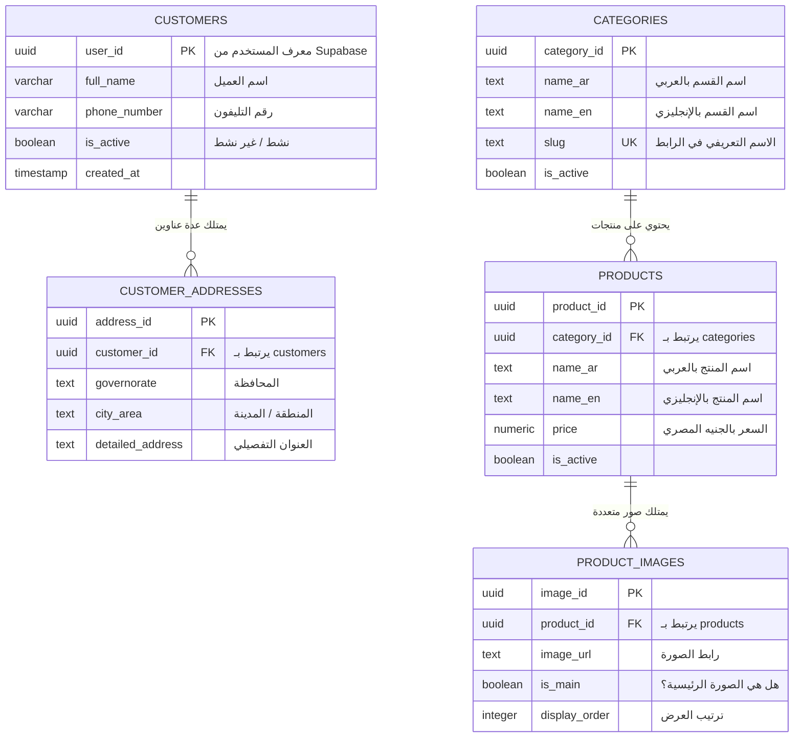

# دليل مشروع VARELLION الشامل وخارطة الطريق للمطور

> **اسم المشروع:** VARELLION Accessories E-Commerce Platform  
> **الإصدار الحالي:** 0.1.0 (مرحلة التأسيس وضبط الأمان)  
> **نوع الملف:** الدليل المرجعي الشامل للمشروع (Project Guide & Roadmap)  
> **لغة التوثيق:** عامية مصرية مبسطة مع مصطلحات تقنية بالإنجليزية  

---

## أ. ملخص تنفيذي سريع (Executive Summary)

### 1. إيه هو مشروع VARELLION؟
متجر إلكتروني مصري متخصص في بيع إكسسوارات الموبايل الرجالية والإلكترونية الراقية (ساعات، محافظ، كروت، كابلات، وشواحن). المتجر مصمم ليعمل بواجهتين: **عربي (RTL)** كأساس، و**إنجليزي (LTR)**، مع التعامل بالجنيه المصري (**EGP**).

### 2. مين اللي هيستخدم النظام؟
1. **العميل (Customer / Guest):** يقدر يتصفح المنتجات والأقسام، يضيف للسلة، ويعمل طلب كـ "زائر" (Guest Checkout) بدون إجبار على إنشاء حساب، ثم يكمل تأكيد الطلب مع خدمة العملاء عبر **واتساب (WhatsApp Handoff)** مع الدفع عند الاستلام (**Cash on Delivery - COD**).
2. **مدير المتجر (Admin):** حساب وحيد في المرحلة الأولى (مع قابلية التوسع لاحقاً)، يدخل عبر صفحة سرية محمية (بإيميل وكلمة سر أو عبر Google Sign-In المعتمد) لإدارة المنتجات، الصور، الأسعار، المخزون، محافظات الشحن، ومتابعة الطلبات.

### 3. إيه هي التكنولوجيات الأساسية؟
- **الواجهة (Frontend):** مخطط لها بـ Next.js (App Router)، React، TypeScript، و Tailwind CSS (لم يتم إنشاؤها في الكود الفعلي بعد).
- **الباك إند (Backend):** مبني ومجهز بـ Java 17 و Spring Boot 3.3.4 (معمارية Modular Monolith).
- **قاعدة البيانات (Database):** PostgreSQL سحابية مستضافة على **Supabase**.
- **المصادقة والأمان (Security):** Spring Security 6.x كـ OAuth2 Resource Server مربوط بـ **Supabase Auth**.

### 4. إحنا واقفين فين دلوقتي في التطوير؟
- **تم إنجازه بنجاح وموثق:**
  1. توثيق شامل لكل متطلبات البراند والشاشات وقواعد العمل وقواعد البيانات (12 ملف Markdown).
  2. ضبط بنية الـ Backend الأساسية وملف `pom.xml` وإعدادات الاتصال بالسيرفر السحابي لـ Supabase.
  3. بناء واختبار طبقة أمان كاملة (**Spring Security 6.x**) بنسبة نجاح 100% (20 اختبار آلي ناجح).
  4. تأمين مستودع Git بملفات `.gitignore` صارمة تمنع تسريب ملفات الأسرار `.env`.
- **أهم ما ينقص المشروع حالياً:**
  1. إنشاء كود البزنس الداخلي للـ Backend (المنتجات، الأقسام، السلة، الأوردرات).
  2. إنشاء مشروع الـ Frontend (Next.js) وربطه بالـ Backend.
  3. تنفيذ ملفات ترحيل قاعدة البيانات (Migrations) على قاعدة بيانات Supabase الحقيقية.

---

## ب. لوحة حالة المشروع الحالية (Project Status Dashboard)

| المنطقة البرمجية (Feature) | الحالة الحالية (Current Status) | ما هو موجود بالفعل (What Exists) | ما هو ناقص ومطلوب (What Is Missing) | الأولوية (Priority) |
| :--- | :--- | :--- | :--- | :--- |
| **الفرونت إند (Frontend & UI)** | ⏳ مخطط فقط (Not Started) | مواصفات تفصيلية كاملة في ملفات `02` و `04`. | تهيئة مشروع Next.js وبناء الصفحات والمكونات. | 🔴 عالية جداً |
| **معمارية الأمان (Spring Security)** | ✅ مكتمل ومختبر (Verified) | `SecurityConfig`, `JwtDecoder`, `SecurityUser`, أمان المسارات والـ CORS و 20 اختبار ناجح. | ربط المفاتيح الحقيقية للـ Production في `.env`. | 🟢 مكتمل |
| **قاعدة البيانات (Database)** | 🟡 جزئي (Partially Implemented) | الاتصال بالسيرفر جاهز، وملفات SQL أولية موجودة في `db/migration`. | تصحيح تسمية ملفات Flyway، وتطبيق الجداول فعلياً على Supabase. | 🔴 عالية جداً |
| **حسابات العملاء وتسجيل الدخول** | ✅ جاهز في الأمان، مؤجل في البزنس | المصادقة عبر Supabase JWT جاهزة في الباك إند، بينما البزنس يعتمد Guest Checkout. | ربط تسجيل الدخول في الواجهة الأمامية إن طُلب مستقبلاً. | 🟡 متوسطة |
| **دخول الأدمن و Google Sign-In** | 🟡 مكتمل في الأمان، ينقصه الـ Controller | فلترة الصلاحيات وتأمين إيميل الأدمن المعتمد جاهز في `SupabaseJwtAuthConverter`. | إضافة شاشة Login للأدمن في الفرونت إند، و API للـ Logout/Session. | 🟠 عالية |
| **كتالوج المنتجات والأقسام** | ⏳ مواصفات فقط (Specs Only) | جداول SQL موجودة في ملف الهجرة `V2`، والبيانات المبدئية في ملف `06`. | كتابة كلاسات الجافا (Entity, Repository, Service, Controller). | 🔴 عالية جداً |
| **السلة وإنشاء الطلبات (Cart & Orders)** | ⏳ مواصفات فقط (Specs Only) | مواصفات دورة الطلب في ملف `08`. ملف هجرة السلة فارغ. | بناء جدول الطلبات وجدول عناصر السلة وكود الـ APIs. | 🔴 عالية جداً |
| **المخزون وحجز الـ 24 ساعة** | ⏳ مواصفات فقط (Specs Only) | قواعد الحجز التلقائي وإلغاء الحجز موثقة في ملف `08`. | كود الـ Scheduler وحسابات الكميات في الجافا. | 🟠 عالية |
| **الشحن والمحافظات المصرية** | ⏳ مواصفات فقط (Specs Only) | قواعد تسعير الـ 27 محافظة موثقة في ملف `03` و `08`. | جدول `shipping_rates` وكود احتساب مصاريف الشحن. | 🟡 متوسطة |
| **رفع الصور (Cloudinary)** | ⏳ مخطط وموثق | هيكل الـ Interface وشروط الحماية موثقة في ملف `08` و `10`. | إضافة مكتبة Cloudinary SDK وعمل الـ Service الخاصة بها. | 🟡 متوسطة |
| **الاختبارات الآلية (Testing)** | 🟡 جزئي (Security Tests Only) | 20 اختبار وحدة وتكامل للأمان تعمل بنجاح في `VarellionSecurityIntegrationTest`. | اختبارات الـ Business Logic للمنتجات والأوردرات بعد كتابتها. | 🟠 عالية |
| **الاستضافة والـ Deployment** | ⏳ لم تبدأ (Not Started) | الاتصال بـ Supabase جاهز. سيرفر استضافة الباك إند والفرونت لم يُحدد بعد. | اختيار السيرفر وإعداد خطة الإنتاج (CI/CD, Docker). | 🔵 لاحقاً |

---

## ج. كيف يعمل المشروع؟ (How the Project Works)

المشروع مبني ليعمل بنظام معزول وآمن: الفرونت إند شغال في مساره، والباك إند بيخدم كـ **REST API**، وقاعدة البيانات بتخزن البيانات الموثوقة.

### سيناريو واقعي لرحلة زائر يشتري منتج:
1. **الزائر يفتح الموقع:** المتصفح يطلب صفحة المنتجات من Next.js.
2. **الواجهة تطلب البيانات:** الفرونت إند يبعت طلب `GET /api/v1/products` للباك إند (مسار عام لا يحتاج تسجيل دخول).
3. **الباك إند يرد:** يفحص الـ Security Filter Chain، يسمح بالطلب، يقرأ المنتجات من PostgreSQL في Supabase، ويرجعها كـ JSON.
4. **العميل يضيف للسلة ويطلب:** يملأ اسمه ورقمه ومحافظته وعنوانه ويدوس "تأكيد الطلب".
5. **الباك إند يسجل الأوردر:** يستلم الطلب عبر `POST /api/v1/orders`، يحسب الأسعار من قاعدة البيانات بنفسه (لا يثق في أسعار المتصفح)، يحجز المخزون لمدة 24 ساعة، ويحفظ الطلب برقم فريد (مثلاً `VAR-2026-1001`).
6. **التحويل لواتساب:** الفرونت إند يستلم رقم الطلب ويفتح رابط واتساب مجهز مسبقاً برسالة ملخصة ليتحدث العميل مع خدمة العملاء.
7. **لوحة تحكم الأدمن:** يدخل الأدمن بحسابه المعتمد (`admin@varellion.com`)، يرسل المتصفح ترويسة `Authorization: Bearer <JWT>`، الباك إند يفك تشفير التوكن ويتأكد أنه أدمن، ويفتح له شاشة تأكيد الشحن وتعديل الأسعار.

```mermaid
flowchart TD
    subgraph Client_Layer ["طبقة العميل والواجهة (Client & Browser)"]
        Guest["عميل زائر (بدون تسجيل)"]
        AdminUser["مدير المتجر (Admin)"]
        Frontend["Next.js Storefront & Admin UI"]
    end

    subgraph Security_Gate ["بوابة أمان الباك إند (Spring Security Filter Chain)"]
        CORS["1. فحص الـ CORS والترويسات"]
        RouteMatch{"2. نوع المسار؟"}
        JwtEngine["3. فحص التوكن المشفر وتحديد الصلاحية<br/>(SupabaseJwtAuthConverter)"]
    end

    subgraph Business_Backend ["طبقة منطق العمل (Spring Boot Backend)"]
        PublicCatalog["APIs المنتجات العامة (/api/v1/products)"]
        OrderService["خدمة تسجيل الطلبات وحجز المخزون"]
        AdminDashboard["خدمات الإدارة المحمية (/api/v1/admin/**)"]
    end

    subgraph Cloud_Data ["السحابة وقاعدة البيانات (Supabase & Cloudinary)"]
        SupabaseAuth["Supabase Auth (إصدار الـ Tokens ومصادقة Google)"]
        PostgresDB[("PostgreSQL Database (المنتجات، المخزون، الطلبات)")]
        CloudinaryMedia["Cloudinary (تخزين صور الإكسسوارات)"]
    end

    Guest -->|1. تصفح وإتمام الطلب| Frontend
    AdminUser -->|1. تسجيل دخول الأدمن| SupabaseAuth
    SupabaseAuth -->>|2. استلام JWT| AdminUser
    AdminUser -->|3. طلبات لوحة التحكم مع Bearer Token| Frontend

    Frontend --> CORS
    CORS --> RouteMatch

    RouteMatch -->|مسار عام (Public)| PublicCatalog
    RouteMatch -->|مسار طلب أوردر زائر| OrderService
    RouteMatch -->|مسار أدمن محمي| JwtEngine

    JwtEngine -->|أدمن موثق ROLE_ADMIN| AdminDashboard
    JwtEngine -->|غير موثق أو عميل عادي| Reject["رفض الطلب 401 أو 403"]

    PublicCatalog --> PostgresDB
    OrderService --> PostgresDB
    AdminDashboard --> PostgresDB
    AdminDashboard -.-> CloudinaryMedia
```

---

## د. التكنولوجيات الحالية في المشروع مشروحة ببساطة (Technologies Explained Simply)

| التقنية (Technology) | مكان استخدامها | ليه المشروع محتاجها؟ | إيه اللي لازم تفهمه عنها كمبتدئ؟ |
| :--- | :--- | :--- | :--- |
| **Java 17 LTS** | لغة الباك إند الأساسية | لغة قوية وسريعة ومستقرة ومناسبة للأنظمة المالية والتجارية الكبيرة. | إصدار حديث وطويل الدعم، يدعم ميزات حديثة مثل الـ Records والـ Pattern Matching. |
| **Spring Boot 3.3.4** | إطار عمل الباك إند | يريحك من كتابة إعدادات السيرفر يدوياً، ويوفر بيئة متكاملة جاهزة للإنتاج. | زي "محرك السيارة"؛ بيشغل خادم Tomcat داخلي ويدير إنشاء الكائنات (Beans) تلقائياً. |
| **Spring Security 6.x** | نظام الحماية والأمان | حماية مسارات الموقع، التحقق من التوكنات، ومنع اختراق البيانات وعزل المستخدمين. | عبارة عن سلسلة حراس (Filter Chain) بتفتش كل طلب قبل ما يوصل لأي Controller. |
| **OAuth2 Resource Server** | داخل Spring Security | للتحقق من التوكنات (JWT) الصادرة من Supabase بدون الحاجة لكتابة كود فك تشفير يدوي. | بيخلي الباك إند بتاعك يثق في التوكنات اللي جاية من Supabase فقط لو التوقيع الرقمي صحيح. |
| **Nimbus JOSE + JWT** | معالجة الـ JWT | مكتبة تشفير بتفحص توقيع الـ Token وتتأكد إنه مش متزور ومش منتهي. | بتفك التوكن وتطلع الـ Claims (بيانات المستخدم زي الـ ID والإيميل) بشكل آمن تماماً. |
| **Spring Data JPA & Hibernate** | طبقة التعامل مع قاعدة البيانات | بتخليك تتعامل مع جداول قاعدة البيانات كأنها كلاسات Java عادية (Entities). | بدل ما تكتب `SELECT * FROM products` يدوي في كل مكان، الـ Repository بيعملها بدالة بسيطة. |
| **PostgreSQL (Supabase)** | قاعدة البيانات السحابية | لتخزين المنتجات، الأسعار، الطلبات، والعملاء بدقة شديدة ودعم الـ Constraints. | داتابيز علائقية (Relational DB) قوية جداً بتمنع الأخطاء الحسابية والمخزون السالب. |
| **Flyway** | إدارة ترحيل الجداول (Migrations) | لإنشاء وتعديل الجداول بكود SQL منظم ومرقم، بحيث كل أعضاء الفريق يكون عندهم نفس الداتابيز. | بدل ما تعمل الجداول من الـ Dashboard بالماوس، بتكتب ملفات مرقمة (`V1`, `V2`) والـ Flyway ينفذها أول ما السيرفر يشتغل. |
| **Lombok** | كتابة الكود | يقلل كتابة الكود المكرر مثل الـ Getters والـ Setters والـ Constructors عبر Annotations. | بتكتب `@Getter` فوق الكلاس فـ Lombok يولد كل دوال الجلب تلقائياً بدون زحمة في الملف. |
| **H2 Database (In-Memory)** | بيئة الاختبارات (Test Scope فقط) | قاعدة بيانات سريعة بتشتغل في الرام وقت تشغيل الاختبارات بدون الحاجة للاتصال بالإنترنت. | بتنشأ أول ما تكتب `mvn test` وتتدمر أول ما الاختبارات تخلص، عشان تحافظ على نظافة الداتابيز الحقيقية. |
| **Maven** | إدارة المشروع والـ Dependencies | بيحمل كل المكتبات المطلوبة من الإنترنت، ويترجم الكود (Compile) ويشغل الاختبارات ويخرج ملف الـ JAR. | هو مدير الحزم، ملف `pom.xml` هو قايمة الطلبات اللي Maven بينزلها ويبني المشروع بناءً عليها. |

---

## هـ. أهم الملفات والمجلدات ودورها (Important Files and Folders)

### 1. ملفات الأمان والحماية (`backend/src/main/java/com/varellion/store/security/`):
- **[`SecurityConfig.java`](file:///home/mohamed-saad/Desktop/براند/backend/src/main/java/com/varellion/store/security/SecurityConfig.java):**  
  *الدور:* الملف الرئيسي لإعدادات الحماية؛ يحدد أن مسارات الكتالوج عامة ومسارات الأدمن محمية برتبة `ROLE_ADMIN`، ويفرض ترويسات الأمان المشددة.  
  *الاعتمادية:* كل طلب وارد للموقع يمر عليه أولاً.
- **[`SupabaseJwtAuthenticationConverter.java`](file:///home/mohamed-saad/Desktop/براند/backend/src/main/java/com/varellion/store/security/SupabaseJwtAuthenticationConverter.java):**  
  *الدور:* يقرأ توكن Supabase ويستخرج الـ UUID، ويفحص إيميل الأدمن المعتمد ليعطيه رتبة الأدمن، ويعطي رتبة الزائر لباقي المستخدمين.  
  *الاعتمادية:* يعتمد عليه `SecurityConfig` لمعرفة هوية وصلاحية صاحب التوكن.
- **[`SecurityUser.java`](file:///home/mohamed-saad/Desktop/براند/backend/src/main/java/com/varellion/store/security/SecurityUser.java):**  
  *الدور:* الكائن الذي يمثل المستخدم الموثق داخل الكود ويحتوي على الـ `id`, `email`, و الأدوار.  
  *الاعتمادية:* يستخدمه المطور داخل الكنترولر لجلب بيانات المستخدم الحالي: `@AuthenticationPrincipal SecurityUser user`.
- **[`SecurityUtils.java`](file:///home/mohamed-saad/Desktop/براند/backend/src/main/java/com/varellion/store/security/SecurityUtils.java):**  
  *الدور:* كلاس مساعد وثابت لقراءة المستخدم الحالي والتحقق هل هو أدمن من أي مكان في الكود دون تكرار.
- **[`JwtDecoderConfig.java`](file:///home/mohamed-saad/Desktop/براند/backend/src/main/java/com/varellion/store/security/JwtDecoderConfig.java):**  
  *الدور:* يقوم بفحص التوقيع الرقمي للتوكن والتأكد من تاريخ الصلاحية باستخدام مفاتيح Supabase المشفرة.
- **[`CorsConfig.java`](file:///home/mohamed-saad/Desktop/براند/backend/src/main/java/com/varellion/store/security/CorsConfig.java):**  
  *الدور:* يسمح للفرونت إند المعتمد فقط بالتواصل مع الباك إند ويمنع المواقع الخارجية.
- **[`CustomAuthenticationEntryPoint.java`](file:///home/mohamed-saad/Desktop/براند/backend/src/main/java/com/varellion/store/security/CustomAuthenticationEntryPoint.java) و [`CustomAccessDeniedHandler.java`](file:///home/mohamed-saad/Desktop/براند/backend/src/main/java/com/varellion/store/security/CustomAccessDeniedHandler.java):**  
  *الدور:* إرجاع رسائل أخطاء JSON موحدة ونظيفة (401 و 403) بدون إظهار أي أخطاء داخلية للعميل.

### 2. ملفات الإعدادات والبيئة (`backend/`):
- **[`application.properties`](file:///home/mohamed-saad/Desktop/براند/backend/src/main/resources/application.properties):**  
  *الدور:* ملف إعدادات السيرفر؛ يحتوي على رابط داتابيز Supabase، واسم المستخدم، وإعدادات Flyway، وإعدادات توكنات Supabase.
- **[`.env`](file:///home/mohamed-saad/Desktop/براند/backend/.env) و [`.env.example`](file:///home/mohamed-saad/Desktop/براند/backend/.env.example):**  
  *الدور:* ملف البيئة المحلي الذي تضع فيه كلمة سر قاعدة البيانات وأسرار التوكن دون رفعها على GitHub.
- **[`.gitignore`](file:///home/mohamed-saad/Desktop/براند/.gitignore):**  
  *الدور:* يحمي المشروع من رفع أي ملفات سرية أو ملفات مؤقتة (`target/`, `.env`).

### 3. ملفات ترحيل قاعدة البيانات (`backend/src/main/resources/db/migration/`):
- **[`V1__create_customers_and_addresses.sql`](file:///home/mohamed-saad/Desktop/براند/backend/src/main/resources/db/migration/V1__create_customers_and_addresses.sql):**  
  *الدور:* ينشئ جدول العملاء `customers` وجدول العناوين `customer_addresses`.
- **[`V2__create_categories.sql`](file:///home/mohamed-saad/Desktop/براند/backend/src/main/resources/db/migration/V2__create_categories.sql):**  
  *الدور:* ينشئ جدول الأقسام `categories` وجدول المنتجات `products` وجدول صور المنتجات `product_images`.

### 4. ملفات التوثيق القياسية (في روت المشروع):
- **`00_VARELLION_MASTER_BUILD_PROMPT.md` إلى `10_VARELLION_EXTERNAL_SERVICES_SETUP.md`:**  
  *الدور:* الملفات المرجعية الأساسية لمواصفات وتصميم البراند والشاشات والداتابيز والـ APIs.

---

## و. قاعدة البيانات مشروحة ببساطة (Database Explained Simply)

قاعدة البيانات الحالية في ملفات الـ SQL مصممة لدعم متجر VARELLION مع الحفاظ على سلامة البيانات العلائقية:

### 1. الجداول الموجودة في ملفات الـ SQL الحالية:
1. **`customers` (جدول العملاء):**  
   يرتبط مباشرة بجدول المستخدمين في Supabase (`auth.users`) عبر `user_id UUID`. يحفظ الاسم الكامل ورقم التليفون وحالة التفعيل.
2. **`customer_addresses` (جدول العناوين):**  
   يرتبط بجدول العملاء (`ON DELETE CASCADE`). يحفظ المحافظة، المدينة، والعنوان بالتفصيل لكل عميل.
3. **`categories` (جدول الأقسام):**  
   يحفظ اسم القسم بالعربي والإنجليزي (`name_ar`, `name_en`)، والـ `slug` الفريد (مثل `smart-watches`)، مع تريجر أوتوماتيكي لتحديث حقل `updated_at`.
4. **`products` (جدول المنتجات):**  
   يرتبط بجدول الأقسام (`category_id`) ولا يسمح بحذف القسم إذا كان بداخله منتجات (`ON DELETE RESTRICT`). يحفظ الاسم والوصف باللغتين وسعر المنتج.
5. **`product_images` (جدول صور المنتجات):**  
   يحفظ روابط الصور وموقعها وترتيب العرض، مع فهرس فريد (`UNIQUE INDEX`) يضمن وجود **صورة رئيسية واحدة فقط لكل منتج**.

### 2. العلاقات بين الجداول (ER Diagram):



> [!WARNING]
> **ملاحظة أمان وتدقيق هامة على ملفات الـ SQL:**
> 1. ملفات الهجرة المكتوبة حتى الآن تشمل فقط العملاء، الأقسام، المنتجات، والصور. **جداول الطلبات (`orders`), عناصر الطلب (`order_items`), السلة (`carts`), المخزون (`inventory_items`), وأسعار المحافظات (`shipping_rates`) لم تُكتب ملفات الـ SQL الخاصة بها بعد**.
> 2. يوجد ملف فارغ بحجم 0 بايت اسمه [`003_carts_and_cart_items.sql.sql`](file:///home/mohamed-saad/Desktop/براند/backend/src/main/resources/db/migration/003_carts_and_cart_items.sql.sql) بامتداد مزدوج ولا يتبع تسمية Flyway القياسية (`V3__...`)؛ يجب حذفه أو تصحيح اسمه عند بناء السلة.
> 3. هذه الجداول **لم يتم تطبيقها على سيرفر Supabase السحابي بعد** بانتظار إدخال كلمة السر وتشغيل أول هجرة رسمية.

---

## ز. الأمان والمصادقة (Authentication and Security)

المشروع يعتمد على نموذج أمان فائق الحماية:

1. **التحقق من الهوية (Authentication):**
   - العميل العادي يتسوق كزائر (`Guest`) دون الحاجة لأي تسجيل دخول.
   - إذا تم تسجيل الدخول (أدمن أو عميل)، يتم ذلك في الواجهة الأمامية عبر **Supabase Auth** (مباشرة أو عبر Google OAuth).
   - بعد نجاح الدخول، يصدر Supabase توكن مشفر (`Access Token / JWT`) يحمله المتصفح في كل استدعاء للباك إند.
2. **دور الباك إند (Spring Security Resource Server):**
   - الباك إند **لا يخزن كلمات سر المستخدمين** و **لا ينشئ توكنات**؛ بل يتحقق تشفيرياً من توكن Supabase باستخدام المفاتيح العامة (JWKS) أو الـ JWT Secret.
   - يتأكد الباك إند من تاريخ انتهاء التوكن ومن أن جهة الإصدار (`Issuer`) تطابق مشروع VARELLION.
3. **توزيع الصلاحيات (Authorization):**
   - أي توكن سليم يحصل على دور `ROLE_USER`.
   - لا يحصل أي مستخدم على دور الأدمن `ROLE_ADMIN` إلا إذا كان إيميله موجوداً في قائمة الأدمن المعتمدة المشفرة في ملف البيئة (`ADMIN_EMAILS`) وشرط أن يكون الإيميل موثقاً من Google (`email_verified = true`).
4. **حماية عزل بيانات العملاء (IDOR Protection):**
   - تم تفعيل حماية تمنع أي عميل من التلاعب وتعديل معرف العميل في الرابط لرؤية بيانات شخص آخر:
     `@PreAuthorize("#userId == authentication.principal.id or hasRole('ADMIN')")`
     العميل لا يستطيع فتح إلا موارده الخاصة، بينما الأدمن فقط يملك حق الإشراف.

---

## ح. مسار الـ APIs والتواصل مع الفرونت إند (API & Frontend Flow)

### المسارات الموجودة حالياً في الباك إند (عبر `SecurityTestController` و `SecurityConfig`):

| الرابط (Endpoint) | الطريقة (Method) | الصلاحية المطلوبة | ما يرسله العميل | ما يرجعه السيرفر (Response) | الغرض منه |
| :--- | :--- | :--- | :--- | :--- | :--- |
| `/api/v1/public/ping` | `GET` | عام للجميع (PermitAll) | لا شيء | `{"status": "ok"}` | فحص اتصال الواجهة بالباك إند |
| `/actuator/health` | `GET` | عام للجميع | لا شيء | `{"status": "UP"}` | فحص جاهزية السيرفر |
| `/api/v1/user/me` | `GET` | مسجل دخول (ROLE_USER) | ترويسة Bearer Token | بيانات المستخدم (UUID، الإيميل، الصلاحيات) | استرجاع البروفايل |
| `/api/v1/user/items/{userId}` | `GET` | صاحب الحساب أو الأدمن | ترويسة Bearer Token | بيانات العنصر المطلوب | إثبات الحماية من ثغرات الـ IDOR |
| `/api/v1/admin/dashboard` | `GET` | أدمن فقط (ROLE_ADMIN) | ترويسة Bearer Token للأدمن | `{"message": "Admin dashboard data"}` | حماية لوحة التحكم |

### كيف يتم التعامل مع الأخطاء؟
لو الطلب تم برفض أو خطأ، يرجع الباك إند كائن `ErrorResponse` موحد بدلاً من صفحات الـ HTML المزعجة:
```json
{
  "timestamp": "2026-10-18T13:20:00Z",
  "status": 401,
  "error": "Unauthorized",
  "message": "Full authentication is required to access this resource.",
  "path": "/api/v1/admin/dashboard"
}
```

---

## ط. ماذا فعل الذكاء الاصطناعي في المشروع بالضبط؟ (What Has the AI Actually Done?)

بناءً على تاريخ المحادثات وتتبع الملفات وسجلات الفحص في المستودع:

1. **توحيد اسم البراند:** تم تصحيح واستبدال أسماء قديمة مثل (ZELVIX و AVELTRYN) وتثبيت اسم البراند الحقيقي **VARELLION** في جميع ملفات التوثيق الـ 12.
2. **تنظيف الكود القديم بطلبك:** تم مسح كود الجافا التجريبي القديم بالكامل للحفاظ على رغبتك في كتابة وتنظيم الكود بأسلوبك.
3. **تأسيس معمارية الأمان الرسمية (Spring Security 6.x):**
   - تم إنشاء حزمة أمان متكاملة مطابقة لأعلى المعايير (`SecurityConfig`, `JwtDecoderConfig`, `SupabaseJwtAuthenticationConverter`, `SecurityUser`, `CustomAuthenticationEntryPoint`, `CustomAccessDeniedHandler`, `CorsConfig`).
   - تم حل مشكلة شائعة تم اكتشافها في ملفات فحص الأمان (وهي ابتلاع أخطاء الـ 403 بواسطة معالج الأخطاء) عبر كلاس [`GlobalExceptionHandler.java`](file:///home/mohamed-saad/Desktop/براند/backend/src/main/java/com/varellion/store/common/exception/GlobalExceptionHandler.java).
4. **تأمين مستودع Git:** تم إنشاء ملف [`.gitignore`](file:///home/mohamed-saad/Desktop/براند/.gitignore) شامل في الروت لحجب ملفات `.env` ومجلدات الـ `target/` لضمان عدم تسريب أي أسرار عند عمل `git push`.
5. **كتابة وتشغيل 20 اختبار أمان آلي:**
   - تم إنشاء اختبارات تكاملية [`VarellionSecurityIntegrationTest.java`](file:///home/mohamed-saad/Desktop/براند/backend/src/test/java/com/varellion/store/security/VarellionSecurityIntegrationTest.java) واختبارات وحدة [`SupabaseJwtAuthenticationConverterTest.java`](file:///home/mohamed-saad/Desktop/براند/backend/src/test/java/com/varellion/store/security/SupabaseJwtAuthenticationConverterTest.java).
   - تم تشغيل الاختبارات عبر Maven ونجحت جميعها بنسبة 100% (`BUILD SUCCESS`).
6. **ما لم يتم تنفيذه بعد (غير مكتمل):**
   - كود منطق العمل (Business Logic) للأقسام والمنتجات والأوردرات لم يتم تنفيذه حتى الآن.
   - مشروع الفرونت إند لم يتم إنشاؤه بعد.

---

## ي. المشاكل والمخاطر التقنية مرتبة حسب خطورتها (Problems and Technical Risks)

### 🔴 خطيرة جداً (Critical):
1. **ملف هجرة خاطئ وفارغ في الـ Migrations:**  
   - *الملف:* [`backend/src/main/resources/db/migration/003_carts_and_cart_items.sql.sql`](file:///home/mohamed-saad/Desktop/براند/backend/src/main/resources/db/migration/003_carts_and_cart_items.sql.sql)  
   - *الدليل:* الملف حجمه 0 بايت وامتداده مكرر (`.sql.sql`) ولا يتبع نمط Flyway (`V3__...`).  
   - *الخطر:* إذا تم تشغيل السيرفر وقاعدة البيانات متصلة، سيتوقف Flyway عن العمل ويفشل تشغيل السيرفر فوراً.  
   - *الحل:* حذف هذا الملف أو كتابة محتواه وتسميته `V3__create_carts_and_cart_items.sql`.

### 🟠 متوسطة (Medium):
2. **تجاوز الـ Row Level Security (RLS) في اتصال الباك إند:**  
   - *الدليل:* الباك إند يتصل بـ Supabase باستخدام مستخدم `postgres` الخارق (Superuser)، مما يتجاوز سياسات الـ RLS الموجودة على الجداول تلقائياً.  
   - *التأثير:* إذا أخطأ المطور في كتابة كويري ولم يحدد `WHERE user_id = :id`، فقد تظهر بيانات عميل لعميل آخر.  
   - *الحل:* تم تطبيق حماية الصلاحيات في كود الجافا نفسه عبر `@PreAuthorize`، ويُنصح لاحقاً بإضافة Interceptor يمرر معرف العميل لقاعدة البيانات.
3. **غياب جداول الطلبات والشحن في الـ Migrations:**  
   - *الدليل:* مجلد `db/migration` يحتوي فقط على `V1` و `V2` (العملاء، الأقسام، المنتجات، الصور). لا توجد جداول للطلبات `orders` أو أسعار الشحن `shipping_rates`.  
   - *الحل:* كتابة ملف `V3` و `V4` للجداول المتبقية قبل كتابة كود الجافا الخاص بها.

### 🟡 منخفضة (Low):
4. **تعدد جداول في ملف هجرة واحد (`V2`):**  
   - *الدليل:* ملف `V2__create_categories.sql` ينشئ الأقسام والمنتجات والصور في نفس الملف.  
   - *الحل:* يفضل في المشاريع الكبيرة فصل كل موديول في ملف هجرة مستقل (`V2` للأقسام، `V3` للمنتجات، إلخ)، ولكنها حالياً صالحة برمجياً ولن تعطل المشروع.

---

## ك. ماذا يجب أن تفعل بعد ذلك؟ (What Should I Do Next?)

إليك خارطة طريق عملية ومرتبة خطوة بخطوة:

### 1. افعل الآن فوراً (Do First) — الخطوة الوحيدة الأهم:
> **الخطوة الأولى والأهم:** **تنظيم ملفات الـ SQL للـ Database (إنهاء ملفات الهجرة).**  
> *السبب:* لا يمكنك كتابة كود الجافا للمنتجات والطلبات بدون وجود الجداول السليمة في قاعدة البيانات.  
> *المطلوب:*
> 1. حذف الملف الفارغ `003_carts_and_cart_items.sql.sql`.
> 2. كتابة ملف هجرة `V3__create_orders_and_shipping.sql` لإنشاء جداول الأوردرات والشحن.
> 3. وضع كلمة سر Supabase في ملف `.env` واختبار اتصال قاعدة البيانات الحقيقية وتطبيق الهجرة.

### 2. افعل بعد ذلك (Do Next):
- **الخطوة الثانية:** كتابة موديول الكتالوج في الجافا (`modules/categories` و `modules/products`) بأسلوب الـ **Modular Monolith** (Entity, Repository, Service, Controller).
- **الخطوة الثالثة:** كتابة موديول الطلبات والشحن (`modules/orders` و `modules/shipping`) لتمكين الزائر من عمل Checkout وحجز المخزون لمدة 24 ساعة.
- **الخطوة الرابعة:** إنشاء مشروع الفرونت إند بـ **Next.js** وتوصيل صفحة عرض المنتجات بالباك إند.

### 3. افعل لاحقاً (Do Later):
- ربط خدمة **Cloudinary** لرفع صور المنتجات من لوحة تحكم الأدمن.
- تأكيد واستخراج روابط الواتساب التلقائية لخدمة العملاء.
- نشر المشروع على سيرفر استضافة حقيقي (Deployment).

---

## ل. دليل المبتدئ لفهم المصطلحات (My Beginner Learning Guide)

لكي تتابع الخطوات القادمة بسهولة، إليك أهم المفاهيم مشروحة ببساطة:

### 1. ما هو الـ Entity والـ Repository؟
- **Entity:** كلاس جافا عادي يمثل صفاً في جدول قاعدة البيانات. كل متغير فيه يمثل عموداً في الجدول (مثلاً `private String nameAr`).
- **Repository:** واجهة (Interface) جاهزة من Spring Data بتعطيك دوال فورية للتعامل مع الجدول مثل `save()`, `findById()`, و `delete()` بدون كتابة كود SQL معقد.
- *مثال:* لما نضيف منتج، بنعمل `productRepository.save(product)`.

### 2. ما هو الـ DTO ولماذا نستخدمه؟
- **DTO (Data Transfer Object):** كلاس هدفه نقل البيانات فقط بين الفرونت إند والباك إند.
- *ليه بنستخدمه؟* عشان نحمي قاعدة البيانات. لو جدول المنتج فيه 15 عمود، لكن الفرونت إند محتاج يعرض الاسم والسعر بس، بنعمل `ProductResponseDto` فيه الحقلين دول فقط، فنوفر استهلاك البيانات ونحمي بيانات السيرفر الداخلية.

### 3. ما هو الـ JWT (JSON Web Token)؟
- هو بمثابة **"كارنيه دخول إلكتروني مختوم"** يحصل عليه المستخدم لما يسجل دخوله من Supabase.
- التوكن عبارة عن نص طويل مشفر المتصفح بيبعته في ترويسة كل طلب (`Authorization: Bearer <token>`).
- السيرفر أول ما يشوف الختم بيتأكد فوراً إن المستخدم ده موثوق ومش بيحتاج يسأله عن كلمة السر في كل ضغطة زر.

---

## م. قائمة فحص الاختبارات الحالية (Testing Checklist)

| عنصر الفحص (Test Item) | الحالة الفعلية (Status) | الدليل وطريقة التحقق |
| :--- | :--- | :--- |
| هل الباك إند يقوم بالبناء بنجاح (`Build`)؟ | ✅ ناجح (Passed) | تم تشغيل `mvn clean compile` وحصلنا على `BUILD SUCCESS`. |
| هل اختبارات الأمان تعمل وتمر بالكامل؟ | ✅ ناجح (Passed) | تم تشغيل `mvn test` ومرت جميع الاختبارات الـ 20 بنجاح. |
| هل يتم رفض الطلبات غير المصرح لها (401)؟ | ✅ ناجح (Passed) | تم التحقق في `AuthenticationEnforcement.userEndpointShouldReturn401`. |
| هل يتم حجب مستخدم عادي عن لوحة الأدمن (403)؟ | ✅ ناجح (Passed) | تم التحقق في `RoleBasedAuthorization.ordinaryCustomerDeniedAccessToAdminDashboard`. |
| هل ترويسات الأمان المشددة موجودة (CSP, HSTS)؟ | ✅ ناجح (Passed) | تم التحقق في `SecurityHeaders.responsesMustIncludeHardenedSecurityHeaders`. |
| هل يتم حظر نطاقات الـ CORS غير المعتمدة؟ | ✅ ناجح (Passed) | تم التحقق في `CorsPolicy.corsPreflightFromUntrustedOriginIsBlocked`. |
| هل اتصال قاعدة البيانات السحابية الحقيقي شغال؟ | 🟡 لم يُختبر فعلياً (Not Run) | تم فحص المنفذ 6543 و 5432 ونجح الاتصال الشبكي، بانتظار إدخال كلمة السر. |
| هل تعمل الـ APIs الخاصة بالمنتجات والأوردرات؟ | ⏳ غير موجودة بعد (Not Implemented) | الكود لم يُكتب بعد. |

---

## ن. أسئلة ونقاط مجهولة يجب حسمها (Questions and Unknowns)

1. **كلمة سر قاعدة بيانات Supabase الحقيقية:**  
   - *المجهول:* كلمة السر لم تُوضع بعد في ملف `.env`.  
   - *الأهمية:* لا يمكن تشغيل الـ Migrations الفعلية على السحابة بدونها.
2. **حساب Cloudinary لتخزين الصور:**  
   - *المجهول:* هل تم إنشاء حساب Cloudinary وتجهيز الـ `API_KEY` والـ `CLOUD_NAME`؟  
   - *الأهمية:* لا يمكن رفع صور المنتجات بدون مفاتيح الخدمة.
3. **رقم الواتساب الرسمي المعتمد لخدمة العملاء:**  
   - *المجهول:* الرقم المسجل في ملف التوثيق هو `01104867352`.  
   - *الأهمية:* يجب التأكد هل هو الرقم النهائي الذي سيتم ربطه في رسائل التحويل للواتساب.

---

## س. المرجع السريع للمشروع (Quick Reference)

- **اسم المشروع:** VARELLION Accessories.
- **أمر تشغيل الاختبارات للتأكد من سلامة الكود:**
  ```bash
  mvn test -f backend/pom.xml
  ```
- **أمر تنظيف وإعادة بناء الباك إند:**
  ```bash
  mvn clean compile -f backend/pom.xml
  ```
- **أهم الملفات التي تدير النظام حالياً:**
  - الإعدادات: [`backend/src/main/resources/application.properties`](file:///home/mohamed-saad/Desktop/براند/backend/src/main/resources/application.properties)
  - الأمان: [`backend/src/main/java/com/varellion/store/security/SecurityConfig.java`](file:///home/mohamed-saad/Desktop/براند/backend/src/main/java/com/varellion/store/security/SecurityConfig.java)
  - البيئة المحلية: [`backend/.env`](file:///home/mohamed-saad/Desktop/براند/backend/.env)
- **أهم 3 مهام قادمة:**
  1. تصحيح واستكمال ملفات الـ SQL المتبقية (Orders, Cart, Shipping).
  2. كتابة كود موديول المنتجات والأقسام في الجافا (`modules/products` و `modules/categories`).
  3. إنشاء تطبيق الـ Frontend بـ Next.js.

### 💬 البرومبت الجاهز للخطوة القادمة (انسخه لأي AI للمتابعة):
```text
أنا أعمل على مشروع متجر إلكتروني VARELLION Accessories مبني بـ Spring Boot 3 و PostgreSQL (Supabase).
بنية الأمان (Spring Security OAuth2 Resource Server) مكتملة ومختبرة بنجاح بنسبة 100%.
المطلوب منك الآن كمطور Backend خبير:
1. فحص مجلد db/migration وتصحيح ملف 003_carts_and_cart_items.sql.sql وإضافة ملفات هجرة Flyway المتبقية لجدول الطلبات (orders) وأسعار الشحن (shipping_rates).
2. تجهيز كود موديول المنتجات والأقسام (modules/categories و modules/products) بمعمارية Modular Monolith (Entity, Repository, Service, Controller, DTO, Mapper) بحيث يقدم الـ APIs العامة لعرض المنتجات والأقسام.
لا تقم بتعديل أي كلاسات داخل حزمة الأمان com.varellion.store.security لأنها معتمدة ومختبرة بالكامل.
```
