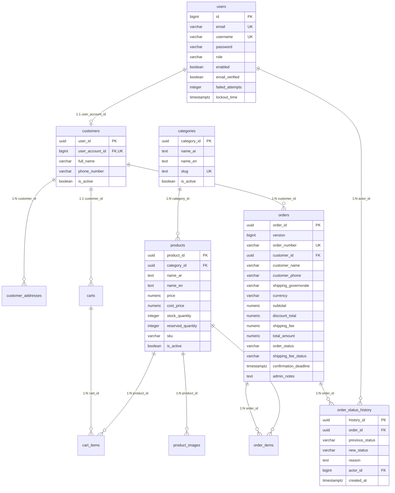

# VARELLION Admin Architecture — Audit of Existing Backend & Infrastructure

> **Document Version:** 2.0.0  
> **Status:** COMPLETED AUDIT (READ-ONLY)  
> **Audit Date:** November 2026  
> **Target System:** Spring Boot 3.3.4 / PostgreSQL 17.11 (Supabase) / Next.js 15.2.1  

---

## 1. Executive Summary & Audit Scope

This document delivers a forensic, code-level architectural audit of the VARELLION e-commerce backend with specific focus on administrative capabilities, data models, persistence boundaries, security configurations, API conventions, and test coverage.

Every finding is strictly grounded in the inspected Java source files under `backend/src/main/java/com/varellion/store/`, Flyway SQL migrations under `backend/src/main/resources/db/migration/` (`V1` through `V13`), test suites under `backend/src/test/java/`, configuration files, and frontend integration touchpoints under `frontend/src/`.

### Finding Classification Schema:
* **IMPLEMENTED:** Fully present in source code, active in runtime, backed by database schema and tests.
* **PARTIALLY IMPLEMENTED:** Scaffolded or limited to a single sub-case; lacks full lifecycle management or fine-grained capabilities.
* **MISSING:** Absent from controllers, services, repositories, or schema; requires architectural design and implementation.
* **NEEDS IMPROVEMENT:** Present and functioning, but exhibits architectural debt, race condition vulnerabilities, scalability limits, or security risks.
* **REQUIRES VERIFICATION:** Dependent on live cloud infrastructure (e.g. Supabase connection, external OAuth endpoints) that cannot be executed in offline read-only audits.

---

## 2. Forensic Audit Matrix

| Domain / Subsystem | Current Implementation in Code | Classification | Evidence & Source Files |
| :--- | :--- | :--- | :--- |
| **Admin Orders Listing** | Paginated order retrieval with status and search filtering (`page`, `limit`, `status`, `search`). | **IMPLEMENTED** | `AdminOrderController.java:41-50`, `OrderService.java:314-338`, `OrderRepository.java:36-50` (`findAdminOrders`) |
| **Admin Order Details** | Complete order details lookup by human-friendly orderNumber (`VAR-YYYYMMDD-NNNN`). | **IMPLEMENTED** | `AdminOrderController.java:53-63`, `OrderService.java:339-354`, `OrderRepository.java:20-25` |
| **Admin Order Status Transition** | State machine transition enforcement (`canTransitionTo`), optimistic locking (`@Version`), and history logging. | **IMPLEMENTED** | `AdminOrderController.java:65-94`, `OrderService.java:438-537`, `OrderStatus.java:26-52`, `Order.java:33` |
| **Admin Order Notes Update** | Dedicated endpoint to update internal administrative notes on orders without changing status. | **MISSING** | `Order.java:88` has `adminNotes`, but only written during initial order checkout. No standalone update API. |
| **Admin Order Cancellation & Stock Release** | Transition to `CANCELLED` releases reserved stock atomically. | **IMPLEMENTED** | `OrderService.java:500-520` |
| **Admin Dashboard Analytics** | Aggregate metrics (revenue, order counts by status, customer counts, low stock alerts, trends). | **MISSING** | No controller or service methods calculate administrative KPIs. Root `/admin` frontend redirects to `/admin/orders`. |
| **Product CRUD & Lifecycle** | Creating, updating, deleting (or soft-deleting), archiving, and toggling product status. | **MISSING** | `ProductController.java` is read-only (`GET /api/products`, `GET /api/products/{id}`). Zero write endpoints exist. |
| **Inventory Stock Adjustment** | Manual adjustment of stock quantities, stock audit logs, and stock movement tracking. | **MISSING** | `Product.java:54-58` has `stockQuantity` and `reservedQuantity`, but mutations only occur through checkout reservations. |
| **Product Image Management** | Uploading images, reordering gallery, setting thumbnail/main image. | **MISSING** | `ProductImage.java` exists, but no admin endpoints exist to mutate or upload images. |
| **Category CRUD & Reordering** | Creating, editing, archiving categories, or checking active product dependencies before deletion. | **MISSING** | `CategoryController.java` only exposes public `GET /api/categories` and `GET /api/categories/{slug}`. |
| **Customer Management** | Listing customer directory, viewing spending totals, viewing customer order history, blocking accounts. | **MISSING** | `CustomerController.java` only provides self-service profile endpoints (`/api/customer/profile`) for authenticated customers. |
| **Shipping Zones & Rates** | Modifying shipping fees, enabling/disabling regions, configuring delivery durations. | **MISSING / HARDCODED** | Shipping rates are hardcoded in `OrderService.java:106-129` (50, 60, 65, 75, 85 EGP). No database table or API exists. |
| **Discounts & Coupons Engine** | Promo codes, percentage/fixed discounts, usage limits, expiration dates. | **MISSING** | `Order.java:65` has `discountTotal` column, but defaults to `0.00`. No coupon tables, entities, or calculation services exist. |
| **Store Settings Management** | Configuring contact phone, WhatsApp URL, free shipping threshold, maintenance mode. | **MISSING / HARDCODED** | Settings are hardcoded in `application.properties` (`varellion.store.*`) and frontend env vars. No admin management API. |
| **Admin User Management** | Creating staff accounts, resetting admin passwords, managing roles. | **MISSING** | Admin accounts can only be provisioned via database seed or by logging in with an email in the `ADMIN_EMAILS` env var. |
| **Fine-Grained RBAC** | Granular permissions (e.g. `orders:read`, `products:update`, `admins:manage`). | **MISSING** | System only recognizes binary roles: `ROLE_USER` and `ROLE_ADMIN` in `User.role VARCHAR(20)`. No permission authorities exist. |
| **System-Wide Audit Logging** | Immutable tracking of administrative modifications across products, inventory, settings, and users. | **PARTIALLY IMPLEMENTED** | `order_status_history` tracks order status changes, but no general audit logging exists for products, stock, or settings. |
| **Customer Support / Inquiries** | Managing customer inquiries, complaints, and contact logs. | **MISSING** | No database tables or endpoints exist for customer support tickets or inquiry routing. |
| **Automated Notifications** | Outbound SMS / WhatsApp order confirmations or admin operational alerts. | **MISSING** | Persisted to DB only; no SMS or WhatsApp gateway client exists in the backend code. |
| **Error Handling & Normalization** | Centralized REST error envelopes (`ErrorResponse`) with HTTP status mapping. | **IMPLEMENTED** | `GlobalExceptionHandler.java:26-217`, `ErrorResponse.java:1-27` |
| **Response Enveloping** | Uniform success responses (`ApiResponse<T>`). | **IMPLEMENTED** | `ApiResponse.java:1-43` |
| **Optimistic Concurrency Control** | Versioning to prevent lost updates during concurrent edits. | **PARTIALLY IMPLEMENTED** | `Order.java:33` has `@Version Long version` (added in Flyway `V12`). `Product.java` and `Category.java` lack `@Version`. |
| **Pessimistic Concurrency Control** | Deadlock-free inventory reservation during checkout. | **IMPLEMENTED** | `OrderService.java:158-182`, `ProductRepository.java:25-27` (`findByIdForUpdate` with ascending sort). |

---

## 3. Deep-Dive Subsystem Audits

### 3.1 Existing Admin Capabilities & Endpoints

Currently, administrative endpoints are strictly isolated within a single controller:
* **Controller Class:** `com.varellion.store.admin.order.controller.AdminOrderController`
* **Base Path:** `/api/admin/orders`
* **Security Annotation:** `@PreAuthorize("hasRole('ADMIN')")`
* **Protection Rule:** `SecurityConfig.java:70` (`.requestMatchers("/api/admin/**").hasRole("ADMIN")`)

#### Implemented Endpoints:
1. `GET /api/admin/orders`
   - **Parameters:** `page` (default 0), `limit` (default 10), `status` (`OrderStatus` enum, optional), `search` (String, optional).
   - **Service Method:** `OrderService.getAdminOrders(page, limit, status, search)`
   - **Database Query:** `OrderRepository.findAdminOrders(status, search, pageable)`
   - **Query Mechanism:** Custom JPQL query matching `LOWER(o.orderNumber)`, `o.customerPhone`, or `LOWER(o.customerName)` with `ORDER BY o.createdAt DESC`.
   - **Response:** `ApiResponse<PagedOrdersResponse>` containing `orders`, `totalElements`, `totalPages`, `currentPage`, `pageSize`.

2. `GET /api/admin/orders/{orderNumber}`
   - **Parameters:** `orderNumber` with validation regex `^VAR-\d{8}-\d{4}$`.
   - **Service Method:** `OrderService.getAdminOrderByNumber(orderNumber)`
   - **Database Query:** `OrderRepository.findByOrderNumberWithDetails(orderNumber)` with `LEFT JOIN FETCH o.items`.
   - **Response:** `ApiResponse<OrderResponseDto>` containing complete order metadata, line items, and audit history.

3. `PUT /api/admin/orders/{orderNumber}/status`
   - **Parameters:** `orderNumber` (`^VAR-\d{8}-\d{4}$`), `@Valid @RequestBody UpdateOrderStatusRequest` (`newStatus: OrderStatus`, optional `reason: String` max 500 chars).
   - **Security Principal:** `@AuthenticationPrincipal UserDetails adminUser` resolved to `actorId: Long` via `resolveAdminActorId()`.
   - **Service Method:** `OrderService.updateOrderStatus(orderNumber, newStatus, reason, actorId)`
   - **Business Rules:**
     - Idempotency guard: If `order.getOrderStatus() == newStatus`, returns current order without side effects.
     - State machine check: `currentStatus.canTransitionTo(newStatus)` enforces legal forward progressions and blocks transitions from terminal states (`DELIVERED`, `CANCELLED`, `EXPIRED`, `RETURNED`, `EXCHANGED`).
     - Stock restoration: If transitioning to `CANCELLED` from a state where stock was reserved (`PENDING_CUSTOMER_CONFIRMATION`, `CONFIRMED`, `PREPARING`), `reservedQuantity` is decremented atomically for each product.
     - Audit logging: Inserts an immutable row into `public.order_status_history` capturing `order_id`, `previous_status`, `new_status`, `reason`, `actor_id`, and `created_at`.
     - Optimistic locking: Increments `Order.version`. Throws `ObjectOptimisticLockingFailureException` on conflict, translated by `GlobalExceptionHandler` to HTTP 409 Conflict.

---

### 3.2 Reusable Business Logic & Service Assets

The backend contains high-quality, production-tested components ready for reuse in the expanded Admin system:

1. **`IdempotencyService.java`:**
   - In-memory concurrent cache preventing duplicate form submissions and network replay attacks. Can be leveraged for admin operations (e.g. bulk order status updates, financial adjustments, coupon creation).
2. **`OrderReservationService.java`:**
   - Handles automated expiry of unconfirmed orders (`confirmationDeadline < NOW()`). Can be integrated with an admin trigger or scheduled job.
3. **`ProductRepository.findByIdForUpdate`:**
   - Pessimistic write lock query (`SELECT ... FOR UPDATE`). Reusable for admin stock adjustments to prevent race conditions with in-flight customer orders.
4. **`CategoryRepository.countActiveProductsByCategoryId`:**
   - Query checking product dependencies. Reusable for category deletion guards.
5. **`CustomUserDetails` & `JwtAuthenticationFilter`:**
   - Stateless security pipeline capable of binding fine-grained authorities into the Spring `SecurityContext`.

---

### 3.3 Database Schema & Relationship Audit

The PostgreSQL database (Supabase) reflects Flyway migrations `V1` through `V13`:

#### Key Database Invariants & Existing Protections:
* **Stock Invariant:** `CONSTRAINT chk_stock_available CHECK (reserved_quantity <= stock_quantity)` enforced in `public.products` (Migration `V3`).
* **Order Number Integrity:** `order_number VARCHAR(32) NOT NULL UNIQUE CHECK (LENGTH(TRIM(order_number)) >= 6)` enforced in `public.orders` (Migration `V5`).
* **Price & Subtotal Invariants:** `CHECK (price >= 0)`, `CHECK (cost_price >= 0)`, `CHECK (subtotal >= 0)`, `CHECK (unit_price >= 0)`.
* **Foreign Key Constraints:**
  - `products.category_id REFERENCES categories(category_id) ON DELETE RESTRICT` (prevents deleting categories that hold products).
  - `orders.customer_id REFERENCES customers(user_id) ON DELETE RESTRICT` (prevents deleting customers who have order history).
  - `order_items.order_id REFERENCES orders(order_id) ON DELETE CASCADE`.
  - `order_status_history.actor_id REFERENCES users(id) ON DELETE SET NULL` (Migration `V13`).
* **Row-Level Security (RLS):**
  - Enabled and forced on `public.users` (Migration `V7`), `public.carts`, and `public.cart_items` (Migration `V10`). Direct client access via PostgREST is revoked; all writes must route through Spring Boot.

---

### 3.4 Security & Authorization Audit

1. **Authentication:**
   - Handled via `JwtAuthenticationFilter` reading `Authorization: Bearer <token>`.
   - Token payload contains `sub` (email or username) and `token_type: ACCESS`.
   - Evaluated by `CustomUserDetailsService.loadUserByUsername()`, which verifies account lockout (`lockout_time`) and assigns `ROLE_<role>`.
2. **Current Authorization Flaw (SEC-ADMIN-01):**
   - The user model has only a single string column `User.role` with values `"USER"` or `"ADMIN"`.
   - `SecurityConfig.java:70` enforces `.requestMatchers("/api/admin/**").hasRole("ADMIN")`.
   - **Weakness:** Every administrator has total, unrestricted access to all admin endpoints. There is no separation of duties (e.g. an order fulfillment agent can delete catalog products, alter financial settings, or modify user accounts).
3. **Public Admin Registration Exclusion:**
   - `AuthService.java:125` strictly prevents public registration of admin accounts. The registration endpoint always assigns `"USER"`.
   - Admin roles are assigned only via Google OAuth if the email matches `ADMIN_EMAILS` (env var) or via direct database seeding.

---

### 3.5 Validation & Error Handling Audit

1. **Input Validation:**
   - Jakarta Bean Validation (`@Valid`, `@NotBlank`, `@Pattern`, `@Size`) is implemented across existing DTOs.
   - `AdminOrderController` validates `orderNumber` path variable with `@Pattern(regexp = "^VAR-\\d{8}-\\d{4}$")`.
   - `UpdateOrderStatusRequest` validates `newStatus` (`@NotNull`) and `reason` (`@Size(max = 500)`).
2. **Global Exception Mapping:**
   - Handled in `GlobalExceptionHandler.java`:
     - `BusinessException` $\implies$ Custom status (e.g. 400, 409).
     - `ResourceNotFoundException` $\implies$ 404 Not Found.
     - `MethodArgumentNotValidException` & `ConstraintViolationException` $\implies$ 400 Bad Request with field-by-field `validationErrors` map.
     - `ObjectOptimisticLockingFailureException` $\implies$ 409 Conflict with Arabic localized message.
     - `BadCredentialsException` $\implies$ 401 Unauthorized with uniform message.
     - `LockedException` $\implies$ 423 Locked.
     - `Exception` (unhandled) $\implies$ 500 Internal Server Error (stack traces suppressed).

---

### 3.6 Test Coverage Audit

The existing backend test suite consists of **20 test classes** using JUnit 5, Mockito, AssertJ, and Spring MockMvc:
* **Admin Order Tests:** `AdminOrderControllerTest.java` (390 lines) thoroughly tests:
  - Authorized admin order retrieval (200 OK).
  - Unauthenticated rejection (401 Unauthorized).
  - Customer role rejection (`ROLE_USER` $\implies$ 403 Forbidden).
  - Malformed order number rejection (400 Bad Request).
  - Order status updates, invalid transitions, and audit logging verification.
* **Service Tests:** `OrderServiceTest.java`, `ProductServiceTest.java`, `CartServiceTest.java`, `CustomerServiceTest.java`.
* **Testing Profile:** Uses `application-test.properties` with an in-memory H2 database running in PostgreSQL compatibility mode (`jdbc:h2:mem:varellion_test;MODE=PostgreSQL`). Flyway is disabled during unit tests.

---

## 4. Architectural Weaknesses & Production Risks

| Risk ID | Severity | Subsystem | Description & Production Impact | Required Architectural Remediation |
| :--- | :--- | :--- | :--- | :--- |
| **RISK-01** | **CRITICAL** | Authorization / RBAC | Binary role system (`USER` / `ADMIN`) prevents least-privilege administrative access. No fine-grained permissions exist. | Introduce normalized RBAC schema (`roles`, `permissions`, `user_roles`, `role_permissions`) and `@PreAuthorize("hasAuthority('...')")`. |
| **RISK-02** | **HIGH** | Audit & Governance | No general audit log exists for admin actions (product creation, price edits, stock adjustments, store settings changes). | Implement `admin_audit_logs` table with an AOP / service-level audit recording mechanism. |
| **RISK-03** | **HIGH** | Shipping Flexibility | Shipping fees and governorate rules are hardcoded in Java code (`OrderService.java:106-129`). Modifying delivery fees requires code change and redeployment. | Design `shipping_zones` and `shipping_zone_governorates` database tables with admin CRUD endpoints. |
| **RISK-04** | **MEDIUM** | Product Concurrency | `Product.java` lacks `@Version`. Concurrent admin updates (e.g. two managers updating price or description) cause lost updates. | Add `version BIGINT DEFAULT 0` and `@Version` annotation to `Product` entity. |
| **RISK-05** | **MEDIUM** | In-Memory Scalability | Rate limiting (`RateLimitFilter`) and idempotency caching (`IdempotencyService`) reside in JVM `ConcurrentHashMap`. Unusable across multi-node clusters. | Provide abstraction interface for idempotency and rate limiting, specifying Redis as the clustered provider. |
| **RISK-06** | **LOW** | Image Assets | No media upload pipeline exists in the backend. Products reference external image URLs (e.g. Unsplash, Supabase storage). | Define structured image management contract with URL validation, display ordering, and thumbnail selection. |

---

## 5. Audit Conclusion

The VARELLION backend possesses a robust, highly disciplined architectural foundation: strict financial calculations, deadlock prevention, optimistic locking on orders, and hardened database constraints. 

However, **the administrative surface is currently limited to order fulfillment**. Building out the remaining 14 modules requires an additive, non-breaking architectural expansion that preserves existing invariants while introducing enterprise-grade RBAC, dynamic configurations, and complete administrative visibility.
