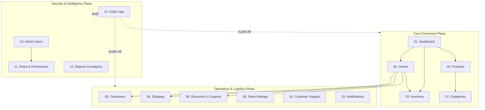
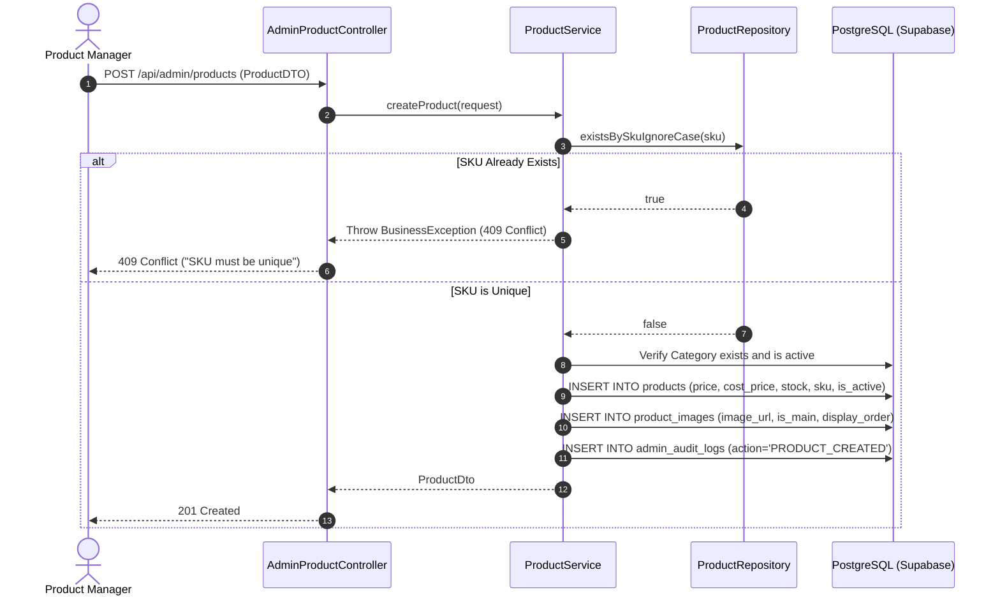
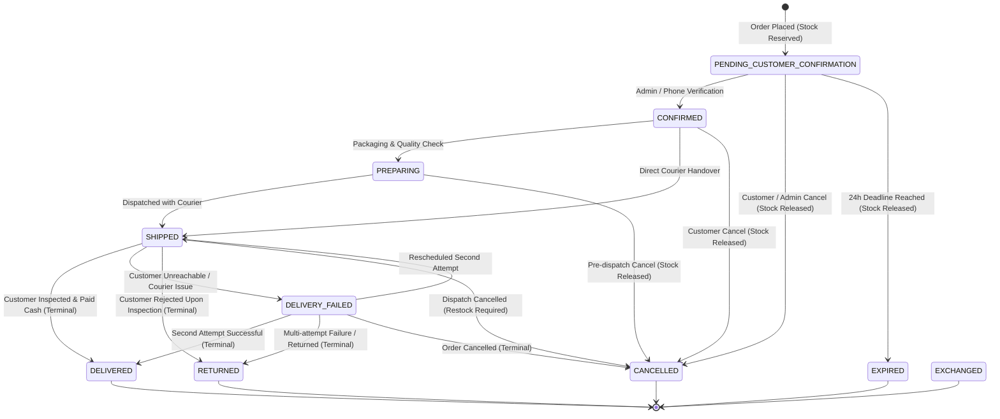

# VARELLION Admin Architecture — Complete Business Architecture (15 Modules)

> **Document Version:** 2.0.0  
> **Status:** APPROVED ARCHITECTURAL SPECIFICATION  
> **Scope:** Detailed business requirements, admin capabilities, business workflows, database dependencies, security, validations, edge cases, and integrations across all 15 Admin modules.  
> **Target Market:** Arab Republic of Egypt (EGP Currency, 27 Governorates, Cash on Delivery, Inspection Before Payment)  

---

## 1. Architectural Philosophy & Module Taxonomy

The VARELLION Admin Control System is architected as a cohesive, domain-driven management plane designed to govern the end-to-end luxury e-commerce lifecycle.

### Core Governance Invariants:
1. **Financial Integrity:** Gross revenue, net revenue, shipping totals, and discounts are computed strictly using server-side ledger calculations from immutable `orders` and `order_items`. Client financial representations are ignored.
2. **Deadlock & Race Protection:** Inventory mutations combine optimistic version checking for catalog data and deterministic ascending-key pessimistic locks (`SELECT ... FOR UPDATE`) for physical stock changes.
3. **Defensive Status FSM:** Order status changes are strictly validated against `OrderStatus.canTransitionTo()`. Terminal states (`DELIVERED`, `CANCELLED`, `EXPIRED`, `RETURNED`, `EXCHANGED`) can never be altered.
4. **Complete Accountability:** Any destructive, financial, or status-altering administrative action records an immutable audit trail in `public.admin_audit_logs`.

---

## 2. Module 01 — Executive Dashboard Management

### 2.1 Business Purpose
Provides store executives and operations managers with real-time operational visibility into sales, order pipelines, inventory health, and revenue trends across Egypt.

### 2.2 Admin Capabilities
* View real-time key performance indicators (KPIs): Total Gross Revenue, Total Orders, Net Sales, Average Order Value (AOV).
* Monitor order fulfillment pipeline breakdown: Pending Confirmation, Confirmed, Preparing, Shipped, Delivered, Delivery Failed, Cancelled, Returned.
* View inventory alerts: Low-Stock Products ($\le 5$ units), Out-of-Stock Products (0 units).
* View Top-Selling Products ranked by units sold and revenue generated.
* View recent order activity stream with instant status indicators and quick-action links.
* Filter dashboard analytics by time periods: Today, Yesterday, Last 7 Days, Last 30 Days, This Month, Year to Date, Custom Date Range.

### 2.3 Business Workflows & KPI Calculation Rules
1. **Gross Revenue Calculation:**
   $$\text{Gross Revenue} = \sum_{\text{orderStatus} \in \{\text{CONFIRMED}, \text{PREPARING}, \text{SHIPPED}, \text{DELIVERED}\}} \text{subtotal}$$
   *Note:* Excludes `CANCELLED`, `EXPIRED`, and `PENDING_CUSTOMER_CONFIRMATION`. Shipping fees are tracked separately to prevent conflating gross merchandise value with logistics reimbursement.
2. **Net Revenue Calculation:**
   $$\text{Net Revenue} = \sum_{\text{orderStatus} = \text{DELIVERED}} \text{subtotal} - \sum_{\text{orderStatus} = \text{RETURNED}} \text{subtotal}$$
3. **Pending Actions Funnel:** Real-time counter of orders requiring immediate operational intervention:
   - Orders awaiting customer confirmation (`PENDING_CUSTOMER_CONFIRMATION` nearing 24h deadline).
   - Confirmed orders waiting to be packed (`CONFIRMED`).
   - Packed orders waiting for courier pickup (`PREPARING`).

### 2.4 Required APIs
* `GET /api/admin/dashboard/summary` — High-level KPI cards and pending action counters.
* `GET /api/admin/dashboard/sales-chart` — Time-series revenue and order count data points.
* `GET /api/admin/dashboard/order-breakdown` — Distribution of orders across the 10 lifecycle statuses.
* `GET /api/admin/dashboard/stock-alerts` — List of products breaching low-stock and out-of-stock thresholds.
* `GET /api/admin/dashboard/top-products` — Top 5 best-performing products by sales volume.

### 2.5 Database Dependencies
* Tables: `public.orders`, `public.order_items`, `public.products`, `public.customers`.
* Index requirement: `CREATE INDEX idx_orders_status_created ON public.orders(order_status, created_at);`

### 2.6 Security & Validation
* Required Permission: `reports:read` or `dashboard:read`.
* Parameters: `startDate` and `endDate` must be valid ISO-8601 timestamps; `startDate <= endDate`. Max historical window: 365 days per single query to protect connection pool.

---

## 3. Module 02 — Products Management

### 3.1 Business Purpose
Manages the VARELLION luxury product catalog (Horology, Genuine Leather Goods, Men's Accessories), ensuring bilingual consistency (Arabic/English), rich media presentation, SKU uniqueness, and accurate pricing.

### 3.2 Admin Capabilities
* Paginated product catalog search and filtering by Category, Stock Status (In Stock, Low Stock, Out of Stock), Active State (`is_active`), and Price Range.
* Create new product with dual-language titles (`name_ar`, `name_en`), descriptions (`description_ar`, `description_en`), prices (`price`, `cost_price`), stock, and SKU.
* Update existing product metadata, categorization, pricing, and active status.
* Soft-delete / Archive products (setting `is_active = false`) to preserve order history integrity.
* Hard-delete products **only** if they have never been ordered (`COUNT(order_items) == 0`).
* Manage product media gallery: upload image URLs, assign display order, set primary thumbnail (`is_main`).

### 3.3 Business Workflows & Invariants

### 3.4 Required APIs
* `GET /api/admin/products` — Paginated list with sorting and filtering.
* `GET /api/admin/products/{productId}` — Detailed product view with category, images, and sales metrics.
* `POST /api/admin/products` — Create new product with initial inventory and media.
* `PUT /api/admin/products/{productId}` — Full update of product details (supports optimistic lock).
* `PATCH /api/admin/products/{productId}/status` — Toggle active/inactive status.
* `DELETE /api/admin/products/{productId}` — Guarded deletion or automatic archiving.
* `POST /api/admin/products/{productId}/images` — Add gallery image.
* `DELETE /api/admin/products/{productId}/images/{imageId}` — Remove gallery image.
* `PUT /api/admin/products/{productId}/images/reorder` — Reorder gallery images.

### 3.5 Database Dependencies & Concurrency
* Tables: `public.products`, `public.product_images`, `public.categories`, `public.order_items`.
* Invariant: `CHECK (price >= 0)`, `CHECK (cost_price >= 0)`.
* Concurrency: Add `@Version Long version` to `Product.java` to prevent lost updates when two managers edit catalog details simultaneously.

---

## 4. Module 03 — Inventory Management

### 4.1 Business Purpose
Maintains stock accuracy, tracks real-time inventory reservations, records every physical stock adjustment with mandatory audit reasons, and alerts managers to supply shortages.

### 4.2 Admin Capabilities
* View real-time inventory balances: Total Physical Stock (`stock_quantity`), Reserved Stock (`reserved_quantity`), and Available Stock ($stock - reserved$).
* Manual stock adjustments (restock shipment, damage write-off, physical count reconciliation).
* View full inventory movement audit log (who adjusted stock, quantity delta, prior stock, new stock, reason).
* View all active customer reservations and their associated order expiration deadlines.

### 4.3 Stock Mutation Invariants & Reservation Lifecycle
$$\text{Available Stock} = \max(0, \text{stock\_quantity} - \text{reserved\_quantity})$$
* **Rule 1 (Database Constraint):** `reserved_quantity` can never exceed `stock_quantity`. PostgreSQL enforces `CONSTRAINT chk_stock_available`.
* **Rule 2 (Order Placement):** Increments `reserved_quantity` atomically.
* **Rule 3 (Order Fulfillment):** When an order transitions to `SHIPPED`, the physical stock is deducted:
  $$\text{stock\_quantity} \leftarrow \text{stock\_quantity} - \text{qty}, \quad \text{reserved\_quantity} \leftarrow \text{reserved\_quantity} - \text{qty}$$
* **Rule 4 (Order Cancellation):** If an order in `PENDING_CUSTOMER_CONFIRMATION`, `CONFIRMED`, or `PREPARING` is cancelled:
  $$\text{reserved\_quantity} \leftarrow \text{reserved\_quantity} - \text{qty}$$
* **Rule 5 (Manual Stock Adjustment):** An admin adjustment to physical stock must never set `stock_quantity < reserved_quantity`.

### 4.4 Required APIs
* `GET /api/admin/inventory` — Paginated inventory table with available, reserved, and physical stock.
* `GET /api/admin/inventory/low-stock` — Filtered view of products below the low-stock threshold (default: 5 units).
* `PATCH /api/admin/inventory/products/{productId}/stock` — Adjust stock with mandatory adjustment type (`RESTOCK`, `CORRECTION`, `DAMAGED`) and reason.
* `GET /api/admin/inventory/movements` — Complete historical ledger of stock movements.
* `GET /api/admin/inventory/products/{productId}/reservations` — Active order reservations for a specific product.

### 4.5 Security & Auditing
* Permission: `inventory:read`, `inventory:update`.
* Audit: Every manual stock adjustment MUST persist a record into `public.inventory_movements` and `public.admin_audit_logs`.

---

## 5. Module 04 — Orders Management

### 5.1 Business Purpose
Directs the complete order fulfillment and customer satisfaction pipeline across all 27 Egyptian governorates, supporting Cash on Delivery (COD) workflows, courier assignment, customer address updates, and stock reconciliation.

### 5.2 Admin Capabilities
* Comprehensive order table with multi-factor filtering: Order Status, Governorate, Date Range, Customer Phone, Payment Method, Order Number.
* Detailed order view: Customer info, shipping address, financial breakdown, order items snapshot, status transition history, internal administrative notes.
* Update order status strictly conforming to the state machine graph (`OrderStatus.canTransitionTo`).
* Update internal administrative notes (`admin_notes`) to log courier communication, customer verification calls, or inspection notes.
* Update delivery address or recipient phone before dispatch (`PENDING_CUSTOMER_CONFIRMATION` or `CONFIRMED` only).
* Export filtered order reports to CSV/Excel for courier manifests.

### 5.3 Complete State Transition Graph & Terminal States

### 5.4 Edge Cases & Protections
1. **Inspection Rejection at Doorstep ("فحص ومعاينة"):** If a customer exercises their right to inspect goods and rejects them, the order transitions `SHIPPED -> RETURNED`. The stock is physically inspected upon courier return before restocking.
2. **Optimistic Locking Conflict:** If two staff members attempt to update status simultaneously (e.g. one marks `PREPARING` while another cancels), Hibernate detects a `version` mismatch on `orders.version` and rejects the second with HTTP 409 Conflict.
3. **Immutable Price Snapshots:** Changing catalog prices in `Product` NEVER affects historical prices stored in `order_items`.

### 5.5 Required APIs
* `GET /api/admin/orders` — Paginated list with multi-parameter filter (existing, preserved).
* `GET /api/admin/orders/{orderNumber}` — Complete order details with items and status history (existing, preserved).
* `PUT /api/admin/orders/{orderNumber}/status` — Status transition with reason and actor (existing, preserved).
* `PATCH /api/admin/orders/{orderNumber}/notes` — Update internal admin notes.
* `PUT /api/admin/orders/{orderNumber}/shipping-address` — Update shipping address prior to shipment.
* `POST /api/admin/orders/{orderNumber}/cancel` — Dedicated cancel action with automated stock restoration.
* `GET /api/admin/orders/export` — Export filtered orders to CSV/Excel for logistics partners.

---

## 6. Module 05 — Customers Management

### 6.1 Business Purpose
Maintains customer relationship directory, monitors customer order frequencies and lifetime spend, detects suspicious accounts, and provides customer service personnel with purchase history.

### 6.2 Admin Capabilities
* Paginated customer directory with search by name, email, or Egyptian phone number (`01[0125][0-9]{8}`).
* Detailed customer profile: registered date, full name, phone, default delivery address, account status.
* Customer commercial statistics: Total Orders Placed, Total Orders Delivered, Total Spent (EGP), Cancellation Rate, Return Rate.
* Customer order history list.
* Activate, deactivate, or suspend customer accounts.
* Internal notes on customer profiles (e.g. "Frequent returner", "VIP Horology client").

### 6.3 Sensitive Data Protection & IDOR Boundaries
* **Rule 1 (Zero Hash Exposure):** Password hashes (`users.password`), authentication tokens, and internal salt values are strictly excluded from DTOs.
* **Rule 2 (Audit Logging):** Suspending or activating a customer account requires recording an audit log entry with justification.

### 6.4 Required APIs
* `GET /api/admin/customers` — Paginated list with search and order-count sorting.
* `GET /api/admin/customers/{customerId}` — Full profile with aggregated metrics (Total Orders, Total Spend, Delivery Rate).
* `GET /api/admin/customers/{customerId}/orders` — Complete order history for the specified customer.
* `PATCH /api/admin/customers/{customerId}/status` — Toggle customer active/suspended state.
* `PATCH /api/admin/customers/{customerId}/notes` — Update internal administrative notes on customer.

---

## 7. Module 06 — Shipping & Logistics Management

### 7.1 Business Purpose
Governs shipping fees, delivery zones, estimated transit durations, and regional coverage across all 27 Egyptian governorates. Replaces hardcoded Java code with dynamic database-backed configuration.

### 7.2 Current State vs. Proposed Solution
* **Current State:** Hardcoded `if-else` blocks in `OrderService.java:106-129` with 5 zones (50, 60, 65, 75, 85 EGP). Modifying rates requires code commits and application rebuilds.
* **Proposed Solution:** Introduce `public.shipping_zones` and `public.shipping_zone_governorates` tables seeded with the exact live rates. Provide admin CRUD APIs allowing operational updates without redeployment.

### 7.3 Admin Capabilities
* View all shipping zones, associated governorates, base shipping fees, and estimated transit times.
* Update shipping fee for a zone (e.g. increase Delta & Canal from 65 EGP to 70 EGP).
* Enable or disable shipping to specific governorates (e.g. temporarily suspend Sinai during logistics disruption).
* Configure delivery duration estimates shown to customers on storefront and tracking cards.
* Update site-wide Free Shipping Threshold (currently 2,500.00 EGP).

### 7.4 Required APIs
* `GET /api/admin/shipping/zones` — List all shipping zones with assigned governorates and rates.
* `GET /api/admin/shipping/zones/{zoneId}` — View details of a specific shipping zone.
* `PUT /api/admin/shipping/zones/{zoneId}` — Update base fee and estimated delivery days.
* `PATCH /api/admin/shipping/governorates/{governorateId}/status` — Toggle active shipping status for a governorate.
* `GET /api/admin/shipping/governorates` — Flat list of all 27 Egyptian governorates with current zone and fee.

---

## 8. Module 07 — Categories Management

### 8.1 Business Purpose
Organizes the luxury catalog into intuitive, bilingual product categories (e.g. "ساعات يد رجالية فاخرة / Luxury Men's Watches", "محافظ جلد طبيعي / Genuine Leather Wallets").

### 8.2 Admin Capabilities
* List all categories with product counts and active status.
* Create new category with dual-language titles (`name_ar`, `name_en`), URL slug, and descriptions.
* Update category titles, descriptions, and slugs.
* Reorder categories for storefront navigation display.
* Toggle category visibility (`is_active`).
* Delete category **only** if no products are assigned (`COUNT(products) == 0`). If products exist, deletion is blocked, requiring reassignment or soft-deletion.

### 8.3 Required APIs
* `GET /api/admin/categories` — List all categories with total and active product counts.
* `GET /api/admin/categories/{categoryId}` — View category details and assigned products.
* `POST /api/admin/categories` — Create category (validates slug uniqueness).
* `PUT /api/admin/categories/{categoryId}` — Update category metadata.
* `PATCH /api/admin/categories/{categoryId}/status` — Toggle category active state.
* `DELETE /api/admin/categories/{categoryId}` — Guarded deletion (checks product dependencies).

---

## 9. Module 08 — Discounts & Coupons Management

### 9.1 Business Purpose
Drives marketing campaigns, seasonal sales (e.g. White Friday, Eid promotions), and customer retention through automated discount codes and cart vouchers.

### 9.2 Admin Capabilities
* Create promotional coupon codes with configurable parameters:
  - Discount Type: `PERCENTAGE` (e.g. 15% off) or `FIXED_AMOUNT` (e.g. 200 EGP off).
  - Value: Discount magnitude.
  - Minimum Subtotal: Minimum cart value required to unlock discount (e.g. 1,000 EGP).
  - Maximum Discount Cap: Ceiling on percentage discounts (e.g. max 500 EGP).
  - Validity Window: Start Date and Expiration Date (`TIMESTAMPTZ`).
  - Usage Limits: Total allowed uses site-wide and per-customer limit.
* Monitor coupon usage statistics: Times redeemed, total discount value granted, associated orders.
* Deactivate or expire coupons immediately.

### 9.3 Calculation & Financial Rules
1. **Application Sequence:**
   $$\text{Discount} = \min(\text{subtotal} \times \text{percentage}, \text{maxCap})$$
   $$\text{Final Subtotal} = \text{subtotal} - \text{Discount}$$
   $$\text{Total Amount} = \text{Final Subtotal} + \text{Shipping Fee}$$
2. **Server-Side Validation:** The client NEVER computes the discount. The coupon code is passed in `CreateOrderRequest` and validated against date, minimum subtotal, and usage limits inside the transaction.

### 9.4 Required APIs
* `GET /api/admin/coupons` — Paginated list of coupons with status and redemption counters.
* `GET /api/admin/coupons/{couponId}` — Detailed coupon metrics and redemption history.
* `POST /api/admin/coupons` — Create coupon with validation rules.
* `PUT /api/admin/coupons/{couponId}` — Update coupon parameters.
* `PATCH /api/admin/coupons/{couponId}/status` — Toggle active state or expire coupon.
* `DELETE /api/admin/coupons/{couponId}` — Soft-delete / archive coupon.

---

## 10. Module 09 — Store Settings Management

### 10.1 Business Purpose
Centralizes management of global store configurations, business contact information, policy thresholds, and maintenance toggles.

### 10.2 Admin Capabilities
* Manage General Store Info: Brand name, support phone number, WhatsApp contact URL, official email.
* Configure Commercial Policies: Free Shipping Threshold (default: 2,500 EGP), Low-Stock Threshold (default: 5 units), Order Confirmation Deadline Window (default: 24 hours).
* Maintenance Mode: Toggle site-wide maintenance banner or read-only storefront mode for scheduled updates.
* Social Links: Facebook, Instagram, TikTok official profile URLs.

### 10.3 Security & Secret Isolation
* **STRICT PROHIBITION:** Database credentials, JWT signing secrets (`jwt.secret`), Google OAuth client secrets, and infrastructure passwords MUST NEVER be stored in or exposed via the store settings table.

### 10.4 Required APIs
* `GET /api/admin/settings` — Retrieve all manageable store settings.
* `PUT /api/admin/settings` — Batch update store settings (records audit log).
* `GET /api/admin/settings/{settingKey}` — Retrieve single setting value.
* `PUT /api/admin/settings/{settingKey}` — Update single setting value.

---

## 11. Module 10 — Admin Users Management

### 11.1 Business Purpose
Manages internal administrative accounts, staff onboarding, account suspension, and password governance.

### 11.2 Admin Capabilities
* List all staff accounts with their assigned administrative roles, status, and last login timestamp.
* Create new administrator account with initial temporary password and assigned role.
* Update admin user profile (name, email, role assignment).
* Suspend or activate admin user accounts.
* Force password reset on next login.
* Unlock accounts locked due to consecutive failed login attempts (`failed_attempts >= 5`).

### 11.3 Privilege Escalation Safeguards
* An administrator can never assign a role with higher privileges than their own.
* Only `SUPER_ADMIN` accounts can create, modify, or deactivate other `SUPER_ADMIN` accounts.
* Self-deletion and self-demotion are blocked by backend validation.

### 11.4 Required APIs
* `GET /api/admin/users` — Paginated list of administrative users.
* `GET /api/admin/users/{userId}` — Staff user profile and assigned roles.
* `POST /api/admin/users` — Create staff user account.
* `PUT /api/admin/users/{userId}` — Update staff details and role assignment.
* `PATCH /api/admin/users/{userId}/status` — Activate/suspend staff account.
* `POST /api/admin/users/{userId}/unlock` — Unlock locked account.
* `POST /api/admin/users/{userId}/reset-password` — Trigger administrative password reset.

---

## 12. Module 11 — Roles & Permissions Management

### 12.1 Business Purpose
Establishes a flexible, fine-grained Role-Based Access Control (RBAC) architecture, replacing hardcoded role strings with normalized roles and granular permission authorities.

### 12.2 Standard Administrative Roles (5 Roles)
1. **`SUPER_ADMIN`:** Full system ownership; manages settings, roles, staff, and financial data.
2. **`ADMIN`:** General management; products, orders, categories, customer support, reports.
3. **`ORDER_MANAGER`:** Order fulfillment, courier tracking, shipping status updates, customer phone calls.
4. **`PRODUCT_MANAGER`:** Catalog management, product creation, pricing, stock adjustments, categories.
5. **`CUSTOMER_SUPPORT`:** Customer inquiries, order lookup, customer profiles, order notes.

### 12.3 Required APIs
* `GET /api/admin/roles` — List all roles and their assigned permission sets.
* `GET /api/admin/roles/{roleId}` — View specific role details.
* `POST /api/admin/roles` — Create custom administrative role.
* `PUT /api/admin/roles/{roleId}/permissions` — Update permissions assigned to a role.
* `GET /api/admin/permissions` — Catalog of all 43 system permissions grouped by domain.

---

## 13. Module 12 — Reports & Analytics

### 13.1 Business Purpose
Delivers deep historical data analysis, sales aggregation, profitability reports, and export capabilities for accounting and supply chain planning.

### 13.2 Admin Capabilities
* Sales & Revenue Reports: Aggregate gross revenue, shipping collections, discounts, and net revenue by day, week, month, or custom period.
* Product Performance Reports: Units sold, gross margin, return frequency, inventory turnover per SKU.
* Geographic Logistics Reports: Order distribution and fulfillment success rate across Egypt's 27 governorates.
* Customer Acquisition & Lifetime Value: New vs. returning customer revenue split.
* Export capabilities: Stream reports directly to CSV/Excel.

### 13.3 Required APIs
* `GET /api/admin/reports/sales` — Aggregate sales report with date groupings.
* `GET /api/admin/reports/products` — Product sales and turnover metrics.
* `GET /api/admin/reports/shipping` — Governorate delivery performance report.
* `GET /api/admin/reports/export` — Stream report file (CSV/Excel) with filters.

---

## 14. Module 13 — System Audit Logs & Admin Activity

### 14.1 Business Purpose
Maintains an immutable, append-only security and operational audit trail recording every administrative state mutation for compliance, security investigation, and internal accountability.

### 14.2 Admin Capabilities
* Search and filter audit records by Actor (Staff Member), Target Entity (`PRODUCT`, `ORDER`, `USER`, `SETTING`), Action Type (`CREATE`, `UPDATE`, `DELETE`, `STATUS_CHANGE`), and Date Range.
* Inspect complete modification diffs (previous value vs. new value) stored in structured JSON.
* Export audit logs for compliance audits.
* **IMMUTABILITY ENFORCEMENT:** No endpoint, admin role, or staff user is permitted to modify or delete audit log rows.

### 14.3 Required APIs
* `GET /api/admin/audit-logs` — Paginated list with filtering by actor, entity, action, and date.
* `GET /api/admin/audit-logs/{logId}` — Detailed audit event view with before/after state diff.
* `GET /api/admin/audit-logs/entities` — List of auditable entity types and action names.

---

## 15. Module 14 — Customer Support & Inquiries Management

### 15.1 Business Purpose
Manages customer inquiries, pre-sale questions regarding watch specifications and leather care, and post-delivery assistance.

### 15.2 Admin Capabilities
* Inbound inquiry queue with status: `OPEN`, `IN_PROGRESS`, `RESOLVED`, `CLOSED`.
* Assign inquiries to support staff members.
* Record customer communication notes (phone call summaries, WhatsApp logs).
* Link inquiries to specific customer profiles or order numbers.

### 15.3 Required APIs
* `GET /api/admin/support/inquiries` — Paginated inquiry queue with status and priority filters.
* `GET /api/admin/support/inquiries/{inquiryId}` — Inquiry details, message thread, and notes.
* `PATCH /api/admin/support/inquiries/{inquiryId}/status` — Update inquiry resolution status.
* `POST /api/admin/support/inquiries/{inquiryId}/notes` — Add internal support note.
* `PATCH /api/admin/support/inquiries/{inquiryId}/assign` — Assign inquiry to staff user.

---

## 16. Module 15 — Notifications & Operational Alerts Management

### 16.1 Business Purpose
Monitors outbound communication channels (order confirmation SMS, courier dispatch WhatsApp notices) and manages internal administrative alert triggers.

### 16.2 Admin Capabilities
* View outbound customer notification logs and delivery status.
* Configure operational alert thresholds (e.g. alert staff when order is pending confirmation $> 20$ hours, or stock drops below 3 units).
* Resend failed notifications manually.

### 16.3 Required APIs
* `GET /api/admin/notifications/logs` — Outbound message log with delivery status.
* `POST /api/admin/notifications/resend/{logId}` — Retry failed outbound notice.
* `GET /api/admin/notifications/templates` — View message notification templates.
* `PUT /api/admin/notifications/templates/{templateId}` — Update notification template text (Arabic/English).

---

## 17. Complete Module Summary & Interaction Topology

The 15 modules collectively establish complete, enterprise-grade administrative control over VARELLION. By strictly separating concerns between catalog management, logistics, customer relations, security governance, and immutable auditing, the system eliminates operational blind spots while safeguarding database integrity.
