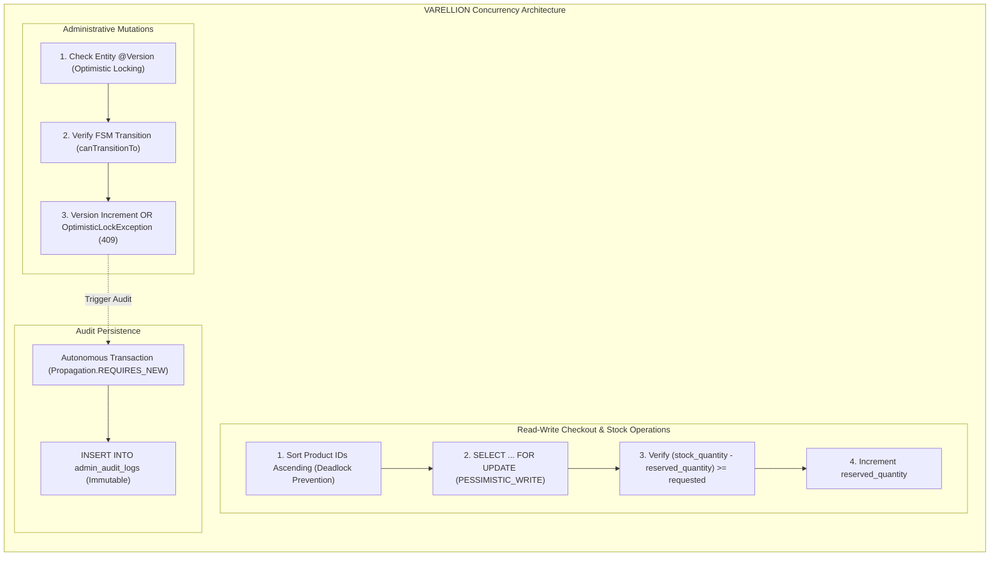

# VARELLION Admin Architecture — Database Impact Analysis & Migration Specification

> **Document Version:** 2.0.0  
> **Status:** APPROVED DATABASE ARCHITECTURE SPECIFICATION  
> **Target Engine:** PostgreSQL 17.11 (Supabase AWS EU-West-1)  
> **Proposed Migration:** `V14__admin_system_expansion.sql` (PLANNING ONLY)  

---

## 1. Database Philosophy & Data Integrity Invariants

The VARELLION database architecture enforces strict relational integrity, immutable historical auditing, and mathematical consistency.

### Core Database Safeguards:
1. **Zero-Drift Financials:** Financial fields (`price`, `cost_price`, `subtotal`, `shipping_fee`, `total_amount`) use exact precision `NUMERIC(10, 2)`. Floating-point representations (`FLOAT`, `DOUBLE PRECISION`) are prohibited.
2. **Deterministic Locking Order:** Multi-item inventory locking queries sort `productId` in ascending order to prevent deadlocks under high-concurrency checkout traffic.
3. **Optimistic Locking Everywhere:** High-churn administrative tables implement `@Version BIGINT NOT NULL DEFAULT 0` to prevent lost updates during concurrent edits.
4. **Append-Only Auditing:** Audit records (`order_status_history`, `admin_audit_logs`, `inventory_movements`) are append-only. No `UPDATE` or `DELETE` grants are permitted.
5. **Preservation of Existing Tables:** Existing tables (`users`, `customers`, `customer_addresses`, `categories`, `products`, `product_images`, `carts`, `cart_items`, `orders`, `order_items`, `order_status_history`) remain structurally intact and backward-compatible.

---

## 2. Module-by-Module Database Dependency & Impact Analysis

| Module | Existing Tables Used | Proposed Tables / Columns | Integrity Risks & Safeguards | Locking & Transaction Boundaries |
| :--- | :--- | :--- | :--- | :--- |
| **01. Dashboard** | `orders`, `order_items`, `products`, `customers` | None (Aggregation only) | High-load analytics queries locking transaction pool. Handled via covering composite indexes and read-only replica routing. | `@Transactional(readOnly = true)`. Isolation: `READ COMMITTED`. |
| **02. Products** | `products`, `product_images`, `categories` | Add `version BIGINT DEFAULT 0` to `products`. | Concurrent edits overwriting price or stock. Safeguarded via `@Version` optimistic locking. Hard-delete blocked if referenced in `order_items`. | `@Transactional(rollbackFor = Exception.class)`. |
| **03. Inventory** | `products` | New: `inventory_movements` | Stock overselling or negative inventory. Safeguarded via `CHECK (stock_quantity >= 0)` and `CHECK (reserved_quantity <= stock_quantity)`. | Pessimistic write lock: `ProductRepository.findByIdForUpdate`. |
| **04. Orders** | `orders`, `order_items`, `order_status_history` | None (Existing tables complete) | Invalid status transitions; lost updates. Existing `orders.version` `@Version` column preserves concurrency safety. | `@Transactional`. Atomic state machine transition + stock restoration. |
| **05. Customers** | `customers`, `users`, `customer_addresses` | None (Add index on phone) | Accidental deletion of customers with order history. Blocked by `orders.customer_id REFERENCES customers(user_id) ON DELETE RESTRICT`. | `@Transactional`. |
| **06. Shipping** | None (Currently hardcoded in code) | New: `shipping_zones`, `shipping_zone_governorates` | Hardcoded fees prevent dynamic price updates. Tables seeded with exact live rates (50, 60, 65, 75, 85 EGP). | `@Transactional(readOnly = true)` for checkout lookup; read-write for admin updates. |
| **07. Categories** | `categories`, `products` | Add `version BIGINT DEFAULT 0` to `categories`. | Deleting a category that holds products. Blocked by `products.category_id REFERENCES categories(category_id) ON DELETE RESTRICT`. | `@Transactional`. |
| **08. Coupons** | `orders` (`discount_total`) | New: `coupons`, `coupon_usages` | Coupon over-redemption or race condition on limited uses. Safeguarded via atomic increment `times_used = times_used + 1 WHERE times_used < usage_limit`. | `@Transactional` inside checkout pipeline. |
| **09. Settings** | None (Properties file) | New: `store_settings` | Exposing database/JWT secrets. Safeguarded via strict key allowlist (secrets strictly prohibited). | `@Transactional`. |
| **10. Admin Users** | `users` | New: `roles`, `permissions`, `user_roles`, `role_permissions` | Privilege escalation; accidental self-demotion or self-deletion. Prevented via database foreign keys and service guards. | `@Transactional`. |
| **11. RBAC** | `users` | New: `roles`, `permissions`, `role_permissions`, `user_roles` | Unmapped permissions. Pre-seeded with 43 system permissions and 5 standard administrative roles. | `@Transactional`. |
| **12. Reports** | `orders`, `order_items` | None (Aggregation only) | Table scans on millions of rows. Handled via compound indexes on `(order_status, created_at)`. | `@Transactional(readOnly = true)`. |
| **13. Audit Logs** | `users` | New: `admin_audit_logs` | Tampering with audit logs. Hardened via PostgREST RLS revocation and immutable table grants. | Autonomous `@Transactional(propagation = Propagation.REQUIRES_NEW)`. |
| **14. Support** | `customers`, `users` | New: `customer_inquiries` | Orphaned inquiries. Linked to `customers` and `users(id)` with `ON DELETE SET NULL`. | `@Transactional`. |
| **15. Alerts** | None | New: `notification_logs`, `notification_templates` | Duplicate outbound alerts. Handled via idempotency keys on notification logs. | `@Transactional`. |

---

## 3. Concurrency, Locking & Transaction Isolation Architecture



### 3.1 Deadlock-Free Pessimistic Write Locking
When an order is created or when an administrator executes a bulk inventory adjustment, multiple product rows are locked. If Transaction A locks Product 1 then Product 2, while Transaction B locks Product 2 then Product 1, a database deadlock occurs.
* **VARELLION Rule:** All multi-product transactions MUST sort the requested product UUIDs in ascending natural order (`Collections.sort(productIds)`) prior to acquiring `@Lock(LockModeType.PESSIMISTIC_WRITE)`.

### 3.2 Optimistic Concurrency Control (`@Version`)
Administrative actions (updating order status, editing product details, modifying shipping fees) involve human read-think-submit cycles. Pessimistic locking across HTTP requests is an anti-pattern.
* **VARELLION Rule:** The `orders` table already contains `version BIGINT NOT NULL DEFAULT 0` (Migration `V12`). Migration `V14` introduces `version BIGINT NOT NULL DEFAULT 0` to `public.products` and `public.categories`. On conflict, Spring Data JPA throws `ObjectOptimisticLockingFailureException`, which `GlobalExceptionHandler` translates to HTTP 409 Conflict.

---

## 4. Proposed Migration: `V14__admin_system_expansion.sql`

This migration is 100% additive and backward-compatible. It introduces the missing tables required for RBAC, dynamic shipping, coupons, settings, inventory movements, customer support, and audit logs.

```sql
-- ============================================================================
-- VARELLION E-Commerce Database Migration
-- Migration: V14__admin_system_expansion.sql
-- Description: Comprehensive administrative schema expansion:
--              1. RBAC (roles, permissions, role_permissions, user_roles)
--              2. Dynamic Shipping Zones & Governorate Mapping
--              3. Store Settings
--              4. Inventory Movements Ledger
--              5. Discounts & Coupons Engine
--              6. Append-Only Admin Audit Logging
--              7. Customer Inquiries & Support Queue
--              8. Outbound Notification Logs & Templates
--              9. Optimistic Versioning on Products & Categories
-- Database: PostgreSQL 15+ (Supabase)
-- ============================================================================

-- ----------------------------------------------------------------------------
-- 1. Optimistic Locking on Catalog Entities
-- ----------------------------------------------------------------------------
ALTER TABLE public.products
    ADD COLUMN IF NOT EXISTS version BIGINT NOT NULL DEFAULT 0;

ALTER TABLE public.categories
    ADD COLUMN IF NOT EXISTS version BIGINT NOT NULL DEFAULT 0;

-- ----------------------------------------------------------------------------
-- 2. Role-Based Access Control (RBAC) Architecture
-- ----------------------------------------------------------------------------
CREATE TABLE IF NOT EXISTS public.roles (
    role_id SERIAL PRIMARY KEY,
    role_name VARCHAR(50) NOT NULL UNIQUE,
    description TEXT,
    is_system_role BOOLEAN NOT NULL DEFAULT FALSE,
    created_at TIMESTAMPTZ NOT NULL DEFAULT NOW()
);

CREATE TABLE IF NOT EXISTS public.permissions (
    permission_id SERIAL PRIMARY KEY,
    permission_name VARCHAR(100) NOT NULL UNIQUE,
    domain VARCHAR(50) NOT NULL,
    description TEXT,
    created_at TIMESTAMPTZ NOT NULL DEFAULT NOW()
);

CREATE TABLE IF NOT EXISTS public.role_permissions (
    role_id INTEGER NOT NULL REFERENCES public.roles(role_id) ON DELETE CASCADE,
    permission_id INTEGER NOT NULL REFERENCES public.permissions(permission_id) ON DELETE CASCADE,
    PRIMARY KEY (role_id, permission_id)
);

CREATE TABLE IF NOT EXISTS public.user_roles (
    user_id BIGINT NOT NULL REFERENCES public.users(id) ON DELETE CASCADE,
    role_id INTEGER NOT NULL REFERENCES public.roles(role_id) ON DELETE CASCADE,
    assigned_at TIMESTAMPTZ NOT NULL DEFAULT NOW(),
    PRIMARY KEY (user_id, role_id)
);

CREATE INDEX IF NOT EXISTS idx_user_roles_user_id ON public.user_roles(user_id);

-- ----------------------------------------------------------------------------
-- 3. Dynamic Shipping Zones & Governorate Rates
-- ----------------------------------------------------------------------------
CREATE TABLE IF NOT EXISTS public.shipping_zones (
    zone_id SERIAL PRIMARY KEY,
    zone_name_ar VARCHAR(100) NOT NULL,
    zone_name_en VARCHAR(100) NOT NULL,
    base_fee NUMERIC(10, 2) NOT NULL CHECK (base_fee >= 0),
    estimated_days_min INTEGER NOT NULL CHECK (estimated_days_min >= 1),
    estimated_days_max INTEGER NOT NULL CHECK (estimated_days_max >= estimated_days_min),
    is_active BOOLEAN NOT NULL DEFAULT TRUE,
    created_at TIMESTAMPTZ NOT NULL DEFAULT NOW(),
    updated_at TIMESTAMPTZ NOT NULL DEFAULT NOW()
);

CREATE TABLE IF NOT EXISTS public.shipping_zone_governorates (
    governorate_id SERIAL PRIMARY KEY,
    zone_id INTEGER NOT NULL REFERENCES public.shipping_zones(zone_id) ON DELETE RESTRICT,
    governorate_name_ar VARCHAR(100) NOT NULL UNIQUE,
    governorate_name_en VARCHAR(100) NOT NULL UNIQUE,
    is_active BOOLEAN NOT NULL DEFAULT TRUE
);

CREATE INDEX IF NOT EXISTS idx_shipping_zone_gov_zone ON public.shipping_zone_governorates(zone_id);

-- ----------------------------------------------------------------------------
-- 4. Store Settings Management
-- ----------------------------------------------------------------------------
CREATE TABLE IF NOT EXISTS public.store_settings (
    setting_key VARCHAR(100) PRIMARY KEY,
    setting_value TEXT NOT NULL,
    value_type VARCHAR(20) NOT NULL DEFAULT 'STRING' CHECK (value_type IN ('STRING', 'INTEGER', 'DECIMAL', 'BOOLEAN', 'JSON')),
    description TEXT,
    updated_by BIGINT REFERENCES public.users(id) ON DELETE SET NULL,
    updated_at TIMESTAMPTZ NOT NULL DEFAULT NOW()
);

-- ----------------------------------------------------------------------------
-- 5. Inventory Movements Ledger
-- ----------------------------------------------------------------------------
CREATE TABLE IF NOT EXISTS public.inventory_movements (
    movement_id BIGSERIAL PRIMARY KEY,
    product_id UUID NOT NULL REFERENCES public.products(product_id) ON DELETE RESTRICT,
    change_quantity INTEGER NOT NULL,
    previous_stock INTEGER NOT NULL CHECK (previous_stock >= 0),
    new_stock INTEGER NOT NULL CHECK (new_stock >= 0),
    movement_type VARCHAR(50) NOT NULL CHECK (movement_type IN ('RESTOCK', 'INVENTORY_COUNT_CORRECTION', 'DAMAGED_WRITE_OFF', 'RETURN_INSPECTION', 'ORDER_FULFILLMENT', 'ORDER_CANCELLATION')),
    reason TEXT NOT NULL,
    actor_id BIGINT REFERENCES public.users(id) ON DELETE SET NULL,
    reference_order_id UUID REFERENCES public.orders(order_id) ON DELETE SET NULL,
    created_at TIMESTAMPTZ NOT NULL DEFAULT NOW()
);

CREATE INDEX IF NOT EXISTS idx_inventory_movements_product ON public.inventory_movements(product_id, created_at DESC);
CREATE INDEX IF NOT EXISTS idx_inventory_movements_actor ON public.inventory_movements(actor_id);

-- ----------------------------------------------------------------------------
-- 6. Discounts & Promotional Coupons Engine
-- ----------------------------------------------------------------------------
CREATE TABLE IF NOT EXISTS public.coupons (
    coupon_id UUID PRIMARY KEY DEFAULT gen_random_uuid(),
    code VARCHAR(50) NOT NULL UNIQUE CHECK (LENGTH(TRIM(code)) >= 3),
    discount_type VARCHAR(20) NOT NULL CHECK (discount_type IN ('PERCENTAGE', 'FIXED_AMOUNT')),
    discount_value NUMERIC(10, 2) NOT NULL CHECK (discount_value > 0),
    min_subtotal NUMERIC(10, 2) NOT NULL DEFAULT 0.00 CHECK (min_subtotal >= 0),
    max_discount_amount NUMERIC(10, 2) CHECK (max_discount_amount IS NULL OR max_discount_amount > 0),
    start_date TIMESTAMPTZ NOT NULL,
    end_date TIMESTAMPTZ NOT NULL,
    usage_limit INTEGER CHECK (usage_limit IS NULL OR usage_limit > 0),
    times_used INTEGER NOT NULL DEFAULT 0 CHECK (times_used >= 0),
    is_active BOOLEAN NOT NULL DEFAULT TRUE,
    created_at TIMESTAMPTZ NOT NULL DEFAULT NOW(),
    updated_at TIMESTAMPTZ NOT NULL DEFAULT NOW(),
    CONSTRAINT chk_coupon_dates CHECK (end_date > start_date),
    CONSTRAINT chk_coupon_limit CHECK (usage_limit IS NULL OR times_used <= usage_limit)
);

CREATE TABLE IF NOT EXISTS public.coupon_usages (
    usage_id UUID PRIMARY KEY DEFAULT gen_random_uuid(),
    coupon_id UUID NOT NULL REFERENCES public.coupons(coupon_id) ON DELETE CASCADE,
    order_id UUID NOT NULL REFERENCES public.orders(order_id) ON DELETE CASCADE,
    customer_id UUID NOT NULL REFERENCES public.customers(user_id) ON DELETE RESTRICT,
    discount_amount NUMERIC(10, 2) NOT NULL CHECK (discount_amount > 0),
    used_at TIMESTAMPTZ NOT NULL DEFAULT NOW(),
    CONSTRAINT uq_order_coupon UNIQUE (order_id, coupon_id)
);

CREATE INDEX IF NOT EXISTS idx_coupon_usages_coupon ON public.coupon_usages(coupon_id);
CREATE INDEX IF NOT EXISTS idx_coupon_usages_customer ON public.coupon_usages(customer_id);

-- ----------------------------------------------------------------------------
-- 7. Immutable Admin Audit Logging
-- ----------------------------------------------------------------------------
CREATE TABLE IF NOT EXISTS public.admin_audit_logs (
    log_id BIGSERIAL PRIMARY KEY,
    actor_id BIGINT REFERENCES public.users(id) ON DELETE SET NULL,
    action VARCHAR(100) NOT NULL,
    entity_name VARCHAR(50) NOT NULL,
    entity_id VARCHAR(100) NOT NULL,
    details_json JSONB,
    ip_address VARCHAR(45),
    created_at TIMESTAMPTZ NOT NULL DEFAULT NOW()
);

CREATE INDEX IF NOT EXISTS idx_audit_logs_actor_created ON public.admin_audit_logs(actor_id, created_at DESC);
CREATE INDEX IF NOT EXISTS idx_audit_logs_entity ON public.admin_audit_logs(entity_name, entity_id);

-- ----------------------------------------------------------------------------
-- 8. Customer Inquiries & Support Queue
-- ----------------------------------------------------------------------------
CREATE TABLE IF NOT EXISTS public.customer_inquiries (
    inquiry_id UUID PRIMARY KEY DEFAULT gen_random_uuid(),
    customer_id UUID REFERENCES public.customers(user_id) ON DELETE SET NULL,
    customer_name VARCHAR(150) NOT NULL,
    customer_phone VARCHAR(30) NOT NULL,
    subject VARCHAR(200) NOT NULL,
    message TEXT NOT NULL,
    status VARCHAR(30) NOT NULL DEFAULT 'OPEN' CHECK (status IN ('OPEN', 'IN_PROGRESS', 'RESOLVED', 'CLOSED')),
    priority VARCHAR(20) NOT NULL DEFAULT 'MEDIUM' CHECK (priority IN ('LOW', 'MEDIUM', 'HIGH', 'URGENT')),
    assigned_to BIGINT REFERENCES public.users(id) ON DELETE SET NULL,
    resolution_notes TEXT,
    created_at TIMESTAMPTZ NOT NULL DEFAULT NOW(),
    updated_at TIMESTAMPTZ NOT NULL DEFAULT NOW()
);

CREATE INDEX IF NOT EXISTS idx_inquiries_status ON public.customer_inquiries(status, priority);

-- ----------------------------------------------------------------------------
-- 9. Outbound Notification Logs & Message Templates
-- ----------------------------------------------------------------------------
CREATE TABLE IF NOT EXISTS public.notification_templates (
    template_id VARCHAR(50) PRIMARY KEY,
    title VARCHAR(100) NOT NULL,
    body_ar TEXT NOT NULL,
    body_en TEXT NOT NULL,
    is_active BOOLEAN NOT NULL DEFAULT TRUE,
    updated_at TIMESTAMPTZ NOT NULL DEFAULT NOW()
);

CREATE TABLE IF NOT EXISTS public.notification_logs (
    log_id BIGSERIAL PRIMARY KEY,
    order_id UUID REFERENCES public.orders(order_id) ON DELETE SET NULL,
    recipient_phone VARCHAR(30) NOT NULL,
    channel VARCHAR(20) NOT NULL CHECK (channel IN ('SMS', 'WHATSAPP')),
    message_content TEXT NOT NULL,
    status VARCHAR(20) NOT NULL DEFAULT 'PENDING' CHECK (status IN ('PENDING', 'SENT', 'FAILED')),
    external_message_id VARCHAR(100),
    error_message TEXT,
    created_at TIMESTAMPTZ NOT NULL DEFAULT NOW()
);

CREATE INDEX IF NOT EXISTS idx_notification_logs_order ON public.notification_logs(order_id);

-- ----------------------------------------------------------------------------
-- 10. Performance Indexes on Existing Tables
-- ----------------------------------------------------------------------------
CREATE INDEX IF NOT EXISTS idx_orders_status_created ON public.orders(order_status, created_at DESC);
CREATE INDEX IF NOT EXISTS idx_customers_phone ON public.customers(phone_number);

-- ----------------------------------------------------------------------------
-- 11. PostgREST Hardening (Supabase)
-- Revoke direct client access; all mutations must route via Spring Boot
-- ----------------------------------------------------------------------------
ALTER TABLE public.admin_audit_logs ENABLE ROW LEVEL SECURITY;
ALTER TABLE public.admin_audit_logs FORCE ROW LEVEL SECURITY;
REVOKE ALL ON public.admin_audit_logs FROM anon, authenticated;

ALTER TABLE public.store_settings ENABLE ROW LEVEL SECURITY;
ALTER TABLE public.store_settings FORCE ROW LEVEL SECURITY;
REVOKE ALL ON public.store_settings FROM anon, authenticated;

ALTER TABLE public.inventory_movements ENABLE ROW LEVEL SECURITY;
ALTER TABLE public.inventory_movements FORCE ROW LEVEL SECURITY;
REVOKE ALL ON public.inventory_movements FROM anon, authenticated;
```

---

## 5. Seed Data Specification

Migration `V14` includes baseline seed data to establish immediate operational continuity:

### 5.1 Shipping Zones Seed (Preserving Live Rates)
```sql
INSERT INTO public.shipping_zones (zone_id, zone_name_ar, zone_name_en, base_fee, estimated_days_min, estimated_days_max) VALUES
(1, 'إقليم القاهرة الكبرى', 'Greater Cairo', 50.00, 1, 2),
(2, 'الإسكندرية ومطروح', 'Alexandria & Matrouh', 60.00, 2, 3),
(3, 'إقليم الدلتا والقناة', 'Delta & Canal', 65.00, 2, 3),
(4, 'شمال الصعيد', 'Northern Upper Egypt', 75.00, 3, 5),
(5, 'جنوب الصعيد والمحافظات الحدودية', 'Deep Upper Egypt & Frontiers', 85.00, 3, 5)
ON CONFLICT (zone_id) DO NOTHING;

-- Seed all 27 governorates mapped to their respective zones
INSERT INTO public.shipping_zone_governorates (zone_id, governorate_name_ar, governorate_name_en) VALUES
(1, 'القاهرة', 'Cairo'),
(1, 'الجيزة', 'Giza'),
(1, 'القليوبية', 'Qalyubia'),
(2, 'الإسكندرية', 'Alexandria'),
(2, 'مطروح', 'Matrouh'),
(3, 'الدقهلية', 'Dakahlia'),
(3, 'الغربية', 'Gharbia'),
(3, 'الشرقية', 'Sharqia'),
(3, 'المنوفية', 'Monufia'),
(3, 'كفر الشيخ', 'Kafr El Sheikh'),
(3, 'البحيرة', 'Beheira'),
(3, 'دمياط', 'Damietta'),
(3, 'بورسعيد', 'Port Said'),
(3, 'الإسماعيلية', 'Ismailia'),
(3, 'السويس', 'Suez'),
(4, 'الفيوم', 'Fayoum'),
(4, 'بني سويف', 'Beni Suef'),
(4, 'المنيا', 'Minya'),
(4, 'أسيوط', 'Asyut'),
(5, 'سوهاج', 'Sohag'),
(5, 'قنا', 'Qena'),
(5, 'الأقصر', 'Luxor'),
(5, 'أسوان', 'Aswan'),
(5, 'البحر الأحمر', 'Red Sea'),
(5, 'الوادي الجديد', 'New Valley'),
(5, 'شمال سيناء', 'North Sinai'),
(5, 'جنوب سيناء', 'South Sinai')
ON CONFLICT (governorate_name_ar) DO NOTHING;
```

### 5.2 Store Settings Seed
```sql
INSERT INTO public.store_settings (setting_key, setting_value, value_type, description) VALUES
('free_shipping_threshold', '2500.00', 'DECIMAL', 'الحد الأدنى لقيمة الطلب للحصول على شحن مجاني'),
('low_stock_threshold', '5', 'INTEGER', 'حد التنبيه للمخزون المنخفض للمنتجات'),
('order_reservation_hours', '24', 'INTEGER', 'مهلة تأكيد الطلب وحجز المخزون بالساعات'),
('store_currency', 'EGP', 'STRING', 'العملة الرسمية للمتجر'),
('support_phone', '01000000000', 'STRING', 'رقم الهاتف الرسمي لخدمة العملاء'),
('whatsapp_url', 'https://wa.me/201000000000', 'STRING', 'رابط الواتساب المباشر للدعم الفني'),
('maintenance_mode', 'false', 'BOOLEAN', 'تفعيل وضع الصيانة المؤقت للمتجر')
ON CONFLICT (setting_key) DO NOTHING;
```

### 5.3 Administrative Roles Seed
```sql
INSERT INTO public.roles (role_id, role_name, description, is_system_role) VALUES
(1, 'SUPER_ADMIN', 'المدير العام للنظام — صلاحيات كاملة غير مقيدة', true),
(2, 'ADMIN', 'مدير المتجر — إدارة الكتالوج، الطلبات، العملاء، والتقارير', true),
(3, 'ORDER_MANAGER', 'مسؤول التجهيز والشحن — إدارة حالات الطلبات والمتابعة اللوجستية', true),
(4, 'PRODUCT_MANAGER', 'مسؤول المنتجات — إدارة الكتالوج والمخزون والتصنيفات', true),
(5, 'CUSTOMER_SUPPORT', 'خدمة العملاء — استعراض الطلبات ومتابعة شكاوى واستفسارات العملاء', true)
ON CONFLICT (role_id) DO NOTHING;
```

---

## 6. Migration Rollback & Safety Plan

* **Non-Destructive Execution:** Migration `V14` contains ZERO `DROP COLUMN` or `ALTER COLUMN ... TYPE` commands against existing tables. All changes are strictly additive (`ADD COLUMN IF NOT EXISTS`, `CREATE TABLE IF NOT EXISTS`).
* **Dry-Run Validation:** The migration script can be validated against an in-memory test database or a staging Supabase branch prior to production application.
* **Compatibility with Current Code:** If the backend runs before the new Admin controllers are deployed, existing customer checkout, cart merge, and order lookup operations are completely unaffected.
