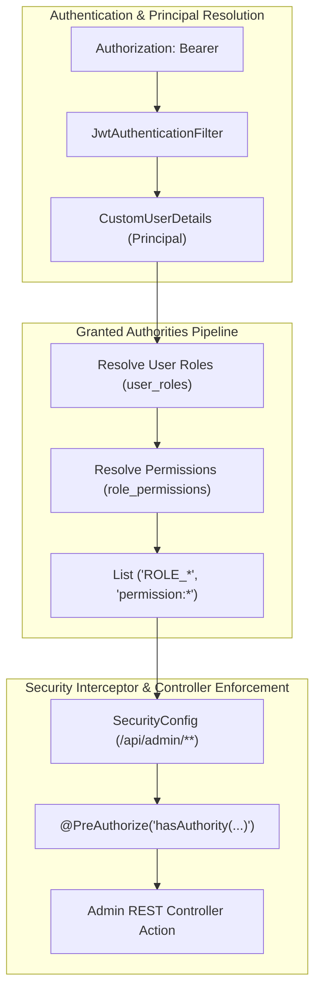

# VARELLION Admin Architecture — Security & Permissions Matrix

> **Document Version:** 2.0.0  
> **Status:** APPROVED SECURITY SPECIFICATION  
> **Security Standard:** OWASP ASVS Level 2, Spring Security 6.3.3 Architecture  
> **Authorization Model:** Multi-Role Fine-Grained Role-Based Access Control (RBAC)  

---

## 1. Security Philosophy & Defense-in-Depth

The administrative tier of VARELLION is governed by a strict **zero-trust, defense-in-depth architecture**.

### Non-Negotiable Security Invariants:
1. **Server-Enforced Authorization:** Administrative access control is strictly enforced on the Spring Boot backend via `@PreAuthorize("hasAuthority('...')")`. Hiding UI buttons, navigation links, or routes on the Next.js frontend is treated purely as UX convenience, never as a security boundary.
2. **Elimination of Binary Roles:** The legacy system evaluated only binary roles (`ROLE_USER` vs. `ROLE_ADMIN`). The expanded architecture introduces 5 specialized administrative roles mapped to **43 fine-grained permissions**.
3. **Privilege Escalation Prevention:** No administrator can grant permissions they do not possess, nor can any staff member elevate their own role or deactivate other `SUPER_ADMIN` accounts.
4. **Credential Isolation & Redaction:** Password hashes, salt values, reset tokens, and internal OAuth secrets are completely excluded from API DTOs.
5. **Session Security & Ephemeral Tokens:** Access tokens remain short-lived (15 minutes) and are stored exclusively in React memory (`AuthContext.tsx`), never in `localStorage` or `sessionStorage`. Refresh tokens are transported via `HttpOnly`, `Secure`, `SameSite=Lax` cookies.

---

## 2. Multi-Role RBAC Architecture



### 2.1 The 5 Administrative Roles
1. **`SUPER_ADMIN`:**
   - **Role ID:** 1
   - **Description:** Executive owner. Possesses all 43 system permissions. Can manage staff users, assign roles, configure global store settings, and execute financial overrides.
2. **`ADMIN`:**
   - **Role ID:** 2
   - **Description:** Store General Manager. Full control over catalog, inventory, order processing, customer profiles, shipping zones, discounts, and reports. Excluded from managing other administrators or modifying system security roles.
3. **`ORDER_MANAGER`:**
   - **Role ID:** 3
   - **Description:** Logistics & Fulfillment Supervisor. Full operational access to order queues, customer address corrections, status transitions, courier manifests, and customer phone verification.
4. **`PRODUCT_MANAGER`:**
   - **Role ID:** 4
   - **Description:** Merchandising & Catalog Specialist. Manages product listings, pricing, dual-language descriptions, gallery media, category taxonomy, and physical stock restocks.
5. **`CUSTOMER_SUPPORT`:**
   - **Role ID:** 5
   - **Description:** Customer Care Representative. Read-only access to customer profiles and orders, permission to add internal order/customer notes, and manage inbound customer support inquiries.

---

## 3. Master Permissions Matrix (43 Granular Permissions)

Every permission follows the standard pattern: `<domain>:<action>`.

| Module Domain | Permission Name | Description & Protected Capabilities | `SUPER_ADMIN` | `ADMIN` | `ORDER_MANAGER` | `PRODUCT_MANAGER` | `CUSTOMER_SUPPORT` |
| :--- | :--- | :--- | :---: | :---: | :---: | :---: | :---: |
| **Dashboard** | `dashboard:read` | View real-time KPI cards, sales chart, and operational funnels. | ✅ | ✅ | ✅ | ✅ | ❌ |
| **Products** | `products:read` | View full catalog listings, SKU details, and product metrics. | ✅ | ✅ | ❌ | ✅ | ❌ |
| | `products:create` | Create new luxury products and upload media gallery. | ✅ | ✅ | ❌ | ✅ | ❌ |
| | `products:update` | Edit product metadata, pricing, descriptions, and categories. | ✅ | ✅ | ❌ | ✅ | ❌ |
| | `products:delete` | Archive or soft-delete products from catalog. | ✅ | ✅ | ❌ | ✅ | ❌ |
| **Inventory** | `inventory:read` | View physical, reserved, and available stock levels. | ✅ | ✅ | ✅ | ✅ | ❌ |
| | `inventory:update` | Manually adjust stock quantities (restock, corrections). | ✅ | ✅ | ❌ | ✅ | ❌ |
| **Orders** | `orders:read` | View administrative order queues, search by phone/number. | ✅ | ✅ | ✅ | ❌ | ✅ |
| | `orders:update` | Transition order lifecycle status, update admin notes, edit address. | ✅ | ✅ | ✅ | ❌ | ❌ |
| | `orders:cancel` | Cancel order and trigger atomic inventory restoration. | ✅ | ✅ | ✅ | ❌ | ❌ |
| | `orders:export` | Export courier manifests and order tables to CSV/Excel. | ✅ | ✅ | ✅ | ❌ | ❌ |
| **Customers** | `customers:read` | View customer directory, spending totals, and purchase history. | ✅ | ✅ | ❌ | ❌ | ✅ |
| | `customers:update` | Update customer notes or suspend/activate customer account. | ✅ | ✅ | ❌ | ❌ | ❌ |
| **Shipping** | `shipping:read` | View shipping zones, rates, and governorate coverage. | ✅ | ✅ | ✅ | ❌ | ❌ |
| | `shipping:update` | Update delivery fees, transit duration, or toggle governorates. | ✅ | ✅ | ❌ | ❌ | ❌ |
| **Categories** | `categories:read` | View all catalog categories and product counts. | ✅ | ✅ | ❌ | ✅ | ❌ |
| | `categories:create` | Create new categories with bilingual names and slugs. | ✅ | ✅ | ❌ | ✅ | ❌ |
| | `categories:update` | Edit category titles, descriptions, and slugs. | ✅ | ✅ | ❌ | ✅ | ❌ |
| | `categories:delete` | Delete categories (guarded by product count checks). | ✅ | ✅ | ❌ | ❌ | ❌ |
| **Coupons** | `coupons:read` | View promotional coupons and redemption statistics. | ✅ | ✅ | ❌ | ❌ | ❌ |
| | `coupons:create` | Create promotional vouchers, discount values, and limits. | ✅ | ✅ | ❌ | ❌ | ❌ |
| | `coupons:update` | Update coupon dates, usage caps, or active status. | ✅ | ✅ | ❌ | ❌ | ❌ |
| | `coupons:delete` | Soft-delete / terminate active coupons. | ✅ | ✅ | ❌ | ❌ | ❌ |
| **Settings** | `settings:read` | View store contact numbers, thresholds, and policies. | ✅ | ✅ | ❌ | ❌ | ❌ |
| | `settings:update` | Update free shipping threshold, reservation window, etc. | ✅ | ❌ | ❌ | ❌ | ❌ |
| **Admin Users**| `admins:read` | View staff user directory, assigned roles, and status. | ✅ | ❌ | ❌ | ❌ | ❌ |
| | `admins:create` | Provision new staff user accounts. | ✅ | ❌ | ❌ | ❌ | ❌ |
| | `admins:update` | Update staff profile, contact, or role assignment. | ✅ | ❌ | ❌ | ❌ | ❌ |
| | `admins:manage` | Suspend staff accounts, unlock accounts, reset passwords. | ✅ | ❌ | ❌ | ❌ | ❌ |
| **Roles** | `roles:read` | View system roles and permission mapping catalog. | ✅ | ❌ | ❌ | ❌ | ❌ |
| | `roles:manage` | Create custom roles or modify role permission grants. | ✅ | ❌ | ❌ | ❌ | ❌ |
| **Reports** | `reports:read` | View sales reports, product performance, and financial sums. | ✅ | ✅ | ❌ | ❌ | ❌ |
| | `reports:export` | Stream raw financial and order reports as CSV/Excel. | ✅ | ✅ | ❌ | ❌ | ❌ |
| **Audit Logs** | `audit:read` | Search and inspect immutable system audit records. | ✅ | ✅ | ❌ | ❌ | ❌ |
| **Support** | `support:read` | View customer inquiries queue and communication threads. | ✅ | ✅ | ❌ | ❌ | ✅ |
| | `support:update` | Update inquiry status, append staff notes, assign staff. | ✅ | ✅ | ❌ | ❌ | ✅ |
| **Alerts** | `notifications:read` | View outbound SMS/WhatsApp notification logs and templates. | ✅ | ✅ | ✅ | ❌ | ❌ |
| | `notifications:update` | Edit notification templates or retry failed outbound notices. | ✅ | ✅ | ❌ | ❌ | ❌ |

---

## 4. Method Security Implementation & Code Architecture

### 4.1 CustomUserDetails Enhancement
To support both legacy role checks (`hasRole('ADMIN')`) and granular authority checks (`hasAuthority('products:create')`), `CustomUserDetailsService.java` loads both the user's role and all assigned permissions into the `GrantedAuthority` collection:

```java
// Enhanced CustomUserDetailsService mapping:
List<SimpleGrantedAuthority> authorities = new ArrayList<>();

// 1. Add legacy role authority
authorities.add(new SimpleGrantedAuthority("ROLE_" + user.getRole()));

// 2. Add granular permission authorities resolved from public.role_permissions
for (String permission : resolvedPermissions) {
    authorities.add(new SimpleGrantedAuthority(permission));
}

return new CustomUserDetails(
    user.getId(),
    user.getEmail(),
    user.getPassword(),
    user.isEnabled(),
    isNotLocked,
    authorities
);
```

### 4.2 Declarative Endpoint Protection Examples
```java
// Controller Class Level
@RestController
@RequestMapping("/api/admin/products")
@RequiredArgsConstructor
@Validated
@Slf4j
public class AdminProductController {

    // Read Catalog: requires 'products:read'
    @GetMapping
    @PreAuthorize("hasAuthority('products:read')")
    public ResponseEntity<ApiResponse<PagedAdminProductsResponse>> getAdminProducts(...) { ... }

    // Create Product: requires 'products:create'
    @PostMapping
    @PreAuthorize("hasAuthority('products:create')")
    public ResponseEntity<ApiResponse<AdminProductDetailDto>> createProduct(...) { ... }

    // Update Product: requires 'products:update'
    @PutMapping("/{productId}")
    @PreAuthorize("hasAuthority('products:update')")
    public ResponseEntity<ApiResponse<AdminProductDetailDto>> updateProduct(...) { ... }

    // Delete Product: requires 'products:delete'
    @DeleteMapping("/{productId}")
    @PreAuthorize("hasAuthority('products:delete')")
    public ResponseEntity<ApiResponse<DeleteProductResponseDto>> deleteProduct(...) { ... }
}
```

---

## 5. Privilege Escalation Prevention & Sensitive Operations

To prevent malicious or accidental privilege escalation within the administration tier, the following rules are enforced at the service layer:

1. **Self-Demotion & Self-Deletion Guard:**
   ```java
   if (currentAdmin.getId().equals(targetUserId)) {
       throw new BusinessException(HttpStatus.BAD_REQUEST, "لا يمكنك تعديل صلاحياتك أو تعطيل حسابك الشخصي");
   }
   ```
2. **Super Admin Hierarchy Protection:**
   An administrator can only modify accounts of equal or lower rank. Only users with `SUPER_ADMIN` role can modify, assign, or revoke `SUPER_ADMIN` privileges.
3. **Immutability of Audit Records:**
   The `admin_audit_logs` table has NO repository methods or service endpoints for `DELETE` or `UPDATE`. Audit rows are strictly write-once, append-only.
4. **Account Lockout Recovery:**
   If a staff user enters 5 invalid passwords, `users.failed_attempts = 5` and `users.lockout_time = NOW() + 15 min`. An unlocked admin with `admins:manage` can invoke `POST /api/admin/users/{userId}/unlock` to immediately clear the lockout.

---

## 6. Audit Logging Architecture (`AuditLogService`)

Every state mutation performed by an administrator must trigger an asynchronous or transactional audit event:

```java
@Service
@RequiredArgsConstructor
public class AuditLogService {

    private final AdminAuditLogRepository auditLogRepository;

    @Transactional(propagation = Propagation.REQUIRES_NEW)
    public void recordAction(Long actorId, String action, String entityName, String entityId, Object details, HttpServletRequest request) {
        String clientIp = resolveClientIp(request);
        String detailsJson = serializeToJson(details);

        AdminAuditLog log = AdminAuditLog.builder()
                .actorId(actorId)
                .action(action)
                .entityName(entityName)
                .entityId(entityId)
                .detailsJson(detailsJson)
                .ipAddress(clientIp)
                .createdAt(OffsetDateTime.now())
                .build();

        auditLogRepository.save(log);
    }
}
```

### Audited Actions Catalog:
* `PRODUCT_CREATED`, `PRODUCT_UPDATED`, `PRODUCT_STATUS_TOGGLED`, `PRODUCT_DELETED`
* `STOCK_ADJUSTMENT`, `STOCK_RESTOCK`, `STOCK_DAMAGED_WRITE_OFF`
* `ORDER_STATUS_CHANGED`, `ORDER_CANCELLED`, `ORDER_ADDRESS_MODIFIED`, `ORDER_NOTES_UPDATED`
* `CUSTOMER_SUSPENDED`, `CUSTOMER_ACTIVATED`
* `SHIPPING_FEE_UPDATED`, `SHIPPING_REGION_TOGGLED`
* `COUPON_CREATED`, `COUPON_UPDATED`, `COUPON_TERMINATED`
* `STORE_SETTINGS_UPDATED`
* `ADMIN_USER_CREATED`, `ADMIN_USER_SUSPENDED`, `ADMIN_ROLE_MODIFIED`, `ADMIN_PASSWORD_RESET`

---

## 7. Security Summary

This security architecture transforms VARELLION from a basic binary-permission system into a multi-tiered, enterprise-grade control plane. Least-privilege access is guaranteed across all 68 endpoints, protecting customer data, inventory assets, and financial ledgers against unauthorized modification.
