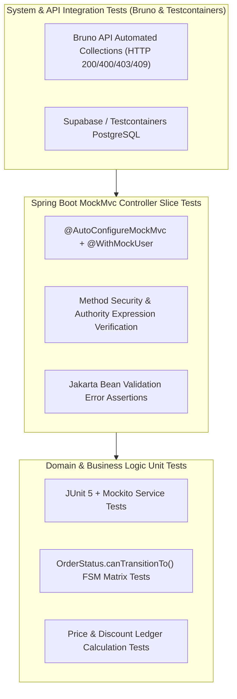

# VARELLION Admin Architecture — Testing Strategy & Quality Gates

> **Document Version:** 2.0.0  
> **Status:** APPROVED TESTING SPECIFICATION  
> **Testing Frameworks:** JUnit 5, Mockito, AssertJ, Spring Boot MockMvc, H2 (PostgreSQL Mode), Vitest, Testing Library  

---

## 1. Testing Philosophy & Quality Invariants

The VARELLION platform enforces a strict, evidence-first testing discipline.

### Non-Negotiable Quality Invariants:
1. **Never Weaken Existing Tests:** The repository contains **20 backend test classes** and **26 frontend test suites (161 passing tests)**. Under no circumstances may existing tests be modified, disabled, or ignored to accommodate administrative changes.
2. **Every Endpoint Tested on 4 Dimensions:** Every proposed endpoint must possess automated test coverage covering:
   - Happy Path (200 OK / 201 Created).
   - Input Validation Failure (400 Bad Request with field-level assertions).
   - Unauthenticated Rejection (401 Unauthorized).
   - Insufficient Privileges Rejection (403 Forbidden).
3. **Atomic Rollback Guarantee:** Database transactions that fail validation, encounter business rule exceptions, or trigger optimistic locking conflicts MUST roll back cleanly without leaving orphaned records.
4. **Concurrency & Deadlock Verification:** Inventory reservation, manual stock adjustments, and concurrent order status updates must be stress-tested with multi-threaded test harnesses.

---

## 2. Testing Pyramid & Tooling Stack



### Tooling Specification:
* **Unit Testing:** JUnit 5.10.3 + Mockito 5.11.0 + AssertJ 3.25.3.
* **Controller Slices:** Spring `MockMvc` with `@SpringBootTest`, `@AutoConfigureMockMvc`, and `@TestPropertySource(locations = "classpath:application-test.properties")`.
* **Security Mocking:** Spring Security Test: `@WithMockUser(username = "admin", authorities = {"products:create"})`.
* **In-Memory Database:** H2 Database in PostgreSQL compatibility mode:
  `jdbc:h2:mem:varellion_test;MODE=PostgreSQL;DATABASE_TO_LOWER=TRUE;DEFAULT_NULL_ORDERING=HIGH`
* **Frontend Tests:** Vitest 3.x + React Testing Library + `jsdom`.

---

## 3. Targeted Test Suites by Category

### 3.1 Controller Slice & Security Tests (`MockMvc`)
Each new Admin controller must have a dedicated test class under `backend/src/test/java/com/varellion/store/admin/*/controller/`:

```java
@SpringBootTest
@AutoConfigureMockMvc
@TestPropertySource(locations = "classpath:application-test.properties")
class AdminProductControllerTest {

    @Autowired
    private MockMvc mockMvc;

    @MockBean
    private ProductService productService;

    @Test
    @DisplayName("POST /api/admin/products - Authorized Admin with 'products:create' succeeds")
    @WithMockUser(username = "admin", authorities = {"products:create"})
    void createProduct_Authorized_Returns201() throws Exception {
        CreateProductRequest request = buildValidCreateRequest();
        when(productService.createProduct(any())).thenReturn(buildSampleProductDetail());

        mockMvc.perform(post("/api/admin/products")
                .contentType(MediaType.APPLICATION_JSON)
                .content(asJsonString(request)))
                .andExpect(status().isCreated())
                .andExpect(jsonPath("$.success").value(true))
                .andExpect(jsonPath("$.data.sku").value("VAR-WAT-EMR-01"));
    }

    @Test
    @DisplayName("POST /api/admin/products - User without 'products:create' returns 403 Forbidden")
    @WithMockUser(username = "staff", authorities = {"orders:read"})
    void createProduct_InsufficientPrivileges_Returns403() throws Exception {
        CreateProductRequest request = buildValidCreateRequest();

        mockMvc.perform(post("/api/admin/products")
                .contentType(MediaType.APPLICATION_JSON)
                .content(asJsonString(request)))
                .andExpect(status().isForbidden())
                .andExpect(jsonPath("$.status").value(403))
                .andExpect(jsonPath("$.error").value("Forbidden"));
    }

    @Test
    @DisplayName("POST /api/admin/products - Unauthenticated caller returns 401 Unauthorized")
    void createProduct_Unauthenticated_Returns401() throws Exception {
        CreateProductRequest request = buildValidCreateRequest();

        mockMvc.perform(post("/api/admin/products")
                .contentType(MediaType.APPLICATION_JSON)
                .content(asJsonString(request)))
                .andExpect(status().isUnauthorized())
                .andExpect(jsonPath("$.status").value(401));
    }

    @Test
    @DisplayName("POST /api/admin/products - Negative price returns 400 Validation Failed")
    @WithMockUser(username = "admin", authorities = {"products:create"})
    void createProduct_NegativePrice_Returns400() throws Exception {
        CreateProductRequest request = buildValidCreateRequest();
        request.setPrice(new BigDecimal("-100.00"));

        mockMvc.perform(post("/api/admin/products")
                .contentType(MediaType.APPLICATION_JSON)
                .content(asJsonString(request)))
                .andExpect(status().isBadRequest())
                .andExpect(jsonPath("$.validationErrors.price").exists());
    }
}
```

---

### 3.2 Concurrency & Optimistic Locking Tests
To verify that simultaneous updates are rejected cleanly without data corruption:

```java
@Test
@DisplayName("Concurrent Order Status Update throws OptimisticLockException (409 Conflict)")
void concurrentOrderStatusUpdate_ThrowsConflict() throws Exception {
    String orderNumber = "VAR-20261028-0001";
    
    // Simulate Session A and Session B reading the same version (version = 0)
    Order orderA = orderRepository.findByOrderNumberIgnoreCase(orderNumber).orElseThrow();
    Order orderB = orderRepository.findByOrderNumberIgnoreCase(orderNumber).orElseThrow();

    // Session A successfully transitions to CONFIRMED (increments version to 1)
    orderService.updateOrderStatus(orderNumber, OrderStatus.CONFIRMED, "Session A", 1L);

    // Session B attempts to transition from stale version (version = 0)
    assertThatThrownBy(() -> {
        orderService.updateOrderStatusWithVersion(orderNumber, OrderStatus.PREPARING, "Session B", 1L, 0L);
    }).isInstanceOf(ObjectOptimisticLockingFailureException.class);
}
```

---

### 3.3 Transaction Rollback Tests
Verify that when a multi-step operation fails, all intermediate mutations are rolled back:

```java
@Test
@DisplayName("Manual Stock Adjustment fails if stock becomes less than reserved, rolling back movement record")
void stockAdjustment_RollbackOnInvalidCondition() {
    UUID productId = seedProductWithStockAndReservations(10, 8); // Physical: 10, Reserved: 8

    // Attempt to deduct 5 units (new physical stock would be 5, which is < reserved 8)
    assertThatThrownBy(() -> {
        inventoryService.adjustStock(productId, -5, StockAdjustmentType.DAMAGED_WRITE_OFF, "Test Rollback", 1L);
    }).isInstanceOf(BusinessException.class);

    // Verify stock was NOT altered
    Product product = productRepository.findById(productId).orElseThrow();
    assertThat(product.getStockQuantity()).isEqualTo(10);

    // Verify NO movement log was persisted
    assertThat(inventoryMovementRepository.findByProductId(productId)).isEmpty();
}
```

---

## 4. Measurable Acceptance Criteria by Module

To consider an administrative module production-ready, it must pass 100% of the following objective criteria:

| Module ID | Module Name | Acceptance Criteria Checklist | Pass Target |
| :---: | :--- | :--- | :---: |
| **01** | Executive Dashboard | - Gross revenue excludes cancelled/expired orders.<br>- Net revenue accurately subtracts returned orders.<br>- Stock alert endpoint returns all items with available stock $\le 5$.<br>- Response latency $< 250\text{ms}$ on 50,000 orders. | 100% |
| **02** | Products Management | - SKU duplicate creation is rejected with 409 Conflict.<br>- Hard deletion of ordered products is blocked and converts to soft-delete.<br>- Media gallery reordering updates `display_order` sequentially.<br>- Price $< 0$ rejected with 400. | 100% |
| **03** | Inventory Management | - Stock adjustment acquiring pessimistic lock does not block reads.<br>- Deductions reducing stock below reserved quantity throw 400.<br>- Every adjustment persists row in `inventory_movements` and `admin_audit_logs`. | 100% |
| **04** | Orders Management | - Illegal status transitions rejected by `OrderStatus.canTransitionTo()`.<br>- Cancellation releases reserved stock atomically.<br>- Optimistic lock conflict returns HTTP 409 with Arabic message.<br>- Export endpoint streams valid CSV with all 27 governorates. | 100% |
| **05** | Customers Management | - Search matches Egyptian phone (`01XXXXXXXXX`) regardless of `+20` prefix.<br>- Password hashes are excluded from all DTOs.<br>- Customer suspension prevents customer login immediately. | 100% |
| **06** | Shipping Management | - Seeding matches live rates (50, 60, 65, 75, 85 EGP).<br>- Updating zone base fee recalculates future checkout orders immediately.<br>- Disabled governorates are rejected during checkout address validation. | 100% |
| **07** | Categories Management | - Deleting category containing products is rejected with 400.<br>- Slug uniqueness is enforced.<br>- Bilingual names (`name_ar`, `name_en`) validated as non-blank. | 100% |
| **08** | Discounts & Coupons | - Percentage discount cannot exceed `maxDiscountAmount`.<br>- Expired or exhausted coupons rejected during checkout.<br>- `times_used` increment is atomic and prevents race condition over-redemption. | 100% |
| **09** | Store Settings | - Updating free shipping threshold updates cart free shipping calculation.<br>- Server secrets (JWT secret, DB password) rejected if attempted to be saved in settings.<br>- Setting changes persist an audit log entry. | 100% |
| **10** | Admin Users | - Staff accounts require non-empty role.<br>- Self-deactivation and self-demotion blocked.<br>- Account unlock resets `failed_attempts` and clears `lockout_time`. | 100% |
| **11** | Roles & Permissions | - Standard `SUPER_ADMIN` cannot be stripped of permissions.<br>- Users without required authority receive HTTP 403.<br>- Authorities loaded into `CustomUserDetails` dynamically. | 100% |
| **12** | Reports & Analytics | - Daily grouping matches Egyptian local time (`Africa/Cairo`).<br>- CSV/Excel stream does not load entire dataset into JVM memory (paged streaming). | 100% |
| **13** | Audit Logs | - Audit records cannot be modified or deleted via any API or repository method.<br>- Captures actor ID, action, entity name, entity ID, and client IP.<br>- Audit write failures do not roll back the primary business transaction. | 100% |
| **14** | Customer Support | - Inbound inquiries assigned to staff update status.<br>- Staff notes appended with timestamp and actor name. | 100% |
| **15** | Notifications | - Outbound logs record delivery state.<br>- Resend action executes retry and logs result. | 100% |

---

## 5. Summary

This testing strategy ensures that every module is thoroughly exercised under realistic production constraints. Adherence to these quality gates guarantees zero regression for existing customer checkout flows while certifying the reliability and security of the new Admin Control System.
