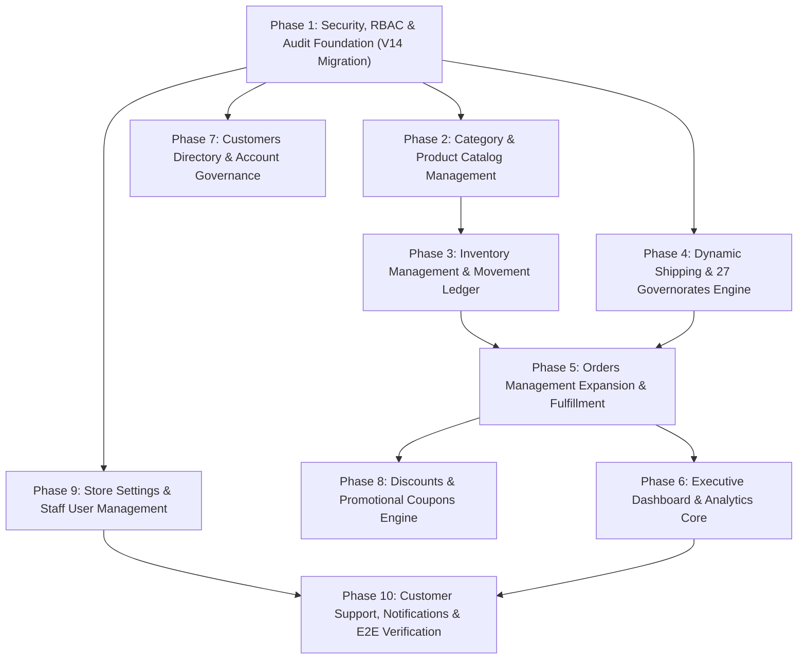

# VARELLION Admin Architecture — Implementation Roadmap (10 Phases)

> **Document Version:** 2.0.0  
> **Status:** APPROVED IMPLEMENTATION ROADMAP (PENDING STAKEHOLDER AUTHORIZATION)  
> **Execution Policy:** Independent, deliverable phases ordered by strict technical dependencies.  
> **Rule Reminder:** PLANNING ONLY — Do not modify code until explicit user approval.  

---

## 1. Technical Dependency Graph & Phase Sequencing

The implementation sequence is structured so that fundamental security, persistence, and auditing infrastructure precedes business domain endpoints:

---

## 2. Detailed Phase Specifications

---

### Phase 1: Security, RBAC & Audit Foundation
* **Objective:** Establish the multi-role RBAC schema, fine-grained permission evaluation in Spring Security, and the append-only audit logging service.
* **Required Endpoints:** None (Foundational infrastructure).
* **Existing Files to Reuse:** `SecurityConfig.java`, `CustomUserDetails.java`, `CustomUserDetailsService.java`, `User.java`, `UserRepository.java`.
* **Files to Modify:**
  - `SecurityConfig.java` (Enable Method Security, map fine-grained authorities).
  - `CustomUserDetailsService.java` (Resolve roles and permissions into `GrantedAuthority` collection).
  - `User.java` (Add `@ManyToMany` relationship to `Role`).
* **New Files to Create:**
  - `backend/src/main/resources/db/migration/V14__admin_system_expansion.sql`
  - `com.varellion.store.security.entity.Role.java`
  - `com.varellion.store.security.entity.Permission.java`
  - `com.varellion.store.security.repository.RoleRepository.java`
  - `com.varellion.store.security.repository.PermissionRepository.java`
  - `com.varellion.store.admin.audit.entity.AdminAuditLog.java`
  - `com.varellion.store.admin.audit.repository.AdminAuditLogRepository.java`
  - `com.varellion.store.admin.audit.service.AuditLogService.java`
* **Database Changes:** Flyway migration `V14` executing tables: `roles`, `permissions`, `role_permissions`, `user_roles`, `admin_audit_logs`.
* **Security Requirements:** All new security components must be backwards-compatible with existing `ROLE_USER` and `ROLE_ADMIN` checks.
* **Tests:** `RbacAuthorityMappingTest.java`, `AuditLogServiceTest.java`.
* **Acceptance Criteria:** Loading a user with assigned role dynamically resolves their full set of permission authorities into `SecurityContextHolder`.
* **Frontend Handoff:** Token decoding logic updated to parse authorities; `<PermissionGate>` component implemented.

---

### Phase 2: Category & Product Catalog Management
* **Objective:** Implement complete administrative lifecycle for categories and luxury products (creation, editing, media gallery management, soft-deletion, and optimistic locking).
* **Required Endpoints (15 endpoints):**
  - Products: `GET /api/admin/products`, `GET /api/admin/products/{id}`, `POST /api/admin/products`, `PUT /api/admin/products/{id}`, `PATCH /api/admin/products/{id}/status`, `DELETE /api/admin/products/{id}`, `POST /api/admin/products/{id}/images`, `DELETE /api/admin/products/{id}/images/{imageId}`, `PUT /api/admin/products/{id}/images/reorder`.
  - Categories: `GET /api/admin/categories`, `GET /api/admin/categories/{id}`, `POST /api/admin/categories`, `PUT /api/admin/categories/{id}`, `PATCH /api/admin/categories/{id}/status`, `DELETE /api/admin/categories/{id}`.
* **Existing Files to Reuse:** `Product.java`, `Category.java`, `ProductImage.java`, `ProductRepository.java`, `CategoryRepository.java`.
* **Files to Modify:**
  - `Product.java` (Add `@Version Long version`).
  - `Category.java` (Add `@Version Long version`).
  - `ProductRepository.java` (Add `existsBySkuIgnoreCase`, admin search queries).
* **New Files to Create:**
  - `com.varellion.store.admin.catalog.controller.AdminProductController.java`
  - `com.varellion.store.admin.catalog.controller.AdminCategoryController.java`
  - `com.varellion.store.admin.catalog.service.AdminProductService.java`
  - `com.varellion.store.admin.catalog.service.AdminCategoryService.java`
  - DTOs: `CreateProductRequest`, `UpdateProductRequest`, `AdminProductDetailDto`, `CreateCategoryRequest`, `UpdateCategoryRequest`.
* **Database Changes:** `ALTER TABLE products ADD COLUMN version BIGINT DEFAULT 0;` (included in `V14`).
* **Security:** Guarded by `products:*` and `categories:*` permissions.
* **Tests:** `AdminProductControllerTest.java`, `AdminCategoryControllerTest.java`.
* **Acceptance Criteria:** SKU uniqueness enforced; deleting an ordered product archives it instead of deleting; optimistic lock conflict returns 409.
* **Frontend Handoff:** Product catalog table, product create/edit form, image uploader and gallery reorder component.

---

### Phase 3: Inventory Management & Stock Movements
* **Objective:** Implement physical stock adjustment, stock movement audit trail, active reservation inspection, and low-stock alerting.
* **Required Endpoints (5 endpoints):**
  - `GET /api/admin/inventory`, `GET /api/admin/inventory/low-stock`, `PATCH /api/admin/inventory/products/{id}/stock`, `GET /api/admin/inventory/movements`, `GET /api/admin/inventory/products/{id}/reservations`.
* **Existing Files to Reuse:** `Product.java`, `ProductRepository.java` (`findByIdForUpdate`).
* **New Files to Create:**
  - `com.varellion.store.admin.inventory.controller.AdminInventoryController.java`
  - `com.varellion.store.admin.inventory.service.AdminInventoryService.java`
  - `com.varellion.store.admin.inventory.entity.InventoryMovement.java`
  - `com.varellion.store.admin.inventory.repository.InventoryMovementRepository.java`
  - DTOs: `AdjustStockRequest`, `InventoryItemDto`, `InventoryMovementDto`.
* **Database Changes:** Table `inventory_movements` (included in `V14`).
* **Security:** Guarded by `inventory:read` and `inventory:update`.
* **Tests:** `AdminInventoryControllerTest.java`, `InventoryLockingConcurrencyTest.java`.
* **Acceptance Criteria:** Stock adjustments use pessimistic write lock; deductions cannot reduce physical stock below reserved stock; all changes logged to movement ledger.
* **Frontend Handoff:** Inventory table, restock modal, stock movement audit drawer.

---

### Phase 4: Dynamic Shipping & 27 Governorates Engine
* **Objective:** Replace hardcoded shipping rates in `OrderService.java` with database-backed shipping zones and governorates.
* **Required Endpoints (5 endpoints):**
  - `GET /api/admin/shipping/zones`, `GET /api/admin/shipping/zones/{id}`, `PUT /api/admin/shipping/zones/{id}`, `PATCH /api/admin/shipping/governorates/{id}/status`, `GET /api/admin/shipping/governorates`.
* **Existing Files to Reuse:** `OrderService.java`.
* **Files to Modify:**
  - `OrderService.java` (Refactor `calculateAuthoritativeShippingFee` to query `ShippingZoneRepository` with fallback).
* **New Files to Create:**
  - `com.varellion.store.admin.shipping.controller.AdminShippingController.java`
  - `com.varellion.store.admin.shipping.service.AdminShippingService.java`
  - `com.varellion.store.admin.shipping.entity.ShippingZone.java`
  - `com.varellion.store.admin.shipping.entity.ShippingZoneGovernorate.java`
  - `com.varellion.store.admin.shipping.repository.ShippingZoneRepository.java`
  - `com.varellion.store.admin.shipping.repository.ShippingZoneGovernorateRepository.java`
  - DTOs: `ShippingZoneDto`, `UpdateShippingZoneRequest`, `GovernorateDetailDto`.
* **Database Changes:** Tables `shipping_zones` and `shipping_zone_governorates` seeded with live rates (included in `V14`).
* **Security:** Guarded by `shipping:read` and `shipping:update`.
* **Tests:** `AdminShippingControllerTest.java`, `ShippingCalculationIntegrationTest.java`.
* **Acceptance Criteria:** Live rates (50, 60, 65, 75, 85 EGP) preserved; rate change in zone immediately updates customer checkout fee.
* **Frontend Handoff:** Shipping zones management page, governorates rate editor.

---

### Phase 5: Orders Management Expansion & Fulfillment
* **Objective:** Expand existing order controller with internal notes updates, shipping address modifications prior to dispatch, explicit cancellation with stock release, and courier manifest exports.
* **Required Endpoints (4 new, 3 preserved = 7 total):**
  - Preserved: `GET /api/admin/orders`, `GET /api/admin/orders/{orderNumber}`, `PUT /api/admin/orders/{orderNumber}/status`.
  - New: `PATCH /api/admin/orders/{orderNumber}/notes`, `PUT /api/admin/orders/{orderNumber}/shipping-address`, `POST /api/admin/orders/{orderNumber}/cancel`, `GET /api/admin/orders/export`.
* **Existing Files to Reuse:** `AdminOrderController.java`, `OrderService.java`, `Order.java`, `OrderItem.java`, `OrderStatusHistory.java`.
* **Files to Modify:**
  - `AdminOrderController.java` (Add new endpoint mappings).
  - `OrderService.java` (Implement address update, notes update, CSV export).
* **New Files to Create:**
  - DTOs: `UpdateAdminNotesRequest`, `UpdateOrderAddressRequest`, `CancelOrderRequest`.
  - Service: `com.varellion.store.admin.order.service.OrderExportService.java`.
* **Security:** Guarded by `orders:read`, `orders:update`, `orders:cancel`, `orders:export`.
* **Tests:** Update `AdminOrderControllerTest.java` to cover notes, address update, and export.
* **Acceptance Criteria:** Address modification blocked if order is `SHIPPED` or terminal; CSV stream formats dates and governorates properly.
* **Frontend Handoff:** Address update dialog, internal notes widget, courier manifest CSV export button.

---

### Phase 6: Executive Dashboard & Analytics Core
* **Objective:** Implement real-time dashboard KPIs, sales time-series chart, status breakdown, and top-selling products.
* **Required Endpoints (5 endpoints):**
  - `GET /api/admin/dashboard/summary`, `GET /api/admin/dashboard/sales-chart`, `GET /api/admin/dashboard/order-breakdown`, `GET /api/admin/dashboard/stock-alerts`, `GET /api/admin/dashboard/top-products`.
* **Existing Files to Reuse:** `OrderRepository.java`, `ProductRepository.java`.
* **New Files to Create:**
  - `com.varellion.store.admin.dashboard.controller.AdminDashboardController.java`
  - `com.varellion.store.admin.dashboard.service.AdminDashboardService.java`
  - DTOs: `DashboardSummaryDto`, `SalesChartPointDto`, `OrderStatusBreakdownDto`, `TopProductDto`.
* **Security:** Guarded by `dashboard:read` or `reports:read`.
* **Tests:** `AdminDashboardControllerTest.java`.
* **Acceptance Criteria:** Summary gross revenue excludes cancelled orders; net revenue subtracts returns; query latency $< 250\text{ms}$.
* **Frontend Handoff:** `/admin/dashboard` page with metric cards, revenue line chart, donut status chart, and quick-action alerts.

---

### Phase 7: Customers Directory & Account Governance
* **Objective:** Implement administrative customer directory, search by normalized Egyptian phone, lifetime value metrics, and account suspension.
* **Required Endpoints (5 endpoints):**
  - `GET /api/admin/customers`, `GET /api/admin/customers/{id}`, `GET /api/admin/customers/{id}/orders`, `PATCH /api/admin/customers/{id}/status`, `PATCH /api/admin/customers/{id}/notes`.
* **Existing Files to Reuse:** `Customer.java`, `CustomerRepository.java`, `CustomerService.java`, `User.java`.
* **New Files to Create:**
  - `com.varellion.store.admin.customer.controller.AdminCustomerController.java`
  - `com.varellion.store.admin.customer.service.AdminCustomerService.java`
  - DTOs: `AdminCustomerSummaryDto`, `AdminCustomerDetailDto`, `ToggleCustomerStatusRequest`.
* **Security:** Guarded by `customers:read` and `customers:update`. Zero password hash exposure.
* **Tests:** `AdminCustomerControllerTest.java`.
* **Acceptance Criteria:** Normalization matches phone numbers whether entered as `010...` or `+2010...`; account suspension prevents login.
* **Frontend Handoff:** Customer directory table, customer profile drawer, order history list.

---

### Phase 8: Discounts & Promotional Coupons Engine
* **Objective:** Implement promo code creation, percentage/fixed discounts, usage limits, expiration dates, and checkout integration.
* **Required Endpoints (6 endpoints):**
  - `GET /api/admin/coupons`, `GET /api/admin/coupons/{id}`, `POST /api/admin/coupons`, `PUT /api/admin/coupons/{id}`, `PATCH /api/admin/coupons/{id}/status`, `DELETE /api/admin/coupons/{id}`.
* **Existing Files to Reuse:** `Order.java` (`discount_total`).
* **Files to Modify:**
  - `OrderService.java` (Integrate coupon validation into `createOrder` pipeline).
  - `CreateOrderRequest.java` (Add optional `couponCode: String`).
* **New Files to Create:**
  - `com.varellion.store.admin.coupon.controller.AdminCouponController.java`
  - `com.varellion.store.admin.coupon.service.AdminCouponService.java`
  - `com.varellion.store.admin.coupon.entity.Coupon.java`
  - `com.varellion.store.admin.coupon.entity.CouponUsage.java`
  - `com.varellion.store.admin.coupon.repository.CouponRepository.java`
  - `com.varellion.store.admin.coupon.repository.CouponUsageRepository.java`
  - DTOs: `CreateCouponRequest`, `CouponDto`, `CouponDetailDto`.
* **Database Changes:** Tables `coupons` and `coupon_usages` (included in `V14`).
* **Security:** Guarded by `coupons:*` permissions.
* **Tests:** `AdminCouponControllerTest.java`, `CouponCheckoutIntegrationTest.java`.
* **Acceptance Criteria:** Percentage discounts do not exceed `maxDiscountAmount`; atomic `times_used` increment prevents over-redemption.
* **Frontend Handoff:** Coupons management page, create coupon dialog, checkout promo input.

---

### Phase 9: Store Settings & Staff User Management
* **Objective:** Implement dynamic store settings management and internal staff account administration with RBAC role assignments.
* **Required Endpoints (11 endpoints):**
  - Settings (4): `GET /api/admin/settings`, `PUT /api/admin/settings`, `GET /api/admin/settings/{key}`, `PUT /api/admin/settings/{key}`.
  - Staff Users (7): `GET /api/admin/users`, `GET /api/admin/users/{id}`, `POST /api/admin/users`, `PUT /api/admin/users/{id}`, `PATCH /api/admin/users/{id}/status`, `POST /api/admin/users/{id}/unlock`, `POST /api/admin/users/{id}/reset-password`.
* **Existing Files to Reuse:** `User.java`, `UserRepository.java`, `AuthService.java`.
* **New Files to Create:**
  - `com.varellion.store.admin.settings.controller.AdminSettingsController.java`
  - `com.varellion.store.admin.settings.service.AdminSettingsService.java`
  - `com.varellion.store.admin.settings.entity.StoreSetting.java`
  - `com.varellion.store.admin.settings.repository.StoreSettingRepository.java`
  - `com.varellion.store.admin.user.controller.AdminUserController.java`
  - `com.varellion.store.admin.user.service.AdminUserService.java`
  - DTOs: `StoreSettingsDto`, `UpdateStoreSettingsRequest`, `CreateAdminUserRequest`, `AdminUserDto`.
* **Database Changes:** Table `store_settings` (included in `V14`).
* **Security:** Guarded by `settings:*` and `admins:*` permissions. Self-demotion blocked.
* **Tests:** `AdminSettingsControllerTest.java`, `AdminUserControllerTest.java`.
* **Acceptance Criteria:** Server secrets cannot be stored in settings; unlocked staff user can log in immediately.
* **Frontend Handoff:** Settings editor form, staff user directory, user invite/create modal.

---

### Phase 10: Customer Support, Notifications & System Auditing
* **Objective:** Implement support ticket handling, outbound notification logs, and system audit log browser with complete end-to-end verification.
* **Required Endpoints (12 endpoints):**
  - Support (5): `GET /api/admin/support/inquiries`, `GET /api/admin/support/inquiries/{id}`, `PATCH /api/admin/support/inquiries/{id}/status`, `POST /api/admin/support/inquiries/{id}/notes`, `PATCH /api/admin/support/inquiries/{id}/assign`.
  - Notifications (4): `GET /api/admin/notifications/logs`, `POST /api/admin/notifications/resend/{id}`, `GET /api/admin/notifications/templates`, `PUT /api/admin/notifications/templates/{id}`.
  - Audit Logs (3): `GET /api/admin/audit-logs`, `GET /api/admin/audit-logs/{id}`, `GET /api/admin/audit-logs/entities`.
* **New Files to Create:**
  - Controllers: `AdminSupportController.java`, `AdminNotificationController.java`, `AdminAuditLogController.java`.
  - Services: `AdminSupportService.java`, `AdminNotificationService.java`.
  - Entities: `CustomerInquiry.java`, `NotificationLog.java`, `NotificationTemplate.java`.
  - Repositories: `CustomerInquiryRepository.java`, `NotificationLogRepository.java`, `NotificationTemplateRepository.java`.
* **Database Changes:** Tables `customer_inquiries`, `notification_logs`, `notification_templates` (included in `V14`).
* **Security:** Guarded by `support:*`, `notifications:*`, and `audit:read`.
* **Tests:** `AdminSupportControllerTest.java`, `AdminAuditLogControllerTest.java`.
* **Acceptance Criteria:** Audit logs are searchable by actor and date; support inquiries can be assigned to staff; resend action retries notifications.
* **Frontend Handoff:** Customer support dashboard, notification log inspector, audit trail viewer.

---

## 3. Implementation Verification & Quality Gates

Before any phase is marked complete, it must satisfy:
1. `mvn clean test` runs with **0 failures and 0 errors**.
2. Frontend `npm test` runs with **0 regressions**.
3. All new endpoints are covered by Bruno API test requests in `bruno/`.
4. Git diff contains zero mock data left in production paths and zero commented-out code.
