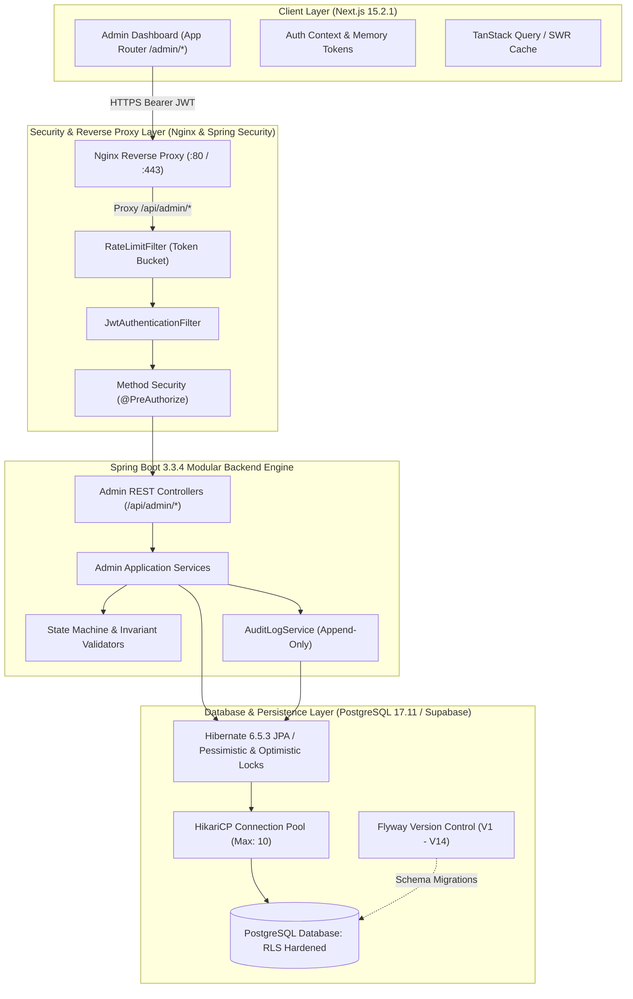

# VARELLION Admin Backend System Architecture & Master Specification

> **Document Version:** 2.0.0 (Enterprise Specification)  
> **Status:** ARCHITECTURE & PLANNING ONLY — PENDING STAKEHOLDER APPROVAL  
> **Author:** Principal Backend Architect, Database Architect & Security Engineer  
> **Target Environment:** Spring Boot 3.3.4 (Java 17/21), Next.js 15.2.1 (App Router), PostgreSQL 17.11 (Supabase AWS EU-West-1)  
> **Repository:** VARELLION E-Commerce Platform  
> **Date:** November 2026  

---

## 1. Executive Summary & Purpose

This documentation suite establishes the authoritative, production-grade **Admin Backend Architecture, API Specifications, Database Impact Analysis, Security RBAC Model, and Implementation Roadmap** for the VARELLION luxury e-commerce platform.

VARELLION operates in the Arab Republic of Egypt, specializing in masculine luxury horology (chronographs, skeleton automatics) and vegetable-tanned full-grain leather accessories. The business model is centered on high-trust customer assurance:
1. **Inspection Prior to Payment ("معاينة وفحص قبل الاستلام")**: Customers have the absolute right to inspect physical items before paying courier cash.
2. **Authoritative Cash on Delivery (COD)** across all 27 Egyptian governorates.
3. **Server-authoritative pricing and inventory locking** to prevent race conditions and fraud.

While the public customer-facing experience (authentication, customer profile, catalog browsing, cart sync, checkout with pessimistic locking, and dual-factor guest order tracking) is fully implemented and tested, **the administrative control plane currently possesses only order fulfillment endpoints (`GET /api/admin/orders`, `GET /api/admin/orders/{orderNumber}`, `PUT /api/admin/orders/{orderNumber}/status`)**.

This document suite designs the complete, production-ready Admin System across **15 core business modules**, introducing **68 granular endpoints**, a unified **Role-Based Access Control (RBAC) model with 43 fine-grained permissions**, an **append-only audit logging architecture**, and a deterministic **10-phase implementation roadmap**.

---

## 2. Master Documentation Index

The VARELLION Admin architecture documentation is structured into 12 dedicated, highly specialized architectural volumes:

| Document | File Path | Scope & Core Contents |
| :--- | :--- | :--- |
| **01. Project Architecture Audit** | [`01-PROJECT-ARCHITECTURE-AUDIT.md`](./01-PROJECT-ARCHITECTURE-AUDIT.md) | Comprehensive audit of existing backend, entities, security, repositories, services, tests, and architectural risks. Classified findings (`IMPLEMENTED`, `PARTIALLY IMPLEMENTED`, `MISSING`, `NEEDS IMPROVEMENT`). |
| **02. Reference Analysis & Inventory** | [`02-REFERENCE-ANALYSIS.md`](./02-REFERENCE-ANALYSIS.md) | Exhaustive inventory of repository references, specifications, schema files, design guides, and identified contradictions between documentation and live code. |
| **03. Skills Utilization Report** | [`03-SKILLS-UTILIZATION.md`](./03-SKILLS-UTILIZATION.md) | Report on discovered Agent Skills (`admin-order-management`, `awesome-api-design`, `awesome-database-audit`, `awesome-security-audit`, etc.), their application, and methodological rigor. |
| **04. Admin Business Architecture** | [`04-ADMIN-BUSINESS-ARCHITECTURE.md`](./04-ADMIN-BUSINESS-ARCHITECTURE.md) | Detailed business requirements, workflows, domain events, edge cases, and architectural specifications across all 15 Admin modules. |
| **05. Complete Admin API Inventory** | [`05-ADMIN-API-INVENTORY.md`](./05-ADMIN-API-INVENTORY.md) | Complete inventory of all 68 admin endpoints: HTTP methods, paths, parameters, DTOs, permissions, transactional boundaries, concurrency, and caching rules. |
| **06. API Contract Specifications** | [`06-ADMIN-API-CONTRACTS.md`](./06-ADMIN-API-CONTRACTS.md) | Realistic JSON payloads for every endpoint: headers, request bodies, success envelopes (`ApiResponse<T>`), validation errors, security failures, and conflict errors (`ErrorResponse`). |
| **07. Database Impact Analysis** | [`07-DATABASE-IMPACT-ANALYSIS.md`](./07-DATABASE-IMPACT-ANALYSIS.md) | PostgreSQL schema analysis, proposed Flyway migration `V14`, foreign keys, constraints, pessimistic/optimistic locking analysis, and data integrity safeguards. |
| **08. Security & Permissions Matrix** | [`08-SECURITY-AND-PERMISSIONS.md`](./08-SECURITY-AND-PERMISSIONS.md) | Comprehensive security model: 5 administrative roles, 43 granular permissions, Method Security expressions, token security, privilege escalation prevention, and audit logging. |
| **09. Frontend Integration Guide** | [`09-FRONTEND-INTEGRATION-GUIDE.md`](./09-FRONTEND-INTEGRATION-GUIDE.md) | Next.js App Router integration guide: page hierarchy, data fetching with TanStack Query / SWR, optimistic updates, error mapping, and UI permission gates. |
| **10. Testing Strategy & Quality Gates** | [`10-TESTING-STRATEGY.md`](./10-TESTING-STRATEGY.md) | Verification framework: JUnit 5, MockMvc, H2 compatibility tests, concurrency stress tests, transaction rollback verification, and measurable acceptance criteria. |
| **11. Implementation Roadmap** | [`11-IMPLEMENTATION-ROADMAP.md`](./11-IMPLEMENTATION-ROADMAP.md) | Phased, dependency-ordered rollout plan (Phases 1 to 10) with exact deliverables, files to create/modify, and verification gates. |
| **12. Open Questions & Architectural Decisions** | [`12-OPEN-QUESTIONS-AND-DECISIONS.md`](./12-OPEN-QUESTIONS-AND-DECISIONS.md) | Key architectural tradeoffs, unresolved business questions requiring stakeholder input, and recommended technical decisions. |

---

## 3. Core Architectural Principles

All designs within this documentation strictly observe the following foundational principles:

1. **Strict Project Integrity:** This phase is **PLANNING AND DOCUMENTATION ONLY**. No Java code, frontend components, or database migrations are modified until formal stakeholder approval.
2. **Server-Side Authoritative Computations:** The client is never trusted for financial amounts, stock balances, discounts, or shipping rates. All calculations occur inside ACID-compliant backend transactions.
3. **Deadlock-Free Row-Level Locking:** All bulk inventory mutations sort entities deterministically by primary key (`productId` ASC) prior to acquiring `PESSIMISTIC_WRITE` locks (`SELECT ... FOR UPDATE`).
4. **Optimistic Concurrency Control:** High-churn administrative entities (Orders, Products, Settings) enforce `@Version BIGINT` locking to eliminate lost updates between concurrent admin sessions.
5. **Defense-in-Depth Authorization:** Role checks are never delegated solely to the frontend navigation UI. Every admin endpoint enforces `@PreAuthorize("hasAuthority('...')")` evaluated against cryptographically signed JWT claims.
6. **Immutable Financial & Historical Snapshots:** Order prices, item names, SKUs, and historical lifecycle status transitions are immutable once persisted.

---

## 4. System Architecture Overview

---

## 5. Next Steps

Review the architectural volumes in sequence starting with [01-PROJECT-ARCHITECTURE-AUDIT.md](./01-PROJECT-ARCHITECTURE-AUDIT.md). After review and alignment on [12-OPEN-QUESTIONS-AND-DECISIONS.md](./12-OPEN-QUESTIONS-AND-DECISIONS.md), Phase 1 of the [11-IMPLEMENTATION-ROADMAP.md](./11-IMPLEMENTATION-ROADMAP.md) can be authorized for implementation.
