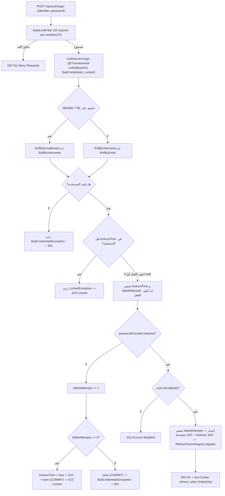
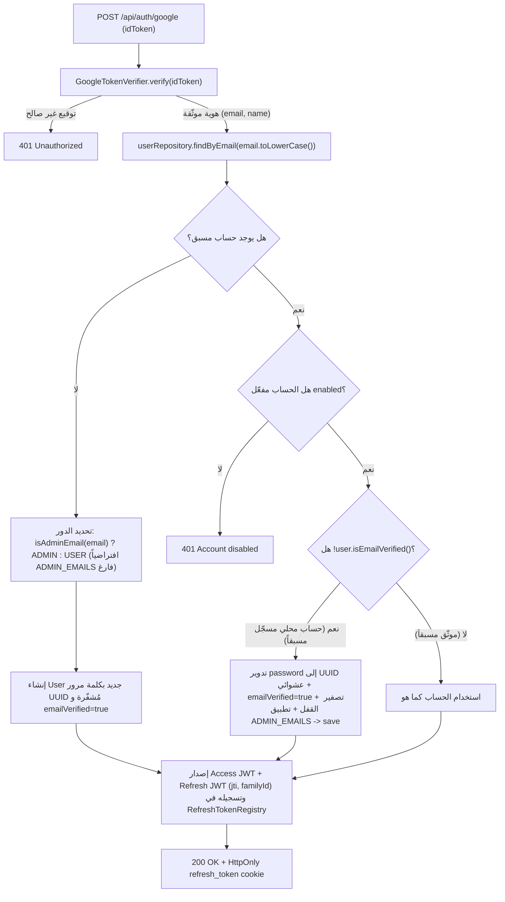
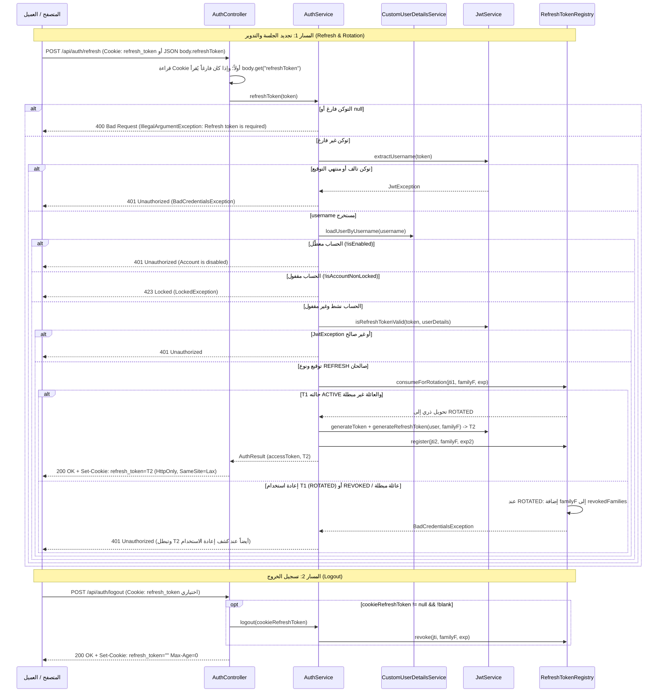
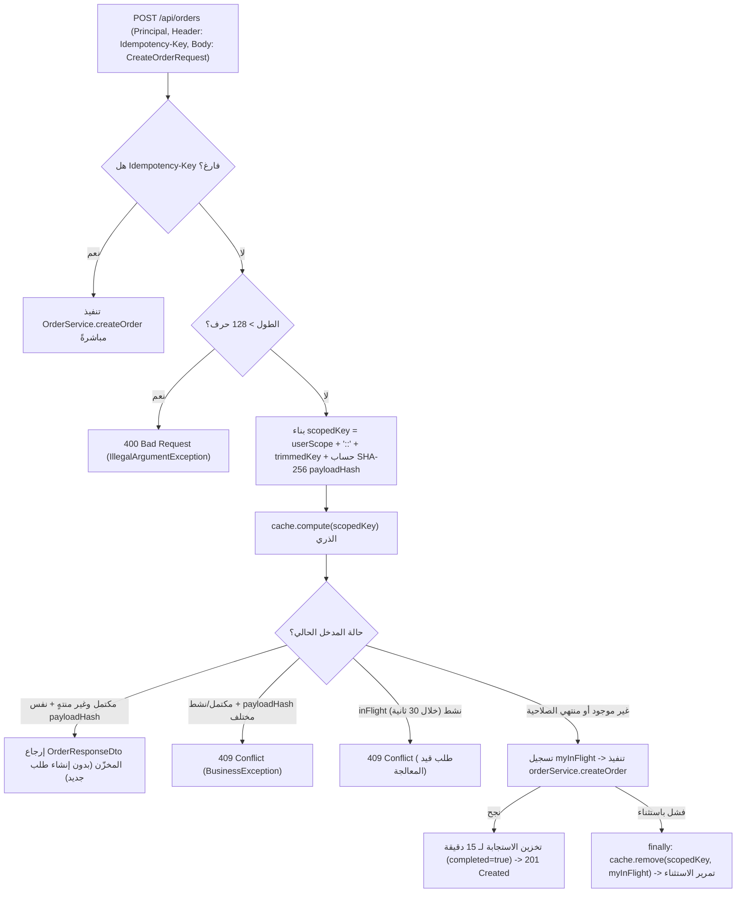
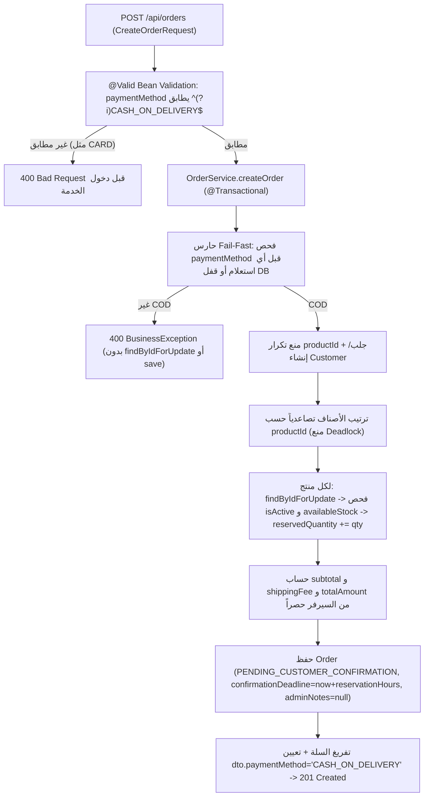
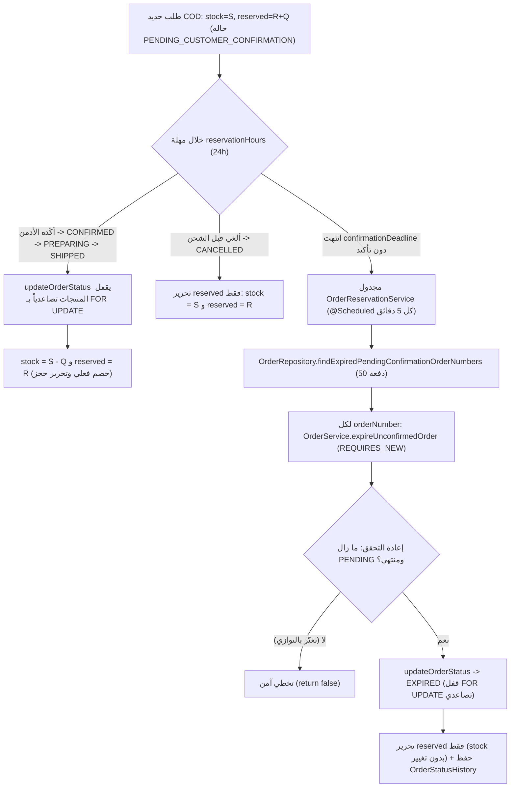
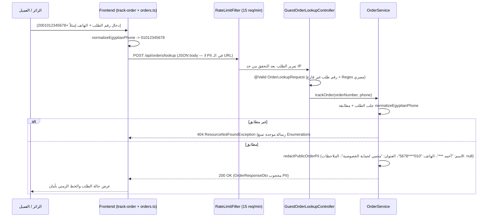

# MISSION 03 — التوثيق الشامل والموثّق بالأدلة لتغييرات VARELLION

> **تاريخ التوثيق:** 2026-11-18  
> **الفرع (Git Branch):** `ahmed-essam`  
> **آخر Commit أساسي قبل التعديلات:** `2aeb6aa` (`chore(ahmed-essam): add admin blueprint and clean distracting docs while preserving skills`)  
> **نطاق التوثيق:** جميع التعديلات والإضافات المُنفّذة خلال **MISSION 03** لمعالجة معوّقات الإنتاج الـ 14 المؤكّدة (`AUD-001` إلى `AUD-014`) في نظام **VARELLION Luxury E-Commerce**، استناداً حصرياً إلى الكود الفعلي و`git diff` والاختبارات.  
> **ملاحظة منهجية:** كل ادّعاء تقني في هذا المستند مبني على الكود المصدري أو ملفات الإعداد أو مخرجات الاختبارات الفعلية. أي بند لم يُختبر على بيئة حقيقية (مثل PostgreSQL/Supabase الإنتاجي أو شهادة TLS حيّة) مُعلَّم صراحةً بـ **UNVERIFIED**.

---

## 1. جرد التغييرات الفعلي في المستودع (Actual Repository Inventory)

تم التحقق مباشرةً من حالة Git (`git branch --show-current`، `git log -n 5 --oneline`، `git status --short`، `git diff --stat`) بدلاً من الاعتماد على أي تقارير سابقة.

### 1.1 السياق التاريخي لآخر 5 Commits
| Commit | الوصف |
|---|---|
| `2aeb6aa` (`HEAD -> ahmed-essam`) | `chore(ahmed-essam): add admin blueprint and clean distracting docs while preserving skills` |
| `5b34b07` (`main`) | `update` |
| `8a3de82` | `Merge pull request #2 from mohamedcody/feature/checkout-cod-flow` |
| `cd1501a` | `update seo this project` |
| `c21205b` | `fix(audit): drop redundant V11 trigger, align actor_id to users.id BIGINT FK (Package B)` |

### 1.2 ملخص حالة Working Tree مقابل `HEAD` (`2aeb6aa`)
| التصنيف | العدد الفعلي | التفاصيل |
|---|---:|---|
| **إجمالي الملفات المُعدَّلة في المستودع (`M`)** | **58** | `38` ملفاً ضمن Mission 03 + `20` ملفاً من تعديلات SEO/skills سابقة لم تُمس في Mission 03 |
| **إجمالي المسارات الجديدة غير المتتبعة (`??`)** | **16** | `2` ملفان أُنشئا في Mission 03 + `14` مساراً من تعديلات SEO/skills سابقة (2 مجلدات مهارات + 12 ملفاً في Frontend) |
| **ملفات Mission 03 المُعدَّلة (`MODIFIED`)** | **38** | `22` ملف كود/إعداد Backend + `9` ملفات اختبار Backend + `1` ملف نشر (`compose.prod.yml`) + `6` ملفات Frontend منسّقة (`5` كود + `1` اختبار) |
| **ملفات Mission 03 الجديدة (`CREATED`)** | **2** | `RefreshTokenRegistry.java` + `AuthSecurityIntegrationTest.java` |
| **إجمالي ملفات Mission 03 الموثّقة هنا** | **40** | `38` مُعدَّل + `2` مُنشأ (`+1013 / -265` سطر في الملفات المُعدَّلة، بالإضافة إلى `445` سطراً في الملفين الجديدين) |

> **تنبيه حول الملفات المشتركة مع تعديلات SEO السابقة:**  
> - `compose.prod.yml` يحتوي على تعديلات SEO سابقة للـ Frontend (`INTERNAL_API_URL`, `NEXT_PUBLIC_SITE_URL`, `NEXT_PUBLIC_SUPPORT_PHONE`, `NEXT_PUBLIC_WHATSAPP_URL`) إلى جانب تعديلات Mission 03 للـ Backend (`SERVER_SHUTDOWN`, `SPRING_PROFILES_ACTIVE`, `SPRING_FLYWAY_URL`, `SPRING_FLYWAY_VALIDATE_ON_MIGRATE`, `ADMIN_EMAILS`, `COOKIE_SECURE`, و`FRONTEND_URL`).  
> - `frontend/src/app/track-order/page.tsx` يحتوي على تعديل SEO سابق (`<main>` إلى `
` لتجنب تكرار عنصر `<main>`) إلى جانب تعديل Mission 03 لدالة `normalizeEgyptianPhone`.  
> - بقية الـ 20 ملفاً المُعدَّلة (`nginx.conf`, `frontend/.env.example`, `skills-lock.json`, و17 ملف SEO/UI في `frontend/`) والـ 14 مساراً غير المتتبع (مجلدات `awesome-agent-skills-main/skills/*`، وأصول `frontend/public/*`، وملفات `layout.tsx`، و`ProductsCatalogClient.tsx`، و`seo-hardening.test.tsx`) هي أعمال سابقة محفوظة كما هي وليست جزءاً من Mission 03.

### 1.3 خريطة المعوّقات الـ 14 (`AUD-001`–`AUD-014`)
| المعرّف | الخطورة | المجال | الحالة في Mission 03 |
|---|---|---|---|
| `AUD-001` | Critical | Auth & Order Idempotency | مكتمل (في الكود والاختبارات — تخزين In-Memory لخادم واحد) |
| `AUD-002` | Critical | RateLimitFilter & Trusted Proxies | مكتمل (في الكود والاختبارات) |
| `AUD-003` | Critical | Persistent Account Lockout | مكتمل (في الكود واختبار H2 Integration) |
| `AUD-004` | Critical | Username/Email Collision & Google OAuth Takeover | مكتمل (في الكود والاختبارات) |
| `AUD-005` | High | GlobalExceptionHandler HTTP Statuses (401/403/409) | مُنفّذ في الكود (تغطية اختبارات `401`/`403` مكتملة؛ اختبار `PessimisticLockingFailureException` غير موجود `UNVERIFIED`) |
| `AUD-006` | High | AdminProductService Pessimistic Locking | مكتمل (في الكود والاختبارات) |
| `AUD-007` | High | Automatic Reservation Expiration Scheduler | مكتمل (في الكود واختبار H2 Integration) |
| `AUD-008` | High | Production Compose, Graceful Shutdown & TLS | **مكتمل جزئياً** (الإعدادات مُحصّنة؛ شهادة TLS وتشغيل 443 على الخادم الحي `UNVERIFIED`) |
| `AUD-009` | High | Strict COD-Only Payment Scope (Backend + Frontend) | **مكتمل جزئياً** (مسار Backend وCheckout الطبيعي محصوران في COD؛ تبقى صفحة `/checkout/mock-paymob` وبقايا `callback/page.tsx` للتنظيف قبل الإنتاج) |
| `AUD-010` | High | `ADMIN_EMAILS` Default & `.env` Production Isolation | مُنفّذ في الكود (اختبار `ADMIN_EMAILS` مكتمل؛ اختبار `loadDotEnv()` في وضع `prod` غير موجود `UNVERIFIED`) |
| `AUD-011` | High | Refresh Token Revocation, Rotation & Reuse Detection | مكتمل (في الكود والاختبارات — تخزين In-Memory لخادم واحد) |
| `AUD-012` | High | Flyway Validation, `:5432` Separation & `prepareThreshold=0` | مكتمل في الإعدادات (اختبار PostgreSQL/Supavisor الحقيقي `UNVERIFIED`) |
| `AUD-013` | High | Cart Quantity Caps, Overflow & Stock Guards | مكتمل (في الكود والاختبارات) |
| `AUD-014` | High | Guest Order Tracking PII Redaction, Validation & POST Lookup | مكتمل (في الكود والاختبارات) |

---

## 2. التوثيق التفصيلي لكل ملف مُعدَّل أو مُنشأ في Mission 03 (All 40 Files)

### 2.1 ملفات كود وإعدادات Backend (22 مُعدَّل + 1 مُنشأ = 23 ملفاً)

---

#### 1) `backend/src/main/java/com/varellion/store/security/service/RefreshTokenRegistry.java`
- **الحالة:** `CREATED` (150 سطراً)
- **السلوك السابق:** لم يكن موجوداً؛ كانت Refresh Tokens عبارة عن JWTs عديمة الحالة (Stateless) لا يمكن إبطالها من السيرفر عند تسجيل الخروج ولا تتبع إعادة استخدامها.
- **السلوك الجديد:** سجل خيطي آمن (`ConcurrentHashMap`) في الذاكرة يتتبع كل Refresh Token عبر `jti` (`tokenId`) ومعرّف عائلة الجلسة `token_family` (`familyId`) وحالته (`ACTIVE` / `ROTATED` / `REVOKED`) مع حد أقصى `MAX_TRACKED_TOKENS = 100_000`، وتنظيف مجدول كل 5 دقائق (`@Scheduled(fixedRate = 300_000)`).
- **العناصر المُنشأة:**
  - الفئة `RefreshTokenRegistry` (`@Service`) وEnum داخلي `TokenState` وClass `TokenRecord`.
  - `register(String tokenId, String familyId, Instant expiresAt)`: تسجيل توكن جديد كـ `ACTIVE`.
  - `consumeForRotation(String tokenId, String familyId, Instant expiresAt)`: فحص إبطال العائلة (`revokedFamilies`) ثم الانتقال الذري عبر `tokens.compute(...)` من `ACTIVE` إلى `ROTATED`. عند اكتشاف إعادة استخدام توكن `ROTATED`، يُبطل العائلة بالكامل ويطلق `BadCredentialsException`.
  - `revoke(String tokenId, String familyId, Instant expiresAt)`: إبطال صريح للتوكن وعائلته (عند `logout`).
  - `fingerprint(String rawToken)`: دالة `SHA-256` احتياطية عندما يفتقد التوكن لـ `jti`.
  - `cleanupExpired()`: إزالة السجلات والعائلات المنتهية الصلاحية دورياً.
- **لماذا كان التغيير ضرورياً (`AUD-011`):** لأن حذف الكوكي في المتصفح وحده لا يمنع مهاجماً سرق التوكن من الاستمرار في تجديد الجلسة لمدة 7 أيام.
- **الأثر الأمني والتجاري:** إغلاق ثغرة بقاء جلسة مسروقة بعد تسجيل الخروج، وكشف فوري لسرقة Refresh Token عبر إبطال كامل العائلة (Token Reuse Detection).
- **الاختبارات المرتبطة:** `AuthServiceTest.testLogoutRevokesRefreshToken`، `AuthServiceTest.testRefreshTokenReuseDetectionRevokesFamily`، `AuthSecurityIntegrationTest.refreshToken_LogoutAndRotationReuseDetection`.
- **القيود المتبقية:** تخزين In-Memory فقط (مناسب لنسخة Backend واحدة). إعادة تشغيل الخادم تفقد السجل (التوكنات الصادرة قبل إعادة التشغيل تُعامل كـ untracked وتُوسم `ROTATED` عند أول تجديد)، ولا يتشارك بين عدة نسخ (Multi-instance) بدون Redis أو جدول DB.

---

#### 2) `backend/src/main/java/com/varellion/store/security/jwt/JwtService.java`
- **الحالة:** `MODIFIED` (`+27 / -1`)
- **السلوك السابق:** `generateRefreshToken(UserDetails)` كان يُنشئ JWT بدون `jti` وبدون `token_family`. كما كان تحويل المفتاح السري الاحتياطي يستخدم `secret.getBytes()` بالترميز الافتراضي لنظام التشغيل.
- **السلوك الجديد:** كل Refresh Token يحمل الآن `jti` (`UUID.randomUUID()`) وادّعاء `token_family` (`TOKEN_FAMILY_CLAIM = "token_family"`). كما تم تثبيت `StandardCharsets.UTF_8` عند تحويل المفتاح السري غير المشفّر بـ Base64.
- **العناصر المُعدَّلة/المضافة:**
  - الثابت `TOKEN_FAMILY_CLAIM = "token_family"`.
  - `extractTokenId(String token)`، `extractTokenFamily(String token)`، `extractExpirationInstant(String token)`.
  - Overload جديد `generateRefreshToken(UserDetails userDetails, String familyId)` وتحديث `generateRefreshToken(UserDetails)` لتوليد `familyId` جديد وتمريره.
  - تحديث Constructor لاستخدام `secret.getBytes(StandardCharsets.UTF_8)`.
- **لماذا كان التغيير ضرورياً (`AUD-011`):** لتمكين `RefreshTokenRegistry` من تتبع كل توكن فردي وربط سلسلة التدوير بعائلة واحدة، ومنع اختلاف التوقيع بين أنظمة التشغيل بسبب Locale encoding.
- **الأثر الأمني والتجاري:** ربط رياضي موقّع داخل الـ JWT بين الجلسة وعائلة التوكنات الخاصة بها دون كشف بيانات حساسة.
- **الاختبارات المرتبطة:** `JwtServiceTest`، `AuthServiceTest`، `AuthSecurityIntegrationTest.refreshToken_LogoutAndRotationReuseDetection`.
- **القيود المتبقية:** لا توجد تغييرات على Access Token (لا يزال Stateless لمدة 15 دقيقة `JWT_EXPIRATION=900000`).

---

#### 3) `backend/src/main/java/com/varellion/store/security/controller/AuthController.java`
- **الحالة:** `MODIFIED` (`+5 / -1`)
- **السلوك السابق:** دالة `POST /api/auth/logout` كانت بدون معاملات؛ تكتفي بإرسال `Set-Cookie` بقيمة فارغة و`Max-Age=0` دون إخبار السيرفر بإبطال التوكن.
- **السلوك الجديد:** تقبل `logout(...)` معامل `@CookieValue(name = "refresh_token", required = false) String cookieRefreshToken` وتستدعي `authService.logout(cookieRefreshToken)` قبل مسح الكوكي.
- **العناصر المُعدَّلة:** `AuthController.logout(String cookieRefreshToken)`.
- **لماذا كان التغيير ضرورياً (`AUD-011`):** ربط نقطة نهاية الخروج بآلية الإبطال الخادمي في `RefreshTokenRegistry`.
- **الأثر الأمني والتجاري:** تسجيل الخروج يبطل الجلسة فعلياً على السيرفر وليس في المتصفح فقط.
- **الاختبارات المرتبطة:** `AuthControllerTest.logout_ShouldClearHttpOnlyCookieWithMaxAgeZero`، `AuthSecurityIntegrationTest.refreshToken_LogoutAndRotationReuseDetection`.
- **القيود المتبقية:** إذا استدعى العميل `/logout` بدون كوكي (مثلاً مسحه مسبقاً)، ينجح الطلب بـ 200 دون إبطال خادمي لأن التوكن غير مرسل.

---

#### 4) `backend/src/main/java/com/varellion/store/security/service/AuthService.java`
- **الحالة:** `MODIFIED` (`+148 / -36`)
- **السلوك السابق:**
  1. `login()` كان يحمل `@Transactional` بدون `noRollbackFor`، فيُعاد لفّ (Rollback) تحديث `failedAttempts` و`lockoutTime` كلما أُطلقت `BadCredentialsException` أو `LockedException` (`AUD-003`).
  2. `login()` و`refreshToken()` كانا يبحثان بـ `findByUsername` قبل `findByEmail`، ولم يمنع `register()` الرمز `@` في `username` (`AUD-004`).
  3. `googleLogin()` كان يربط تلقائياً بحساب محلي موجود بنفس الإيميل دون تدوير كلمة المرور التي قد يكون مهاجم سجّلها مسبقاً قبل تسجيل دخول الضحية عبر Google (`AUD-004`).
  4. `@Value("${ADMIN_EMAILS:admin@varellion.com}")` كان يمنح صلاحية `ADMIN` افتراضياً لـ `admin@varellion.com` عند غياب متغير البيئة (`AUD-010`).
  5. `refreshToken()` لم يلتقط `JwtException` (فيتسرب كـ `500`) ولم يتكامل مع `RefreshTokenRegistry` (`AUD-005`, `AUD-011`).
- **السلوك الجديد:**
  1. `@Transactional(noRollbackFor = {BadCredentialsException.class, LockedException.class})` على `login()`.
  2. دالة `resolveUserByIdentifier(String identifier)`: إذا احتوى المُعرّف على `@` تبحث بـ `findByEmail(lowercase)` أولاً ثم `findByUsername`؛ وإلا العكس. و`register()` يرفض أي `username` يحتوي على `@`.
  3. في `googleLogin()`: إذا وُجد حساب محلي بنفس البريد وكان `!user.isEmailVerified()`، يُستبدل `password` بـ UUID عشوائي مُشفّر، ويُفعّل `emailVerified=true`، ويُصفّر `failedAttempts`/`lockoutTime`، وتُطبّق قائمة `ADMIN_EMAILS`.
  4. تغيير القيمة الافتراضية إلى `@Value("${ADMIN_EMAILS:}")` وفلترة السلاسل الفارغة في `isAdminEmail`.
  5. حقن `RefreshTokenRegistry` وإضافة `logout(String refreshToken)` و`issueAndRegisterRefreshToken(...)` و`safeExtractTokenId/Family/Expiration(...)`، وتغليف استدعاءات `jwtService` في `refreshToken()` بـ `try/catch (JwtException)` لرمي `BadCredentialsException` (`401`).
- **العناصر المُعدَّلة/المضافة:** `login`, `register`, `googleLogin`, `refreshToken`, `logout`, `issueAndRegisterRefreshToken`, `safeExtractTokenId`, `safeExtractTokenFamily`, `safeExtractExpiration`, `resolveUserByIdentifier`, `isAdminEmail`, وحقل `adminEmails` و`refreshTokenRegistry`.
- **لماذا كان التغيير ضرورياً:** يعالج خمسة معوّقات أمنية حرجة/عالية (`AUD-003`, `AUD-004`, `AUD-005`, `AUD-010`, `AUD-011`).
- **الأثر الأمني والتجاري:** تفعيل حقيقي لحماية Brute-Force (قفل 15 دقيقة بعد 5 محاولات فاشلة)، منع الاستيلاء على الحسابات قبل التسجيل (Pre-registration Account Takeover)، منع صلاحيات أدمن افتراضية، وضمان استجابة `401` سليمة عند التوكنات التالفة أو المعاد استخدامها.
- **الاختبارات المرتبطة:** `AuthServiceTest` (21 اختباراً منها 5 جديدة)، `AuthSecurityIntegrationTest` (اختبارات Lockout، `@` rejection، `401`، Logout/Rotation).
- **القيود المتبقية:** قفل الحساب يعتمد على `LocalDateTime.now()` (توقيت الخادم المحلي، يُنصح بتوحيد UTC على الخادم الإنتاجي).

---

#### 5) `backend/src/main/java/com/varellion/store/security/dto/RegisterRequest.java`
- **الحالة:** `MODIFIED` (`+5 / -0`)
- **السلوك السابق:** كان يتحقق فقط من `@NotBlank` و`@Size(min = 3, max = 50)` لحقل `username`، مما سمح بتسجيل بريد شخص آخر كاسم مستخدم (مثل `victim@varellion.com`).
- **السلوك الجديد:** أُضيف `@Pattern(regexp = "^[a-zA-Z0-9_.\\-\\u0600-\\u06FF]+$")` لمنع `@` والمسافات مع دعم الأحرف اللاتينية والعربية والأرقام و`_ . -`.
- **العناصر المُعدَّلة:** حقل `RegisterRequest.username`.
- **لماذا كان التغيير ضرورياً (`AUD-004`):** قطع مسار تصادم مساحة الأسماء بين `username` و`email` من طبقة الـ Validation قبل دخول الخدمة.
- **الأثر الأمني والتجاري:** منع انتحال البريد الإلكتروني عبر `username` مع الحفاظ على دعم الأسماء العربية لعملاء السوق المصري.
- **الاختبارات المرتبطة:** `AuthSecurityIntegrationTest.validationAndErrorStatusHardening` (`400 Bad Request` عند وجود `@`).
- **القيود المتبقية:** لا يؤثر بأثر رجعي على أي صفوف قديمة في قاعدة البيانات إن وُجدت (لم تُفحص بيانات الإنتاج التزاماً بقواعد الأمان).

---

#### 6) `backend/src/main/java/com/varellion/store/security/service/CustomUserDetailsService.java`
- **الحالة:** `MODIFIED` (`+7 / -3`)
- **السلوك السابق:** `loadUserByUsername(String identifier)` كان يبحث بـ `findByUsername` دائماً قبل `findByEmail`.
- **السلوك الجديد:** إذا احتوى `identifier` على `@` يبحث أولاً في `findByEmail(identifier.trim().toLowerCase())` ثم `findByUsername`؛ وإلا يبحث بـ `findByUsername` ثم `findByEmail`.
- **العناصر المُعدَّلة:** `CustomUserDetailsService.loadUserByUsername`.
- **لماذا كان التغيير ضرورياً (`AUD-004`):** لأن Spring Security و`JwtAuthenticationFilter` يمررون بريد المستخدم (`subject`) لهذه الدالة عند كل طلب مصادق عليه.
- **الأثر الأمني والتجاري:** ضمان أن البريد الإلكتروني يطابق مالك البريد دائماً ولا يُخطف بواسطة `username` متطابق.
- **الاختبارات المرتبطة:** `AuthSecurityIntegrationTest`، `AuthServiceTest`.
- **القيود المتبقية:** لا توجد.

---

#### 7) `backend/src/main/java/com/varellion/store/customer/service/CustomerService.java`
- **الحالة:** `MODIFIED` (`+5 / -0`)
- **السلوك السابق:** الدالة الخاصة `findUser(String usernameOrEmail)` كانت تبحث بـ `findByUsername` أولاً ثم `findByEmail`.
- **السلوك الجديد:** إذا احتوى `usernameOrEmail` على `@` تبحث بـ `findByEmail(usernameOrEmail.toLowerCase())` أولاً ثم `findByUsername`.
- **العناصر المُعدَّلة:** `CustomerService.findUser(String usernameOrEmail)`.
- **لماذا كان التغيير ضرورياً (`AUD-004`):** لتوحيد أولوية البحث بالبريد الإلكتروني في طبقة ملف العميل والعناوين (`getOrCreateCustomerForUser`) مع طبقة المصادقة.
- **الأثر الأمني والتجاري:** منع ربط طلب أو عنوان عميل بحساب خاطئ عند وجود تصادم في المعرّفات.
- **الاختبارات المرتبطة:** `CustomerServiceTest` (6 اختبارات)، `OrderLifecycleInventoryIntegrationTest`.
- **القيود المتبقية:** لا توجد.

---

#### 8) `backend/src/main/java/com/varellion/store/security/filter/RateLimitFilter.java`
- **الحالة:** `MODIFIED` (`+2 / -0`)
- **السلوك السابق:** الفئة تحتوي على مُنشِئين: `RateLimitFilter(ClientIpResolver)` و`RateLimitFilter()` بدون `@Autowired`. وبسبب قاعدة Spring DI، عند وجود أكثر من مُنشِئ دون `@Autowired` يختار Spring المُنشِئ الافتراضي الفارغ الذي يُنشئ `new ClientIpResolver("")` متجاهلاً `APP_TRUSTED_PROXIES` تماماً!
- **السلوك الجديد:** إضافة `@Autowired` فوق `public RateLimitFilter(ClientIpResolver clientIpResolver)`.
- **العناصر المُعدَّلة:** مُنشِئ `RateLimitFilter(ClientIpResolver)`.
- **لماذا كان التغيير ضرورياً (`AUD-002`):** خلف Nginx في Docker (`172.28.0.10/32`)، تجاهل `APP_TRUSTED_PROXIES` يجعل جميع المستخدمين يتشاركون نفس IP البروكسي، فيحظر 20 طلباً من مستخدم واحد الموقعَ بالكامل (Denial of Service).
- **الأثر الأمني والتجاري:** تفعيل العزل الحقيقي للحد الأقصى للطلبات لكل IP عميل موثوق خلف Nginx مع استمرار رفض رؤوس `X-Forwarded-For` المزوّرة من اتصالات غير موثوقة.
- **الاختبارات المرتبطة:** `AuthSecurityIntegrationTest.rateLimitFilterBean_UsesInjectedTrustedProxyConfig`، `RateLimitFilterTest` (8 اختبارات)، `ClientIpResolverTest` (17 اختباراً).
- **القيود المتبقية:** العدادات ما زالت في `ConcurrentHashMap` محلي (لنسخة خادم واحدة).

---

#### 9) `backend/src/main/java/com/varellion/store/common/exception/GlobalExceptionHandler.java`
- **الحالة:** `MODIFIED` (`+44 / -1`)
- **السلوك السابق:** لم تكن توجد معالجات صريحة لـ `AccessDeniedException` ولا لعموم `AuthenticationException` / `JwtException` ولا لـ `PessimisticLockingFailureException`؛ فكانت تقع في معالج `Exception.class` العام وتعيد `500 Internal Server Error`.
- **السلوك الجديد:** إضافة 3 معالجات صريحة تعيد JSON موحّداً عبر `ErrorResponse`:
  - `handleAuthenticationOrJwtFailure({AuthenticationException.class, JwtException.class})` → `401 Unauthorized`.
  - `handleAccessDenied(AccessDeniedException.class)` → `403 Forbidden`.
  - `handlePessimisticLockFailure(PessimisticLockingFailureException.class)` → `409 Conflict` برسالة عربية واضحة للعميل.
- **العناصر المُعدَّلة/المضافة:** المعالجات الثلاثة المذكورة في `GlobalExceptionHandler`.
- **لماذا كان التغيير ضرورياً (`AUD-005`):** لأن `@PreAuthorize` يطلق `AccessDeniedException` داخل طبقة الـ MVC، وتلف التوكن يطلق `JwtException`، وتنازع أقفال الصفوف يطلق `PessimisticLockingFailureException` — وإرجاع `500` يُربك الواجهة وأدوات المراقبة.
- **الأثر الأمني والتجاري:** عقود HTTP دقيقة (`401`/`403`/`409`) دون تسريب تفاصيل استثناءات داخلية (`StackTrace`).
- **الاختبارات المرتبطة:** `GlobalExceptionHandlerTest` (6 اختبارات منها 2 جديدة)، `AuthSecurityIntegrationTest.validationAndErrorStatusHardening`.
- **القيود المتبقية:** لا توجد.

---

#### 10) `backend/src/main/java/com/varellion/store/VarellionApplication.java`
- **الحالة:** `MODIFIED` (`+11 / -3`)
- **السلوك السابق:** الدالة `loadDotEnv()` كانت تقرأ ملف `.env` المحلي دائماً حتى في بيئة `prod`، وكانت إزالة علامات التنصيص تنفذ `value.substring(1, value.length() - 1)` دون التحقق من أن `value.length() >= 2` (ما يسبب `StringIndexOutOfBoundsException` لو كانت القيمة حرف تنصيص واحد).
- **السلوك الجديد:**
  1. فحص `spring.profiles.active` و`SPRING_PROFILES_ACTIVE`: إذا احتوى على `prod` (case-insensitive) تخرج `loadDotEnv()` فوراً دون قراءة أي ملف `.env` من القرص.
  2. إضافة شرط `value.length() >= 2` قبل قصّ علامات التنصيص.
- **العناصر المُعدَّلة:** `VarellionApplication.loadDotEnv()`.
- **لماذا كان التغيير ضرورياً (`AUD-010`):** منع تلوّث بيئة الإنتاج بملف `.env` منسي على الخادم، ومنع تعطل الإقلاع بسبب قيمة `.env` شاذة.
- **الأثر الأمني والتجاري:** فصل صارم بين التطوير المحلي والإنتاج بحيث تأتي جميع أسرار الإنتاج من بيئة الحاوية/المنصة حصراً.
- **الاختبارات المرتبطة:** إقلاع جميع اختبارات `@SpringBootTest` (9 فئات اختبار). *ملاحظة:* لم يُكتب اختبار وحدة مخصص لـ `loadDotEnv()` مع ملف `.env` فعلي.
- **القيود المتبقية:** يعتمد على تمرير `SPRING_PROFILES_ACTIVE=prod` في بيئة الإنتاج (تم تثبيته في `compose.prod.yml`).

---

#### 11) `backend/src/main/java/com/varellion/store/order/controller/OrderController.java`
- **الحالة:** `MODIFIED` (`+5 / -3`)
- **السلوك السابق:** استدعى `idempotencyService.execute(idempotencyKey, () -> orderService.createOrder(...))` دون تمرير هوية المستخدم أو جسم الطلب `request`.
- **السلوك الجديد:** يستخرج `String userScope = userDetails.getUsername()` ويمرّر `(userScope, idempotencyKey, request, () -> orderService.createOrder(userScope, request))` إلى `idempotencyService.execute(...)`.
- **العناصر المُعدَّلة:** `OrderController.createOrder`.
- **لماذا كان التغيير ضرورياً (`AUD-001`):** ربط مفتاح التكرار (Idempotency-Key) بحساب المستخدم المصدّق عليه وببصمة محتوى الطلب لمنع تسريب بيانات طلبات عملاء آخرين (IDOR).
- **الأثر الأمني والتجاري:** إغلاق ثغرة IDOR حرجة في إنشاء الطلبات.
- **الاختبارات المرتبطة:** `OrderControllerTest` (8 اختبارات).
- **القيود المتبقية:** إذا لم يرسل العميل ترويسة `Idempotency-Key`، يُنفَّذ الطلب مباشرةً كالسابق.

---

#### 12) `backend/src/main/java/com/varellion/store/order/service/IdempotencyService.java`
- **الحالة:** `MODIFIED` (`+125 / -28`)
- **السلوك السابق:** كان يخزّن الاستجابات في `ConcurrentHashMap` عام بمفتاح العميل الخام فقط (بدون نطاق مستخدم)، بآلية `get` ثم `put` غير ذرية (TOCTOU)، ودون فحص تطابق حمولة الطلب، ودون حد أقصى للحجم، مع حذف غير مشروط `cache.remove(key)` في `catch`.
- **السلوك الجديد:**
  - Overload رئيسي `execute(String userScope, String key, Object payload, Supplier<OrderResponseDto> action)` مع الإبقاء على overload قديم متوافق لاختبارات الوحدة المعزولة.
  - فرض طول أقصى للمفتاح `MAX_KEY_LENGTH = 128` حرفاً (`IllegalArgumentException` → `400`).
  - عزل كامل للمفتاح بصيغة `effectiveScope + "::" + trimmedKey`.
  - حساب بصمة `SHA-256` لجسم الطلب عبر `JsonMapper` بترتيب حتمي للخصائص (`SORT_PROPERTIES_ALPHABETICALLY`, `ORDER_MAP_ENTRIES_BY_KEYS`). إعادة استخدام نفس المفتاح لنفس المستخدم بحمولة مختلفة تطلق `BusinessException(409 Conflict)`.
  - انتقال حالة ذري عبر `cache.compute(...)` يميّز بين طلب مكتمل (يعيد الاستجابة المخزّنة)، وطلب قيد التنفيذ (`inFlight` بمهلة 30 ثانية → `409 Conflict`)، وطلب جديد.
  - حذف مشروط `cache.remove(scopedKey, myInFlight)` في كتلة `finally` فقط إذا لم يكتمل الطلب، كي لا يحذف طلب فاشل نتيجة طلب أحدث.
  - حد أقصى `MAX_CACHE_ENTRIES = 20_000` وTTL 15 دقيقة مع تنظيف دوري `@Scheduled(fixedRate = 300_000) cleanExpired()`.
- **العناصر المُعدَّلة/المضافة:** `IdempotencyService` بالكامل (`CacheEntry`, `execute` overload, `computePayloadHash`, `cleanExpired`).
- **لماذا كان التغيير ضرورياً (`AUD-001`):** منع تسريب بيانات عميل لآخر عبر تخمين `Idempotency-Key` (مثل `checkout-1`)، ومنع ازدواجية الطلبات في الطلبات المتزامنة، ومنع استنزاف الذاكرة.
- **الأثر الأمني والتجاري:** حماية الخصوصية ومنع تكرار الطلبات المزدوجة بدقة ذرية.
- **الاختبارات المرتبطة:** `IdempotencyServiceTest` (6 اختبارات منها 3 جديدة: عزل المستخدمين، تعارض الحمولة `409`، رفض المفتاح الأطول من 128 حرفاً).
- **القيود المتبقية:** تخزين In-Memory لخادم واحد فقط (لا ينتقل بين نسخ Backend متعددة دون Redis أو جدول DB).

---

#### 13) `backend/src/main/java/com/varellion/store/admin/catalog/service/AdminProductService.java`
- **الحالة:** `MODIFIED` (`+5 / -4`)
- **السلوك السابق:** `updateProduct` كان يستخدم `findByIdWithDetailsAdmin(productId)` (بدون قفل صف)، و`toggleProductStatus` و`deleteProduct` كانا يستخدمان `findById(productId)` (بدون قفل صف)، بينما كان `OrderService` يحجز المخزون تحت قفل `findByIdForUpdate`. كما كان فحص SKU يستدعي `product.getSku().equalsIgnoreCase(...)` دون فحص `null`.
- **السلوك الجديد:** تحويل العمليات الثلاث (`updateProduct`, `toggleProductStatus`, `deleteProduct`) إلى `productRepository.findByIdForUpdate(productId)` (`LockModeType.PESSIMISTIC_WRITE`)، وجعل فحص SKU آمناً ضد `null`.
- **العناصر المُعدَّلة:** `AdminProductService.updateProduct`, `toggleProductStatus`, `deleteProduct`.
- **لماذا كان التغيير ضرورياً (`AUD-006`):** منع حالة السباق (Lost Update) حيث يقرأ الأدمن نسخة قديمة من `reservedQuantity` ثم يحفظ تعديله، فيمسح حجز طلب عميل نُفّذ في نفس اللحظة.
- **الأثر الأمني والتجاري:** توحيد آلية القفل بين لوحة الإدارة ومحرك الطلبات بدون أي تعديل على مخطط قاعدة البيانات.
- **الاختبارات المرتبطة:** `AdminProductServiceTest` (14 اختباراً محدّثة للتحقق من `findByIdForUpdate`)، `AdminProductControllerTest` (12 اختباراً).
- **القيود المتبقية:** تنازع الأقفال الفعلي (`SELECT ... FOR UPDATE`) على PostgreSQL تحت ضغط عالٍ لم يُختبر إلا على H2 (انظر قسم UNVERIFIED).

---

#### 14) `backend/src/main/java/com/varellion/store/order/repository/OrderRepository.java`
- **الحالة:** `MODIFIED` (`+3 / -0`)
- **السلوك السابق:** لم يوجد استعلام لاستخراج الطلبات المعلّقة التي تجاوزت `confirmationDeadline`.
- **السلوك الجديد:** إضافة الاستعلام JPQL:
  `findExpiredPendingConfirmationOrderNumbers(@Param("now") OffsetDateTime now, Pageable pageable)` الذي يجلب `o.orderNumber` حيث `orderStatus = PENDING_CUSTOMER_CONFIRMATION` و`confirmationDeadline IS NOT NULL AND confirmationDeadline < :now` مرتبة تصاعدياً حسب `confirmationDeadline`.
- **العناصر المضافة:** `OrderRepository.findExpiredPendingConfirmationOrderNumbers`.
- **لماذا كان التغيير ضرورياً (`AUD-007`):** للاستفادة المباشرة من الفهرس الجزئي الموجود مسبقاً في `V5` (`idx_orders_confirmation_deadline`) لجلب الطلبات المنتهية على دفعات محدودة دون تحميل كيانات كاملة في الذاكرة.
- **الأثر الأمني والتجاري:** أداء سريع ومستقر لمجدول تحرير المخزون المحجوز.
- **الاختبارات المرتبطة:** `OrderLifecycleInventoryIntegrationTest.automaticReservationExpiration_ReleasesReservedStockOnly`.
- **القيود المتبقية:** لم يُتحقق من خطة التنفيذ `EXPLAIN ANALYZE` على PostgreSQL الحي (`UNVERIFIED`).

---

#### 15) `backend/src/main/java/com/varellion/store/order/service/OrderReservationService.java`
- **الحالة:** `MODIFIED` (`+48 / -4`)
- **السلوك السابق:** كانت الخدمة تحتوي فقط على دالتين مساعدتين غير مستدعاتين (`calculateConfirmationDeadline` بـ 24 ساعة ثابتة، و`isReservationExpired`) بدون أي `@Scheduled` ولا ربط بـ `OrderService`.
- **السلوك الجديد:**
  - حقن `OrderService` وقراءة `${varellion.store.reservation-hours:24}`.
  - إضافة المجدول `@Scheduled(fixedDelayString = "${varellion.store.reservation-expiry-check-ms:300000}") public int expireOverdueReservations()`.
  - يجلب دفعة حتى `EXPIRATION_BATCH_SIZE = 50` رقم طلب منتهٍ، ويعالج كل طلب داخل `try/catch` مستقل عبر `orderService.expireUnconfirmedOrder(orderNumber)` بحيث لا يعطّل خطأ أو تعارض قفل في طلب واحد بقية الدفعة.
- **العناصر المُعدَّلة/المضافة:** `EXPIRATION_BATCH_SIZE`, `orderService`, `reservationHours`, `calculateConfirmationDeadline`, `expireOverdueReservations`.
- **لماذا كان التغيير ضرورياً (`AUD-007`):** منع تجميد المخزون المحجوز (`reserved_quantity`) إلى الأبد عند هجر العملاء لطلبات COD غير المؤكدة.
- **الأثر الأمني والتجاري:** استرجاع تلقائي للمخزون القابل للبيع دون تدخل يدوي من فريق التشغيل.
- **الاختبارات المرتبطة:** `OrderLifecycleInventoryIntegrationTest.automaticReservationExpiration_ReleasesReservedStockOnly`.
- **القيود المتبقية:** في حال تشغيل أكثر من نسخة Backend مستقبلاً، ستعمل المجدولات بالتوازي (محمية جزئياً عبر إعادة فحص الحالة و`@Version` في `Order`، لكن يُفضّل قفل مجدول موزع مثل ShedLock عند التوسع الأفقي).

---

#### 16) `backend/src/main/java/com/varellion/store/order/dto/CreateOrderRequest.java`
- **الحالة:** `MODIFIED` (`+5 / -0`)
- **السلوك السابق:** حقل `paymentMethod` لم يكن عليه أي قيد تحقق؛ كان يقبل أي نص مثل `"CARD"` أو `"PAYMOB"` أو نصوص عشوائية.
- **السلوك الجديد:** إضافة `@Pattern(regexp = "^(?i)CASH_ON_DELIVERY$", message = "الدفع عند الاستلام (CASH_ON_DELIVERY) هو وسيلة الدفع المتاحة حالياً فقط")`.
- **العناصر المُعدَّلة:** حقل `CreateOrderRequest.paymentMethod`.
- **لماذا كان التغيير ضرورياً (`AUD-009`):** فرض نطاق الإطلاق الأولي (COD-only) على بوابة الإدخال HTTP (`400 Bad Request`).
- **الأثر الأمني والتجاري:** منع إنشاء طلبات تدّعي الدفع بالبطاقة بينما لا توجد بوابة دفع إلكتروني مفعّلة.
- **الاختبارات المرتبطة:** `OrderControllerTest.createOrder_NonCodPaymentMethod_Returns400`.
- **القيود المتبقية:** عند تفعيل Paymob مستقبلاً سيلزم توسيع هذا التعبير النمطي إلى القيم المسموحة رسمياً.

---

#### 17) `backend/src/main/java/com/varellion/store/order/service/OrderService.java`
- **الحالة:** `MODIFIED` (`+82 / -17`)
- **السلوك السابق:**
  1. `createOrder` كان يقبل أي `paymentMethod` ويحقنه داخل حقل `adminNotes`، ويثبّت `confirmationDeadline` على 24 ساعة صلبة.
  2. لم توجد دالة `expireUnconfirmedOrder` لتحرير المخزون في معاملة مستقلة.
  3. `trackOrder` كان يعيد كامل البيانات الشخصية (`customerName`, `customerPhone`, `shippingDetailedAddress`, `customerNotes`) دون إخفاء.
  4. `normalizeEgyptianPhone` كان يُنتج رقماً خاطئاً من 12 خانة (`0010...`) عند تمرير `+2001012345678` أو `002001012345678`.
- **السلوك الجديد:**
  1. **Fail-fast COD Guard (`AUD-009`):** في بداية `createOrder` (قبل أي استعلام أو قفل `findByIdForUpdate`)، أي `paymentMethod` غير فارغ وغير مطابق لـ `CASH_ON_DELIVERY` يرمي `BusinessException` بـ `400 BAD_REQUEST`. تم إلغاء كتابة طريقة الدفع في `adminNotes` (`adminNotes(null)`) وتثبيت `dto.setPaymentMethod("CASH_ON_DELIVERY")`.
  2. **قابلية ضبط مهلة الحجز (`AUD-007`):** حقن `@Value("${varellion.store.reservation-hours:24}") private int reservationHours = 24;` واستخدامه في `confirmationDeadline`.
  3. **إنهاء الصلاحية المعزول (`AUD-007`):** إضافة `@Transactional(propagation = Propagation.REQUIRES_NEW) public boolean expireUnconfirmedOrder(String orderNumber)` التي تعيد التحقق من أن الطلب ما زال `PENDING_CUSTOMER_CONFIRMATION` ومنتهي المهلة ثم تفوّض إلى `updateOrderStatus(..., OrderStatus.EXPIRED, ..., null)` مما يحرر `reservedQuantity` فقط بترتيب الأقفال التصاعدي (TreeMap).
  4. **حماية خصوصية التتبع العام (`AUD-014`):** إضافة `redactPublicOrderPii`, `maskCustomerName` (`أحمد ***`), و`maskPhoneNumber` (`010****5678`)، واستبدال العنوان التفصيلي بـ `"محمي لحماية الخصوصية"`، وتصفير `customerNotes` (`null`) في استجابة `trackOrder`.
  5. **إصلاح تطبيع الهاتف المصري (`AUD-014`):** تعديل `normalizeEgyptianPhone` لإزالة `0020` أو `20` (لطول 12 أو 13 خانة) ثم إضافة `0` فقط إذا كان الطول 10 خانات ويبدأ بـ `10/11/12/15`.
- **العناصر المُعدَّلة/المضافة:** `reservationHours`, `createOrder`, `trackOrder`, `redactPublicOrderPii`, `maskCustomerName`, `maskPhoneNumber`, `expireUnconfirmedOrder`, `normalizeEgyptianPhone`.
- **لماذا كان التغيير ضرورياً:** يعالج `AUD-007`, `AUD-009`, `AUD-014` في قلب منطق الطلبات.
- **الأثر الأمني والتجاري:** حماية المخزون من التجميد، منع الطلبات الوهمية ببطاقة غير مدعومة، وحماية بيانات العملاء الخاصة في نقطة التتبع العامة.
- **الاختبارات المرتبطة:** `OrderServiceTest` (48 اختباراً)، `OrderLifecycleInventoryIntegrationTest` (7 اختبارات)، `OrderConcurrencyDeadlockIntegrationTest` (1 اختبار).
- **القيود المتبقية:** `Order` لا يحتوي على عمود `payment_method` في قاعدة البيانات حالياً (مقبول في مرحلة COD-only لأن كل الطلبات COD).

---

#### 18) `backend/src/main/java/com/varellion/store/order/controller/GuestOrderLookupController.java`
- **الحالة:** `MODIFIED` (`+12 / -3`)
- **السلوك السابق:** نقطة `GET /api/orders/track` كانت تستقبل `orderNumber` و`phone` كـ `@RequestParam String` بدون `@Validated` وبدون أي قيود على صيغة الهاتف المصري أو عدم الفراغ.
- **السلوك الجديد:** إضافة `@Validated` على الـ Controller، و`@NotBlank` على `orderNumber` و`phone`، و`@Pattern(regexp = "^(\\+?20|0020)?0?1[0125][0-9]{8}$")` على `phone` مطابقةً لنقطة `POST /api/orders/lookup`.
- **العناصر المُعدَّلة:** `GuestOrderLookupController` (annotation + `trackOrder` parameters).
- **لماذا كان التغيير ضرورياً (`AUD-014`):** توحيد صرامة التحقق بين مساري `POST /lookup` و`GET /track` ورفض المدخلات التالفة بـ `400 Bad Request` قبل وصولها للخدمة.
- **الأثر الأمني والتجاري:** تقليل سطح الاستغلال والاستعلامات غير الصالحة مع الحفاظ على التوافق الخلفي لروابط التتبع.
- **الاختبارات المرتبطة:** `AuthSecurityIntegrationTest.guestTrackEndpoint_InvalidPhone_Returns400`، `GuestOrderLookupControllerTest` (6 اختبارات).
- **القيود المتبقية:** مسار `GET /api/orders/track` لا يزال متاحاً للتوافق الخلفي؛ الواجهة الأمامية تحوّلت إلى `POST /api/orders/lookup` لتفادي تسجيل الهاتف في سجلات الـ URL.

---

#### 19) `backend/src/main/java/com/varellion/store/cart/dto/AddToCartRequest.java`
- **الحالة:** `MODIFIED` (`+2 / -0`)
- **السلوك السابق:** `quantity` كان مقيداً بـ `@Min(1)` فقط دون حد أقصى.
- **السلوك الجديد:** إضافة `@Max(value = 99, message = "Quantity cannot exceed 99")`.
- **العناصر المُعدَّلة:** حقل `AddToCartRequest.quantity`.
- **لماذا كان التغيير ضرورياً (`AUD-013`):** منع إرسال قيم مثل `Integer.MAX_VALUE` عبر API السلة.
- **الأثر الأمني والتجاري:** إغلاق مدخل فيض الأعداد الصحيحة (Integer Overflow) من طبقة الـ DTO.
- **الاختبارات المرتبطة:** `CartControllerTest` (6 اختبارات)، `CartServiceTest` (9 اختبارات).
- **القيود المتبقية:** الحد `99` ثابت في الكود (ملائم لتجارة التجزئة الفاخرة).

---

#### 20) `backend/src/main/java/com/varellion/store/cart/dto/UpdateCartItemRequest.java`
- **الحالة:** `MODIFIED` (`+2 / -0`)
- **السلوك السابق:** `quantity` كان مقيداً بـ `@Min(0)` فقط دون حد أقصى.
- **السلوك الجديد:** إضافة `@Max(value = 99, message = "Quantity cannot exceed 99")`.
- **العناصر المُعدَّلة:** حقل `UpdateCartItemRequest.quantity`.
- **لماذا كان التغيير ضرورياً (`AUD-013`):** توحيد سقف الكمية مع `AddToCartRequest` ومنع الكميات الشاذة عند تعديل السلة.
- **الأثر الأمني والتجاري:** منع استغلال مدخلات تحديث السلة.
- **الاختبارات المرتبطة:** `CartControllerTest`، `CartServiceTest`.
- **القيود المتبقية:** الحد `99` ثابت في الكود.

---

#### 21) `backend/src/main/java/com/varellion/store/cart/service/CartService.java`
- **الحالة:** `MODIFIED` (`+10 / -3`)
- **السلوك السابق:**
  1. `addItem` و`mergeCart` كانا يجمعان الكمية بنوع `int` (`existingItem.getQuantity() + request.getQuantity()`) مما يسبب فيضاً (32-bit signed overflow) إلى رقم سالب عند تمرير `Integer.MAX_VALUE` فيُحفظ رقم سالب أو يفشل قيد DB.
  2. `updateItemQuantity` عندما يكون المنتج غير نشط أو `availableStock <= 0` كان يحسب `Math.min(newQuantity, 0) = 0` ويحاول حفظ `quantity = 0` مما يصطدم بقيد قاعدة البيانات `CHECK (quantity > 0)` ويطلق `500`/`409`.
- **السلوك الجديد:**
  1. استخدام حساب `long` قبل القص بـ `Math.min((long) existing + delta, availableStock)` في `addItem` و`mergeCart`.
  2. في `updateItemQuantity` (عند `newQuantity > 0`): التحقق من `Boolean.FALSE.equals(product.getIsActive())` → `IllegalArgumentException("المنتج غير متاح حالياً")`، ومن `availableStock <= 0` → `IllegalArgumentException("المنتج غير متوفر حالياً بالمخزون")`.
- **العناصر المُعدَّلة:** `CartService.addItem`, `updateItemQuantity`, `mergeCart`.
- **لماذا كان التغيير ضرورياً (`AUD-013`):** منع أخطاء قاعدة البيانات غير المعالجة وحالات السلة التالفة عند نفاد المخزون أو إيقاف منتج.
- **الأثر الأمني والتجاري:** تجربة سلة سليمة واستجابات `400 Bad Request` واضحة باللغة العربية.
- **الاختبارات المرتبطة:** `CartServiceTest.addItem_PreventsIntegerOverflow`، `CartServiceTest.updateItemQuantity_RejectsInactiveAndOutOfStockProducts`.
- **القيود المتبقية:** لا توجد أقفال صفوف في السلة (متعمد للأداء؛ التحقق الحاسم بالمخزون يتم بقفل `PESSIMISTIC_WRITE` عند `OrderService.createOrder`).

---

#### 22) `backend/src/main/resources/application.properties`
- **الحالة:** `MODIFIED` (`+8 / -1`)
- **السلوك السابق:**
  - `spring.flyway.validate-on-migrate=false` كان يعطّل التحقق من Checksums لملفات الهجرة.
  - لم يكن هناك `spring.flyway.url` منفصل عن `spring.datasource.url` (فكان Flyway يحاول أخذ Advisory Locks عبر Supavisor Transaction Pooler `:6543`).
  - لم يكن `prepareThreshold=0` مثبّتاً في خصائص Hikari (`data-source-properties`).
  - لم يكن الإغلاق اللطيف (`server.shutdown=graceful`) مفعّلاً.
- **السلوك الجديد:**
  - `server.shutdown=${SERVER_SHUTDOWN:graceful}` و`spring.lifecycle.timeout-per-shutdown-phase=30s` (`AUD-008`).
  - `spring.datasource.hikari.data-source-properties.prepareThreshold=${DB_PREPARE_THRESHOLD:0}` (`AUD-012`).
  - `spring.flyway.url=${SPRING_FLYWAY_URL:${SPRING_DATASOURCE_URL}}` و`spring.flyway.validate-on-migrate=${SPRING_FLYWAY_VALIDATE_ON_MIGRATE:true}` (`AUD-012`).
- **العناصر المُعدَّلة:** قسم Server، Hikari، وFlyway في `application.properties`.
- **لماذا كان التغيير ضرورياً (`AUD-008`, `AUD-012`):** منع تلف معاملات الطلبات أثناء إعادة النشر، وتوافق JDBC مع Supavisor `:6543`، وتشغيل Flyway بأمان عبر `:5432` مع كشف أي تعديل غير مقصود في ملفات الهجرة.
- **الأثر الأمني والتجاري:** استقرار الاتصال بـ Supabase وحماية سلامة مخطط قاعدة البيانات.
- **الاختبارات المرتبطة:** إقلاع جميع اختبارات Spring Boot (`68` اختبار H2 Integration) بنجاح دون تعارض مع `prepareThreshold=0`.
- **القيود المتبقية:** السلوك الفعلي ضد Supabase Supavisor (`:6543`) وDirect/Session (`:5432`) وFlyway `V1`–`V13` هو `UNVERIFIED` حتى يُختبر على Staging PostgreSQL.

---

#### 23) `backend/.env.example`
- **الحالة:** `MODIFIED` (`+16 / -13`)
- **السلوك السابق:** كان يحتوي على مراجع مشروع قديم (`zninhofysyaydtumidvy`) ومتغيرات Supabase Auth غير مستخدمة في Backend، ومثّل `ADMIN_EMAILS=admin@varellion.com` و`CORS_ALLOWED_ORIGINS=http://localhost:3000`.
- **السلوك الجديد:** إزالة المراجع القديمة وغير المستخدمة، وتوثيق المتغيرات الفعلية التي يقرؤها التطبيق: `SPRING_DATASOURCE_URL` (`:6543` مع `prepareThreshold=0`)، `SPRING_FLYWAY_URL` (`:5432`)، `SPRING_FLYWAY_VALIDATE_ON_MIGRATE=true`، `JWT_SECRET` (قيمة placeholder صريحة)، `JWT_EXPIRATION=900000`، `JWT_REFRESH_EXPIRATION=604800000`، `GOOGLE_CLIENT_ID`، `ADMIN_EMAILS=` (فارغ افتراضياً)، `FRONTEND_URL=https://varellion.com`، `COOKIE_SECURE=true`، `APP_TRUSTED_PROXIES=127.0.0.1,::1,172.28.0.10/32`.
- **العناصر المُعدَّلة:** قالب متغيرات البيئة في `backend/.env.example`.
- **لماذا كان التغيير ضرورياً (`AUD-010`, `AUD-012`):** مطابقة قالب التهيئة مع الكود الفعلي وإزالة أي تلميح لمنح أدمن افتراضي أو استخدام أسماء متغيرات مهجورة.
- **الأثر الأمني والتجاري:** منع أخطاء تهيئة بيئة الإنتاج عند النشر الأول.
- **الاختبارات المرتبطة:** مراجعة يدوية وفحص عدم تسريب أسرار في `git diff`.
- **القيود المتبقية:** ملف `.env` المحلي الحقيقي لم يُطبع ولم يُمس التزاماً بقواعد الأمان.

---

### 2.2 ملفات اختبارات Backend (9 مُعدَّل + 1 مُنشأ = 10 ملفات)

---

#### 24) `backend/src/test/java/com/varellion/store/security/AuthSecurityIntegrationTest.java`
- **الحالة:** `CREATED` (295 سطراً)
- **السلوك السابق:** لم توجد اختبارات `@SpringBootTest` متكاملة تغطي سلوك `@Transactional` للـ Lockout أو حقن Spring لـ `RateLimitFilter` أو سلسلة إبطال/تدوير Refresh Token أو `@Validated` على `GET /api/orders/track`.
- **السلوك الجديد:** فئة اختبار `@SpringBootTest` + `@AutoConfigureMockMvc` (على قاعدة H2 عبر `application-test.properties`) تحتوي على 5 اختبارات شاملة:
  1. `accountLockout_PersistsInDatabaseAcrossFailedLogins` (`AUD-003`)
  2. `rateLimitFilterBean_UsesInjectedTrustedProxyConfig` (`AUD-002`)
  3. `validationAndErrorStatusHardening` (`AUD-004`, `AUD-005`)
  4. `refreshToken_LogoutAndRotationReuseDetection` (`AUD-011`)
  5. `guestTrackEndpoint_InvalidPhone_Returns400` (`AUD-014`)
- **العناصر المُنشأة:** الفئة `AuthSecurityIntegrationTest` وطرق الاختبار الخمس ودالة `extractRefreshCookie`.
- **لماذا كان التغيير ضرورياً:** لأن عيوباً مثل rollback داخل `@Transactional` (`AUD-003`) واختيار مُنشِئ Spring (`AUD-002`) و`@Validated` proxy (`AUD-014`) لا تظهر في اختبارات Mockito المعزولة بل في سياق Spring الكامل فقط.
- **الأثر الأمني والتجاري:** منع عودة أخطر 5 ثغرات أمنية في أي تعديلات مستقبلية (Regression Shield).
- **الاختبارات المرتبطة:** نفّذت 5/5 بنجاح ضمن تشغيل Maven الأخير.
- **القيود المتبقية:** يعمل على H2 وليس PostgreSQL الحي.

---

#### 25) `backend/src/test/java/com/varellion/store/security/AuthServiceTest.java`
- **الحالة:** `MODIFIED` (`+115 / -7`)
- **السلوك السابق:** لم يمرر `RefreshTokenRegistry`، ولم يختبر رفض `@`، ولا تدوير كلمة مرور Google OAuth، ولا فراغ `ADMIN_EMAILS`، ولا إبطال Logout/Reuse.
- **السلوك الجديد:** حقن `RefreshTokenRegistry` حقيقي في `@BeforeEach` وتحديث اختبارات `AuthService` وإضافة 5 اختبارات وحدة جديدة:
  - `testRegisterRejectsAtSymbolInUsername` (`AUD-004`)
  - `testGoogleLoginRotatesPasswordOnPreRegisteredUnverifiedAccount` (`AUD-004`)
  - `testEmptyAdminEmailsNeverGrantsDefaultAdmin` (`AUD-010`)
  - `testLogoutRevokesRefreshToken` (`AUD-011`)
  - `testRefreshTokenReuseDetectionRevokesFamily` (`AUD-011`)
- **العناصر المُعدَّلة:** تهيئة `AuthServiceTest` + 5 طرق اختبار جديدة (إجمالي 21 اختباراً).
- **لماذا كان التغيير ضرورياً:** تغطية فورية ودقيقة لمنطق `AuthService` الجديد.
- **الأثر الأمني والتجاري:** توثيق تنفيذي لسياسات المصادقة الجديدة.
- **الاختبارات المرتبطة:** 21/21 PASS.
- **القيود المتبقية:** اختبارات وحدة بـ Mockito (تكملها `AuthSecurityIntegrationTest`).

---

#### 26) `backend/src/test/java/com/varellion/store/security/AuthControllerTest.java`
- **الحالة:** `MODIFIED` (`+4 / -1`)
- **السلوك السابق:** اختبار `logout_ShouldClearHttpOnlyCookieWithMaxAgeZero` كان يرسل `POST /api/auth/logout` بدون كوكي ولا يتحقق من استدعاء `authService.logout(...)`.
- **السلوك الجديد:** يرفق `Cookie("refresh_token", "active-refresh-token")` ويتحقق بـ `verify(authService).logout("active-refresh-token")` إلى جانب التحقق من مسح الكوكي.
- **العناصر المُعدَّلة:** `AuthControllerTest.logout_ShouldClearHttpOnlyCookieWithMaxAgeZero`.
- **لماذا كان التغيير ضرورياً (`AUD-011`):** إثبات الربط الفعلي بين `AuthController` و`AuthService.logout`.
- **الأثر الأمني والتجاري:** منع فصل نقطة الخروج عن الإبطال الخادمي مستقبلاً.
- **الاختبارات المرتبطة:** 8/8 PASS.
- **القيود المتبقية:** MockMvc معزول.

---

#### 27) `backend/src/test/java/com/varellion/store/common/exception/GlobalExceptionHandlerTest.java`
- **الحالة:** `MODIFIED` (`+26 / -0`)
- **السلوك السابق:** 4 اختبارات فقط دون تغطية `AccessDeniedException` أو `JwtException` / `AuthenticationException`.
- **السلوك الجديد:** إضافة اختبارين جديدين:
  - `shouldHandleAccessDeniedException` (`403 Forbidden`)
  - `shouldHandleJwtAndAuthExceptions` (`401 Unauthorized` لكل من `MalformedJwtException` و`UsernameNotFoundException`)
- **العناصر المضافة:** الطريقتان المذكورتان (إجمالي 6 اختبارات).
- **لماذا كان التغيير ضرورياً (`AUD-005`):** التحقق من خرائط أكواد HTTP في `GlobalExceptionHandler`.
- **الأثر الأمني والتجاري:** ضمان عدم تسرب `500` في أخطاء الصلاحيات والمصادقة.
- **الاختبارات المرتبطة:** 6/6 PASS.
- **القيود المتبقية:** لم يُضف اختبار وحدة مخصص لـ `PessimisticLockingFailureException` (تمت إضافة معالجها في `GlobalExceptionHandler`، واختبارها المباشر غير موجود حالياً — ملاحظة دقيقة للشفافية).

---

#### 28) `backend/src/test/java/com/varellion/store/order/service/IdempotencyServiceTest.java`
- **الحالة:** `MODIFIED` (`+40 / -0`)
- **السلوك السابق:** 3 اختبارات أساسية فقط (بدون نطاق مستخدم أو بصمة حمولة أو طول مفتاح).
- **السلوك الجديد:** إضافة 3 اختبارات جديدة (`AUD-001`):
  - `execute_SameKeyDifferentUsers_ShouldIsolateResponses`
  - `execute_SameUserDifferentPayload_ShouldThrow409`
  - `execute_OverlongKey_ShouldThrowBadRequest`
- **العناصر المضافة:** الطرق الثلاث (إجمالي 6 اختبارات).
- **لماذا كان التغيير ضرورياً (`AUD-001`):** إثبات عزل المستخدمين وكشف تضارب الحمولة ورفض المفاتيح الطويلة.
- **الأثر الأمني والتجاري:** ضمان استمرار إغلاق ثغرة IDOR.
- **الاختبارات المرتبطة:** 6/6 PASS.
- **القيود المتبقية:** اختبارات وحدة أحادية الخيط (لا تحاكي تزامن خيوط عالية على `inFlight`).

---

#### 29) `backend/src/test/java/com/varellion/store/order/controller/OrderControllerTest.java`
- **الحالة:** `MODIFIED` (`+28 / -0`)
- **السلوك السابق:** لم يختبر رفض `paymentMethod` غير COD وتمرير `userScope` + `payload` للـ `IdempotencyService`.
- **السلوك الجديد:** تحديث استدعاءات mock في اختبارَين من أصل 8 (`createOrder_Authenticated_Returns201` و`createOrder_DuplicateIdempotencyKey_ReturnsCachedResponse`) للـ signature الجديد لـ `IdempotencyService.execute(userScope, key, payload, supplier)`، وإضافة `createOrder_NonCodPaymentMethod_Returns400` (`AUD-009`)؛ بينما الاختبارات الـ 5 الأخرى تغطي 4 نقاط `GET` واختبار `@Valid` (`400`) للهاتف الفارغ.
- **العناصر المُعدَّلة/المضافة:** تحديث Mockito stubs وإضافة `createOrder_NonCodPaymentMethod_Returns400` (إجمالي 8 اختبارات).
- **لماذا كان التغيير ضرورياً (`AUD-001`, `AUD-009`):** التحقق من رفض `"CARD"` عند طبقة الـ Controller بـ `400 Bad Request`.
- **الأثر الأمني والتجاري:** تأكيد إنفاذ COD-only على مستوى HTTP API.
- **الاختبارات المرتبطة:** 8/8 PASS.
- **القيود المتبقية:** MockMvc معزول.

---

#### 30) `backend/src/test/java/com/varellion/store/admin/catalog/service/AdminProductServiceTest.java`
- **الحالة:** `MODIFIED` (`+9 / -7`)
- **السلوك السابق:** كانت اختبارات `updateProduct`, `toggleProductStatus`, `deleteProduct` تحاكي `findByIdWithDetailsAdmin` و`findById`.
- **السلوك الجديد:** تحديث الـ mocks والتحقق إلى `productRepository.findByIdForUpdate(productId)` في الاختبارات الـ 7 الخاصة بـ `updateProduct`, `toggleProductStatus`, `deleteProduct` (من إجمالي 14 اختباراً في الفئة؛ الـ 7 الأخرى تغطي `getAdminProducts` و`getAdminProductById` و`createProduct`).
- **العناصر المُعدَّلة:** stubs في الاختبارات الـ 7 المذكورة داخل `AdminProductServiceTest` (إجمالي 14 اختباراً في الفئة).
- **لماذا كان التغيير ضرورياً (`AUD-006`):** ضمان أن عمليات التعديل الإدارية لا تتراجع عن استخدام `findByIdForUpdate`.
- **الأثر الأمني والتجاري:** تثبيت الحماية ضد فقدان تحديثات المخزون.
- **الاختبارات المرتبطة:** 14/14 PASS.
- **القيود المتبقية:** اختبارات Mockito لا تختبر قفل قاعدة البيانات الفعلي.

---

#### 31) `backend/src/test/java/com/varellion/store/cart/CartServiceTest.java`
- **الحالة:** `MODIFIED` (`+59 / -0`)
- **السلوك السابق:** 7 اختبارات دون تغطية فيض `Integer.MAX_VALUE` أو المنتج غير النشط/النافد في `updateItemQuantity`.
- **السلوك الجديد:** إضافة اختبارين (`AUD-013`):
  - `addItem_PreventsIntegerOverflow`
  - `updateItemQuantity_RejectsInactiveAndOutOfStockProducts`
- **العناصر المضافة:** الطريقتان (إجمالي 9 اختبارات).
- **لماذا كان التغيير ضرورياً (`AUD-013`):** إثبات عدم حدوث Overflow أو حفظ `quantity = 0`.
- **الأثر الأمني والتجاري:** منع تعطل السلة أمام الحالات الحدية.
- **الاختبارات المرتبطة:** 9/9 PASS.
- **القيود المتبقية:** لا توجد.

---

#### 32) `backend/src/test/java/com/varellion/store/order/service/OrderLifecycleInventoryIntegrationTest.java`
- **الحالة:** `MODIFIED` (`+59 / -0`)
- **السلوك السابق:** 6 اختبارات لدورة حياة الطلب دون اختبار للمجدول التلقائي `OrderReservationService.expireOverdueReservations()`.
- **السلوك الجديد:** حقن `OrderReservationService` وإضافة `automaticReservationExpiration_ReleasesReservedStockOnly` (`AUD-007`) الذي ينشئ طلباً، يرجع `confirmationDeadline` إلى الماضي (`minusHours(2)`), يشغّل `expireOverdueReservations()`, ويتحقق من تحوّل الطلب إلى `EXPIRED` وتحرير `reservedQuantity` (مع بقاء `stockQuantity` دون تغيير) وتسجيل سجل في `OrderStatusHistory`.
- **العناصر المضافة:** حقن `OrderReservationService` واختبار `automaticReservationExpiration_ReleasesReservedStockOnly` (إجمالي 7 اختبارات).
- **لماذا كان التغيير ضرورياً (`AUD-007`):** إثبات عمل دورة الانتهاء التلقائي كاملة عبر JPA و`REQUIRES_NEW` على قاعدة بيانات حقيقية (H2).
- **الأثر الأمني والتجاري:** ضمان تحرير المخزون المحجوز بدقة دون المساس بالمخزون الفعلي.
- **الاختبارات المرتبطة:** 7/7 PASS.
- **القيود المتبقية:** يعمل على H2 في الذاكرة وليس PostgreSQL.

---

#### 33) `backend/src/test/java/com/varellion/store/order/service/OrderServiceTest.java`
- **الحالة:** `MODIFIED` (`+37 / -5`)
- **السلوك السابق:** اختبار قديم `createOrder_PaymentMethodCard_ReflectedInDtoAndAdminNotes` كان يتوقع قبول `"CARD"`, واختبارات `trackOrder` كانت تتوقع بيانات غير محجوبة.
- **السلوك الجديد:**
  - استبدال اختبار `"CARD"` باختبارين (`AUD-009`): `createOrder_NonCodPaymentMethod_ThrowsBadRequest` (يثبت رمي `BusinessException(400)` وعدم استدعاء `orderRepository.save` ولا `productRepository.findByIdForUpdate`)، و`createOrder_CashOnDelivery_SucceedsWithoutPollutingAdminNotes` (يثبت قبول `CASH_ON_DELIVERY` وبقاء `adminNotes == null`).
  - تحديث اختبارات `trackOrder` و`normalizeEgyptianPhone` للتحقق من إخفاء PII (`أحمد ***`, `010****5678`, `"محمي لحماية الخصوصية"`, `customerNotes == null`) وتطبيع `+200`/`00200` (`AUD-014`).
- **العناصر المُعدَّلة:** اختبارات الدفع وتتبع الطلب وتطبيع الهاتف (إجمالي 48 اختباراً).
- **لماذا كان التغيير ضرورياً (`AUD-009`, `AUD-014`):** مطابقة الاختبارات مع سياسات COD-only وحماية الخصوصية الجديدة.
- **الأثر الأمني والتجاري:** ضمان فشل أي تعديل يعيد قبول طرق دفع غير مدعومة أو يكشف PII في التتبع العام.
- **الاختبارات المرتبطة:** 48/48 PASS.
- **القيود المتبقية:** اختبارات وحدة بـ Mockito.

---

### 2.3 ملف النشر الإنتاجي (1 مُعدَّل)

---

#### 34) `compose.prod.yml`
- **الحالة:** `MODIFIED` (تعديلات Mission 03 على خدمة `backend`؛ وتعديلات SEO سابقة على خدمة `frontend`)
- **السلوك السابق (لخدمة `backend`):** افتقدت `SERVER_SHUTDOWN`, `SPRING_PROFILES_ACTIVE`, `SPRING_FLYWAY_URL`, `SPRING_FLYWAY_VALIDATE_ON_MIGRATE`, `ADMIN_EMAILS`, `COOKIE_SECURE`، وكان `FRONTEND_URL` يفتـرض `http://localhost`.
- **السلوك الجديد (لخدمة `backend`):** إضافة:
  - `SERVER_SHUTDOWN=graceful`
  - `SPRING_PROFILES_ACTIVE=prod`
  - `SPRING_FLYWAY_URL=${SPRING_FLYWAY_URL:-${SPRING_DATASOURCE_URL}}`
  - `SPRING_FLYWAY_VALIDATE_ON_MIGRATE=${SPRING_FLYWAY_VALIDATE_ON_MIGRATE:-true}`
  - `ADMIN_EMAILS=${ADMIN_EMAILS:-}`
  - `COOKIE_SECURE=${COOKIE_SECURE:-true}`
  - `FRONTEND_URL=${FRONTEND_URL:-https://varellion.com}`
- **العناصر المُعدَّلة:** قسم `services.backend.environment` في `compose.prod.yml`.
- **لماذا كان التغيير ضرورياً (`AUD-008`, `AUD-010`, `AUD-012`):** ضمان إقلاع الإنتاج بملف `prod` (مما يمنع تحميل `.env`)، وكوكيز آمنة، وCORS على HTTPS، وفصل اتصال Flyway.
- **الأثر الأمني والتجاري:** تقليص فجوة التهيئة بين الكود وبيئة الحاويات الإنتاجية.
- **الاختبارات المرتبطة:** فحص يدوي لـ `git diff`؛ تشغيل فعلي بـ `docker compose -f compose.prod.yml up` هو `UNVERIFIED`.
- **القيود المتبقية:** منفذ `443` وشهادات TLS غير مفعّلة بعد في `compose.prod.yml` و`nginx.conf` (انظر القسم 3-F والقسم 8).

---

### 2.4 ملفات Frontend المنسّقة في Mission 03 (6 مُعدَّل: 5 كود + 1 اختبار)

---

#### 35) `frontend/src/services/payment.ts`
- **الحالة:** `MODIFIED` (`+6 / -44`)
- **السلوك السابق:** `initiatePaymobPayment` كانت تستدعي مساراً غير موجود `/payments/paymob/initiate`، وعند الفشل تحوّل العميل بصمت في `catch` إلى مسار محاكاة وهمي `/checkout/mock-paymob?...` يولّد `txn_sim_...`.
- **السلوك الجديد:** إزالة الاستدعاء غير الموجود ومسار المحاكاة بالكامل؛ تطلق `initiatePaymobPayment` خطأً واضحاً بالعربية يفيد بأن Paymob غير متاح حالياً وأن الدفع عند الاستلام هو الوسيلة المتاحة.
- **العناصر المُعدَّلة:** `paymentService.initiatePaymobPayment` وإزالة استيراد `requestApi` غير المستخدم.
- **لماذا كان التغيير ضرورياً (`AUD-009`):** منع وصول عميل حقيقي إلى شاشة دفع وهمية توهمه بأنه دفع ببطاقته البنكية.
- **الأثر الأمني والتجاري:** حماية السمعة والثقة القانونية والمالية للعلامة التجارية.
- **الاختبارات المرتبطة:** `npm run type-check` (`tsc --noEmit` PASS).
- **القيود المتبقية:** تم قطع التحويل إلى المحاكاة من التدفق الطبيعي للدفع (`payment.ts` و`PaymentMethodSelector`)، **لكن ملف المسار `frontend/src/app/checkout/mock-paymob/page.tsx` (`163` سطراً) ما زال موجوداً في المستودع ويمكن الوصول إليه مباشرةً عبر عنوان URL** (حيث يعيد التوجيه إلى `/checkout/callback?success=true&transactionId=PAYMOB_TXN_...`). يُعدّ تعطيل أو إزالة هذه الصفحة تنظيفاً واجباً قبل النشر الإنتاجي (وبالإضافة لذلك سيلزم عند تفعيل Paymob مستقبلاً إعادة بناء التكامل ضد نقطة نهاية Backend حقيقية وموقّعة بـ HMAC).

---

#### 36) `frontend/src/components/checkout/PaymentMethodSelector.tsx`
- **الحالة:** `MODIFIED` (`+13 / -49`)
- **السلوك السابق:** كان خيار `CARD` (Paymob) قابلاً للاختيار بالنقر وبأسهم لوحة المفاتيح (`ArrowDown/Up/Left/Right`).
- **السلوك الجديد:**
  - الإبقاء على خيار `CASH_ON_DELIVERY` نشطاً بتصميم VARELLION الفاخر وحجم لمس واسع (`p-4 rounded-xl`).
  - تعطيل خيار `CARD` صراحةً (`aria-checked={false}`, `aria-disabled="true"`, `tabIndex={-1}`, `cursor-not-allowed`, شارة "قريباً — الدفع عند الاستلام متاح حالياً"، بدون `onClick` وبدون تنقل بالأسهم إليه في `handleKeyDown`).
- **العناصر المُعدَّلة:** `PaymentMethodSelector` ودالة `handleKeyDown`.
- **لماذا كان التغيير ضرورياً (`AUD-009`):** مواءمة تجربة العميل مع قرار الإطلاق COD-only بحيث لا يواجه خطأً متأخراً عند الضغط على "تأكيد الطلب".
- **الأثر الأمني والتجاري:** تقليل الاحتكاك في صفحة الدفع (Checkout) مع توضيح شفاف أن الدفع الإلكتروني قادم قريباً.
- **الاختبارات المرتبطة:** `CheckoutForm.test.tsx` (3/3 PASS) و`tsc --noEmit` (PASS).
- **القيود المتبقية:** عبارة "معاملات بنكية مؤمنة 100%" في السطر 36 بقيت في النص العلوي (تحسين نصي طفيف اختياري مستقبلاً بما أن الدفع حالياً COD).

---

#### 37) `frontend/src/app/checkout/callback/page.tsx`
- **الحالة:** `MODIFIED` (`+3 / -14`)
- **السلوك السابق:** عند وجود `?success=true` في عنوان URL، كان `useEffect` يعدّل كائن الطلب المخزّن في `sessionStorage` (`varellion_last_order`) ويغيّر `cached.orderStatus = 'CONFIRMED'` من طرف المتصفح ويمسح السلة!
- **السلوك الجديد:** إزالة تعديل `sessionStorage` وتلفيق حالة `CONFIRMED` وإزالة `clearCart()` المبني على بارامتر URL غير موثوق؛ يكتفي `useEffect` بإعادة التوجيه إلى `/checkout/success?orderNumber=...` لعرض الحالة الموثوقة من السيرفر.
- **العناصر المُعدَّلة:** `useEffect` داخل `PaymentCallbackContent`.
- **لماذا كان التغيير ضرورياً (`AUD-009`):** منع تزوير حالة الطلب على الواجهة بمجرد فتح رابط `?success=true`.
- **الأثر الأمني والتجاري:** إبقاء Backend مصدر الحقيقة الوحيد (Single Source of Truth) لحالة الطلب.
- **الاختبارات المرتبطة:** `tsc --noEmit` (PASS).
- **القيود المتبقية:** على الرغم من إزالة تزوير `orderStatus = 'CONFIRMED'` داخل `useEffect`، ما زالت في الصفحة بقايا غير مكتملة التنظيف قبل الإنتاج:
  1. **شاشة النجاح البنكي (`isSuccess`، السطور `52–79`):** ما زالت تعرض نص `"تم التحقق البنكي بنجاح — تم تأكيد وسداد طلبك بنجاح!"` لمدة `1.5` ثانية لأي زائر يفتح الرابط مباشرةً مع `?success=true` (أو يأتي من `/checkout/mock-paymob`).
  2. **دالة `handleConvertToCod` (السطور `38–50`):** في عرض فشل الدفع، ما زالت تعدّل `sessionStorage.setItem('varellion_last_order', ...)` (`paymentMethod = 'CASH_ON_DELIVERY'`, `orderStatus = 'PENDING_CUSTOMER_CONFIRMATION'`) وتستدعي `clearCart()` محلياً دون استدعاء Backend.  
  يُعدّ تنظيف هذه البقايا وإزالة/تعطيل `/checkout/mock-paymob` عملاً متبقياً قبل النشر الإنتاجي (وحين بناء Paymob مستقبلاً ستتطلب الصفحة تحققاً خادمياً عبر Webhook).

---

#### 38) `frontend/src/services/orders.ts`
- **الحالة:** `MODIFIED` (`+9 / -5`)
- **السلوك السابق:**
  1. `normalizeEgyptianPhone` كان يضيف `'0'` بشكل غير مشروط بعد قص `0020` أو `20` مما يفسد أرقام `+20010...` و`0020010...` إلى `0010...`.
  2. `trackOrder` كانت تستدعي `GET /orders/track?orderNumber=...&phone=...` مما يُظهر رقم الهاتف ورقم الطلب في سجلات المتصفح والـ Proxy.
- **السلوك الجديد:**
  1. إصلاح `normalizeEgyptianPhone` لتطابق تماماً منطق `OrderService.normalizeEgyptianPhone` في Backend.
  2. تحويل `trackOrder` إلى `POST /orders/lookup` مع `body: JSON.stringify({ orderNumber: cleanNum, phone: cleanPhone })`.
- **العناصر المُعدَّلة:** `normalizeEgyptianPhone` و`ordersService.trackOrder`.
- **لماذا كان التغيير ضرورياً (`AUD-014`):** منع تسريب بيانات التتبع في Query Strings وتوحيد تطبيع أرقام الهواتف المصرية بين الواجهة والخادم.
- **الأثر الأمني والتجاري:** حماية خصوصية العميل ورفع نسبة نجاح البحث عند إدخال الأرقام بالصيغ الدولية.
- **الاختبارات المرتبطة:** `frontend/src/services/__tests__/orders.test.ts` (11/11 PASS)، `frontend/src/app/track-order/__tests__/page.test.tsx` (4/4 PASS).
- **القيود المتبقية:** لا توجد.

---

#### 39) `frontend/src/app/track-order/page.tsx`
- **الحالة:** `MODIFIED` (`+7 / -6` إجمالاً؛ منها تعديل Mission 03 على `normalizeEgyptianPhone` وتعديل SEO سابق من `<main>` إلى `
`)
- **السلوك السابق:** دالة `normalizeEgyptianPhone` المحلية داخل الصفحة كانت تحمل نفس خطأ `+200`/`00200`.
- **السلوك الجديد:** تحديث `normalizeEgyptianPhone` لتتطابق مع `orders.ts` و`OrderService.java`.
- **العناصر المُعدَّلة:** `normalizeEgyptianPhone` في `frontend/src/app/track-order/page.tsx`.
- **لماذا كان التغيير ضرورياً (`AUD-014`):** منع رفض أرقام هواتف مصرية صحيحة مثل `+2001012345678` في واجهة تتبع الطلب.
- **الأثر الأمني والتجاري:** تجربة تتبع سلسة ومتسقة مع الخادم.
- **الاختبارات المرتبطة:** `frontend/src/app/track-order/__tests__/page.test.tsx` (4/4 PASS).
- **القيود المتبقية:** تكرار دالة `normalizeEgyptianPhone` في ملفين (`orders.ts` و`track-order/page.tsx`) يمكن توحيده باستيراد مباشر مستقبلاً.

---

#### 40) `frontend/src/services/__tests__/orders.test.ts`
- **الحالة:** `MODIFIED` (`+10 / -5`)
- **السلوك السابق:** كانت تختبر استدعاء `GET /orders/track?orderNumber=...&phone=...` وتتوقع هاتفاً غير محجوب، ولم تختبر `+200`/`00200`.
- **السلوك الجديد:**
  - إضافة حالات `002001012345678` و`+2001012345678` لاختبار `normalizeEgyptianPhone`.
  - تحديث اختبار `trackOrder` للتحقق من استدعاء `POST /orders/lookup` مع جسم JSON وهاتف محجوب `010****5678`.
- **العناصر المُعدَّلة:** اختبارات `normalizeEgyptianPhone` و`trackOrder` (إجمالي 11 اختباراً).
- **لماذا كان التغيير ضرورياً (`AUD-014`):** التحقق الآلي من عقد التتبع الآمن الجديد.
- **الأثر الأمني والتجاري:** ضمان عدم العودة مستقبلاً لتمرير الهاتف في الـ Query String.
- **الاختبارات المرتبطة:** 11/11 PASS.
- **القيود المتبقية:** mock للـ `requestApi`.

---

## 3. شرح التغييرات حسب كل نظام فرعي (Changes by System)

### A. المصادقة والأمان (Authentication & Security)

#### 1. `IdempotencyService` (`OrderController` + `IdempotencyService`)
- **التدفق قبل التعديل:** `POST /api/orders` كان يمرّر `Idempotency-Key` الخام فقط → `cache.get(key)` ثم `cache.put(key, inFlight)` (غير ذري) → أي مستخدم آخر يرسل نفس المفتاح (مثل `"order-1"`) كان يستلم `OrderResponseDto` الكامل للمستخدم الأول (IDOR وتسريب اسم وعنوان وهاتف!). وعند فشل الطلب كان `cache.remove(key)` قد يحذف مدخلاً أحدث.
- **التدفق بعد التعديل:** `OrderController` يمرّر `(userDetails.getUsername(), idempotencyKey, request, action)` → فحص الطول `<= 128` → بناء مفتاح معزول `userScope::trimmedKey` وحساب بصمة `SHA-256` لجسم JSON مرتّب أبجدياً → استدعاء ذري `cache.compute(scopedKey, ...)`:
  - مدخل مكتمل وغير منتهٍ: إن تطابقت البصمة يعيد النتيجة المخزّنة؛ وإن اختلفت البصمة يرمي `409 Conflict`.
  - مدخل `inFlight` نشط (`30s`): يرمي `409 Conflict` لمنع ازدواج التنفيذ.
  - مدخل جديد أو منتهٍ: يحجز `myInFlight`، ينفّذ `orderService.createOrder(...)`، ثم يحفظ الاستجابة لـ `15 دقيقة`، وفي `finally` لا يحذف إلا عبر `cache.remove(scopedKey, myInFlight)` عند الفشل فقط.

#### 2. `RateLimitFilter` و`ClientIpResolver`
- **التدفق قبل التعديل:** `ClientIpResolver` كان مُهيأً بشكل سليم بـ `@Value("${app.security.rate-limit.trusted-proxies:}")` (يدعم `127.0.0.1,::1,172.28.0.10/32`)، لكن `RateLimitFilter` امتلك مُنشِئين دون `@Autowired`، فاختار Spring المُنشِئ الفارغ `RateLimitFilter()` الذي أنشأ `new ClientIpResolver("")`! النتيجة: خلف Nginx Docker (`172.28.0.10`) لم يُوثَق بالبروكسي أبداً وتشارك كل الزوار دلو IP واحد (`20 req/min` على `/api/auth` و`15 req/min` على `/api/orders/lookup`).
- **التدفق بعد التعديل:** `@Autowired` على `RateLimitFilter(ClientIpResolver)` يجبر Spring على حقن الـ Bean المُهيأ بـ `APP_TRUSTED_PROXIES`. الآن: إذا جاء الطلب من `172.28.0.10` يقرأ `ClientIpResolver` ترويسات `X-Forwarded-For` من اليمين إلى اليسار لاستخراج IP العميل الحقيقي؛ وإذا جاء من IP غير موثوق يتجاهل كل الترويسات المزوّرة ويعتمد `request.getRemoteAddr()`.

#### 3. `AuthService` وقفل الحساب المستمر (`AUD-003`)
- **التدفق قبل التعديل:** `login()` كان `@Transactional` بالوضع الافتراضي (rollback على كل `RuntimeException`). عند كلمة مرور خاطئة: يزيد `failedAttempts` ويحفظ في `userRepository.save(user)` ثم يرمي `BadCredentialsException` → Spring يعمل `ROLLBACK` للمعاملة! فيبقى `failedAttempts = 0` في قاعدة البيانات إلى الأبد ولا يُقفل أي حساب أبداً.
- **التدفق بعد التعديل:** `@Transactional(noRollbackFor = {BadCredentialsException.class, LockedException.class})`. الآن تلتزم قاعدة البيانات (`COMMIT`) بكل زيادة في `failedAttempts` (1..4 → `401`)، وفي المحاولة الخامسة يُحفظ `lockoutTime = now + 15m` وتُرجع `423 Locked`. أي محاولة تالية خلال 15 دقيقة (حتى بكلمة مرور صحيحة) تُرجع `423 Locked`، وبعد انتهاء الـ 15 دقيقة يُعاد تصفير العداد تلقائياً.

#### 4. ربط حسابات Google OAuth ومنع تصادم `username`/`email` (`AUD-004`)
- **التدفق قبل التعديل:**
  - مهاجم يمكنه التسجيل بـ `username = "victim@varellion.com"` و`email = "attacker@evil.com"`؛ وبما أن البحث كان `findByUsername` أولاً، يدخل الضحية ببريده فيطابق سجل المهاجم!
  - أو يسجّل المهاجم مسبقاً حساباً محلياً غير موثّق بـ `email = "victim@gmail.com"` وكلمة مرور يعرفها المهاجم؛ وعندما يدخل الضحية لاحقاً عبر Google OAuth كان النظام يربط الحساب دون إبطال كلمة مرور المهاجم، فيظل للمهاجم دخول دائم لحساب الضحية!
- **التدفق بعد التعديل:**
  - `RegisterRequest` يمنع `@` بـ `@Pattern(regexp = "^[a-zA-Z0-9_.\\-\\u0600-\\u06FF]+$")` و`AuthService.register` يتحقق مجدداً `if (username.contains("@"))`.
  - توحيد البحث المفضّل للبريد الإلكتروني (`email-first` عند وجود `@`) في `AuthService.resolveUserByIdentifier`, `CustomUserDetailsService.loadUserByUsername`, و`CustomerService.findUser`.
  - في `AuthService.googleLogin`: إذا وُجد حساب محلي بنفس البريد وكان `!user.isEmailVerified()` يتم فوراً: استبدال `password` بـ UUID عشوائي مُشفّر، تفعيل `emailVerified = true`، تصفير `failedAttempts` و`lockoutTime`، وتطبيق `isAdminEmail(email)` لترقية `ADMIN` إن كان ضمن القائمة المعتمدة.

#### 5. `JwtService` و`RefreshTokenRegistry` و`AuthController` (`AUD-011`)
- **التدفق قبل التعديل:** Refresh Token كان JWT بلا `jti` وبلا سجل خادمي؛ `POST /api/auth/logout` كان يمسح الكوكي في المتصفح فقط، وإعادة استخدام نفس الـ Refresh Token مراراً كانت تنجح دائماً.
- **التدفق بعد التعديل:**
  - كل `login`/`register`/`googleLogin` يصدر Refresh Token يحمل `jti` فريداً و`token_family` جديداً ويسجّله كـ `ACTIVE` في `RefreshTokenRegistry`.
  - كل `POST /api/auth/refresh` يتحقق من توقيع الـ JWT (وأي `JwtException` يتحول لـ `401`)، ثم يستدعي `refreshTokenRegistry.consumeForRotation(tokenId, familyId, expiresAt)`:
    - إن كان `ACTIVE` → يتحول ذرياً إلى `ROTATED` ويصدر توكن جديد بنفس `familyId` و`jti` جديد.
    - إن كان `ROTATED` (إعادة استخدام / Replay!) → تُضاف كامل `familyId` إلى `revokedFamilies` ويُرمى `401 BadCredentialsException`، فيُبطل فوراً حتى التوكن الأحدث للمستخدم الشرعي لإيقاف الاختراق.
    - إن كان `REVOKED` أو كانت العائلة مبطلة → يُرمى `401`.
  - `POST /api/auth/logout` يقرأ كوكي `refresh_token` ويستدعي `authService.logout(cookieRefreshToken)` لإبطال التوكن وعائلته في `RefreshTokenRegistry` ثم يمسح الكوكي (`Max-Age=0`).

#### 6. `GlobalExceptionHandler` و`ADMIN_EMAILS` (`AUD-005`, `AUD-010`)
- **قبل التعديل:** `AccessDeniedException`, `JwtException`, `UsernameNotFoundException`, و`PessimisticLockingFailureException` كانت تُرجع `500 Internal Server Error`. و`ADMIN_EMAILS` كان يفترض `admin@varellion.com` عند غياب المتغير.
- **بعد التعديل:** استجابات `403 Forbidden`, `401 Unauthorized`, و`409 Conflict` منضبطة في `GlobalExceptionHandler`، و`@Value("${ADMIN_EMAILS:}")` فارغ افتراضياً بحيث لا يُمنح أي دور `ADMIN` ما لم يُعيَّن المتغير صراحةً، مع تعطيل قراءة `.env` في `VarellionApplication` عند تفعيل ملف `prod`.

---

### B. الطلبات والمخزون (Orders & Inventory)

#### 1. آليات القفل في المنظومة (`AUD-006`)
- **Pessimistic Locking (`PESSIMISTIC_WRITE` عبر `ProductRepository.findByIdForUpdate`):**
  - يُستخدم في `OrderService.createOrder` (بترتيب تصاعدي ثابت لـ `productId` لمنع Deadlocks).
  - يُستخدم في `OrderService.updateOrderStatus` عند تحرير `reservedQuantity` أو خصم `stockQuantity` (عبر `TreeMap<UUID, Integer>` للترتيب التصاعدي).
  - **جديد في Mission 03 (`AUD-006`):** أُضيف إلى `AdminProductService.updateProduct`, `toggleProductStatus`, و`deleteProduct` لمنع تعارض تعديل الأدمن مع حجوزات الطلبات الجارية.
- **Optimistic Locking (`@Version` على كيان `Order`):**
  - عمود `orders.version` (أُضيف سابقاً في `V12__add_version_to_orders.sql` ومُربوط بـ `@Version private Long version` في `Order.java`) يمنع تعديلين متزامنين على نفس الطلب (مثل قيام أدمن بتأكيد طلب في نفس اللحظة التي يحاول فيها المجدول إنهاء صلاحيته → ينجح أحدهما ويرفض الآخر بـ `409 Conflict` عبر `GlobalExceptionHandler`).

#### 2. جدولة انتهاء الحجز التلقائي (`OrderRepository` + `OrderReservationService` + `OrderService`) (`AUD-007`)
- **قبل التعديل:** كانت الطلبات تُنشأ بـ `confirmationDeadline = now + 24h` لكن لا يوجد أي مجدول يبحث عن الطلبات المنتهية، فتبقى `reservedQuantity` محجوزة للأبد.
- **بعد التعديل:**
  1. `OrderRepository.findExpiredPendingConfirmationOrderNumbers(now, PageRequest.of(0, 50))` يستخرج أقدم 50 طلب `PENDING_CUSTOMER_CONFIRMATION` انتهت مهلتها.
  2. `OrderReservationService.expireOverdueReservations()` يعمل تلقائياً كل 5 دقائق (`varellion.store.reservation-expiry-check-ms:300000`).
  3. لكل رقم طلب، يستدعي `OrderService.expireUnconfirmedOrder(orderNumber)` داخل معاملة مستقلة `@Transactional(propagation = Propagation.REQUIRES_NEW)` تعيد فحص الحالة والمهلة ثم تستدعي `updateOrderStatus(..., OrderStatus.EXPIRED, ..., null)`.

#### 3. آلة حالات الطلب (`OrderStatus.canTransitionTo`) وسياسة المخزون (`SEC-INV-01`)
الحالات المسموحة بالانتقال منها:
- `PENDING_CUSTOMER_CONFIRMATION` → `CONFIRMED` | `CANCELLED` | `EXPIRED`
- `CONFIRMED` → `PREPARING` | `SHIPPED` | `CANCELLED`
- `PREPARING` → `SHIPPED` | `CANCELLED`
- `SHIPPED` → `DELIVERED` | `DELIVERY_FAILED` | `RETURNED` | `CANCELLED`
- `DELIVERY_FAILED` → `SHIPPED` | `DELIVERED` | `RETURNED` | `CANCELLED`
- **الحالات النهائية (Terminal — لا تقبل أي انتقال):** `DELIVERED`, `CANCELLED`, `EXPIRED`, `RETURNED`, `EXCHANGED`.

#### 4. مثال عملي رقمي لدورة حياة الطلب والمخزون
افترض أن ساعة فاخرة (`SKU: VAR-CLK-01`) رصيدها الابتدائي: `stockQuantity = 10`، `reservedQuantity = 0` → **المتاح للبيع = 10**.
- **السيناريو 1 (إتمام ناجح):**
  1. عميل يطلب قطعتين (`COD`) → `createOrder` يقفل المنتج بـ `FOR UPDATE`: يصبح `stock = 10`, `reserved = 2` (المتاح = `8`)، حالة الطلب `PENDING_CUSTOMER_CONFIRMATION`، `confirmationDeadline = now + 24h`.
  2. الأدمن يؤكد الطلب (`CONFIRMED`) ثم يجهّزه (`PREPARING`) → المخزون يبقى `stock = 10`, `reserved = 2`.
  3. الأدمن يشحن الطلب (`SHIPPED`) → `updateOrderStatus` يخصم من الحجز والمخزون الفعلي معاً: يصبح `stock = 8`, `reserved = 0` (المتاح = `8`).
  4. التسليم (`DELIVERED`) → حالة نهائية، لا يتغير المخزون (`stock = 8`, `reserved = 0`).
- **السيناريو 2 (انتهاء مهلة التأكيد تلقائياً — `AUD-007`):**
  1. بعد مرور 24 ساعة بدون تأكيد، يجلب `OrderReservationService` الطلب ويستدعي `expireUnconfirmedOrder`.
  2. يتحول الطلب إلى `EXPIRED` ويُحرر الحجز فقط: يعود `stock = 10`, `reserved = 0` (المتاح يعود `10`)، ويُوثّق الانتقال في `order_status_history`.
- **السيناريو 3 (مرتجع بعد الشحن `SHIPPED -> RETURNED`):**
  - لا يُعاد `stockQuantity` تلقائياً (سياسة `SEC-INV-01`) لأن تغيير الحالة وحده لا يثبت الاستلام الفعلي في المخزن ولا سلامة القطعة من التلف؛ التعديل يتم يدوياً بعد الفحص الفعلي عبر لوحة الإدارة (`AdminProductService.updateProduct` تحت `findByIdForUpdate`).

---

### C. الدفع وإتمام الطلب (Payment & Checkout — `AUD-009`)

تعمل VARELLION في الإطلاق الأولي بنموذج **COD-First (الدفع عند الاستلام فقط)** مع تأجيل Paymob عمداً.
- **طبقة DTO (`CreateOrderRequest`):** حقل `paymentMethod` مقيد بـ `@Pattern(regexp = "^(?i)CASH_ON_DELIVERY$")`.
- **طبقة الخدمة (`OrderService.createOrder`):** فحص Fail-Fast في أعلى الدالة قبل أي استعلام أو قفل لقاعدة البيانات يرفض أي قيمة غير `CASH_ON_DELIVERY` بـ `BusinessException(HttpStatus.BAD_REQUEST)`، وتوقف تخزين نص طريقة الدفع في `adminNotes`، وأصبح `dto.setPaymentMethod("CASH_ON_DELIVERY")` حتمياً.
- **طبقة الواجهة الأمامية:**
  - `PaymentMethodSelector.tsx`: خيار `CASH_ON_DELIVERY` مفعّل، وخيار `CARD` (Paymob) معطّل (`aria-disabled="true"`, شارة "قريباً") ولا يمكن النقر عليه أو تحديده بلوحة المفاتيح.
  - `payment.ts`: أُزيلت محاكاة `/checkout/mock-paymob` من التدفق البرمجي؛ أي استدعاء لـ `initiatePaymobPayment` يرمي خطأً عربياً صريحاً.
  - `checkout/callback/page.tsx`: أُزيل التلاعب بـ `sessionStorage` داخل `useEffect` الذي كان يغيّر `orderStatus` إلى `CONFIRMED` من معامل `?success=true`.

> **تمييز مهم — التدفق الطبيعي المعطّل مقابل الصفحات المتبقية القابلة للوصول المباشر (عمل تنظيف متبقٍ قبل الإنتاج):**  
> التدفق الطبيعي للعميل من صفحة الدفع (`PaymentMethodSelector` → `payment.ts` → `POST /api/orders`) محصور بالكامل في `CASH_ON_DELIVERY` ولا يمكنه الوصول إلى المحاكاة. ومع ذلك، ما زالت في الواجهة الأمامية بقايا قابلة للوصول المباشر عبر عنوان URL ويجب تنظيفها قبل النشر الإنتاجي:
> 1. صفحة `frontend/src/app/checkout/mock-paymob/page.tsx` (`163` سطراً) ما زالت موجودة كمسار Next.js وتعيد التوجيه إلى `/checkout/callback?success=true&...`.
> 2. شاشة `isSuccess` في `frontend/src/app/checkout/callback/page.tsx` (السطور `52–79`) ما زالت تعرض رسالة `"تم التحقق البنكي بنجاح — تم تأكيد وسداد طلبك بنجاح!"` عند فتح `?success=true`.
> 3. دالة `handleConvertToCod` في `callback/page.tsx` (السطور `38–50`) ما زالت تعدّل `sessionStorage` (`varellion_last_order`) وتستدعي `clearCart()` محلياً عند النقر في شاشة فشل الدفع.

**ماذا يحدث لو حاول عميل (أو مهاجم عبر API) استخدام وسيلة دفع غير مدعومة (مثل `"CARD"`)؟**
1. **من المتصفح (UI):** خيار البطاقة معطّل وغير قابل للتحديد أصلاً.
2. **لو استُدعيت `paymentService.initiatePaymobPayment` برمجياً:** تُرمى رسالة خطأ فورية دون توجيه لأي شاشة محاكاة.
3. **لو أُرسل طلب HTTP مباشر `POST /api/orders` بـ `"paymentMethod": "CARD"`:** ترفضه طبقة Bean Validation (`@Valid`) بـ **`400 Bad Request`** قبل دخول `OrderService`.
4. **لو استُدعي `OrderService.createOrder` مباشرةً من كود داخلي بـ `"CARD"`:** يرفضه الحارس Fail-Fast فوراً بـ `BusinessException(400)` **دون حجز أي قفل `FOR UPDATE` ودون حفظ أي صف في قاعدة البيانات**.

---

### D. سلة التسوق (Cart — `AUD-013`)

- **سقف الكميات على طبقة الإدخال:** `AddToCartRequest` (`@Min(1)` + `@Max(99)`) و`UpdateCartItemRequest` (`@Min(0)` + `@Max(99)`).
- **منع Integer Overflow:** في `CartService.addItem` و`CartService.mergeCart` يُحوَّل الجمع إلى `long` (`(long) existing + added`) قبل القص بالمتاح الفعلي `availableStock` ثم التحويل الآمن إلى `int`، مما يمنع التفاف `Integer.MAX_VALUE + 1` إلى عدد سالب.
- **المنتجات غير النشطة والنافدة في `updateItemQuantity`:**
  - إذا أرسل العميل `quantity == 0` يُحذف الصنف من السلة بشكل طبيعي.
  - إذا أرسل `quantity > 0`: يتحقق أولاً من أن `product.getIsActive()` ليس `false` (وإلا يرمي `IllegalArgumentException("المنتج غير متاح حالياً")` → `400`)، ثم يتحقق من `availableStock > 0` (وإلا يرمي `IllegalArgumentException("المنتج غير متوفر حالياً بالمخزون")` → `400`) بدلاً من محاولة حفظ `0` وكسر قيد قاعدة البيانات `CHECK (quantity > 0)`.

---

### E. تتبع الطلبات للضيوف (Guest Order Tracking — `AUD-014`)

- **مشكلة الخصوصية السابقة:**
  1. نقطة التتبع العامة (`trackOrder`) كانت تعيد الاسم الكامل ورقم الهاتف الكامل والعنوان التفصيلي وملاحظات العميل لأي شخص يطابق رقم الطلب + الهاتف.
  2. الواجهة كانت تستدعي `GET /api/orders/track?orderNumber=...&phone=...` مما يترك رقم الهاتف ورقم الطلب مكشوفَين في سجلات Nginx وسجل المتصفح وترويسة `Referer`.
  3. نقطة `GET /api/orders/track` لم تتحقق من صيغة رقم الهاتف المصري (`@Validated` غير موجود).
  4. أرقام مثل `+2001012345678` و`002001012345678` كانت تُطبَّع بشكل خاطئ إلى `001012345678` (12 خانة) فتفشل المطابقة.
- **التدفق الجديد:**
  1. الواجهة (`frontend/src/services/orders.ts` و`track-order/page.tsx`) تطبّع الهاتف بدقة (بما يشمل `+200`/`00200`) وترسل `POST /api/orders/lookup` بجسم JSON (لا توجد PII في عنوان URL).
  2. مسار `GET /api/orders/track` (المُبقى للتوافق الخلفي) أصبح مقيّداً بـ `@Validated` + `@NotBlank` + `@Pattern` مصري (يعيد `400 Bad Request` للأرقام التالفة).
  3. `OrderService.trackOrder` يطبّع الهاتف ويطابقه، ثم يمرّر الاستجابة عبر `redactPublicOrderPii(...)`:
     - `customerName`: الاسم الأول متبوعاً بـ `***` (مثال: `"أحمد ***"`).
     - `customerPhone`: أول 3 أرقام وآخر 4 أرقام فقط (مثال: `"010****5678"`).
     - `shippingDetailedAddress`: النص الثابت `"محمي لحماية الخصوصية"` (مع بقاء المحافظة والمنطقة للمتابعة اللوجستية).
     - `customerNotes`: `null`.

---

### F. إعدادات الإنتاج والنشر (Production Configuration — `AUD-008`, `AUD-010`, `AUD-012`)

#### ما تم تغييره محلياً في ملفات الإعداد والكود:
1. **`application.properties`:**
   - `server.shutdown=${SERVER_SHUTDOWN:graceful}` + `spring.lifecycle.timeout-per-shutdown-phase=30s`.
   - `spring.datasource.hikari.data-source-properties.prepareThreshold=${DB_PREPARE_THRESHOLD:0}`.
   - `spring.flyway.url=${SPRING_FLYWAY_URL:${SPRING_DATASOURCE_URL}}`.
   - `spring.flyway.validate-on-migrate=${SPRING_FLYWAY_VALIDATE_ON_MIGRATE:true}`.
2. **`compose.prod.yml`:** تمرير `SERVER_SHUTDOWN=graceful`, `SPRING_PROFILES_ACTIVE=prod`, `SPRING_FLYWAY_URL`, `SPRING_FLYWAY_VALIDATE_ON_MIGRATE`, `ADMIN_EMAILS`, `COOKIE_SECURE=true`, و`FRONTEND_URL=https://varellion.com`.
3. **`VarellionApplication.java`:** تخطي تحميل `.env` تلقائياً عند وجود `prod` في `SPRING_PROFILES_ACTIVE`.
4. **`backend/.env.example`:** توحيد أسماء المتغيرات مع الكود وتفريغ `ADMIN_EMAILS=` افتراضياً.

#### ما لا يزال يتطلب خادماً إنتاجياً حقيقياً (`UNVERIFIED`):
- تفعيل منفذ **HTTPS `443`** وشهادة **TLS/SSL** حقيقية (عبر Cloudflare Origin Cert مع وضع `Full (Strict)` أو Let's Encrypt / Certbot) وإعادة التوجيه `80 -> 301 https://` داخل `nginx.conf` و`compose.prod.yml`.
- التحقق الحي من إرسال المتصفح لاستقبال كوكي `refresh_token` مع علمي `HttpOnly; Secure; SameSite=Lax` عبر HTTPS فعلي.
- ضبط `APP_TRUSTED_PROXIES` على IP حاوية Nginx الفعلي في شبكة Docker الإنتاجية.
- اختبار اتصال `SPRING_DATASOURCE_URL` (`:6543`) و`SPRING_FLYWAY_URL` (`:5432`) ضد قاعدة Supabase الفعلية (Staging أولاً).

---

## 4. مخططات التدفق التقنية (Technical Flow Diagrams — Mermaid)

> جميع المخططات التالية مستخلصة مباشرةً من الكود المصدري الحالي بعد Mission 03.

### 1. تسجيل الدخول وقفل الحساب عند المحاولات الفاشلة (`AUD-003`, `AUD-004`)

### 2. تسجيل الدخول عبر Google OAuth وربط الحساب (`AUD-004`, `AUD-010`)

### 3. تدوير وإبطال Refresh Token واكتشاف إعادة الاستخدام (`AUD-011`)

### 4. إنشاء الطلب مع حماية التكرار (`IdempotencyService` — `AUD-001`)

### 5. إنشاء طلب الدفع عند الاستلام (`COD-Only` — `AUD-009`)

### 6. حجز المخزون وانتهاء الصلاحية التلقائي (`AUD-006`, `AUD-007`)

### 7. التتبع العام للطلبات وحماية الخصوصية (`AUD-014`)

---

## 5. خريطة الاختبارات والأدلة التنفيذية (Test Mapping & Verification Evidence)

> **شفافية التوقيت التنفيذي:** جميع نتائج الاختبارات الموثّقة أدناه أُجريت **مباشرةً عقب آخر تعديل في Mission 03 بتاريخ 2026-11-18 الساعة 16:34–16:36 (+02:00)**، ولم يُعدَّل أي ملف كود أو اختبار بعدها (`git diff --stat` مطابق تماماً). وبما أن **Mission 04 مهمة توثيق فقط**، لم يُعَد تشغيل الاختبارات داخل Mission 04؛ لذلك وُسِم كل صف بتاريخ تشغيله الفعلي دون تقديم نتائج قديمة كأنها تشغيل جديد داخل Mission 04.

### 5.1 جدول ربط كل تغيير باختباراته

| المعوّق / التغيير | فئة الاختبار (Test Class) | طريقة الاختبار (Test Method) | السلوك الذي يتم التحقق منه | النوع | حالة التشغيل والنتيجة الفعلية |
|---|---|---|---|---|---|
| **AUD-001** عزل Idempotency بين المستخدمين | `IdempotencyServiceTest` | `execute_SameKeyDifferentUsers_ShouldIsolateResponses` | نفس `Idempotency-Key` لمستخدمَين مختلفَين يُنفَّذ بشكل مستقل دون تسريب طلب مستخدم لآخر | Unit | PASS (شُغّل عقب آخر تعديل في Mission 03 — 16:36) |
| **AUD-001** تعارض حمولة الطلب | `IdempotencyServiceTest` | `execute_SameUserDifferentPayload_ShouldThrow409` | إعادة استخدام نفس المفتاح لنفس المستخدم بحمولة مختلفة يرمي `BusinessException(409)` | Unit | PASS (16:36) |
| **AUD-001** رفض المفتاح الطويل | `IdempotencyServiceTest` | `execute_OverlongKey_ShouldThrowBadRequest` | مفتاح أطول من 128 حرفاً يرمي `IllegalArgumentException` | Unit | PASS (16:36) |
| **AUD-001** تمرير `userScope` و`payload` من Controller | `OrderControllerTest` | اختباران من أصل 8 (`createOrder_Authenticated_Returns201`، `createOrder_DuplicateIdempotencyKey_ReturnsCachedResponse`) — بينما الـ 6 الأخرى تغطي 4 اختبارات `GET` واختبارَين يرفضان `@Valid` (`400`) قبل `IdempotencyService` | تمرير `userDetails.getUsername()` وجسم الطلب إلى `IdempotencyService.execute` | MockMvc | PASS (16:36) |
| **AUD-002** حقن Spring لـ `ClientIpResolver` في `RateLimitFilter` | `AuthSecurityIntegrationTest` | `rateLimitFilterBean_UsesInjectedTrustedProxyConfig` | عميل A يستهلك 20 طلباً خلف Nginx (`172.28.0.10`) فيُحظر بـ `429` بينما عميل B خلف نفس IP ينجح بـ `200` | H2 Integration (`@SpringBootTest`) | PASS (16:36) |
| **AUD-003** استمرارية قفل الحساب في DB | `AuthSecurityIntegrationTest` | `accountLockout_PersistsInDatabaseAcrossFailedLogins` | 4 محاولات خاطئة → `401` وتُحفظ `failedAttempts=1..4` في H2؛ المحاولة 5 → `423 Locked` و`lockoutTime!=null`؛ المحاولة 6 بكلمة مرور صحيحة → تبقى `423` | H2 Integration (`@SpringBootTest`) | PASS (16:36) |
| **AUD-004** رفض `@` في `username` (Service) | `AuthServiceTest` | `testRegisterRejectsAtSymbolInUsername` | `AuthService.register` يرفض اسم مستخدم يحتوي `@` | Unit | PASS (16:36) |
| **AUD-004** رفض `@` في `username` (HTTP DTO) | `AuthSecurityIntegrationTest` | `validationAndErrorStatusHardening` | `POST /api/auth/register` باسم `victim@varellion.com` يعيد `400 Bad Request` | H2 Integration (`@SpringBootTest`) | PASS (16:36) |
| **AUD-004** حماية ربط Google OAuth | `AuthServiceTest` | `testGoogleLoginRotatesPasswordOnPreRegisteredUnverifiedAccount` | استبدال كلمة مرور الحساب المحلي غير الموثّق، تفعيل `emailVerified=true`، وتطبيق `ADMIN_EMAILS` | Unit | PASS (16:36) |
| **AUD-005** معالجة `403` و`401` في `GlobalExceptionHandler` | `GlobalExceptionHandlerTest` | `shouldHandleAccessDeniedException`، `shouldHandleJwtAndAuthExceptions` | إرجاع `403 Forbidden` لـ `AccessDeniedException` و`401 Unauthorized` لـ `MalformedJwtException` و`UsernameNotFoundException` | Unit | PASS (16:36) |
| **AUD-005** رفض `/api/admin/**` وJWT تالف عبر MVC | `AuthSecurityIntegrationTest` | `validationAndErrorStatusHardening` | Refresh JWT تالف يعيد `401` (وليس `500`)؛ مستخدم `USER` على `/api/admin/dashboard/summary` يعيد `403` (وليس `500`) | H2 Integration (`@SpringBootTest`) | PASS (16:36) |
| **AUD-005** معالج `PessimisticLockingFailureException` (`409`) | — | — | مُضاف في `GlobalExceptionHandler.handlePessimisticLockFailure` لكن بدون اختبار وحدة مخصص مباشر | — | **UNVERIFIED (غير مغطى باختبار مباشر)** |
| **AUD-006** قفل `findByIdForUpdate` في تعديل/تعطيل/حذف المنتج | `AdminProductServiceTest` | 7 اختبارات من أصل 14 (`updateProduct_PreservesImagesWhenNull`، `updateProduct_StockLowerThanReserved`، `updateProduct_DuplicateSkuOnUpdate`، `toggleProductStatus_Success`، `toggleProductStatus_ZeroPriceGuard`، `deleteProduct_HardDelete_WhenNoOrderHistory`، `deleteProduct_SoftDelete_WhenOrderHistoryExists`) — بينما الـ 7 الأخرى تغطي `getAdminProducts` و`getAdminProductById` و`createProduct` | التحقق من استدعاء `productRepository.findByIdForUpdate(productId)` بدلاً من القراءة دون قفل | Unit | PASS (16:36) |
| **AUD-007** انتهاء الحجز التلقائي وتحرير `reservedQuantity` فقط | `OrderLifecycleInventoryIntegrationTest` | `automaticReservationExpiration_ReleasesReservedStockOnly` | إرجاع `confirmationDeadline` للماضي، تشغيل `expireOverdueReservations()`، التحول إلى `EXPIRED`، تحرير `reservedQuantity` فقط دون نقص `stockQuantity` | H2 Integration (`@SpringBootTest`) | PASS (16:36) |
| **AUD-008** `compose.prod.yml` و`server.shutdown=graceful` وTLS | جميع فئات `@SpringBootTest` | إقلاع السياق مع `application.properties` | صحة مفاتيح `application.properties` فقط؛ أما تشغيل Docker Compose الإنتاجي وشهادة TLS الحية فلم يُختبرا | H2 Integration (جزئي) | الإعداد المحلي PASS؛ **الإنتاج/TLS: UNVERIFIED** |
| **AUD-009** رفض غير COD عند طبقة HTTP | `OrderControllerTest` | `createOrder_NonCodPaymentMethod_Returns400` | `POST /api/orders` مع `paymentMethod="CARD"` يعيد `400 Bad Request` | MockMvc | PASS (16:36) |
| **AUD-009** رفض غير COD قبل قفل الصفوف + نظافة `adminNotes` | `OrderServiceTest` | `createOrder_NonCodPaymentMethod_ThrowsBadRequest`، `createOrder_CashOnDelivery_SucceedsWithoutPollutingAdminNotes` | `"CARD"` يرمي `BusinessException(400)` دون استدعاء `findByIdForUpdate` أو `save`؛ و`CASH_ON_DELIVERY` يحفظ `adminNotes=null` | Unit | PASS (16:36) |
| **AUD-009** Frontend COD UI & Type-safety | `CheckoutForm.test.tsx` + `tsc --noEmit` | 3 اختبارات في `CheckoutForm.test.tsx` | سلامة الأنواع وعمل نموذج Checkout مع تعطيل `CARD` | Vitest / TypeScript | PASS (16:34) |
| **AUD-010** عدم منح `ADMIN` افتراضياً عند فراغ `ADMIN_EMAILS` | `AuthServiceTest` | `testEmptyAdminEmailsNeverGrantsDefaultAdmin` | حتى البريد `admin@varellion.com` يحصل على `USER` عندما يكون `ADMIN_EMAILS=""` | Unit | PASS (16:36) |
| **AUD-010** تخطي `.env` في `VarellionApplication` عند `prod` | — | — | قراءة كود `VarellionApplication.loadDotEnv()` مباشرةً؛ لا يوجد اختبار وحدة مستقل يحاكي ملف `.env` مع `SPRING_PROFILES_ACTIVE=prod` | — | **UNVERIFIED باختبار آلي مخصص** |
| **AUD-011** إبطال Logout واكتشاف إعادة الاستخدام (Unit) | `AuthServiceTest` | `testLogoutRevokesRefreshToken`، `testRefreshTokenReuseDetectionRevokesFamily` | فشل التجديد بعد Logout، وإبطال كامل العائلة عند إعادة استخدام توكن مُدوَّر | Unit | PASS (16:36) |
| **AUD-011** ربط Logout في Controller | `AuthControllerTest` | `logout_ShouldClearHttpOnlyCookieWithMaxAgeZero` | تمرير قيمة الكوكي إلى `authService.logout(...)` ومسح الكوكي بـ `Max-Age=0` | MockMvc | PASS (16:36) |
| **AUD-011** تدوير وإبطال Refresh Token متكامل | `AuthSecurityIntegrationTest` | `refreshToken_LogoutAndRotationReuseDetection` | تدوير `T1 -> T2`، إعادة إرسال `T1 -> 401`، رفض `T2 -> 401`، ثم تسجيل دخول جديد + `logout -> 401` | H2 Integration (`@SpringBootTest`) | PASS (16:36) |
| **AUD-012** `prepareThreshold=0` و`spring.flyway.*` | جميع فئات `@SpringBootTest` / `@DataJpaTest` | إقلاع السياق على H2 | لا يوجد تعارض في `application.properties` على H2؛ التنفيذ الفعلي ضد PostgreSQL/Supavisor لم يُختبر | H2 Integration (جزئي) | **PostgreSQL/Flyway: UNVERIFIED** |
| **AUD-013** منع Overflow في السلة وحماية المنتج غير النشط/النافد | `CartServiceTest` | `addItem_PreventsIntegerOverflow`، `updateItemQuantity_RejectsInactiveAndOutOfStockProducts` | تمرير `Integer.MAX_VALUE` لا يلتف لسالب؛ وتحديث منتج غير نشط أو رصيده `0` يرمي `IllegalArgumentException` بدلاً من حفظ `0` | Unit | PASS (16:36) |
| **AUD-014** حجب PII وتطبيع `+200`/`00200` (Backend) | `OrderServiceTest` | اختبارات `trackOrder` و`normalizeEgyptianPhone` | إرجاع `أحمد ***`، `010****5678`، `"محمي لحماية الخصوصية"`، `customerNotes=null`، وتطبيع `+200`/`00200` | Unit | PASS (16:36) |
| **AUD-014** تحقق `@Validated` على `GET /api/orders/track` | `AuthSecurityIntegrationTest` | `guestTrackEndpoint_InvalidPhone_Returns400` | تمرير `phone=12345` على `GET /api/orders/track` يعيد `400 Bad Request` | H2 Integration (`@SpringBootTest`) | PASS (16:36) |
| **AUD-014** تحوّل Frontend إلى `POST /orders/lookup` وتطبيع الهاتف | `frontend/src/services/__tests__/orders.test.ts`، `track-order/__tests__/page.test.tsx` | 11 اختباراً في `orders.test.ts` + 4 اختبارات في `page.test.tsx` | تطبيع `+200`/`00200`، إرسال `POST /orders/lookup` بجسم JSON، وعرض حالة `DELIVERED` | Vitest | PASS (16:34) |

### 5.2 ملخص نتائج تشغيل الاختبارات الفعلي
1. **حزمة اختبارات Backend الكاملة (`cd backend && SPRING_DATASOURCE_PASSWORD=test mvn test -B`):**
   - **النتيجة (2026-11-18 16:36):** `BUILD SUCCESS` خلال `41.702 s` — **`298` اختباراً، `0` فشل، `0` أخطاء، `0` متخطّى** (ارتفاع من `278` اختباراً قبل Mission 03 بزيادة **`+20` اختباراً صافياً**).
   - **التوزيع:** `230` اختبار وحدة وMockMvc عبر `25` فئة اختبار + `68` اختبار تكامل H2 (`@SpringBootTest` / `@DataJpaTest`) عبر `9` فئات اختبار.
2. **فحص الأنواع للواجهة الأمامية (`cd frontend && npm run type-check`):**
   - **النتيجة (2026-11-18 16:34):** `tsc --noEmit` خرج برمز `0` (دون أي أخطاء TypeScript).
3. **اختبارات Vitest المستهدفة لملفات Mission 03 (`npx vitest run src/services/__tests__/orders.test.ts src/components/checkout/__tests__/CheckoutForm.test.tsx src/app/track-order/__tests__/page.test.tsx`):**
   - **النتيجة (2026-11-18 16:34):** **`3 / 3` ملفات اختبار ناجحة، `18 / 18` اختباراً ناجحاً** (`11` في `orders.test.ts` + `3` في `CheckoutForm.test.tsx` + `4` في `track-order/page.test.tsx`).
4. **حالة الحزمة الكاملة للواجهة الأمامية (`cd frontend && npm test`) ومشكلة `sitemap.test.ts`:**
   - في تشغيل سابق خلال المرحلة 4 من Mission 03، نجح **`173 / 174`** اختباراً وفشل اختبار واحد فقط هو `src/__tests__/seo/sitemap.test.ts:77`.
   - **سبب الفشل الموثّق:** ليس ناتجاً عن أي تعديل في Mission 03، بل لأن خادم Spring Boot المحلي (`task-184` من جلسة سابقة) كان يعمل على `localhost:8080`، فقام `sitemap.ts` بجلب منتجات حيّة بـ SKU slugs من الخادم بدلاً من `mockProducts` ذات human slugs التي يتوقعها الاختبار (وهي ملاحظة معروفة مسبقاً تحت `AUD-035`). لم يُعدَّل `sitemap.test.ts` التزاماً بنطاق Mission 03.

### 5.3 قيود بيئة H2 وسلوك PostgreSQL غير المتحقَّق منه (`UNVERIFIED`)
- جميع اختبارات Backend (`298`) تعمل على قاعدة **H2 في الذاكرة** بالإعدادات: `MODE=PostgreSQL`، `spring.jpa.hibernate.ddl-auto=create-drop`، و`spring.flyway.enabled=false`.
- بالتالي، البنود التالية **لم تُختبر على PostgreSQL حقيقي وتُعدّ `UNVERIFIED`:**
  1. تنفيذ هجرات Flyway `V1`–`V13` بالتسلسل مع `spring.flyway.validate-on-migrate=true`.
  2. مطابقة كيانات JPA مع المخطط الفعلي عبر `spring.jpa.hibernate.ddl-auto=validate`.
  3. سلوك Supavisor Transaction Pooler (`:6543`) مع `prepareThreshold=0` مقابل Session/Direct (`:5432`) لـ Flyway Advisory Locks.
  4. تنازع أقفال الصفوف الحقيقي (`SELECT ... FOR UPDATE`) و`PessimisticLockingFailureException` تحت أحمال متزامنة عالية على PostgreSQL.
  5. خطة تنفيذ الاستعلام (`EXPLAIN ANALYZE`) على الفهرس الجزئي `idx_orders_confirmation_deadline`.

---

## 6. الأثر على قاعدة البيانات (Database Impact)

1. **لا توجد هجرات جديدة:** لم تُنشأ أي هجرة قاعدة بيانات جديدة خلال Mission 03، ولم تُجرَ أي تغييرات على ملفات الهجرة الموجودة `V1`–`V13` (`ls backend/src/main/resources/db/migration/` يؤكد بقاء 13 ملفاً فقط: `V1` حتى `V13`).
2. **المخطط الحالي غير مُعدَّل:** جميع الجداول والأعمدة والقيود الحالية بقيت كما هي دون مساس.
3. **الاعتماد على الأعمدة والفهارس الموجودة مسبقاً:**
   - `AUD-003` يعتمد على العمودين الموجودين مسبقاً في جدول `users`: `failed_attempts` و`lockout_time` (من `V6`/`V7`).
   - `AUD-004` يعتمد على عمود `email_verified` و`password` و`role` في جدول `users`.
   - `AUD-006` يعتمد على `products.product_id`, `stock_quantity`, `reserved_quantity` وقفل الصف القياسي `FOR UPDATE` (بدون الحاجة لأي عمود إضافي في `products`).
   - `AUD-007` يعتمد مباشرةً على عمود `orders.confirmation_deadline`، وحالة `PENDING_CUSTOMER_CONFIRMATION`/`EXPIRED` المعرّفة في قيد `CHECK`، والفهرس الجزئي الموجود في `V5__create_orders_module.sql` (`idx_orders_confirmation_deadline`)، وعمود التفاؤل `orders.version` من `V12__add_version_to_orders.sql`.
   - `AUD-013` يحترم قيد `CHECK (quantity > 0)` الموجود في `V4__create_carts_and_cart_items.sql` بمنع محاولة كتابة `0`.
4. **الميزات المعتمدة حالياً على الذاكرة الداخلية (In-Memory Storage):**
   - `IdempotencyService`: `ConcurrentHashMap` بحد أقصى `20,000` مدخل وTTL 15 دقيقة وتنظيف دوري كل 5 دقائق.
   - `RefreshTokenRegistry`: `ConcurrentHashMap` بحد أقصى `100,000` توكن وتنظيف دوري كل 5 دقائق.
   - `RateLimitFilter`: `ConcurrentHashMap` بحد أقصى `50,000` عنوان IP ونافذة دقيقة واحدة.
   - **الأثر التشغيلي:** هذا التصميم مناسب وآمن وبسيط **لنسخة خادم Backend واحدة** في الإطلاق الأولي، لكن إعادة تشغيل الحاوية تمسح هذه الخرائط، وتشغيل أكثر من نسخة خلف Load Balancer سيؤدي إلى تجزئة الحالة بين النسخ.
5. **متطلبات الانتقال المستقبلي إلى تخزين موزع (Redis أو جداول DB):**
   - عند الحاجة للتوسع الأفقي (Multi-Replica) مستقبلاً، سيتطلب ذلك:
     - استبدال `ConcurrentHashMap` في `IdempotencyService` بمتجر مشترك يدعم عمليات ذرية `SET NX EX` (مثل Redis) أو جدول مخصص بمفتاح فريد `(user_scope, idempotency_key)` مع مهمة تنظيف للـ TTL.
     - نقل حالة `RefreshTokenRegistry` (التوكنات النشطة/المُدوَّرة والعائلات المبطلة) إلى Redis أو جدول persistent ليبقى الإبطال صامداً بعد إعادة التشغيل ومشتركاً بين جميع النسخ.
     - نقل عدادات `RateLimitFilter` إلى Redis (مثلاً Sliding Window / Token Bucket) وتنسيق `OrderReservationService` بقفل مجدول موزع (مثل ShedLock) لتفادي التنافس المزدوج بين النسخ.

---

## 7. قواعد الأمان والعمل المحفوظة (Preserved Security & Business Rules)

| # | القاعدة غير القابلة للتفاوض | موقع التنفيذ الفعلي في الكود | أثر Mission 03 عليها |
|---|---|---|---|
| 1 | **عدم الوثوق أبداً بالقيم المالية من العميل** | `OrderService.createOrder` + `calculateAuthoritativeShippingFee` (الأسعار من `Product.getPrice()`، والشحن من المحافظة، والشحن المجاني `>= 2500 EGP`) | **محفوظة بالكامل** ولم يُسمح لأي حقل مالي من العميل بالتأثير على الإجمالي. |
| 2 | **ترتيب معرّفات المنتجات تصاعدياً قبل أخذ أقفال `PESSIMISTIC_WRITE`** | `OrderService.createOrder` (`sorted(Comparator.comparing(productId))`) و`OrderService.updateOrderStatus` (`TreeMap<UUID, Integer>`) | **محفوظة ومُعزّزة:** `expireUnconfirmedOrder` (`AUD-007`) يمر عبر `updateOrderStatus` فيلتزم تلقائياً بترتيب `TreeMap`؛ و`AdminProductService` (`AUD-006`) يقفل منتجاً واحداً بـ `findByIdForUpdate`. |
| 3 | **عدم تخزين Access Token في تخزين متصفح دائم (`localStorage`/`sessionStorage`)** | `frontend/src/services/api.ts` (`let inMemoryAccessToken: string | null = null`) و`AuthController` (Refresh Token في HttpOnly Cookie فقط) | **محفوظة بالكامل للتوكنات**؛ كما أُزيل تزوير `orderStatus = 'CONFIRMED'` داخل `useEffect` في `checkout/callback/page.tsx` (`AUD-009`)، مع بقاء دالة `handleConvertToCod` (تعدّل `varellion_last_order` في `sessionStorage` وتستدعي `clearCart()`) كبند تنظيف متبقٍ قبل الإنتاج. |
| 4 | **عدم وصول Frontend مباشرةً إلى Supabase PostgREST** | جميع استدعاءات Frontend تمر عبر `requestApi` إلى Spring Boot `/api/**` (`frontend/src/services/*.ts`) | **محفوظة بالكامل**؛ وتم تحويل التتبع في `orders.ts` إلى `POST /api/orders/lookup` على Spring Boot. |
| 5 | **التسجيل العام يمنح `ROLE_USER` فقط دائماً** | `AuthService.register` (`String role = "USER";`) و`SecurityConfig` (`/api/admin/**` → `hasRole("ADMIN")`) | **مُعزّزة (`AUD-010`, `AUD-004`):** تفريغ الافتراضي في `ADMIN_EMAILS` ومنع اختطاف حسابات Google OAuth غير الموثّقة. |
| 6 | **إنفاذ آلة حالات الطلب (`OrderStatus`)** | `OrderStatus.canTransitionTo` + `OrderService.updateOrderStatus` | **مُعزّزة (`AUD-007`):** الانتهاء التلقائي للطلبات يستخدم نفس `updateOrderStatus(..., EXPIRED, ...)` ولا يتجاوز آلة الحالات أبداً. |
| 7 | **الحفاظ على `@Version` و`PESSIMISTIC_WRITE`** | `Order.java` (`@Version private Long version`)، `ProductRepository.findByIdForUpdate` (`@Lock(LockModeType.PESSIMISTIC_WRITE)`) | **مُعزّزة (`AUD-006`, `AUD-005`):** تعميم `findByIdForUpdate` على `AdminProductService`، وإضافة معالج `PessimisticLockingFailureException` (`409`). |
| 8 | **تطبيع أرقام الهواتف المصرية** | `OrderService.normalizeEgyptianPhone`، `frontend/src/services/orders.ts`، `frontend/src/app/track-order/page.tsx`، و`@Pattern` في `GuestOrderLookupController` | **مُصحّحة وموحّدة (`AUD-014`):** إصلاح خطأ `+200` و`00200` في Backend وFrontend وتوحيد Regex. |
| 9 | **عدم الالتزام بأي أسرار (Never Commit Secrets)** | `.gitignore`، `backend/.env.example`، `VarellionApplication.loadDotEnv()` | **مُعزّزة (`AUD-010`):** تعطيل تحميل `.env` في الإنتاج وتنظيف `.env.example` والتحقق الآلي من خلو `git diff` من أي أسرار. |
| 10 | **الحفاظ على نظام تصميم VARELLION الفاخر وأهداف اللمس WCAG** | لوحة الألوان (`#0E0F11`, `#FAF9F6`, `#C5A059`/`#876725`) في `frontend/` و`PaymentMethodSelector.tsx` (`p-4 rounded-xl`, `role="radiogroup"`, `aria-disabled="true"`) | **محفوظة بالكامل:** تعطيل خيار `CARD` احتفظ بتناسق التصميم الفاخر وإمكانية الوصول ولوحة المفاتيح ومساحة اللمس لخيار `CASH_ON_DELIVERY`. |

---

## 8. العمل المتبقي وخارطة ما بعد Mission 03 (Remaining Work)

### 8.1 مكتمل (Completed — مُثبت في الكود والاختبارات)
- `AUD-001`: عزل `IdempotencyService` لكل مستخدم + بصمة `SHA-256` + قفل ذري `compute()` + حد 128 حرفاً و20,000 مدخل.
- `AUD-002`: حقن `@Autowired` لـ `ClientIpResolver` داخل `RateLimitFilter`.
- `AUD-003`: استمرارية قفل الحساب (`noRollbackFor`) مُثبتة في H2 Integration.
- `AUD-004`: منع `@` في `username` + بحث `email-first` + تدوير كلمة مرور Google OAuth للحسابات المحلية غير الموثّقة.
- `AUD-006`: تعميم `findByIdForUpdate` على `AdminProductService`.
- `AUD-007`: مجدول `OrderReservationService` + استعلام `OrderRepository` + `expireUnconfirmedOrder` بـ `REQUIRES_NEW` لتحرير `reservedQuantity` فقط.
- `AUD-011`: `RefreshTokenRegistry` + `jti`/`token_family` + إبطال Logout واكتشاف إعادة الاستخدام (لنسخة خادم واحدة).
- `AUD-013`: `@Max(99)` ومنع `int` overflow وحماية المنتج غير النشط/النافد في السلة.
- `AUD-014`: حجب PII في التتبع العام + `@Validated` على `GET /track` + تحويل Frontend إلى `POST /orders/lookup` + إصلاح `+200`/`00200`.

### 8.2 مكتمل جزئياً (Partially Completed — أو تغطية اختبارات آلية غير مكتملة)
- **`AUD-005` (معالجات `GlobalExceptionHandler`):**
  - *المُنفّذ في الكود:* معالجات `401 Unauthorized` و`403 Forbidden` و`409 Conflict` (`PessimisticLockingFailureException`).
  - *التغطية الاختبارية:* تم التحقق آلياً من `401` و`403`، بينما يفتقد معالج `PessimisticLockingFailureException` إلى اختبار آلي مخصص (`UNVERIFIED`).
- **`AUD-008` (النشر الإنتاجي وTLS):**
  - *المكتمل:* تحصين `compose.prod.yml` (`SPRING_PROFILES_ACTIVE=prod`, `SERVER_SHUTDOWN=graceful`, `COOKIE_SECURE=true`, `FRONTEND_URL=https://varellion.com`, `SPRING_FLYWAY_URL`) وتفعيل `server.shutdown=graceful` في `application.properties`.
  - *المتبقي على الخادم الإنتاجي:* إصدار وربط شهادة TLS/SSL حقيقية، فتح منفذ `443` في `compose.prod.yml` و`nginx.conf`، إعادة توجيه `HTTP -> HTTPS`، وتأكيد IP البروكسي الفعلي في `APP_TRUSTED_PROXIES`.
- **`AUD-009` (حصر الدفع بـ COD-Only وتنظيف الواجهة الأمامية):**
  - *المكتمل والمُختبر:* حارس COD-only في Backend (`CreateOrderRequest` + `OrderService` Fail-Fast + عدم تلويث `adminNotes`)، وتعطيل التدفق الطبيعي لخيار البطاقة في `PaymentMethodSelector.tsx` و`payment.ts`، وإزالة تزوير `orderStatus = 'CONFIRMED'` داخل `useEffect` في `callback/page.tsx`.
  - *المتبقي (تنظيف Frontend واجب قبل النشر الإنتاجي):* تعطيل/إزالة صفحة المحاكاة القابلة للوصول المباشر `frontend/src/app/checkout/mock-paymob/page.tsx` (`163` سطراً)، وتنظيف شاشة `"تم التحقق البنكي بنجاح"` (`isSuccess`، السطور `52–79`) ودالة `handleConvertToCod` (السطور `38–50` التي تعدّل `sessionStorage` وتستدعي `clearCart()`) في `frontend/src/app/checkout/callback/page.tsx`.
- **`AUD-010` (`ADMIN_EMAILS` وعزل `.env` في الإنتاج):**
  - *المُنفّذ في الكود:* تفريغ افتراضي `ADMIN_EMAILS=`، تخطي تحميل `.env` في `VarellionApplication.loadDotEnv()` عند تفعيل `prod`، وتنظيف `backend/.env.example`.
  - *التغطية الاختبارية:* تم التحقق آلياً من عدم منح `ADMIN` عند فراغ `ADMIN_EMAILS`، بينما تفتقد دالة `loadDotEnv()` في وضع `prod` إلى اختبار آلي مخصص (`UNVERIFIED`).
- **`AUD-012` (إعدادات Flyway وSupavisor):**
  - *المكتمل:* إعداد `SPRING_FLYWAY_URL` (`:5432`)، `validate-on-migrate=true`، وتثبيت `prepareThreshold=0` في Hikari.
  - *المتبقي:* التشغيل الفعلي والتحقق ضد PostgreSQL/Supabase في بيئة Staging.

### 8.3 غير متحقَّق منه بعد (`Not Verified / UNVERIFIED`)
1. تنفيذ هجرات Flyway `V1`–`V13` فعلياً على PostgreSQL/Supabase بـ `SPRING_FLYWAY_VALIDATE_ON_MIGRATE=true`.
2. إقلاع Hibernate ضد PostgreSQL الفعلي بـ `spring.jpa.hibernate.ddl-auto=validate`.
3. سلوك الاتصال الحي عبر Supavisor Transaction Pooler (`:6543`, `prepareThreshold=0`) مقارنةً بـ Session/Direct (`:5432`).
4. تنازع أقفال الصفوف الحقيقي (`FOR UPDATE`) وأداء الفهرس الجزئي `idx_orders_confirmation_deadline` على PostgreSQL.
5. عمل HTTPS وشهادة TLS وترويسات `Set-Cookie: refresh_token=...; HttpOnly; Secure; SameSite=Lax` على نطاق الإنتاج الحي.
6. اختبار وحدة مخصص لكل من `GlobalExceptionHandler.handlePessimisticLockFailure` و`VarellionApplication.loadDotEnv()` في وضع `prod`.

### 8.4 الدين التقني المستقبلي (Future Technical Debt — خارج نطاق الإطلاق COD-First)
1. **التخزين الموزع بـ Redis (أو DB):** نقل `IdempotencyService` و`RefreshTokenRegistry` و`RateLimitFilter` وقفل مجدول `OrderReservationService` قبل التوسع إلى أكثر من نسخة Backend.
2. **تكامل Paymob الحقيقي:** بناء نقاط النهاية في Backend وتوقيع HMAC Callback/Webhook وإعادة تفعيل خيار البطاقة في Frontend عند الجاهزية التجارية.
3. **بوابة SMS / WhatsApp:** إرسال إشعارات تأكيد الطلب وتحديثات الشحن تلقائياً.
4. **محرك الكوبونات والخصومات (Coupon Engine):** عند الحاجة للعروض الترويجية.
5. **نظام المرتجعات والاستبدال (Return Intake Workflow):** مسار رسمي لفحص المرتجعات وإعادة إدخال السليم منها للمخزون.
6. **خط أنابيب التكامل المستمر (CI Pipeline):** تشغيل `mvn test` و`npm run type-check` و`vitest` تلقائياً على كل Pull Request.
7. **إصلاح اختبار `frontend/src/__tests__/seo/sitemap.test.ts` (`AUD-035`):** عزل الاختبار عن الخادم المحلي `localhost:8080` أو مواءمة توقعات الـ slug مع API الفعلي.
8. **انحراف التوثيق القديم (Documentation Drift):** مراجعة وتحديث أي مستندات قديمة في المستودع ما زالت تصف السلوك قبل Mission 03 (مثل افتراض Paymob أو غياب إبطال Refresh Token).
