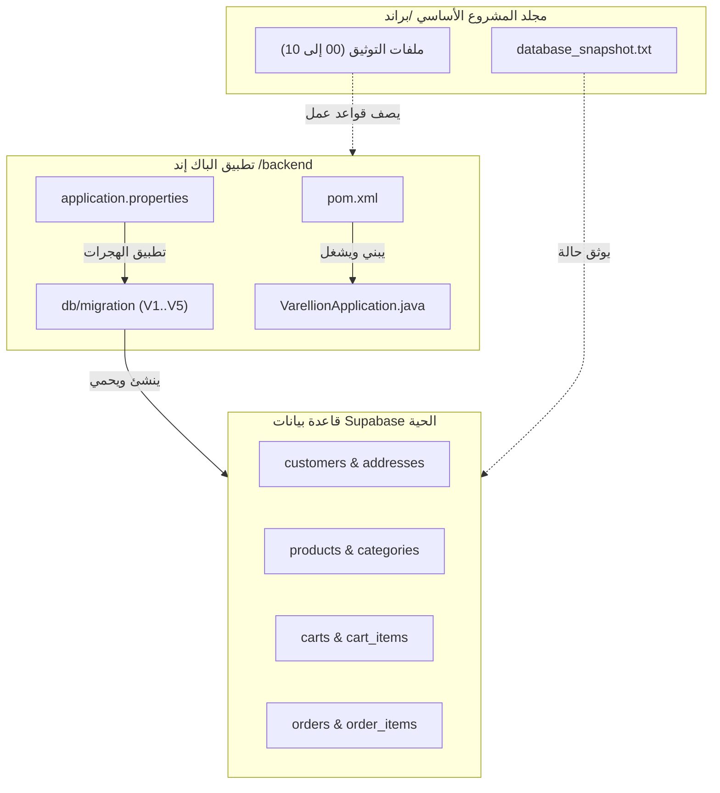

# تقرير التدقيق الشامل لمشروع VARELLION
# VARELLION Comprehensive Project Audit

> **تاريخ التدقيق:** 19 أكتوبر 2026  
> **حالة التدقيق:** تدقيق أولي كامل بدون تعديل على الكود المصدري للتطبيق (Stage A - Read-Only Audit)  
> **مرجعية التدقيق:** ملفات الوثائق المعتمدة (`00`–`10`)، وقاعدة بيانات Supabase الحية (`database_snapshot.txt`)، وتطبيق Spring Boot (`backend/`).

---

## 1. الهيكل الحالي للمشروع (Current Project Structure)

المشروع يقع حالياً في المسار `/home/mohamed-saad/Desktop/براند`، ويتكون من جزأين رئيسيين:

```text
/home/mohamed-saad/Desktop/براند/
├── .gitignore
├── 00_VARELLION_MASTER_BUILD_PROMPT.md
├── 01_VARELLION_BRAND_IDENTITY_AND_DESIGN_SYSTEM.md
├── 02_VARELLION_UI_UX_SPECIFICATION.md
├── 02_VARELLION_UI_UX_SPECIFICATION_FIXED.md
├── 03_VARELLION_BUSINESS_PRODUCT_CONTENT_SPEC.md
├── 04_VARELLION_FRONTEND_ARCHITECTURE.md
├── 05_VARELLION_AI_IMPLEMENTATION_RULES.md
├── 06_VARELLION_INITIAL_CATALOG_AND_SITE_DATA.md
├── 07_VARELLION_MARKETING_CONTENT_GUIDE.md
├── 08_VARELLION_BACKEND_DATABASE_SECURITY_SPEC.md
├── 09_VARELLION_ADMIN_UX_ADDENDUM.md
├── 10_VARELLION_EXTERNAL_SERVICES_SETUP.md
├── PROJECT_GUIDE.md
├── VARELLION_UI_UX_PROJECT_BRIEF.md
├── database_audit_context.txt
├── database_snapshot.txt
└── backend/
    ├── .env
    ├── .env.example
    ├── .gitignore
    ├── pom.xml
    └── src/
        ├── main/
        │   ├── java/com/varellion/store/
        │   │   └── VarellionApplication.java
        │   └── resources/
        │       ├── application.properties
        │       └── db/migration/
        │           ├── V1__create_customers_and_addresses.sql
        │           ├── V2__create_categories.sql
        │           ├── V3__create_product_inventory_and_movements.sql
        │           ├── V4__create_carts_and_cart_items.sql
        │           └── V5__create_orders_module.sql
        └── test/
            └── resources/
                └── application-test.properties
```

---

## 2. الحزمة التقنية الحالية (Technology Stack)

### 2.1 الواجهة الخلفية (Backend)
- **لغة البرمجة وبيئة التشغيل:** Java 17 / OpenJDK 21، متوافقة مع release 17.
- **إطار العمل:** Spring Boot 3.3.4 (Modular Monolith Architecture).
- **أداة البناء وإدارة الحزم:** Apache Maven 3.9.12.
- **قاعدة البيانات الأساسية:** PostgreSQL 17.11 سحابية مستضافة على Supabase (AWS EU-West-1 Pooler).
- **إدارة ترحيل البيانات:** Flyway Core 10.x مع `flyway-database-postgresql` (تم تطبيق 5 هجرات بنجاح V1–V5).
- **الأمان والتحكم بالوصول:** Spring Security 6.x + JJWT (Java JWT `0.12.6`).
- **تخطيط الكائنات (DTO Mapping):** MapStruct `1.6.3` بالتكامل مع Lombok و `lombok-mapstruct-binding 0.2.0`.
- **مراقبة وفحص الحالة:** Spring Boot Actuator (`/actuator/health`, `/actuator/info`).
- **بيئة الاختبار المنعزلة:** H2 In-Memory Database مخصصة لاختبارات الـ Repository والـ Services.

### 2.2 الواجهة الأمامية (Frontend - المستهدفة بالوثائق)
- **المعمارية المعتمدة بالوثيقة `04`:** Next.js 16 App Router + React 19 + TypeScript 5.7.
- **نظام التنسيق:** Tailwind CSS v4.0.
- **ثنائية اللغة وتدويل النصوص:** `next-intl` للمسارات ثنائية اللغة (`/[locale]/`) مع دعم RTL للعربية و LTR للإنجليزية.
- **الأيقونات:** `lucide-react`.

---

## 3. وحدات التطبيق الرئيسية (Major Application Modules)

1. **وحدة التوثيق المرجعي (Documentation & Specifications):**
   - 16 ملف Markdown ونصوص في جذر المشروع تحدد الهوية، تجربة المستخدم، بنية الواجهات، وقواعد الأعمال.
2. **وحدة إدارة قاعدة البيانات والهجرات (`backend/src/main/resources/db/migration`):**
   - 5 هجرات SQL تُمثل الهيكل الحقيقي المطبق على قاعدة البيانات السحابية:
     - `V1`: جدول العملاء (`customers`) وعناوين التوصيل (`customer_addresses`).
     - `V2`: جدول الأقسام (`categories`) وصور المنتجات (`product_images`).
     - `V3`: جدول المنتجات والمخزون (`products`).
     - `V4`: جدول السلات (`carts`) وعناصر السلة (`cart_items`).
     - `V5`: جدول الطلبات (`orders`) وتفاصيل الطلب (`order_items`) وسجل الحالات (`order_status_history`).
3. **وحدة إعدادات الخادم (`backend/src/main/resources/application.properties`):**
   - ضبط اتصال HikariCP، ومسارات CORS، وقواعد حجز المخزون لـ 24 ساعة، والعملة الرسمية (EGP).
4. **نقطة انطلاق تطبيق الباك إند (`VarellionApplication.java`):**
   - كلاس التشغيل الرئيسي للـ Spring Boot Application.

---

## 4. خريطة الاعتماديات والعلاقات (Dependency Map)



---

## 5. المشكلات المعمارية الحالية (Existing Architectural Problems)

### 5.1 الفوضى في جذر المشروع (Root Directory Clutter)
- يوجد 16 ملف توثيق وسجلات نصية مبعثرة في جذر المشروع مباشرة بجانب مجلد `backend/`.
- غياب مجلد منظم للتوثيق الهندسي (`docs/`) يقسم التوثيق إلى: معمارية، وقواعد بيانات، وأدلة تشغيل، ومواصفات تجارية.

### 5.2 التكرار والتضارب في ملفات التوثيق (Documentation Inconsistencies)
- وجود نسختين لملف مواصفات الـ UI/UX:
  - `02_VARELLION_UI_UX_SPECIFICATION.md` (32,255 بايت)
  - `02_VARELLION_UI_UX_SPECIFICATION_FIXED.md` (33,491 بايت)
  يخلق ارتباكاً حول أي الملفين هو المعتمد نهائياً.
- **تناقض في آلية الدفع وحساب العميل:**
  - الوثيقة `08_BACKEND` تذكر أن الإصدار الأول يعتمد الشراء كزائر (Guest Checkout).
  - بينما ملف الهجرة الحي `V5__create_orders_module.sql` وقاعدة البيانات الحية تفرض قيد:
    `customer_id UUID NOT NULL REFERENCES public.customers(user_id)`.
    مما يجعل إنشاء الطلب مستحيلاً بدون تسجيل حساب مسبق في الداتابيز الحالية.

### 5.3 فجوة الكود البرمجي في الباك إند (Backend Code Implementation Gap)
- قاعدة البيانات تحتوي على 10 جداول حية تم ترحيلها بنجاح عبر Flyway، لكن حزمة `com.varellion.store` لا تحتوي بعد على الـ JPA Entities أو الـ Repositories أو الـ Services التي تمثل هذه الجداول برمجياً.

### 5.4 غياب بنية الواجهة الأمامية المستقلة (Missing Dedicated Frontend Directory)
- بالرغم من تفصيل معمارية الواجهة في الوثيقة `04`، لا يوجد مجلد مهيأ للواجهة الأمامية `frontend/` داخل المستودع بجانب `backend/` لتحقيق نمط الـ Monorepo المتوازن.

---

## 6. المخاطر المرتبطة بإعادة التنظيم (Reorganization Risks)

1. **مخاطر كسر روابط التوثيق (Broken Cross-References):**
   - ملفات الماركداون الحالية تشير لبعضها البعض بأسماء ملفات صريحة مثل `04_VARELLION_FRONTEND_ARCHITECTURE.md`. نقلها بدون تحديث الروابط أو الإبقاء على الفهارس المرجعية قد يسبب صعوبة في التتبع.
2. **مخاطر تعارضات قاعدة البيانات (Database Schema Drift):**
   - أي محاولة لكتابة Entities لا تطابق تماماً الـ 10 جداول الموجودة في Supabase ستؤدي فوراً لفشل تشغيل الخادم بسبب تفعيل `spring.jpa.hibernate.ddl-auto=validate`.
3. **مخاطر تسريب الأسرار (Credential Leakage):**
   - وجود ملف `backend/.env` يتطلب الحفاظ الصارم على تجاهله في Git وعدم نسخه خارج مساره الآمن.

---

## 7. التحسينات الموصى بها مرتبة حسب الأولوية (Prioritized Recommendations)

| الأولوية | الإجراء الموصى به | العائد المعماري والتشغيلي |
| :--- | :--- | :--- |
| **P0 (حرجة جداً)** | **تصميم هيكل مجلدات مستهدف ونظيف (`TARGET_STRUCTURE.md`):** فصل الوثائق في `docs/`، وتأسيس حدود الـ `backend/` والـ `frontend/`. | إنهاء الفوضى الجذرية ووضع كل ملف في مكانه الصحيح والمسؤول عنه. |
| **P0 (حرجة جداً)** | **بناء كيانات JPA للكتالوج (`Category`, `Product`, `ProductImage`):** مطابقة الـ Entities للجداول الحقيقية `V2` و `V3`. | تمكين الباك إند من قراءة وتحديث المنتجات والتصنيفات في داتابيز Supabase. |
| **P1 (عالية)** | **بناء كيانات العملاء والطلبات والسلة (`Customer`, `Cart`, `Order`):** مطابقة الجداول `V1`, `V4`, `V5`. | تفعيل محرك التجارة الإلكترونية وإدارة المخزون المحجوز. |
| **P1 (عالية)** | **حسم التكرار في ملفات المواصفات (`02` مقابل `02_FIXED`):** توحيد الوثيقة المعتمدة وأرشفة المسودات القديمة في `docs/archive/`. | منع التضارب للمطورين ووكلاء الذكاء الاصطناعي مستقبلاً. |
| **P2 (متوسطة)** | **تهيئة مجلد الواجهة الأمامية `frontend/`:** إعداد واجهة Next.js 16 أو هيكل SPA معياري طبقاً لقرار المالك. | تجهيز الربط بين الـ Storefront والـ Backend APIs. |
