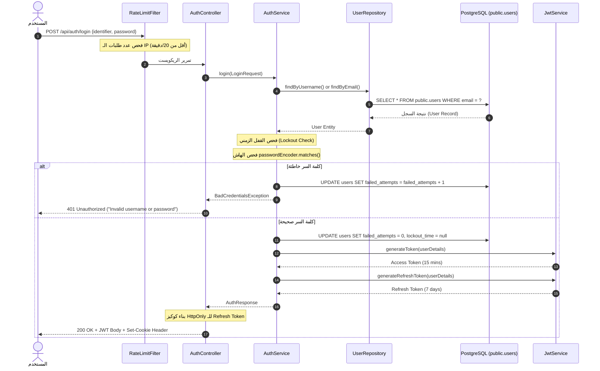
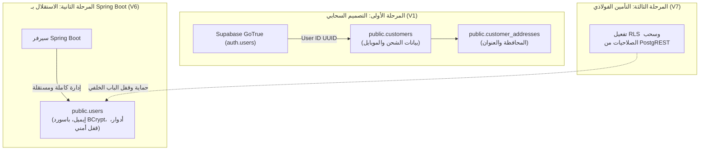

# الدليل الشامل والتعليمي لمعمارية ولوجيك الأمان والمصادقة (Authentication & Security)

> **المشروع:** VARELLION E-Commerce Platform  
> **المسار:** `docs/feature-guides/AUTH_EXPLANATION.md`  
> **الهدف:** شرح تفصيلي وتأسيسي مبسط للمبتدئين لكيفية عمل نظام تسجيل الدخول، الأمان، حماية الحسابات، وتسجيل الدخول عبر جوجل خطوة بخطوة كما هو مكتوب فعلياً داخل الكود.

---

## فهرس المحتويات
1. [القسم الأول: الصورة الكبيرة (The Big Picture)](#القسم-الأول-الصورة-الكبيرة-the-big-picture)
2. [القسم الثاني: خريطة الملفات الحقيقية (File Map)](#القسم-الثاني-خريطة-الملفات-الحقيقية-file-map)
3. [القسم الثالث: رحلة التنفيذ خطوة بخطوة (Step-by-Step Journeys)](#القسم-الثالث-رحلة-التنفيذ-خطوة-بخطوة-step-by-step-journeys)
4. [القسم الرابع: شرح اللوجيك سطرًا بسطر للأكواد الحيوية](#القسم-الرابع-شرح-اللوجيك-سطرا-بسطر-للأكواد-الحيوية)
5. [القسم الخامس: تدفق البيانات عبر الطبقات (Data Flow Diagrams)](#القسم-الخامس-تدفق-البيانات-عبر-الطبقات-data-flow-diagrams)
6. [القسم السادس: قاعدة البيانات والـ Migrations ومقارنة V1 بـ V6 و V7](#القسم-السادس-قاعدة-البيانات-والـ-migrations-ومقارنة-v1-بـ-v6-و-v7)
7. [القسم السابع: قاموس المصطلحات التقنية بالمصري](#القسم-السابع-قاموس-المصطلحات-التقنية-بالمصري)
8. [القسم الثامن: القرارات المعمارية الهندسية (Architectural Decisions)](#القسم-الثامن-القرارات-المعمارية-الهندسية-architectural-decisions)
9. [القسم التاسع: الأمان وحالات الخطأ والحماية من الاختراق](#القسم-التاسع-الأمان-وحالات-الخطأ-والحماية-من-الاختراق)
10. [القسم العاشر: الاختبارات الآلية (Testing Strategy)](#القسم-العاشر-الاختبارات-الآلية-testing-strategy)
11. [القسم الحادي عشر: سيناريو عملي كامل من البداية للنهاية](#القسم-الحادي-عشر-سيناريو-عملي-كامل-من-البداية-للنهاية)
12. [القسم الثاني عشر: ماذا يحدث لو؟ (Troubleshooting & Edge Cases)](#القسم-الثاني-عشر-ماذا-يحدث-لو-troubleshooting--edge-cases)
13. [القسم الثالث عشر: اختبر فهمك (أسئلة وإجابات نموذجية)](#القسم-الثالث-عشر-اختبر-فهمك-أسئلة-وإجابات-نموذجية)
14. [القسم الرابع عشر: ملخص المراجعة السريعة](#القسم-الرابع-عشر-ملخص-المراجعة-السريعة)

---

## القسم الأول: الصورة الكبيرة (The Big Picture)

### 1. ما وظيفة هذه الـ Feature؟
نظام الـ **Auth** (المصادقة والأمان) هو "حارس البوابة" لمشروع المتجر الإلكتروني. وظيفته التحقق من هوية كل شخص يدخل السيرفر:
* هل أنت زائر عادي تتصفح المنتجات؟ (مسموح لك بدون تسجيل).
* هل أنت عميل مسجل يريد شراء منتج ورؤية طلباته السابقة؟
* هل أنت مدير المتجر (Admin) وتريد تعديل الأسعار والمخزون؟
* هل أنت مخترق يحاول تخمين كلمة السر لسرقة الحسابات؟

### 2. ما المشكلة التي تحلها؟
في تطبيقات الويب القديمة، كان السيرفر يحفظ ملف جلسة (Session) لكل مستخدم في ذاكرة الرام (RAM). إذا دخل 100 ألف مستخدم، ينهار السيرفر. ولو أعدنا تشغيل السيرفر، يخرج كل المستخدمين.
نظامنا يحل هذه المشكلة بنمط **Stateless Architecture**:
1. السيرفر لا يحفظ أي جلسة في الذاكرة.
2. عند تسجيل الدخول، يعطيك السيرفر بطاقة مشفرة تسمى **Access Token (JWT)** صالحة لـ 15 دقيقة فقط، وتذكرة تجديد تسمى **Refresh Token** صالحة لـ 7 أيام ومحفوظة في كوكي آمنة ومحمية من الـ JavaScript (`HttpOnly Cookie`).
3. يوفر حماية أوتوماتيكية ضد محاولات الاختراق بالتخمين (قفل الحساب بعد 5 مرات خطأ).
4. يدعم تسجيل الدخول بنقرة واحدة عبر حساب جوجل (Google OAuth 2.0).

### 3. من الذي يستخدمها؟
* **المتسوق (Customer):** لإنشاء حساب، حفظ عناوينه، ومتابعة طلباته.
* **الأدمن (Administrator):** للوصول للوحة التحكم السرية، تقارير المبيعات، وتعديل الكتالوج.
* **السيرفر نفسه (Security Filters):** لفحص كل ريكويست قادم قبل أن يصل إلى أي Controller.

### 4. ما علاقتها بباقي أجزاء النظام؟
الـ Auth ليس ميزة معزولة، بل هو الغلاف المحيط بالنظام بالكامل:
* **المنتجات (Products):** مفتوحة للقراءة فقط لكل الناس، لكن تعديلها أو حذفها يتطلب توكن يحمل دور `ROLE_ADMIN`.
* **السلة والطلبات (Cart & Orders):** تسمح بالشراء كزائر (Guest)، ولكن إذا كان هناك توكن، يتم ربط الطلب تلقائياً بالعميل في قاعدة البيانات.

---

## القسم الثاني: خريطة الملفات الحقيقية (File Map)

جميع الملفات التالية موجودة ومفحوصة بالكامل داخل مجلد `backend/src/main/java/com/varellion/store/security/`:

| الملف ومساره الحقيقي | وظيفته في السيستم | لماذا نحتاج إليه تحديداً؟ | علاقته بباقي الملفات |
|---|---|---|---|
| [`config/SecurityConfig.java`](file:///home/mohamed-saad/Desktop/براند/backend/src/main/java/com/varellion/store/security/config/SecurityConfig.java) | عقل الأمان المركزي وإعدادات Spring Security. | يحدد أي الروابط عامة وأيها يتطلب تسجيل دخول أو رتبة أدمن، ويرتب الفلاتر. | يربط فلاتر الـ `RateLimit` والـ `JwtAuthFilter` ومسارات الـ `AuthController`. |
| [`controller/AuthController.java`](file:///home/mohamed-saad/Desktop/براند/backend/src/main/java/com/varellion/store/security/controller/AuthController.java) | شباك التذاكر واستقبال طلبات الدخول والتسجيل. | يستقبل JSON الطلب من المستخدم ويتحقق من صحته، ويعيد التوكنز ويضبط الكوكيز. | يستدعي `AuthService` لتحقيق المنطق، ويرجع كائنات `AuthResponse`. |
| [`service/AuthService.java`](file:///home/mohamed-saad/Desktop/براند/backend/src/main/java/com/varellion/store/security/service/AuthService.java) | المحرك الفعلي لكل عمليات المصادقة والأمان. | ينفذ التسجيل، مقارنة الباسوردات المشفرة، عداد المحاولات الفاشلة، وتوليد التوكنز. | يتحدث مع `UserRepository`, `PasswordEncoder`, `JwtService`, `GoogleTokenVerifier`. |
| [`jwt/JwtService.java`](file:///home/mohamed-saad/Desktop/براند/backend/src/main/java/com/varellion/store/security/jwt/JwtService.java) | معمل تشفير وفك شفرات الـ JWT (JJWT). | يقوم بتوقيع التوكن بمفتاح سري 256-bit، واستخراج الإيميل، وفحص تاريخ الانتهاء. | يُستدعى بواسطة `AuthService` لإنشاء التوكن، وبواسطة `JwtAuthenticationFilter` للتحقق منه. |
| [`jwt/JwtAuthenticationFilter.java`](file:///home/mohamed-saad/Desktop/براند/backend/src/main/java/com/varellion/store/security/jwt/JwtAuthenticationFilter.java) | حارس الريكويستات المحمية (Request Interceptor). | يعترض كل ريكويست، يستخرج الهيدر `Authorization: Bearer <token>`، ويثبت هوية المستخدم. | يقرأ التوكن بـ `JwtService`، يحمل المستخدم بـ `CustomUserDetailsService`، ويسجله في `SecurityContextHolder`. |
| [`filter/RateLimitFilter.java`](file:///home/mohamed-saad/Desktop/براند/backend/src/main/java/com/varellion/store/security/filter/RateLimitFilter.java) | درع الحماية ضد هجمات الإغراق (DoS / Brute Force). | يمنع أي IP من إرسال أكثر من 20 ريكويست في الدقيقة لمسارات الدخول. | يعمل كأول فلتر في السلسلة قبل وصول الريكويست لأي كود آخر. |
| [`service/GoogleTokenVerifier.java`](file:///home/mohamed-saad/Desktop/براند/backend/src/main/java/com/varellion/store/security/service/GoogleTokenVerifier.java) | ضابط الاتصال مع جوجل للتحقق من هوية المستخدم. | يتحقق من توقيع الـ `idToken` عبر سيرفرات جوجل والتأكد من توثيق الإيميل. | يعتمد على Google API Client الرسمي، وتستدعيه ميثود `googleLogin` في `AuthService`. |
| [`service/CustomUserDetailsService.java`](file:///home/mohamed-saad/Desktop/براند/backend/src/main/java/com/varellion/store/security/service/CustomUserDetailsService.java) | جسر الربط بين قاعدة البيانات وSpring Security. | يحول كائن الـ `User` الخاص بنا إلى كائن `UserDetails` تفهمه مكتبة سبرينج. | يقرأ من `UserRepository` ويبني كائن `CustomUserDetails`. |
| [`entity/User.java`](file:///home/mohamed-saad/Desktop/براند/backend/src/main/java/com/varellion/store/security/entity/User.java) | الكيان الذي يمثل جدول `public.users` في قاعدة البيانات. | يحدد حقول المستخدم (الإيميل، الهاش، العدادات الأمنية، الصلاحيات). | مستخدم في الـ Repository والـ Service. |
| [`repository/UserRepository.java`](file:///home/mohamed-saad/Desktop/براند/backend/src/main/java/com/varellion/store/security/repository/UserRepository.java) | واجهة التعامل مع قاعدة بيانات Postgresql. | دوال البحث السريعة: `findByEmail`, `findByUsername`, `existsByEmail`. | يرث من `JpaRepository<User, Long>`. |
| [`jwt/JwtAuthenticationEntryPoint.java`](file:///home/mohamed-saad/Desktop/براند/backend/src/main/java/com/varellion/store/security/jwt/JwtAuthenticationEntryPoint.java) | مترجم أخطاء غياب التوثيق (401 Unauthorized). | يمنع المتصفح من إظهار شاشة خطأ بيضاء، ويعيد JSON موحد. | تسجله `SecurityConfig` لمعالجة الـ `AuthenticationException`. |
| [`jwt/JwtAccessDeniedHandler.java`](file:///home/mohamed-saad/Desktop/براند/backend/src/main/java/com/varellion/store/security/jwt/JwtAccessDeniedHandler.java) | مترجم أخطاء نقص الصلاحيات (403 Forbidden). | يعيد رد JSON مهندم عندما يحاول مستخدم عادي فتح صفحات الأدمن. | تسجله `SecurityConfig` لمعالجة الـ `AccessDeniedException`. |

---

## القسم الثالث: رحلة التنفيذ خطوة بخطوة (Step-by-Step Journeys)

سنشرح هنا بالتفصيل أهم 4 عمليات موجودة فعلياً في الكود:

### الرحلة 1: تسجيل حساب جديد (User Registration)
1. **المستخدم:** يملأ الفورم (Username, Email, Password) ويضغط "إنشاء حساب".
2. **الـ Endpoint:** يتم إرسال `POST /api/auth/register` حاملاً JSON.
3. **الفلترة الأولى (Rate Limit):** يمر الريكويست أولاً بـ `RateLimitFilter` للتأكد أن الـ IP لم يتجاوز 20 طلباً في الدقيقة.
4. **الاستقبال والتحقق (Controller):** يستقبل `AuthController.register(@Valid @RequestBody RegisterRequest request)` البيانات. الأنوتاشن `@Valid` تفحص الشروط: الإيميل صالح، الباسورد لا يقل عن 8 أحرف، الاسم غير فارغ.
5. **منطق الخدمة (AuthService):**
   * تحويل الإيميل لأحرف صغيرة (`toLowerCase().trim()`).
   * سؤال الـ Repository: هل الإيميل مسجل مسبقاً؟ (`existsByEmail`). إذا وُجد ⬅️ يُرمى استثناء `IllegalArgumentException("Email is already registered")`.
   * سؤال الـ Repository: هل الاسم مأخوذ؟ (`existsByUsername`). إذا وُجد ⬅️ يُرمى استثناء `IllegalArgumentException("Username is already taken")`.
   * تشفير الباسورد فوراً عبر `passwordEncoder.encode(request.getPassword())`.
   * إعطاء رتبة `USER` إجبارياً لمنع أي تلاعب لمنح صلاحية `ADMIN`.
6. **قاعدة البيانات:** حفظ الكائن في جدول `public.users` مع تفعيل `enabled = true` و `failed_attempts = 0`.
7. **إصدار التوكن:** استدعاء `jwtService.generateToken` لإصدار Access Token، وتوليد Refresh Token.
8. **الرد:** يضع الـ Controller الـ Refresh Token في كوكي `Set-Cookie: refresh_token=...; HttpOnly; Secure; SameSite=Lax`، ويرجع كائن `AuthResponse` يحمل الـ Access Token والبيانات الأساسية بكود `200 OK`.

---

### الرحلة 2: تسجيل الدخول العادي وحماية القفل (Login & Lockout Protection)
1. **المستخدم:** يرسل اسم المستخدم (أو الإيميل) وكلمة السر.
2. **الـ Endpoint:** ريكويست `POST /api/auth/login`.
3. **البحث المزدوج المرن:**
   * يبحث السيرفر في قاعدة البيانات بـ Username، فإن لم يجد يبحث بـ Email.
   * إن لم يجد المستخدم إطلاقاً ⬅️ يرمي `BadCredentialsException("Invalid username or password")`.
4. **فحص القفل الزمني (Lockout Check):**
   * هل الحقل `lockout_time` يحتوي على وقت في المستقبل؟
   * **نعم:** السيرفر يرفض المحاولة فوراً ويرمي `LockedException("Account is temporarily locked...")` دون فحص الباسورد حتى!
   * **لا (انتهت الـ 15 دقيقة):** السيرفر يصفر العدادات تلقائياً ويسمح بمتابعة الفحص.
5. **مطابقة الباسورد المشفر (BCrypt):**
   * يفحص السيرفر `passwordEncoder.matches(enteredPassword, user.getPassword())`.
   * **لو كلمة السر خطأ:**
     1. يزيد عداد `failed_attempts` بمقدار 1.
     2. إذا وصل العداد إلى 5 ⬅️ يضبط `lockout_time = now + 15 minutes` ويقفل الحساب!
     3. يحفظ التعديل في الداتا بيز ويرمي خطأ `BadCredentialsException` موحد لمنع التخمين.
   * **لو كلمة السر صحيحة:**
     1. يصفر العداد فوراً: `failed_attempts = 0` و `lockout_time = null`.
     2. يفحص هل الحساب مفعل (`enabled == true`)؟
     3. يصدر التوكنز ويرسل الرد.

---

### الرحلة 3: تسجيل الدخول السريع عبر جوجل (Google OAuth Login)
1. **الفرونت إند:** بعد أن يسجل المستخدم دخوله في نافذة جوجل الرسمية، يحصل على توكن مشفر من جوجل اسمه `idToken`.
2. **الـ Endpoint:** يرسل الفرونت إند التوكن في ريكويست: `POST /api/auth/google` وبداخله `{"idToken": "..."}`.
3. **التحقق الخارجي (GoogleTokenVerifier):**
   * يرسل السيرفر التوكن للـ Verifier التابع لجوجل.
   * يتأكد من سلامة التوقيع الرقمي ومطابقة الـ Client ID.
   * يتأكد أن `payload.getEmailVerified() == true`. إذا كان غير موثق يرفض العملية فوراً.
4. **الإنشاء التلقائي (Auto-Provisioning):**
   * يبحث السيرفر في جدول `users` بالإيميل الوارد من جوجل:
     * **إذا كان الحساب موجوداً:** يدخله فوراً ويصدر التوكن.
     * **إذا كان الحساب جديداً:** ينشئ له حساباً تلقائياً في ثانية واحدة:
       * يعطيه اسماً مبنياً على اسمه في جوجل أو إيميله.
       * ينشئ له كلمة مرور عشوائية مستحيلة التخمين مشفرة بـ BCrypt (`UUID.randomUUID().toString()`).
       * يحدد الرتبة: إذا كان الإيميل مذكوراً في متغير البيئة `ADMIN_EMAILS` يمنحه رتبة `ADMIN`، وغير ذلك يمنحه `USER`.
       * يجعل `email_verified = true` تلقائياً لأن جوجل قامت بتوثيقه مسبقاً.
5. **الرد:** يعيد السيرفر الـ Access Token ويضبط الـ Refresh Token في الكوكي كما في الدخول العادي تماماً.

---

### الرحلة 4: فحص الريكويستات المحمية (JWT Request Interception)
عندما يطلب العميل رابطاً محمياً (مثل عرض الملف الشخصي أو تعديل المنتجات):
```text
المتصفح 
   │ 
   ▼ (GET /api/admin/products مع هيدر Authorization: Bearer eyJhbGci...)
[RateLimitFilter] ──(أقل من المعدل)──► 
[JwtAuthenticationFilter]
   │
   ├─► هل يوجد هيدر Authorization يبدأ بـ "Bearer "؟
   │     ├─► لا: يمرر الطلب للفلتر التالي (سيتوقف عند فلتر الصلاحيات لاحقاً).
   │     └─► نعم: يستخرج الـ JWT.
   │
   ├─► فك شفرة التوكن عبر JwtService:
   │     ├─► استخراج الإيميل (Subject).
   │     ├─► التأكد أن نوع التوكن هو ACCESS وليس REFRESH.
   │     └─► التأكد من عدم انتهاء تاريخ الصلاحية (15 دقيقة).
   │
   ├─► تحميل بيانات الصلاحيات عبر CustomUserDetailsService:
   │     └─► استرجاع الرتبة (ROLE_ADMIN أو ROLE_USER).
   │
   ├─► تسجيل الهوية في الذاكرة المؤقتة للريكويست:
   │     └─► SecurityContextHolder.getContext().setAuthentication(authToken).
   │
   ▼
[SecurityFilterChain Authorization Checks]
   │
   ├─► هل المسار يتطلب ROLE_ADMIN والمستخدم لديه ROLE_USER؟
   │     └─► نعم: استدعاء JwtAccessDeniedHandler ⬅️ رد 403 Forbidden.
   │
   └─► الصلاحيات سليمة ومطابقة؟
         └─► نعم: وصول الطلب إلى الـ Controller وتنفيذ العمل بنجاح (200 OK).
```

---

## القسم الرابع: شرح اللوجيك سطرًا بسطر للأكواد الحيوية

### 1. ميثود التحقق وقفل الحساب عند الخطأ في `AuthService.java`

```java
// مسار الملف: backend/src/main/java/com/varellion/store/security/service/AuthService.java
// الكلاس: AuthService | الميثود: login

if (!passwordEncoder.matches(request.getPassword(), user.getPassword())) {
    // 1. زيادة عداد المحاولات الفاشلة للمستخدم بـ 1
    int attempts = (user.getFailedAttempts() != null ? user.getFailedAttempts() : 0) + 1;
    user.setFailedAttempts(attempts);

    // 2. هل وصل المستخدم للحد الأقصى المسموح (5 محاولات)؟
    if (attempts >= MAX_FAILED_ATTEMPTS) {
        // 3. تحديد موعد فك القفل بعد 15 دقيقة من اللحظة الحالية
        user.setLockoutTime(LocalDateTime.now().plusMinutes(LOCKOUT_MINUTES));
        userRepository.save(user); // حفظ حالة القفل فوراً في الداتا بيز
        log.warn("Account locked for user: {} due to {} failed attempts", user.getEmail(), attempts);
        throw new LockedException("Account has been locked for 15 minutes due to 5 consecutive failed login attempts.");
    }

    userRepository.save(user); // حفظ العداد المحدث
    // 4. رسالة خطأ عامة وموحدة عمداً لحماية الخصوصية
    throw new BadCredentialsException("Invalid username or password");
}
```

* **ماذا تفعل هذه الأسطر؟** تتحقق من صحة كلمة السر، وفي حال الخطأ تسجل محاولة فاشلة، وإذا بلغت 5 محاولات متتالية تقفل الحساب لـ 15 دقيقة.
* **لماذا تم كتابتها هكذا؟** لمنع هجمات المعاجم (Dictionary Attacks) والروبوتات التي تجرب آلاف كلمات السر في ثوانٍ.
* **لماذا نرجع رسالة عامة "Invalid username or password"؟** لمنع ثغرة تسمى **User Enumeration**. لو قلنا للمخترق "كلمة السر خطأ"، سيعرف أن الإيميل موجود أصلاً في الموقع. لكن حين نقول "اسم المستخدم أو كلمة السر غير صحيحة"، لا يعرف هل الإيميل خطأ أم الباسورد خطأ.

---

### 2. ميثود التحقق من توكن جوجل في `GoogleTokenVerifier.java`

```java
// مسار الملف: backend/src/main/java/com/varellion/store/security/service/GoogleTokenVerifier.java
// الكلاس: GoogleTokenVerifier | الميثود: verify

public GoogleIdentity verify(String idTokenString) {
    try {
        // 1. فحص التوكن عبر مكتبة جوجل والتأكد من توقيعه وصلاحيته وتطابق الـ Client ID
        GoogleIdToken idToken = verifier.verify(idTokenString);
        if (idToken != null) {
            GoogleIdToken.Payload payload = idToken.getPayload();

            // 2. شرط جوهري: هل الإيميل موثق في جوجل؟
            Boolean emailVerified = payload.getEmailVerified();
            if (emailVerified == null || !emailVerified) {
                throw new IllegalArgumentException("Google account email is not verified.");
            }

            // 3. استخراج البيانات الأساسية بأمان
            String subject = payload.getSubject(); // المعرف الفريد للمستخدم في جوجل
            String email = payload.getEmail();
            String name = (String) payload.get("name");

            return new GoogleIdentity(subject, email, name);
        } else {
            throw new IllegalArgumentException("Invalid Google ID token signature or expired.");
        }
    } catch (Exception e) {
        log.error("Failed to verify Google ID token: {}", e.getMessage());
        throw new IllegalStateException("Failed to verify Google token: " + e.getMessage(), e);
    }
}
```

* **ماذا يحدث لو حذفنا `payload.getEmailVerified()`؟** تحدث ثغرة أمنية فادحة! يمكن لشخص إنشاء حساب تجريبي في جوجل بإيميل وهمي لم يوثقه برمز الـ OTP (مثلاً يدعي أنه `ceo@company.com`)، ويسجل به في موقعنا ويستولي على حساب المدير. اشتراط التوثيق يضمن أن جوجل تأكدت بنفسها من ملكية الإيميل.

---

### 3. ميثود التفريق الصارم بين نوعي التوكن في `JwtService.java`

```java
// مسار الملف: backend/src/main/java/com/varellion/store/security/jwt/JwtService.java
// الكلاس: JwtService

public boolean isTokenValid(String token, UserDetails userDetails) {
    final String username = extractUsername(token);
    // شرط ثلاثي: النوع ACCESS + الإيميل مطابق + لم ينتهِ وقته
    return isTokenType(token, ACCESS_TOKEN_TYPE)
            && (username.equals(userDetails.getUsername()))
            && !isTokenExpired(token);
}

public boolean isRefreshTokenValid(String token, UserDetails userDetails) {
    final String username = extractUsername(token);
    // شرط ثلاثي: النوع REFRESH فقط + الإيميل مطابق + لم ينتهِ وقته
    return isTokenType(token, REFRESH_TOKEN_TYPE)
            && (username.equals(userDetails.getUsername()))
            && !isTokenExpired(token);
}
```

* **ما الفائدة الأمنية هنا؟** يتم حقن Claim داخلي اسمه `token_type` قيمته إما `ACCESS` أو `REFRESH`.
* **ماذا يحدث لو لم نضعه؟** يستطيع المخترق أخذ الـ Refresh Token (الذي يظل صالحاً لـ 7 أيام) وإرساله في هيدر الريكويستات المحمية مكان الـ Access Token، وبذلك نكون فقدنا فائدة قصر عمر الـ Access Token (الـ 15 دقيقة). هذا الكود يمنع تماماً استخدام أي تذكرة في غير موضعها.

---

## القسم الخامس: تدفق البيانات عبر الطبقات (Data Flow Diagrams)

### 1. مخطط تدفق تسجيل الدخول العادي (Standard Login Flow)



**شرح الرسم بالعربية:**  
الطلب يدخل أولاً على فلتر الـ Rate Limit لصد الهجمات. ثم يصل للـ Controller الذي يمرره للـ Service. تبحث الـ Service عن المستخدم في الداتا بيز وتقارن كلمة السر المشفرة. لو صحيحة، تصفر عداد الأخطاء وتطلب من `JwtService` صك تذكرتين (Access Token سريع الانتهاء + Refresh Token طويل الأجل). الـ Controller يضع التذكرة الطويلة في كوكي آمنة ويعيد التذكرة القصيرة في جسم الـ JSON.

---

## القسم السادس: قاعدة البيانات والـ Migrations ومقارنة V1 بـ V6 و V7

### 1. الجدول الأساسي للأمان: `public.users` (من ملف `V6__create_users_table.sql`)

تم إنشاؤه عبر الميجريشن [`V6__create_users_table.sql`](file:///home/mohamed-saad/Desktop/براند/backend/src/main/resources/db/migration/V6__create_users_table.sql) ويتكون من الأعمدة التالية:

| اسم العمود في SQL | نوع البيانات | القيود (Constraints) | القيمة الافتراضية | ما يمثله في كود الجافا (`User.java`) |
|---|---|---|---|---|
| `id` | `BIGSERIAL` | `PRIMARY KEY` | تسلسلي تلقائي | `private Long id;` |
| `email` | `VARCHAR(150)` | `NOT NULL`, `UNIQUE` | - | `private String email;` |
| `username` | `VARCHAR(150)` | `NOT NULL`, `UNIQUE` | - | `private String username;` |
| `password` | `VARCHAR(255)` | `NOT NULL` | - | `private String password;` |
| `role` | `VARCHAR(20)` | `NOT NULL` | `'USER'` | `private String role;` |
| `enabled` | `BOOLEAN` | `NOT NULL` | `TRUE` | `private boolean enabled;` |
| `email_verified` | `BOOLEAN` | `NOT NULL` | `FALSE` | `private boolean emailVerified;` |
| `failed_attempts` | `INTEGER` | `NOT NULL` | `0` | `private Integer failedAttempts;` |
| `lockout_time` | `TIMESTAMPTZ` | `NULLABLE` | `NULL` | `private LocalDateTime lockoutTime;` |
| `created_at` | `TIMESTAMPTZ` | `NOT NULL` | `NOW()` | `private LocalDateTime createdAt;` |
| `updated_at` | `TIMESTAMPTZ` | `NOT NULL` | `NOW()` | `private LocalDateTime updatedAt;` |

#### الفهارس (Indexes):
* `idx_users_email`: لتسريع عملية البحث عن المستخدم بالإيميل أثناء تسجيل الدخول في أجزاء من الملي ثانية.
* `idx_users_username`: لتسريع البحث باسم المستخدم.

---

### 2. التطور المعماري: ما العلاقة بين `V1` و `V6` و `V7`؟

هذه النقطة هي جوهر فهمك لقاعدة بيانات المشروع، وإليك القصة الحقيقية خلف هذه الملفات:



#### المقارنة التفصيلية:
1. **ملف `V1` ([`V1__create_customers_and_addresses.sql`](file:///home/mohamed-saad/Desktop/براند/backend/src/main/resources/db/migration/V1__create_customers_and_addresses.sql)):**
   * **وظيفته:** إنشاء جداول التجارة والشحن (`customers` و `customer_addresses`).
   * **علاقته بالمصادقة:** في بداية التخطيط للمشروع، كان الاعتماد على خدمة سوبابيز الجاهزة (`auth.users`)، وكان جدول `customers` يربط معها بمفتاح أجنبي `user_id UUID REFERENCES auth.users(id)`.
   * **محتواه:** اسم المستلم للشحن، رقم تليفون المندوب، عنوان البيت والمحافظة.
2. **ملف `V6` ([`V6__create_users_table.sql`](file:///home/mohamed-saad/Desktop/براند/backend/src/main/resources/db/migration/V6__create_users_table.sql)):**
   * **وظيفته:** إنشاء جدول الحسابات الخاص بسيرفر Spring Boot (`public.users`).
   * **لماذا احتجنا إليه؟** لأننا قررنا عدم ربط التطبيق بسوبابيز فقط، بل بناء محرك أمان احترافي مستقل (Custom JWT Engine) قادر على إدارة الصلاحيات، عداد محاولات الدخول، التحقق المباشر من جوجل، وتشفير BCrypt داخل الجافا.
3. **ملف `V7` ([`V7__secure_users_table.sql`](file:///home/mohamed-saad/Desktop/براند/backend/src/main/resources/db/migration/V7__secure_users_table.sql)):**
   * **وظيفته:** سد ثغرة خطيرة نتجت عن طبيعة سوبابيز. سوبابيز تقوم تلقائياً بإنشاء REST API عام لأي جدول يوضع في `public`.
   * لو لم نكتب `V7`، كان بإمكان أي شخص فتح رابط سوبابيز ورؤية إيميلات وهاشات جدول `users`!
   * `V7` قام بتشغيل Row Level Security وسحب الصلاحيات من كل الزوار (`REVOKE ALL ON TABLE public.users FROM anon, authenticated;`)، ليصبح جدول المستخدمين ملكاً حصرياً لسيرفر Spring Boot فقط.

---

## القسم السابع: قاموس المصطلحات التقنية بالمصري

| المصطلح الإنجليزي | معناه بالمصري الفصيح | دوره الحقيقي داخل المشروع | مثال توضيحي بسيط |
|---|---|---|---|
| **Authentication (AuthN)** | "إثبات الهوية" أو مين اللي داخل؟ | التأكد إنك صاحب الحساب فعلاً عبر الباسورد أو جوجل. | زي ما تطلع بطاقتك الشخصية عشان تثبت اسمك. |
| **Authorization (AuthZ)** | "تحديد الصلاحيات" أو مسموح لك بإيه؟ | التأكد هل الحساب ده عميل يشتري، ولا أدمن يعدل أسعار؟ | زي التذكرة اللي بتسمح لك تدخل الـ VIP وتمنع غيرك. |
| **Stateless** | "ولا شايل في قلبي ولا فاكرك" (بدون جلسة) | السيرفر مبيحفظش حالة في الرام؛ كل ريكويست بيعرف نفسه بـ Token مستقل. | زي تذكرة المترو، السيرفر مش فاكر وشك، بس بيبص على التذكرة يلاقيها سليمة يدخلك. |
| **JWT (JSON Web Token)** | بطاقة هوية رقمية مشفرة ومختومة | نص مشفر يحمل إيميلك وصلاحيتك وتاريخ انتهاء، وموقع بمفتاح سري. | زي شهادة التخرج المختومة بختم النسر؛ أي حد يشوف الختم يتأكد إنها مش مزورة. |
| **BCrypt** | خلاط تشفير الباسوردات الذي لا يُعكس | خوارزمية تشفر كلمة السر بحيث يستحيل فكها حتى لو سرق أحدهم الداتا بيز. | لو دخلت "123456" تخرج "$2a$10$wK8..."، مستحيل ترجعها لأصلها إلا بالتخمين. |
| **Salt (في التشفير)** | رشة بهارات عشوائية لكل باسورد | نص عشوائي يضاف للباسورد قبل تشفيره ليمنع تشابه الهاشات لو يوزرين ليهم نفس الباسورد. | عشان لو أنا وأنت باسوردنا "admin"، الهاش بتاعي في الداتا بيز يكون مختلف تماماً عن هاشك. |
| **Rate Limiting** | "حاسب يا بني مش ورا بعض كدة" | تحديد سرعة إرسال الطلبات (20 طلب في الدقيقة) لمنع هجمات الإغراق. | زي إشارة المرور اللي بتدخل العربيات واحدة واحدة وتمنع التكدس. |
| **Account Lockout** | تجميد الحساب مؤقتاً | قفل الحساب 15 دقيقة بعد 5 محاولات باسورد غلط لحمايته من روبوتات التخمين. | زي الفيزا اللي بتتسحب لو دخلت الرقم السري غلط 3 مرات في الـ ATM. |
| **HttpOnly Cookie** | كوكي في خزانة حديدية | كوكي متصفح يستحيل قراءتها بأكواد JavaScript، مخصصة للـ Refresh Token. | بتمنع المخترق من سرقة التوكن لو عمل ثغرة XSS في الفرونت إند. |
| **SecurityContextHolder** | جيب السيرفر في الريكويست الحالي | المكان اللي بيتخزن فيه بيانات المستخدم الموثق داخل سبرينج طول فترة الريكويست. | زي الكارنيه اللي بتعلقه في رقبتك طول ما أنت جوه الشركة عشان الكل يعرف رتبتك. |

---

## القسم الثامن: القرارات المعمارية الهندسية (Architectural Decisions)

لماذا صُمم السيستم بهذه الطريقة؟ إليك الأسباب الهندسية والبدائل:

### 1. لماذا اخترنا الـ JWT بدلاً من الـ Sessions التقليدية؟
* **المشكلة:** متجر VARELLION مصمم ليتوسع (Scalable). لو اعتمدنا على Sessions، سنحتاج سيرفر Redis مركزي لتوزيع الجلسات بين عدة سيرفرات backend، أو ستفشل الجلسات إذا أعدنا تشغيل السيرفر.
* **الحل:** الـ JWT مستقل بذاته (Self-contained)؛ يحمل بيانات المستخدم وصلاحياته مختومة بتوقيع رقمي يثق به أي سيرفر يملك المفتاح السري (`jwt.secret`).

### 2. لماذا نظام التوكن المزدوج (Access Token + Refresh Token Cookie)؟
* **المعضلة:** لو جعلنا التوكن يعيش أسبوعاً وسُرق من المستخدم، يستطيع المخترق استخدامه لمدة أسبوع كامل دون أن نستطيع طرده! ولو جعلناه يعيش 15 دقيقة فقط، سيضطر المستخدم لكتابة الباسورد كل ربع ساعة!
* **الحل الهندسي الأفضل عالمياً:**
  * **Access Token:** قصير الأجل (15 دقيقة) يعيش في ذاكرة المتصفح المؤقتة لإرساله مع كل طلب API.
  * **Refresh Token:** طويل الأجل (7 أيام) لا يُرسل مع كل طلب، بل يُحفظ في كوكي مغلقة (`HttpOnly; Secure; SameSite=Lax`). عندما ينتهي الـ 15 دقيقة، يستدعي الفرونت إند تلقائياً `/api/auth/refresh` لتجديد الـ Access Token دون أن يشعر المستخدم بأي انقطاع.

### 3. لماذا استخدام نمط الـ DTOs وعدم استقبال الـ Entity مباشرة في الكنترولر؟
* **المشكلة:** لو استقبلنا `User` مباشرة في ميثود الـ Register، يستطيع مستخدم خبيث إرسال JSON يحتوي على حقل `"role": "ADMIN"`، فتقوم أداة مثل Jackson بحقن الرتبة ويصبح أدمن في خطوة واحدة (ثغرة Mass Assignment).
* **الحل:** كلاسات الـ DTO مثل [`RegisterRequest.java`](file:///home/mohamed-saad/Desktop/براند/backend/src/main/java/com/varellion/store/security/dto/RegisterRequest.java) تحتوي فقط على الحقول المسموح للعميل كتابتها (Username, Email, Password).

---

## القسم التاسع: الأمان وحالات الخطأ والحماية من الاختراق

تم تدريع النظام ضد أشهر ثغرات الويب وفق معايير OWASP:

1. **الحماية من هجمات انتحال الـ IP في الـ Rate Limiter:**
   * في ملف [`RateLimitFilter.java`](file:///home/mohamed-saad/Desktop/براند/backend/src/main/java/com/varellion/store/security/filter/RateLimitFilter.java#L98-L105)، تم الاعتماد حصرياً على `request.getRemoteAddr()` ورفض الاعتماد الأعمى على هيدر `X-Forwarded-For` لأن المخترق يستطيع تزويره بسهولة للتحايل على حظر الـ IP.
2. **الحماية من استنزاف ذاكرة السيرفر (Memory Exhaustion DoS):**
   * الـ `RateLimitFilter` يضع حداً أقصى `MAX_TRACKED_IPS = 50_000`. لو حاول مهاجم توليد ملايين الـ IPs الوهمية لإسقاط الرام، يوقف الفلتر تتبع العناوين الجديدة ويدخل في وضع الأمان لمنع انهيار السيرفر.
3. **الحماية من تسريب رسائل الخطأ الحساسة (Error Handling):**
   * عند حدوث أي خطأ في كلمة السر أو عدم وجود الحساب، الرد دائماً:
     ```json
     {
       "status": 401,
       "error": "Unauthorized",
       "message": "Invalid username or password"
     }
     ```
     ممنوع نهائياً إظهار رسائل مثل "User not found" أو "Password incorrect" أو طباعة الـ StackTrace للمستخدم.

---

## القسم العاشر: الاختبارات الآلية (Testing Strategy)

يحتوي مجلد الاختبارات [`backend/src/test/java/com/varellion/store/security/`](file:///home/mohamed-saad/Desktop/براند/backend/src/test/java/com/varellion/store/security/) على تغطية شاملة تم التأكد من تشغيلها ونجاحها بالكامل:

### 1. ما الذي يتم اختباره حالياً؟
* **[`AuthServiceTest.java`](file:///home/mohamed-saad/Desktop/براند/backend/src/test/java/com/varellion/store/security/AuthServiceTest.java) (9 اختبارات ناجحة):**
  1. `testSuccessfulLogin`: نجاح تسجيل الدخول بالبيانات الصحيحة وتوليد التوكنز.
  2. `testFailedLoginAttempt`: زيادة عداد الأخطاء ورفض الباسورد الخاطئ.
  3. `testAccountLockoutAfterFiveAttempts`: قفل الحساب فوراً لمدة 15 دقيقة عند الخطأ الخامس.
  4. `testBlockedLoginWhenLocked`: منع الدخول طالما الحساب في فترة القفل حتى لو كُتب الباسورد الصحيح.
  5. `testRegisterUser`: تشفير كلمة السر وحفظ المستخدم الجديد برتبة `USER`.
  6. `testGoogleLoginExistingUser`: دخول مستخدم جوجل القديم وإصدار توكنز له.
  7. `testGoogleLoginNewUser`: التسجيل التلقائي لمستخدم جوجل الجديد.
  8. `testGoogleLoginDisabledUser`: منع دخول حساب جوجل المعطل إدارياً.
  9. `testGoogleLoginMissingEmail`: رفض توكن جوجل إذا لم يكن يحتوي على إيميل.
* **[`JwtServiceTest.java`](file:///home/mohamed-saad/Desktop/براند/backend/src/test/java/com/varellion/store/security/JwtServiceTest.java) (اختباران ناجحان):**
  1. التأكد أن توكن الـ ACCESS يعمل فقط كـ Access Token ولا يمكن استخدامه كـ Refresh Token.
  2. التأكد أن توكن الـ REFRESH يعمل فقط للتجديد ولا يمكن تمريره في هيدر الريكويستات المحمية.
* **[`RateLimitFilterTest.java`](file:///home/mohamed-saad/Desktop/براند/backend/src/test/java/com/varellion/store/security/RateLimitFilterTest.java) (3 اختبارات ناجحة):**
  1. السماح بالطلبات ضمن الحد المسموح (أقل من 20).
  2. حظر الطلب رقم 21 بكود `429 Too Many Requests`.
  3. تمرير طلبات الـ OPTIONS الخاصة بالـ CORS دون احتسابها في العداد.

### 2. كيفية تشغيل الاختبارات من التيرمينال:
```bash
# تشغيل اختبارات المصادقة فقط:
cd backend && mvn test -Dtest=AuthServiceTest

# تشغيل اختبارات التوكن فقط:
cd backend && mvn test -Dtest=JwtServiceTest

# تشغيل اختبارات الـ Rate Limit فقط:
cd backend && mvn test -Dtest=RateLimitFilterTest

# تشغيل حزمة اختبارات الأمان بالكامل:
cd backend && mvn test -Dtest="*Security*,*Auth*,*Jwt*,*RateLimit*"
```

---

## القسم الحادي عشر: سيناريو عملي كامل من البداية للنهاية

تخيل رحلة مستخدم حقيقي اسمه **"أحمد"** يزور متجر VARELLION:

1. **الخطوة الأولى (زيارة الموقع):**
   * أحمد يفتح صفحة المنتجات `GET /api/products`.
   * يمر الريكويست بـ `SecurityConfig` ويجد أن مسارات المنتجات مصنفة كـ `permitAll()`.
   * يرى أحمد الكتالوج والصور والأسعار دون الحاجة لتسجيل دخول.
2. **الخطوة الثانية (التسجيل السريع بجوجل):**
   * أحمد يضغط على "تسجيل الدخول بجوجل".
   * يفتح المتصفح نافذة جوجل، يختار أحمد `ahmed@gmail.com`.
   * ترسل جوجل للفرونت إند كود الـ `idToken`.
   * يرسل الفرونت إند الـ `idToken` إلى `POST /api/auth/google`.
3. **الخطوة الثالثة (كواليس السيرفر):**
   * يستقبل `GoogleTokenVerifier` التوكن ويفحصه ويتأكد أن الإيميل موثق.
   * يسأل `AuthService` الداتا بيز: هل أحمد مسجل؟
   * الإجابة: لا، هذا أول دخول لأحمد.
   * ينشئ السيرفر حساباً جديداً لأحمد باسم `ahmed_7392` وباسورد عشوائي مشفر ورتبة `USER`.
   * يصدر السيرفر توكن صلاحيته 15 دقيقة، ويرسله لأحمد مع كوكي الـ Refresh Token.
4. **الخطوة الرابعة (طلب الشراء المحمي):**
   * يضع أحمد منتجاً في السلة ويذهب لصفحة الدفع.
   * يرسل الفرونت إند الطلب حاملاً هيدر: `Authorization: Bearer <ahmed_access_token>`.
   * يعترض `JwtAuthenticationFilter` الطلب، يتأكد من صحة التوكن، ويثبت هوية أحمد في السيرفر.
   * ينفذ السيرفر عملية الشراء ويسجل الأوردر باسم أحمد ورقم هويته (`id: 42`).
5. **الخطوة الخامسة (محاولة التسلل للأدمن):**
   * يحاول أحمد فتح رابط لوحة تحكم الإدارة `GET /api/admin/metrics`.
   * يفحص السيرفر رتبة أحمد في التوكن فيجدها `ROLE_USER` بينما المسار يتطلب `ROLE_ADMIN`.
   * يتدخل `JwtAccessDeniedHandler` فوراً ويرد بكود `403 Forbidden` برسالة مهندمة:
     `"Access denied: You do not have the required permissions"`.

---

## القسم الثاني عشر: ماذا يحدث لو؟ (Troubleshooting & Edge Cases)

### س1: ماذا يحدث لو حاول شخص كتابة الباسورد خطأ 4 مرات ثم كتبه صح في المرة الخامسة؟
* **وفق الكود الحقيقي:** في المرة الخامسة الصحيحة، يتم تصفير العداد فوراً وتعيين `failed_attempts = 0` و `lockout_time = null`، ويدخل المستخدم بشكل طبيعي تماماً ولا يُقفل حسابه.

### س2: ماذا يحدث لو أرسل مستخدم تذكرة الـ Refresh Token في هيدر استعراض المنتجات بدلاً من Access Token؟
* **وفق الكود الحقيقي:** ستقوم ميثود `jwtService.isTokenValid` برفض التوكن فوراً لأن الـ Claim الداخلي `token_type` يحمل القيمة `REFRESH` بينما المسار يتطلب `ACCESS`. سيعود له خطأ `401 Unauthorized`.

### س3: ماذا يحدث لو أوقفت خدمة قاعدة البيانات (PostgreSQL) فجأة؟
* **وفق الكود الحقيقي:** سيفشل الـ `UserRepository` في تنفيذ استعلام الـ SQL ويرمي `CannotCreateTransactionException`. سيتدخل الـ Global Exception Handler ويعيد كود `500 Internal Server Error` برسالة آمنة تمنع إظهار تفاصيل تعطل الاتصال بالداتا بيز.

### س4: ماذا يحدث لو حاول مستخدم التسجيل بإيميل موجود بالفعل؟
* **وفق الكود الحقيقي:** ميثود `register` تفحص `userRepository.existsByEmail(email)`. عند وجوده، يُرمى استثناء `IllegalArgumentException("Email is already registered: ...")`، ويترجم في الـ Controller إلى رد `400 Bad Request` بالرسالة التوضيحية للعميل.

### س5: ماذا يحدث لو تم تعديل جدول `users` في قاعدة البيانات بإضافة عمود جديد دون تعديل `User.java`؟
* **وفق الكود الحقيقي:** تطبيق Spring Boot سيستمر في العمل ولن يتأثر، لأن مكتبة Hibernate تتجاهل الأعمدة الموجودة في قاعدة البيانات إذا لم تكن معرفة داخل الـ Entity، طالما أن العمود الجديد ليس `NOT NULL` بدون قيمة افتراضية.

---

## القسم الثالث عشر: اختبر فهمك (أسئلة وإجابات نموذجية)

اختبر نفسك في هذه الأسئلة لتقيس مدى استيعابك العميق للوجيك:

### الأسئلة:
1. *(سهل)* لماذا تنتهي صلاحية الـ Access Token بعد 15 دقيقة فقط، بينما تظل الـ Refresh Token لمدة 7 أيام؟
2. *(سهل)* أين يتم تخزين الـ Refresh Token في متصفح المستخدم، ولماذا لا نضعه في `localStorage`؟
3. *(متوسط)* ما الفرق الأساسي بين جدول `public.users` وجدول `public.customers` في قاعدة البيانات؟
4. *(متوسط)* ماذا تفعل ميثود `googleLogin` إذا كان إيميل الشخص القادم من جوجل غير مسجل مسبقاً في الداتا بيز؟
5. *(متقدم)* لماذا قمنا في ملف الميجريشن `V7` بكتابة أمر سحب الصلاحيات `REVOKE ALL ON TABLE public.users FROM anon, authenticated`؟
6. *(متقدم)* كيف يحمي كود تسجيل الدخول السيرفر من ثغرة معرفة الحسابات المسجلة (Account Enumeration)؟

---

### الإجابات النموذجية:

1. **إجابة س1:** الـ Access Token يُرسل مع كل ريكويست عبر الإنترنت، فلو تم اعتراضه أو سرقته، تكون فرصة استغلاله محدودة جداً بـ 15 دقيقة فقط. بينما الـ Refresh Token لا يُرسل إلا نادراً عند الحاجة لتجديد التذكرة ومحمي في كوكي مشفرة، مما يجمع بين أقصى درجات الأمان وراحة المستخدم دون الحاجة لكتابة الباسورد باستمرار.
2. **إجابة س2:** يتم تخزينه في `HttpOnly Cookie`. لا نضعه في `localStorage` لأن كود الجافا سكريبت يستطيع قراءة `localStorage`، فلو حدثت أي ثغرة XSS في الواجهة يمكن للمخترق سرقة التوكن، بينما كوكي الـ `HttpOnly` محمية ومحجوبة تماماً عن الجافا سكريبت ولا يقرؤها إلا السيرفر.
3. **إجابة س3:** جدول `users` (المعمول في `V6`) خاص بطبقة **الأمان والدخول** (الإيميل، الباسورد المشفر، الصلاحية USER/ADMIN، وعداد قفل الحساب). أما جدول `customers` (المعمول في `V1`) فهو خاص بطبقة **التجارة والشحن** (الاسم التجاري للشحن، رقم الموبايل للتوصيل، وعناوين التوصيل المرتبطة به).
4. **إجابة س4:** تقوم بعملية تسمى **Auto-Provisioning**؛ تنشئ له حساباً جديداً في ثانية واحدة بباسورد عشوائي مشفر مستحيل التخمين، وتفعل حسابه فوراً `email_verified = true`، وتمنحه رتبة `ADMIN` لو كان إيميله موجوداً في قائمة مديري المتجر بملف البيئة، أو `USER` لو كان متسوقاً عادياً.
5. **إجابة س5:** لأن سوبابيز تنشئ تلقائياً واجهة REST API مفتوحة على الإنترنت لأي جدول في الـ schema العامة (`public`). فلو لم نكتب أمر السحب في `V7`، كان بإمكان أي شخص فتح رابط سوبابيز من المتصفح وقراءة جدول المستخدمين وإيميلاتهم وهاشات كلمات السر. أمر `V7` جعل الوصول مقتصراً على سيرفر Spring Boot فقط.
6. **إجابة س6:** من خلال توحيد رسالة الخطأ دائماً إلى `"Invalid username or password"` سواء كان الحساب غير موجود أصلاً في قاعدة البيانات، أو كان موجوداً ولكن كلمة السر غير صحيحة. هذا يمنع المهاجم من معرفة أي الإيميلات مسجلة بالفعل في الموقع.

---

## القسم الرابع عشر: ملخص المراجعة السريعة

* **جوهر الميزة:** نظام أمان حديث بدون جلسات (Stateless JWT) مبني داخل Spring Boot 3 مع حماية كاملة لقفل الحسابات ودعم تسجيل الدخول عبر جوجل.
* **أهم 3 ملفات يجب أن تفهمها جيداً:**
  1. [`AuthService.java`](file:///home/mohamed-saad/Desktop/براند/backend/src/main/java/com/varellion/store/security/service/AuthService.java): العقل المدبر لعمليات الدخول والتسجيل وقفل الحسابات.
  2. [`SecurityConfig.java`](file:///home/mohamed-saad/Desktop/براند/backend/src/main/java/com/varellion/store/security/config/SecurityConfig.java): خريطة الطرق وتوزيع الصلاحيات وترتيب الفلاتر.
  3. [`JwtService.java`](file:///home/mohamed-saad/Desktop/براند/backend/src/main/java/com/varellion/store/security/jwt/JwtService.java): معمل صك وتوقيع وفحص تذاكر الـ JWT والتفريق الصارم بين نوعي الـ Access والـ Refresh.
* **أهم 5 مفاهيم تعلمتها اليوم:**
  1. الـ Stateless لا يحفظ جلسات في السيرفر.
  2. الـ JWT بطاقة هوية مؤقتة تحمل الصلاحيات.
  3. حماية الـ Brute Force تقفل الحساب 15 دقيقة بعد 5 أخطاء.
  4. تسجيل جوجل يتحقق من التوقيع ومن شرط `emailVerified == true`.
  5. الفصل المعماري بين المستخدم كحساب أمان (`users`) والعميل كشحن وعناوين (`customers`).
* **أخطاء إياك أن ترتكبها عند التعديل مستقبلاً:**
  * ❌ إياك أن تسمح للمستخدم باختيار رتبته بنفسه في فورم التسجيل.
  * ❌ إياك أن تظهر رسالة تفيد بأن الإيميل غير موجود عند تسجيل الدخول.
  * ❌ إياك أن تقبل توكن جوجل دون التأكد من توثيق الإيميل `emailVerified == true`.
  * ❌ إياك أن تعتمد على `X-Forwarded-For` فقط في الـ Rate Limiter دون وجود بروكسي موثوق.
* **الخطوات القادمة للمشروع:**
  * إضافة واجهة مستخدم (UI) لزرار تسجيل الدخول بجوجل في الفرونت إند (Next.js) وربطه مع الـ Endpoint الجاهز بالباك إند.
