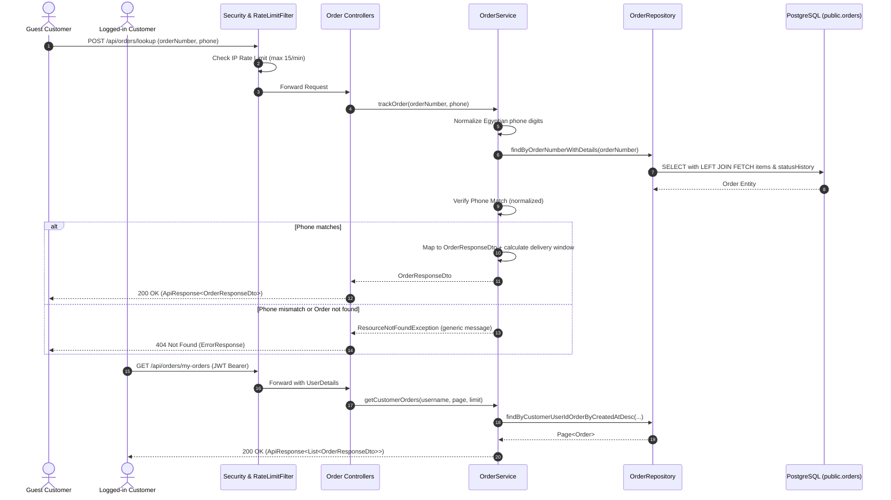

# Backend Order Tracking & Guest Lookup Implementation Plan

> **For agentic workers:** REQUIRED SUB-SKILL: Use superpowers:subagent-driven-development (recommended) or superpowers:executing-plans to implement this plan task-by-task. Steps use checkbox (`- [ ]`) syntax for tracking.

**Goal:** Build a robust, production-grade Backend Order Tracking & Guest Lookup engine in Spring Boot 3.3 for the luxury e-commerce store VARELLION, providing secure public tracking via order number & verified Egyptian phone number, authenticated order history for logged-in customers, anti-enumeration rate limiting, and 100% test coverage.

**Architecture:** 
- Controller layer exposes `POST /api/orders/lookup` and `GET /api/orders/track` for public guest lookups, plus `GET /api/orders/my-orders` and `GET /api/orders/{orderNumber}` for authenticated customers.
- Service layer (`OrderService`) handles phone number normalization (handling Egyptian carrier prefixes `010/011/012/015`, international `+20` and `0020`), constant-time secure matching, dynamic governorate delivery estimations, and timeline transformation.
- Data access layer (`OrderRepository`, `OrderItemRepository`, `OrderStatusHistoryRepository`) utilizes JPA fetch joins (`LEFT JOIN FETCH`) to eliminate N+1 query problems and guarantee fast, single-roundtrip responses.
- Security layer (`SecurityConfig`, `RateLimitFilter`) permits public tracking while enforcing an `ORDER_LOOKUP` bucket (15 requests/minute per client IP) to defend against brute-force order enumeration.

**Tech Stack:** Java 17, Spring Boot 3.3.4, Spring Data JPA, PostgreSQL (Supabase schema `public`), Spring Security 6, Jakarta Validation, Lombok, Mockito, MockMvc, JUnit 5.

**Spec / Reference:** PostgreSQL `public.orders`, `public.order_items`, `public.order_status_history` (`V5__create_orders_module.sql`), `_references/skateshop` order verification pattern, and `frontend/src/services/orders.ts` contract.

---

## Global Constraints

- Must strictly adhere to the existing JPA entity schema in `com.varellion.store.order.entity` (`Order`, `OrderItem`, `OrderStatusHistory`, `OrderStatus`, `ShippingFeeStatus`).
- Zero database breaking changes; use existing PostgreSQL foreign keys and check constraints.
- Response envelope must follow standard `com.varellion.store.common.response.ApiResponse<T>`.
- Rate limiting must guard public tracking endpoints against brute-force harvesting of customer phone numbers or order IDs.
- Must compile cleanly with `mvn clean compile -DskipTests` and pass all unit/controller tests with `mvn test`.

---

## Review Focus

1. **Phone Number Formatting Variants:** Egyptian customers may input phone numbers in various formats (`01012345678`, `+201012345678`, `00201012345678`, `010 1234 5678`, `010-1234-5678`). The system must normalize both the stored and input numbers to 11 digits before comparison.
2. **Order Enumeration Security (Anti-Scraping):** A failed lookup (invalid order number OR mismatched phone) must return an identical generic error message (`ResourceNotFoundException`: "لم نتمكن من العثور على طلب مطابق لرقم الطلب ورقم الهاتف المدخلين") with HTTP 404 to avoid leaking whether an order number exists.
3. **N+1 Query Elimination:** An order consists of line items and status history. The repository query MUST use `LEFT JOIN FETCH` or `@EntityGraph` to load order, items, and statusHistory in a single SQL query.
4. **Order Ownership Enforcement for Authenticated Users:** An authenticated customer querying `/api/orders/{orderNumber}` must only access orders tied to their own `customer_id` (unless holding `ROLE_ADMIN`).
5. **Timeline Lifecycle State Integrity:** Chronological status history must sort ascending (`createdAt ASC`), with calculated estimated delivery windows based on Egyptian governorates.

---

## Architecture Flow



---

## Proposed Changes

```
backend/
├── src/main/java/com/varellion/store/order/
│   ├── dto/
│   │   ├── OrderLookupRequest.java             [NEW]
│   │   ├── OrderItemDto.java                   [NEW]
│   │   ├── OrderStatusHistoryDto.java          [NEW]
│   │   ├── OrderResponseDto.java               [MODIFY - Implement full DTO]
│   │   └── CreateOrderRequest.java             [MODIFY - Implement DTO]
│   ├── repository/
│   │   ├── OrderRepository.java                [MODIFY - Implement Spring Data queries]
│   │   ├── OrderItemRepository.java            [MODIFY - Implement Spring Data queries]
│   │   └── OrderStatusHistoryRepository.java   [MODIFY - Implement Spring Data queries]
│   ├── service/
│   │   ├── OrderService.java                   [MODIFY - Implement core logic]
│   │   └── OrderReservationService.java        [MODIFY - Implement deadline checker]
│   └── controller/
│       ├── GuestOrderLookupController.java     [MODIFY - Implement public tracking APIs]
│       └── OrderController.java                [MODIFY - Implement authenticated customer APIs]
├── src/main/java/com/varellion/store/security/
│   ├── config/SecurityConfig.java              [MODIFY - Allow GET /api/orders/track & POST /api/orders/lookup]
│   └── filter/RateLimitFilter.java             [MODIFY - Add ORDER_LOOKUP rate limit bucket (15/min)]
└── src/test/java/com/varellion/store/order/
    ├── service/OrderServiceTest.java           [NEW]
    ├── controller/GuestOrderLookupControllerTest.java [NEW]
    └── controller/OrderControllerTest.java     [NEW]
```

---

## Step-by-Step Implementation Tasks

### Task 1: Order Data Transfer Objects (DTOs)

**Files:**
- Create: `backend/src/main/java/com/varellion/store/order/dto/OrderLookupRequest.java`
- Create: `backend/src/main/java/com/varellion/store/order/dto/OrderItemDto.java`
- Create: `backend/src/main/java/com/varellion/store/order/dto/OrderStatusHistoryDto.java`
- Modify: `backend/src/main/java/com/varellion/store/order/dto/OrderResponseDto.java`
- Modify: `backend/src/main/java/com/varellion/store/order/dto/CreateOrderRequest.java`

- [ ] **Step 1:** Implement `OrderLookupRequest.java` with validation annotations.
- [ ] **Step 2:** Implement `OrderItemDto.java` and `OrderStatusHistoryDto.java`.
- [ ] **Step 3:** Implement `OrderResponseDto.java` and `CreateOrderRequest.java`.
- [ ] **Step 4:** Run `mvn test-compile` to verify clean compilation.

---

### Task 2: Spring Data JPA Order Repositories

**Files:**
- Modify: `backend/src/main/java/com/varellion/store/order/repository/OrderRepository.java`
- Modify: `backend/src/main/java/com/varellion/store/order/repository/OrderItemRepository.java`
- Modify: `backend/src/main/java/com/varellion/store/order/repository/OrderStatusHistoryRepository.java`

- [ ] **Step 1:** Implement repository interfaces with `@Repository` and custom JPQL fetch queries.
- [ ] **Step 2:** Run `mvn test-compile` to verify mapping and syntax.

---

### Task 3: OrderService & Phone Normalization / Status Helpers

**Files:**
- Modify: `backend/src/main/java/com/varellion/store/order/service/OrderService.java`
- Modify: `backend/src/main/java/com/varellion/store/order/service/OrderReservationService.java`
- Test: `backend/src/test/java/com/varellion/store/order/service/OrderServiceTest.java`

- [ ] **Step 1:** Write unit tests in `OrderServiceTest.java` (test successful tracking, normalized phone matching with `+20`, phone mismatch failure, not found failure, governorate delivery calculations).
- [ ] **Step 2:** Run `mvn test -Dtest=OrderServiceTest` and verify failure.
- [ ] **Step 3:** Implement `OrderService.java` and helper methods.
- [ ] **Step 4:** Run `mvn test -Dtest=OrderServiceTest` and verify 100% passing.

---

### Task 4: Security & Anti-Scraping Rate Limiting

**Files:**
- Modify: `backend/src/main/java/com/varellion/store/security/config/SecurityConfig.java`
- Modify: `backend/src/main/java/com/varellion/store/security/filter/RateLimitFilter.java`
- Test: `backend/src/test/java/com/varellion/store/security/RateLimitFilterTest.java`

- [ ] **Step 1:** Update `RateLimitFilter.java` with the `ORDER_LOOKUP` bucket.
- [ ] **Step 2:** Update `SecurityConfig.java` authorization rules.
- [ ] **Step 3:** Run `mvn test -Dtest=RateLimitFilterTest` to ensure existing and new rate limits pass.

---

### Task 5: REST Controllers (Guest & Authenticated)

**Files:**
- Modify: `backend/src/main/java/com/varellion/store/order/controller/GuestOrderLookupController.java`
- Modify: `backend/src/main/java/com/varellion/store/order/controller/OrderController.java`
- Test: `backend/src/test/java/com/varellion/store/order/controller/GuestOrderLookupControllerTest.java`
- Test: `backend/src/test/java/com/varellion/store/order/controller/OrderControllerTest.java`

- [ ] **Step 1:** Write `GuestOrderLookupControllerTest.java` using MockMvc (test valid POST lookup, valid GET track, invalid phone format validation 400, not found 404).
- [ ] **Step 2:** Write `OrderControllerTest.java` (test my-orders list and order detail by number).
- [ ] **Step 3:** Implement `GuestOrderLookupController.java` and `OrderController.java`.
- [ ] **Step 4:** Run `mvn test -Dtest=GuestOrderLookupControllerTest,OrderControllerTest` and verify all tests pass.

---

### Task 6: Full Backend Suite Verification & Integration Audit

**Files:**
- All backend test suites.

- [ ] **Step 1:** Run full test suite: `mvn clean test`.
- [ ] **Step 2:** Verify 0 compile errors, 0 test failures.
- [ ] **Step 3:** Package application: `mvn package -DskipTests` to ensure executable JAR builds cleanly.

---

## Verification Plan

### Automated Tests
Run from the `backend/` directory:
```bash
# 1. Run new Order Tracking Service tests
mvn test -Dtest=OrderServiceTest

# 2. Run new Controller MockMvc tests
mvn test -Dtest=GuestOrderLookupControllerTest,OrderControllerTest

# 3. Run full backend test suite to verify no regressions
mvn test
```

### Manual Verification
1. Start backend: `mvn spring-boot:run`
2. Test Guest Order Tracking with cURL:
```bash
# Public POST lookup
curl -X POST http://localhost:8080/api/orders/lookup \
  -H "Content-Type: application/json" \
  -d '{"orderNumber": "VAR-20261028-0001", "phone": "01012345678"}'

# Public GET tracking link
curl -X GET "http://localhost:8080/api/orders/track?orderNumber=VAR-20261028-0001&phone=01012345678"

# Test Rate Limiting (> 15 requests within 1 minute) -> HTTP 429 Too Many Requests
```
