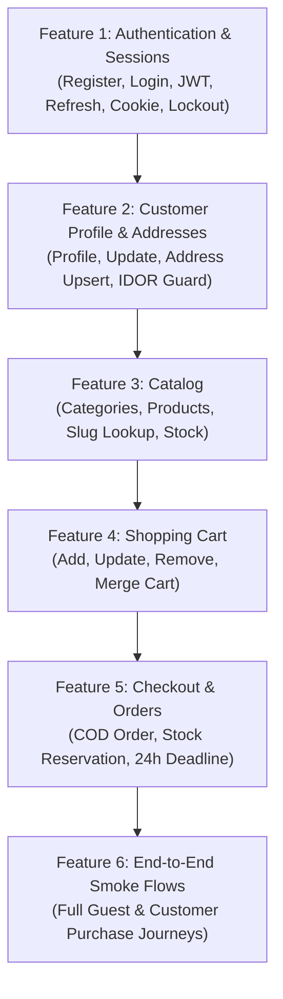

# VARELLION — Backend Test Roadmap & Prioritization Plan

**Auditor:** Senior Backend QA Engineer & Spring Boot Security Specialist  
**Approach:** Dependency-Aware, Feature-by-Feature Execution  
**Current Milestone:** Backend Core Verification (Authentication & Customer Profile)

---

## 1. Feature Prioritization Matrix

Features are prioritized based on:
1. **Security & Authentication Risk** (Protects user accounts and boundaries)
2. **Feature Dependency Chain** (Upstream prerequisites must be tested first)
3. **Implementation Readiness** (Implemented code vs skeleton files)
4. **Data Integrity & Business Criticality**

| Priority | Feature Domain | Package / Path | Current Code Status | Test Readiness |
| :---: | :--- | :--- | :---: | :---: |
| **P1 (Top)** | **Authentication & Session Management** | `com.varellion.store.security` | **COMPLETED & COMPILED** | **READY NOW** |
| **P2** | **Customer Profile & Delivery Address** | `com.varellion.store.customer` | **COMPLETED & COMPILED** | **READY NOW** |
| **P3** | **Product Catalog (Categories & Products)** | `com.varellion.store.catalog` | Skeleton Only (0 bytes) | Blocked (Pending Impl) |
| **P4** | **Shopping Cart Management** | `com.varellion.store.cart` | Skeleton Only (0 bytes) | Blocked (Pending Impl) |
| **P5** | **Orders & Checkout Lifecycle** | `com.varellion.store.order` | Skeleton Only (0 bytes) | Blocked (Pending Impl) |
| **P6** | **End-to-End Cross-Feature Journeys** | Cross-Module | Partially Blocked | Blocked (Needs Catalog/Cart) |

---

## 2. Feature-by-Feature Rollout Plan

---

## 3. Detailed Phase Breakdown

### Phase 1: Authentication & Session Management (Current Focus)
* **Goal:** Verify that identity management is completely bulletproof, tokens are minted with correct claims and expiration, cookies are protected (`HttpOnly; Secure; SameSite=Lax`), brute-force lockout triggers after 5 failed attempts, and weak credentials are rejected.
* **Bruno Collection Path:** `bruno/01-authentication/`
* **Documentation Guide:** `docs/testing/features/authentication.md`
* **Prerequisites:** Running Spring Boot backend (`http://localhost:8080`) with accessible database or in-memory environment.

### Phase 2: Customer Profile & Delivery Address
* **Goal:** Verify that authenticated customers can view their profile, update full name and Egyptian phone number, and upsert their single delivery address without IDOR risk.
* **Bruno Collection Path:** `bruno/02-customer-profile/`
* **Documentation Guide:** `docs/testing/features/customer-profile.md`
* **Prerequisites:** Bearer token obtained from Phase 1.

### Phase 3 to 6: Remaining Modules
* Scheduled for testing as soon as backend application endpoints are implemented in subsequent development sprints.
