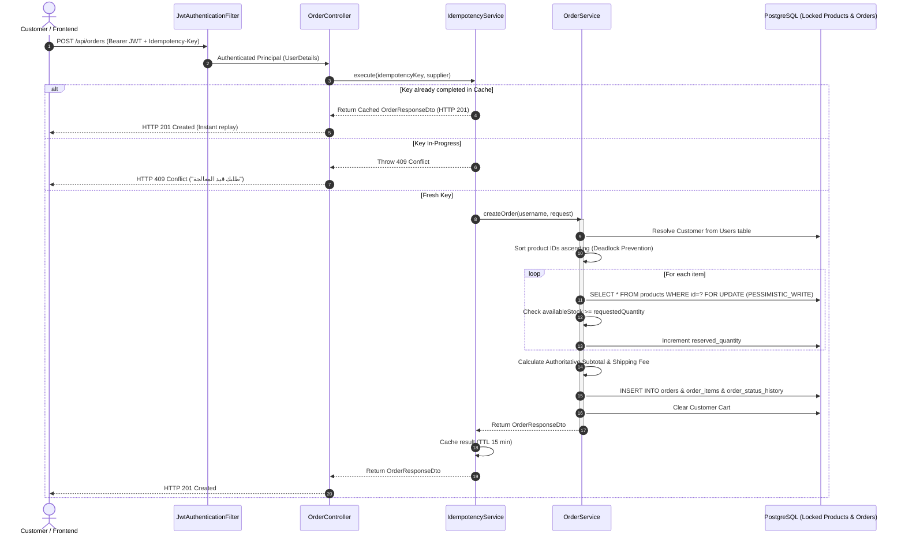

# VARELLION — Feature Test Guide: Orders & Checkout Lifecycle

**Feature:** Orders, Checkout Lifecycle, Inventory Reservation, and Public Tracking  
**Package:** `com.varellion.store.order`  
**Base URL:** `{{baseUrl}}/api/orders`  
**Bruno Directory:** `bruno/03-orders/`  
**Target Environment:** Local (`http://localhost:8080`) / Test Profile  

---

## 1. Feature Architecture & Contract Overview

The Orders subsystem in VARELLION is responsible for authoritative order placement, inventory reservation under pessimistic row-level write locks, idempotency control, financial calculations, multi-channel guest tracking, and cross-customer data isolation.



### Key Architectural Guarantees:
1. **Server-Authoritative Pricing:** Client-injected prices are completely ignored. Every unit price, subtotal, and shipping fee is derived directly from locked catalog records.
2. **Pessimistic Row-Level Locking:** Prevents stock overselling using `@Lock(LockModeType.PESSIMISTIC_WRITE)` (`SELECT ... FOR UPDATE`).
3. **Deadlock Prevention:** All items within an order are sorted ascending by `productId` before locks are acquired, guaranteeing a deterministic lock hierarchy across concurrent transactions.
4. **Atomic Rollback:** `@Transactional(rollbackFor = Exception.class)` ensures that if any item fails stock validation or a constraint fails, all reserved inventory is rolled back immediately.
5. **Idempotency Protection:** Supported via `Idempotency-Key` header with in-flight collision detection (`409 Conflict`) and response caching (`201 Created` replay).
6. **Anti-Enumeration Tracking:** Both `POST /api/orders/lookup` and `GET /api/orders/track` require matching order number and registered phone number. Mismatches return uniform `404 Not Found`.
7. **Customer Isolation (Anti-IDOR):** Authenticated endpoints verify `order.customer.id == authenticatedCustomer.id`. Unauthorized access returns `404 Not Found` to prevent resource probing.

---

## 2. API Contract Specification

| Method | Endpoint | Auth | Purpose | Success Status | Key Error Statuses |
|---|---|---|---|---|---|
| `POST` | `/api/orders` | `ROLE_USER` | Authoritative Order Placement | `201 Created` | `400 Bad Request`, `401 Unauthorized`, `404 Not Found`, `409 Conflict` |
| `GET` | `/api/orders/my-orders` | `ROLE_USER` | Paginated Customer History | `200 OK` | `401 Unauthorized` |
| `GET` | `/api/orders/{orderNumber}`| `ROLE_USER` | Authenticated Order Details | `200 OK` | `401 Unauthorized`, `404 Not Found` |
| `POST` | `/api/orders/lookup` | Public | Guest Order Lookup (JSON) | `200 OK` | `400 Bad Request`, `404 Not Found` |
| `GET` | `/api/orders/track` | Public | Guest Deep-link Tracking | `200 OK` | `400 Bad Request`, `404 Not Found` |

---

## 3. Bruno Test Suite Organization (`bruno/03-orders/`)

The Orders testing suite consists of **48 automated requests** divided into 12 targeted domains:

```
bruno/03-orders/
├── 01-successful-creation/           (4 requests: Single, Multi-item, Free shipping, Notes)
├── 02-request-validation/            (11 requests: Empty body, Missing fields, Nulls, UUIDs, Quantities, Duplicates)
├── 03-authentication-authorization/ (4 requests: Missing tokens, Forged tokens, Protected paths)
├── 04-inventory-stock/               (3 requests: Nonexistent product, Exceeding stock, Rollback check)
├── 05-pricing-calculations/          (6 requests: Price tampering, Cairo, Alex, Delta, Upper Egypt, Frontier)
├── 06-idempotency/                   (4 requests: Unique key, Replay cached, New key, Missing key)
├── 07-concurrency/                   (2 requests: In-flight 409 collision, Pessimistic lock guide)
├── 08-transactions-rollback/         (1 request: Multi-item atomic rollback on second item failure)
├── 09-status-and-tracking/           (5 requests: Auth details, My-orders list, Public POST, Public GET, Phone mismatch)
├── 10-customer-isolation/            (3 requests: Customer B login, Anti-IDOR check, History leak check)
├── 11-boundary-edge-cases/           (3 requests: 150-char name, Phone +20 normalization, Page=0 limit=1)
└── 12-regression-tests/              (2 requests: SQL injection probe, Full smoke test)
```

---

## 4. How to Execute Tests in Bruno

1. Open Bruno and select collection: `VARELLION E-Commerce API`.
2. Ensure active environment is **`Local`**.
3. Run `bruno/01-authentication/05-Login-Success.bru` (populates `{{accessToken}}`).
4. Run `bruno/03-orders/01-successful-creation/01-Create-Single-Item-Order-COD.bru` (populates `{{createdOrderNumber}}` and `{{createdCustomerPhone}}`).
5. Run the remaining folders in sequence or execute the entire collection via CLI:
   ```bash
   bru run --env Local
   ```
